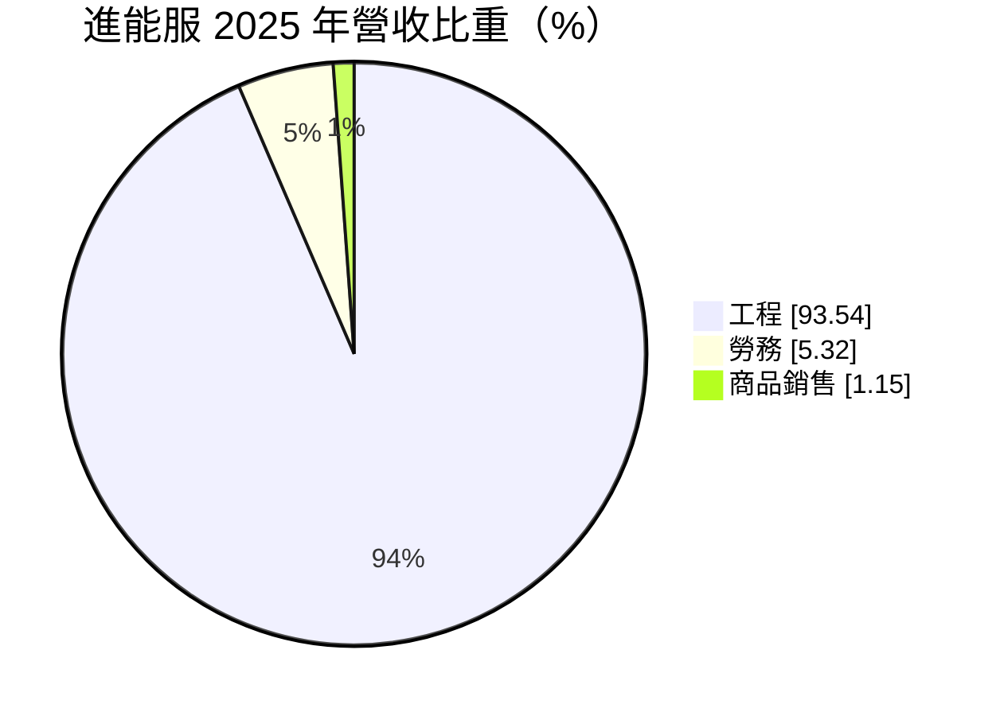
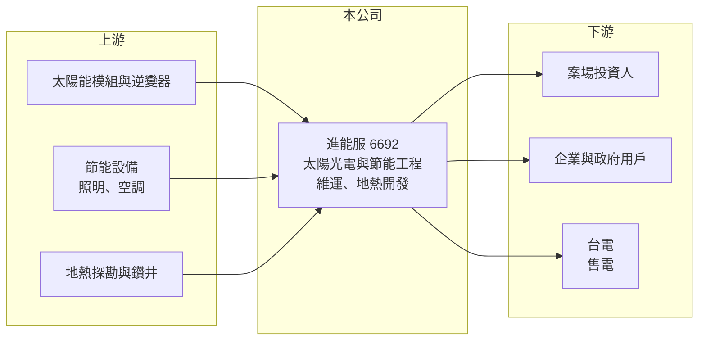

# 6692 進能服

> 上櫃｜[[產業索引-綠能環保|綠能環保]]｜上市（櫃）日期 2024/02/02

# 第一章：企業模式與商業藍圖

> [!info] 撰寫說明
> 精簡版，由 Claude 依公開資料整理，架構比照 [[2330台積電]]，資料截至 2026-10-08。來源：富邦 MoneyDJ 財務比率年表（2018 至 2025 年）與基本資料（2025 年營收比重）；櫃買中心開放資料快照（基本資料、2026 年上半年資產負債與損益、本益比殖利率、每月營收）；經濟日報、Yahoo 股市、優分析新聞標題。節能服務內容、客戶類型與地熱計畫細節為憑記憶與新聞標題整理，已標「待校對」；歷年營收由每股營業額與成長率推算。#待校對

進金生能源服務（簡稱進能服）成立於 2014 年 10 月、2024 年 2 月上櫃，董事長陳加屏、總經理厲國欽，屬於進金生集團（集團關係待校對）。它是以[[能源技術服務]]起家的綠能工程公司，業務涵蓋太陽光電系統工程、節能改善與電廠維運，2025 年取得地熱探勘許可（年份依報導推估，待校對），嘗試切入[[地熱發電]]。

- **核心業務：** 2025 年營收中工程占 93.54%、勞務占 5.32%、商品銷售占 1.15%。工程主要是替企業、政府或電廠投資人興建太陽光電系統（屋頂型與地面型，比重待校對），以及照明、空調等節能改善工程；勞務則是案場維運與能源管理服務。營收幾乎全部來自工程，代表公司目前仍以一次性專案為主，經常性收入很少。
- **營收結構：** 依營收成長率回推，2025 年營收約 14.6 億元（推算），年減 34.63%，2022 年約 27.9 億元（推算）為高點。營收隨大型案場的完工時點大幅起伏，2026 年 1 至 8 月累計營收 5.55 億元，年減約 51%。
- **營運據點：** 以台灣為主，案場遍及各地（分布待校對）。2025 年新聞提到公司取得地熱探勘許可，代表開始布局需要長期投入的地熱開發（地點與規模待校對）。
- **長期方向：** 公司的長期方向是從太陽光電工程延伸到地熱、儲能等多元綠能，並以[[ESCO]]模式提供企業節能與用電管理服務。地熱屬於可全天候發電的基載型再生能源，若能成功開發並自持電廠，將帶來長期售電收入，但探勘與開發的風險與資金需求都很高。

# 第二章：護城河深度與競爭優勢

進能服的護城河相當有限，太陽光電工程門檻不高、參與者眾多，公司仍在尋找差異化的定位。

- **競爭優勢：** 公司具備太陽光電與節能工程的整合經驗，能同時提供設計、施工與維運，對中小型企業客戶有一站式服務的便利性。地熱探勘許可是少數業者才有的資源，若後續開發順利，可能成為未來的差異化來源。不過[[毛利率]]從 2020 年的 26.29% 降到 2023 至 2025 年的 11% 至 14%，2026 年上半年甚至出現毛損，顯示工程的議價能力很弱。
- **主要對手：** 太陽光電統包同業包括 [[6869雲豹能源]]、[[6873泓德能源]]、[[6806森崴能源]]、[[6443元晶]] 等；地熱領域則有台電、中油與多家民間開發商投入（名單待校對）。進能服規模較小，在大型案場與融資條件上居於劣勢。
- **觀察重點：** 2026 年上半年毛損 3,174 萬元、營業虧損 1.24 億元，顯示部分專案成本超支或認列損失（推估）。觀察重點是工程毛利能否恢復到 10% 以上，以及地熱探勘是否有具體進度與資金規劃。

# 第三章：財務體質與盈利規模

資料日期：2026-10-08，表格是撰寫當時的快照；最新月營收、毛利率、累計 EPS 由自動排程寫在本筆記的屬性欄位（月營收、毛利率、累計EPS 等）。#待校對

進能服的營收與獲利起伏劇烈，上櫃後獲利能力明顯下降，2026 年上半年轉為虧損。

| 年度 | 營收（億元） | [[毛利率]] | [[營業利益率]] | EPS（元） | [[ROE]] |
|---|---|---|---|---|---|
| 2021 | 約 15.2（推算） | 17.00% | 5.96% | 2.11 | 11.16% |
| 2022 | 約 27.9（推算） | 14.41% | 6.66% | 4.04 | 20.37% |
| 2023 | 約 16.5（推算） | 12.68% | 1.34% | 0.23 | 1.27% |
| 2024 | 約 22.4（推算） | 11.05% | 0.53% | 0.94 | 5.69% |
| 2025 | 約 14.6（推算） | 13.81% | 0.14% | 0.23 | 1.27% |

註：2025 年營收以每股營業額 24.9 元乘以約 5,884 萬股推算，其他年度依 MoneyDJ 營收成長率回推；上櫃前股本較小，推算值僅供參考。2026 年上半年營收 3.66 億元、毛利率約 −8.7%、營業利益率約 −33.7%、EPS −1.16 元（櫃買中心資料，比率由損益表計算）。

- **長期指標：** 2021 至 2025 年營收年複合成長率約 −1%（推算），近 5 年平均 [[ROE]] 約 8.0%（推算），但 2023 年以後都低於 6%。最近一次年度現金股利約 0.20 元（櫃買中心殖利率資料），約為 2025 年 EPS 0.23 元的 88%。每股現金流量正負交錯（2022 年 −9.88 元、2024 年 8.68 元、2025 年 1.67 元），[[自由現金流]]不穩定。
- **[[ROIC]] 與 [[WACC]]：** 2025 年稅後營業利益僅約 160 萬元（營業利益率 0.14% × 營收約 14.6 億元 × 0.8），投入資本約 12.7 億元（2026 年第二季權益總計 9.70 億元，加上以總負債 10.08 億元的三成推估的有息負債約 3.0 億元，其餘多為應付工程款與合約負債），ROIC 約 0.1%（推算）；以 2026 年上半年營業虧損 1.24 億元計算，ROIC 已轉為負值。WACC 約 5.9%（推算：無風險利率 1.75%、市場風險溢酬 6%、β 取工程同業常見值 0.9，股東權益成本 7.15%；稅前負債成本 2.5%、稅率 20%；權益比重約 76%）。ROIC 遠低於 WACC，代表目前的業務模式正在侵蝕價值。
- **財務特色：** 2026 年第二季負債比率約 51%（負債 10.08 億元 ÷ 資產 19.78 億元），流動負債 9.70 億元占負債絕大部分，流動資產 15.17 億元約為流動負債的 1.6 倍。保留盈餘 1.23 億元，持續虧損將侵蝕配息能力；公司持有庫藏股 89.7 萬股（約 2,860 萬元）。

# 第四章：總體風險與地緣政治

進能服的風險集中在工程毛利、營收不連續與新事業的開發不確定性。

- **產業週期：** 太陽光電工程需求受政府再生能源目標、[[躉購費率]]與模組價格影響，政策節奏改變時，案場投資人可能延後開工。大型案場完工時點集中，營收在年度間大幅波動。
- **營運風險：** 固定總價的工程合約在物料、人力上漲時容易虧損，2026 年上半年的毛損就是警訊。地熱探勘需要鑽井驗證，失敗率與成本都高，若投入過多而未成功，會拖累財務。
- **其他風險：** 再生能源法規、地熱開發許可與環評程序的變動，會影響新事業時程；客戶與案場投資人的財務狀況也會影響工程款回收。

# 專有名詞解析

## 金融

- **[[ROIC]]**：投入資本報酬率，稅後營業利益除以股東權益加有息負債，衡量本業運用資本的效率。
- **[[WACC]]**：加權平均資金成本，股東與債權人要求報酬率的加權平均，是 ROIC 要超越的門檻。

## 產業

- **[[能源技術服務]]**：協助企業規劃節能、再生能源與用電管理的專業服務，常以工程加維運的方式提供。
- **[[ESCO]]**：能源技術服務業者，替客戶投資節能設備並從節省的電費中分享收益的商業模式。
- **[[地熱發電]]**：利用地底熱水或蒸汽推動渦輪發電，可全天候穩定供電，屬於基載型再生能源。
- **[[躉購費率]]**：政府保證收購再生能源電力的固定價格，通常保證 20 年，是太陽光電案場收益的基礎。

# 核心供應鏈

- 上游：模組廠 [[6443元晶]]、[[3576聯合再生]]，逆變器 [[2308台達電]]（是否為供應商待校對）。
- 下游／客戶：太陽光電案場投資人、企業與公部門節能客戶。
- 同業：[[6869雲豹能源]]、[[6873泓德能源]]、[[6806森崴能源]]。

## 最新新聞
<!-- news:start -->
<!-- news:end -->

## 相關連結
- [公開資訊觀測站](https://mopsov.twse.com.tw/mops/web/t05st03?step=1&firstin=1&co_id=6692)
- [Goodinfo](https://goodinfo.tw/tw/StockDetail.asp?STOCK_ID=6692)
- [Yahoo 股市](https://tw.stock.yahoo.com/quote/6692)
- [鉅亨網新聞](https://www.cnyes.com/twstock/6692/news)
