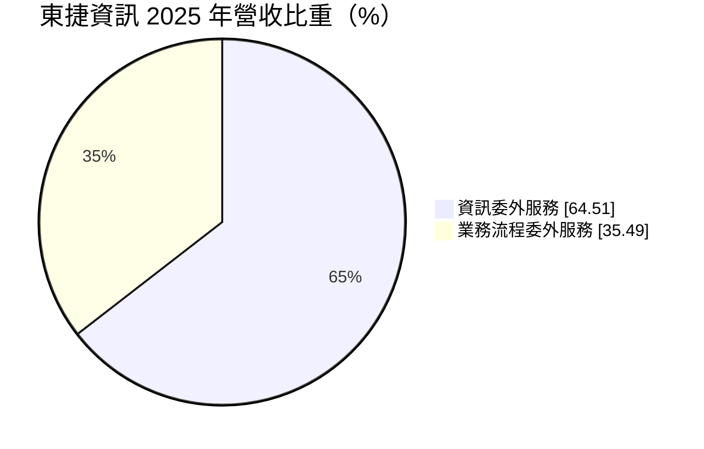
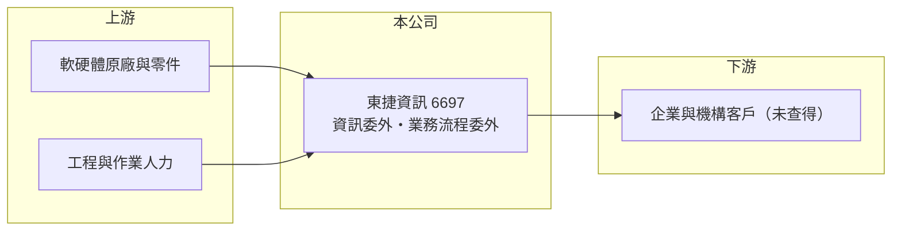

# 6697 東捷資訊

> 上櫃｜[[產業索引-資訊服務業|資訊服務業]]｜上市（櫃）日期 2019/12/26

# 第一章：企業模式與商業藍圖

> [!info] 撰寫說明
> 精簡版，由 Claude 依公開資料整理，架構比照 [[2330台積電]]，資料截至 2026-10-08。來源：Goodinfo 經營績效年表（2019 至 2025 年）；富邦 e 點通（MoneyDJ）公司基本資料（2025 年營收比重）；櫃買中心開放資料快照（基本資料、2026 年第二季資產負債與上半年損益、每月營收、股利）。股東背景、主要客戶與服務細節在可連上的來源中未揭露，屬整理性推估的部分標示待校對，公開資料有限。#待校對

東捷資訊（東捷資訊服務，英文簡稱 ITTS）成立於 1990 年 12 月、2019 年 12 月上櫃，總部在台北市南港區三重路，實收資本額約 2.73 億元，董事長高尚偉。它是專做企業[[委外服務]]的資訊服務公司，2025 年營收約 13.4 億元，業務分為資訊委外與[[業務流程委外]]兩大塊，替客戶承接 IT 維運與行政作業流程。

- **核心業務：** 資訊委外服務約占 65%，推估包括電腦設備維護、機房與桌面支援、系統維運等，讓客戶不必自己養一整個 IT 團隊。業務流程委外約占 35%，是把客戶的資料處理、文件作業、客服等例行流程接過來執行（服務內容待校對）。
- **營收結構：** 委外服務通常以多年期合約、按月或按服務量計費，屬於[[經常性收入]]性質很高的業務，這也是東捷營收七年來穩定在 12 億至 13 億元的原因。代價是附加價值較低，[[毛利率]]只有 13% 至 15%，比以軟體或顧問為主的同業低很多。
- **營運據點與人均產值：** 總部在台北，服務以台灣為主，推估在主要城市設有服務據點以提供到場支援（待校對）。委外服務是人力密集型業務，獲利取決於人均產值與人力調度效率；員工人數未查得，人均產值無法推算。
- **長期方向：** 企業持續把非核心的 IT 與行政作業外包，是委外服務的長期需求來源。東捷的長期課題是導入自動化與 AI 工具，在相同人力下承接更多服務量，把毛利率從十幾%往上推，而不是只靠人力擴張成長。

# 第二章：護城河深度與競爭優勢

東捷的護城河來自委外合約的高轉換成本與服務紀錄，但低毛利顯示它的定價能力有限。

- **競爭優勢：** 委外服務一旦上線，委外廠商就深度參與客戶的日常運作，熟悉客戶的設備、流程與人員，更換廠商的交接成本與營運中斷風險都很高，因此合約續約率通常不低。東捷營收與營業利益率長期穩定，說明客戶基礎相當牢固。
- **主要對手：** IT 委外與維運服務的同業包括 [[6590普鴻]]、[[2471資通]]、[[2453凌群]]、[[6214精誠]] 等，國際上則有 IBM、DXC 等大型委外服務商（待校對）；業務流程委外則與各類人力派遣與 BPO 業者競爭。
- **觀察重點：** 第一，[[營業利益率]]從 2022 年的 3.9% 回升到 2025 年的 6.9%，能否持續改善；第二，業務流程委外比重的變化；第三，客戶集中度與主要合約的續約情況（未查得）。

# 第三章：財務體質與盈利規模

資料日期：2026-10-08，表格是撰寫當時的快照；最新月營收、毛利率、累計 EPS 由自動排程寫在本筆記的屬性欄位（月營收、毛利率、累計EPS 等）。#待校對

東捷的財務特色是營收極度穩定、毛利率低但 ROE 不差，靠的是輕資產與高周轉。

| 年度 | 營收（億元） | [[毛利率]] | [[營業利益率]] | EPS（元） | [[ROE]] |
|---|---|---|---|---|---|
| 2019 | 12.3 | 13.3% | 5.12% | 2.57 | 15.1% |
| 2020 | 12.3 | 13.4% | 5.35% | 2.41 | 12.5% |
| 2021 | 13.3 | 14.5% | 6.13% | 2.65 | 13.4% |
| 2022 | 13.3 | 13.8% | 3.87% | 2.04 | 10.1% |
| 2023 | 13.4 | 13.8% | 5.66% | 2.71 | 13.0% |
| 2024 | 11.9 | 14.8% | 5.86% | 2.61 | 12.1% |
| 2025 | 13.4 | 15.4% | 6.91% | 3.04 | 13.6% |
| 2026 上半年 | 7.12 | 16.3% | 7.7% | 1.86 | 未查得 |

註：2019 至 2025 年取自 Goodinfo；2026 年上半年取自櫃買中心開放資料推算（營業毛利 1.16 億元、營業利益 0.55 億元）。

- **長期指標：** 2020 至 2025 年營收年複合成長率約 1.7%（推算），成長緩慢但非常穩定；2021 至 2025 年平均 ROE 約 12.4%（推算）。櫃買中心快照顯示最近一年度現金股利 2.60 元，相對 2025 年 EPS 3.04 元，配息率約八成五（推算），代表公司沒有大額再投資需求，盈餘多數發還股東。
- **[[ROIC]] 與 [[WACC]]：** 2025 年營業利益約 0.93 億元（13.4 億 × 6.91%），稅後約 0.74 億元；2026 年第二季股東權益 6.03 億元，總負債 3.31 億元幾乎全為流動負債，有息負債未查得，假設接近 0，ROIC 約 12%（推算）。WACC 以無風險利率 1.75%、市場風險溢酬 6%、β 0.7（營收穩定的委外服務股常見值）推得權益成本約 5.95%，資本幾乎全為權益，WACC 約 6%（推算）。ROIC 約為 WACC 的兩倍，代表東捷雖然毛利低，但因為幾乎不需要投入資本，仍能穩定創造經濟價值。
- **財務特色：** 2026 年第二季總資產 9.34 億元、負債比率約 35%，[[每股淨值]] 22.06 元。資產以現金與應收帳款為主，屬於典型的輕資產服務業。

# 第四章：總體風險與地緣政治

東捷的風險在於低毛利與人力依賴：成本端只要小幅上升，就會明顯侵蝕本來就薄的利潤。

- **產業週期：** 委外需求受景氣影響較小，景氣差時企業甚至可能增加外包以降低固定成本；但大型客戶縮編或合併時，委外範圍可能被縮減。
- **營運風險：** 人力成本是最大支出，基本工資與工程師薪資上漲，若無法反映在合約價格上，毛利率會被壓縮。若營收集中在少數大客戶，任一合約到期不續約都會造成明顯影響（客戶集中度未查得）。
- **其他風險：** 自動化與 AI 可能讓企業減少對人工 BPO 的需求，長期改變委外市場的規模與型態。委外服務接觸大量客戶資料，[[資安]]與個資外洩會帶來合約與法律風險。

# 專有名詞解析

## 應用

- **[[委外服務]]**：企業把資訊系統開發、維運或業務流程交給外部專業廠商執行，以降低成本並專注本業。
- **[[業務流程委外]]**：企業把資料處理、客服、帳務等例行作業交給外部廠商執行，英文簡稱 BPO。
- **[[資安]]**：資訊安全，保護系統與資料不被入侵、竊取或破壞的技術與管理措施。

## 金融

- **[[經常性收入]]**：每年固定重複發生的收入，例如維運年約、訂閱費，能讓營收比一次性專案更穩定。
- **[[ROIC]]**：投入資本報酬率，稅後營業利益除以股東權益加有息負債，衡量本業運用資本的效率。
- **[[WACC]]**：加權平均資金成本，股東與債權人要求報酬率的加權平均，是 ROIC 要超越的門檻。

# 核心供應鏈

- 上游：軟硬體原廠與維修零件供應商，以及工程與作業人力。
- 下游／客戶：委外服務的企業與機構客戶，具體名單未查得。
- 同業：[[6590普鴻]]、[[2471資通]]、[[2453凌群]]、[[6214精誠]]。

## 最新新聞
<!-- news:start（自動產生，請勿手動編輯此範圍） -->
- 2026-10-22 📰 媒體 10:52｜〈焦點股〉東捷資訊拓雲端、資安版圖 漲逾半根停板創近半年高｜[鉅亨網](https://news.cnyes.com/news/id/6635594)

完整紀錄：[[6697東捷資訊 新聞]]
<!-- news:end -->

## 相關連結
- [公開資訊觀測站](https://mopsov.twse.com.tw/mops/web/t05st03?step=1&firstin=1&co_id=6697)
- [Goodinfo](https://goodinfo.tw/tw/StockDetail.asp?STOCK_ID=6697)
- [Yahoo 股市](https://tw.stock.yahoo.com/quote/6697)
- [鉅亨網新聞](https://www.cnyes.com/twstock/6697/news)
