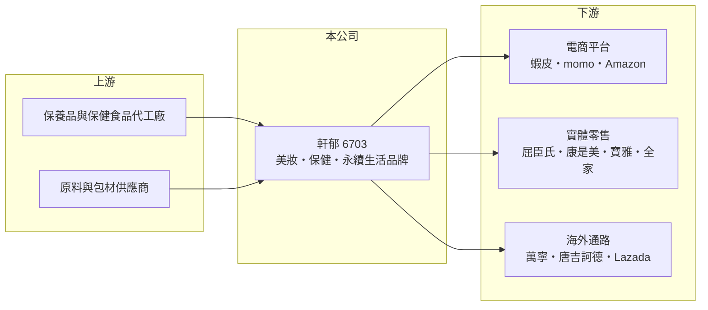

# 6703 軒郁

> 上櫃｜[[產業索引-生技醫療業|生技醫療業]]｜上市（櫃）日期 2020/10/20

# 第一章：企業模式與商業藍圖

> [!info] 撰寫說明
> 精簡版，由 Claude 依公開資料整理，架構比照 [[2330台積電]] 的四章研究，資料截至 2026-10-08。來源：櫃買中心開放資料快照（基本資料、2026 年第二季綜合損益與資產負債、每月營收、本益比）、Goodinfo 經營績效頁、poorstock 整理的公司法說會資料（品牌、通路與大事記）。品牌別營收比重未查得；併購年份部分憑記憶整理，已標待校對。#待校對

本章說明軒郁國際（股票代號：6703，以下簡稱軒郁）的商業模式：一家以多品牌策略經營美妝保養、保健食品與永續生活用品的品牌集團。

- **核心業務：** 軒郁 2009 年 5 月設立（依櫃買中心資料），2020 年 10 月在櫃買中心上櫃，董事長為胡蕙郁、總經理為楊尚軒。公司從 2009 年推出的面膜品牌 SEXYLOOK（西西露）起家，之後陸續推出或納入露緹雅 LUDEYA（2013 年）、未來美 MIRAE（2016 年）、美博士 Dr. May 與新普利 Simply（2019 年）、美度 m2（2020 年）、益比喜 EatBLISS（2021 年）等[[自有品牌]]，並擁有霓淨思 Neogence、遠東生技 FEBICO、達摩本草、阿原 YUAN、碧海絲 BIOSEA 等品牌（poorstock 整理之法說會資料）。
- **營收結構：** 產品分為美妝保養、健康保健、永續生活三大領域，各領域比重未查得。從 2023 年營收由 17.1 億元跳升到 29.7 億元來看，保健食品與併購品牌的貢獻明顯放大（推估）。美妝與[[保健食品]]都屬於高毛利、重行銷的品牌消費品，毛利率長年在 62% 至 69%。
- **營運據點：** 總部在台灣，依法說會資料，公司在全球 15 個國家設有銷售據點。通路涵蓋電商（蝦皮、momo、Yahoo 購物中心、Lazada、Amazon、TikTok Shop）與實體零售（屈臣氏、康是美、[[5904寶雅]]、Costco、[[5903全家]]、松本清、唐吉訶德、萬寧、Guardian）。
- **長期方向：** 軒郁的成長路徑是「多品牌加多通路」：用不同品牌覆蓋不同價格帶與需求，再透過併購取得成熟品牌，並把台灣驗證成功的產品推向香港、新馬、日本與東南亞。長期關鍵在於品牌能否持續推出爆款，以及海外營收能否成為第二個成長引擎。

# 第二章：護城河深度與競爭優勢

消費品牌的護城河，來自品牌認知、產品開發速度與通路掌握。本章分析軒郁的優勢與競爭環境。

- **競爭優勢：** 第一是多品牌組合。單一品牌容易隨流行退燒，軒郁同時經營十多個品牌，分散了個別品牌的生命週期風險，也能在通路談判時提供完整的產品線。第二是電商與社群行銷能力，公司從面膜品牌起家，熟悉網路與社群操作，能快速測試新產品。第三是併購整合，2023 年前後納入阿原、遠東生技等既有品牌（年份待校對），取得其品牌資產與通路。依法說會資料，2025 年新增 5 件發明專利，並入選「2025 中堅潛力企業成長十強」。
- **主要對手：** 台灣的醫美保養與保健品牌同業包括 [[8436大江]]（保健食品代工與品牌）、[[1786科妍]]、[[4190佐登-KY]]、[[1707葡萄王]]（保健食品），以及國際美妝集團與大量中小型網路品牌。美妝保養品的進入門檻低，新品牌不斷出現，競爭非常激烈。
- **觀察重點：** 第一，營收在 2024 年達 35.8 億元高點後，2025 年回落到 32.9 億元，2026 年前 8 個月又恢復成長，要觀察是否重回成長軌道。第二，營業利益率能否維持 10% 以上，因為行銷費用是最大支出。第三，海外通路的營收貢獻。

# 第三章：財務體質與盈利規模

資料日期：2026-10-08，表格是撰寫當時的快照；最新月營收、毛利率、累計 EPS 由自動排程寫在本筆記的屬性欄位（月營收、毛利率、累計EPS 等）。#待校對

軒郁是生技醫療類股中少數兼具營收成長與高資本報酬的公司。本章用多年度數字檢視它的獲利品質。

| 年度 | 營收（新台幣） | [[毛利率]] | [[營業利益率]] | EPS（元） | [[ROE]] |
|---|---|---|---|---|---|
| 2021 | 13.6 億 | 68.0% | 13.8% | 6.84 | 15.5% |
| 2022 | 17.1 億 | 65.3% | 13.0% | 7.79 | 18.7% |
| 2023 | 29.7 億 | 65.8% | 16.8% | 14.66 | 34.2% |
| 2024 | 35.8 億 | 61.9% | 10.0% | 10.16 | 21.8% |
| 2025 | 32.9 億 | 62.6% | 12.3% | 9.90 | 24.2% |
| 2026 上半年 | 17.16 億 | 62.5% | 10.9% | 4.13 | 約 23.1%（年化推算） |

資料來源：2021 至 2025 年為 Goodinfo 經營績效頁（合併報表）；2026 上半年為櫃買中心綜合損益快照，ROE 以歸屬母公司淨利年化除以母公司權益推算。

- **營收規模：** 2020 年營收 13.3 億元，2025 年 32.9 億元，五年年複合成長率約 20%（推算）。2026 年 1 至 8 月累計營收 22.51 億元，較去年同期 19.77 億元成長約 14%。
- **獲利：** 2021 年至 2025 年平均 ROE 約 22.9%（推算），屬於高資本報酬的品牌公司。毛利率從 68% 緩降到 62% 左右，可能與保健食品與併購品牌的毛利結構不同有關（推估）；營業利益率則在 10% 至 17% 之間，主要隨行銷費用投入而波動。2026 年上半年營業費用 8.85 億元，占營收約 52%，說明這門生意的關鍵成本是行銷而不是生產。
- **財務特色：** 2026 年第二季總資產 23.93 億元、負債 10.63 億元，負債比約 44%，權益 13.30 億元，每股淨值 39.27 元。資產中流動資產占約七成，屬於輕資產模式，生產多委外代工（推估）。股利方面，櫃買中心本益比資料顯示最近一期每股股利 1.0 元，可能只涵蓋部分期間，完整年度股利與配息率未查得。
- **[[ROIC]] 與 [[WACC]]：** 有息負債未查得，以非流動負債 3.30 億元近似，投入資本約 16.60 億元。2025 年營業利益約 4.05 億元，稅後約 3.24 億元，ROIC 約 19.5%（推算）；2026 年上半年年化約 18.0%（推算）。WACC 方面，台灣 10 年期公債取 1.75%、市場風險溢酬 6%，β 未查得，取消費品常見的 0.8 至 1.0，股東權益成本約 6.6% 至 7.8%；負債成本假設 2.5%、稅後 2.0%，以市值約 32.6 億元（股價淨值比 2.54 倍乘母公司權益）與負債 3.30 億元計算，權益占約 91%，WACC 約 6.1% 至 7.2%（推算）。ROIC 比 WACC 高出 11 個百分點以上，代表公司以很少的資本創造了明顯的超額報酬，這是輕資產品牌模式的典型優點；長期維持的前提是品牌持續有新產品帶動營收。

# 第四章：總體風險與地緣政治

多品牌消費品公司的風險，主要來自品牌退燒、通路變化與法規。本章整理軒郁的長期風險。

- **產業週期：** 美妝與保健食品屬於可選消費，景氣轉差時消費者會減少購買或轉向低價品牌。產品流行週期短，爆款熱潮過後營收可能明顯回落，2025 年營收下滑就是品牌動能起伏的例子。
- **營運風險：** 行銷費用占營收一半以上，若廣告投放效率下降，營業利益率會很快被壓縮。電商平台的演算法、抽成與流量規則變化，會直接影響銷售。併購品牌的整合也有風險，若併購後營收不如預期，可能提列商譽減損。
- **其他風險：** 保健食品的功效宣稱受食品安全衛生管理法與廣告法規嚴格規範，違規可能面臨罰款與下架。海外市場各有不同的化妝品與食品法規，拓展時需要逐一取得許可。原料與代工價格上漲、匯率變動，也會影響進口原料成本與海外營收。

# 專有名詞解析

## 金融

- **[[毛利率]]**：營業毛利除以營業收入，反映產品扣除直接成本後的獲利空間。
- **[[ROE]]**：股東權益報酬率，稅後淨利除以股東權益，衡量公司運用股東資金賺錢的效率。
- **[[ROIC]]**：投入資本報酬率，稅後營業利益除以股東權益與有息負債的合計，衡量本業對所有資金提供者的報酬。
- **[[WACC]]**：加權平均資金成本，依股東權益與負債的比重加權計算的資金成本，ROIC 高於它才代表創造價值。

## 產業

- **[[自有品牌]]**：公司以自己的品牌直接銷售產品，承擔行銷成本，但毛利與定價權較高。
- **[[保健食品]]**：具特定保健功效訴求的食品，台灣須依法規申請認證或遵守標示規範。

# 核心供應鏈

- 上游：保養品與保健食品代工廠、原料與包材供應商（具體廠商未查得，生產委外比重為推估）。
- 下游／客戶：電商平台（蝦皮、momo、Yahoo 購物中心、Lazada、Amazon、TikTok Shop）、實體零售（屈臣氏、康是美、[[5904寶雅]]、Costco、[[5903全家]]）與海外通路（萬寧、唐吉訶德、松本清、Guardian）。
- 同業：[[8436大江]]、[[1786科妍]]、[[4190佐登-KY]]、[[1707葡萄王]]。

## 最新新聞
<!-- news:start -->
<!-- news:end -->

## 相關連結
- [公開資訊觀測站](https://mopsov.twse.com.tw/mops/web/t05st03?step=1&firstin=1&co_id=6703)
- [Goodinfo](https://goodinfo.tw/tw/StockDetail.asp?STOCK_ID=6703)
- [Yahoo 股市](https://tw.stock.yahoo.com/quote/6703)
- [鉅亨網新聞](https://www.cnyes.com/twstock/6703/news)
