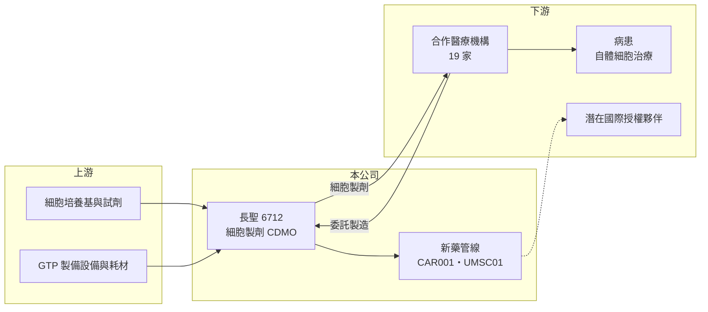

# 6712 長聖

> 上櫃｜[[產業索引-生技醫療業|生技醫療業]]｜上市（櫃）日期 2021/01/08

# 第一章：企業模式與商業藍圖

> [!info] 撰寫說明
> 精簡版，由 Claude 依公開資料整理，架構比照 [[2330台積電]] 的四章研究，資料截至 2026-10-08。來源：櫃買中心開放資料快照（基本資料、2026 年第二季綜合損益與資產負債、每月營收、本益比）、Goodinfo 經營績效頁、中央社 2025 年 4 月 7 日櫃買法說會報導（Yahoo 股市轉載）、優分析與聯合報營收新聞標題。業務別營收比重未查得；法規背景部分憑記憶整理，已標待校對。#待校對

本章說明長聖國際生技（股票代號：6712，以下簡稱長聖）的商業模式：一家以[[細胞治療]]委託製造賺取現金流、同時開發細胞新藥的[[再生醫療]]公司。

- **核心業務：** 長聖 2016 年 12 月設立，2021 年 1 月在櫃買中心上櫃，董事長為劉銖淇、總經理為黃文良。依 2025 年 4 月櫃買法說會報導，公司以細胞製劑的[[CDMO]]（委託開發與製造）為主要收入來源，與台灣 19 家醫療機構合作，業務涵蓋自體免疫細胞與自體幹細胞的委託製造與製程開發；同時以 [[CAR-T]]、幹細胞、奈米技術與外泌體四大技術平台開發新藥。
- **營收結構：** 業務別比重未查得。營收主要來自醫院執行細胞治療時，委託長聖培養與製造病人自體細胞的服務費（推估）。台灣自 2018 年起開放部分細胞治療在醫院執行（俗稱特管辦法，待校對），醫院需要符合規範的細胞製備場所，長聖提供的正是這項專業產能。依同一報導，CDMO 訂單能見度在 2025 年 4 月時已看到 2026 年第一季。
- **營運據點：** 以台灣為主要市場，細胞製備需在符合 GTP 規範的實驗室進行（廠區細節未查得）。2026 年第二季非流動資產約 22.67 億元，占總資產約 64%，代表公司持續投資製備設施與長期資產。
- **長期方向：** 公司採「CDMO 現金流加新藥授權」雙引擎策略。新藥管線中，CAR001（CAR-T 細胞療法）與 UMSC01（臍帶間質幹細胞，用於多發性硬化症）在 2025 年 4 月時處於二期臨床 IIa 階段；公司表示若取得初步療效與安全性數據，有機會依新法規申請有附款許可，提早上市，並與國際藥廠洽談授權。依同一報導，「再生醫療雙法」預計 2025 年施行，將使細胞製劑有正式的藥品上市途徑。

# 第二章：護城河深度與競爭優勢

細胞治療 CDMO 的護城河，來自法規認證的製備場所、技術經驗與醫院合作網絡。本章分析長聖的競爭地位。

- **競爭優勢：** 第一是醫院網絡。與 19 家醫療機構建立合作後，醫院的細胞治療計畫、送審文件與作業流程都與長聖的製程綁定，更換製造夥伴需要重新申請與驗證，轉換成本高。第二是設施與品質系統，符合 GTP 規範的細胞製備場所投資大、驗證時間長，是新進者的主要門檻。第三是平台多元，從免疫細胞到幹細胞、CAR-T，能服務多種治療計畫。
- **主要對手：** 台灣細胞治療與細胞儲存相關的上市櫃同業包括 [[1784訊聯]]、[[6733博晟生醫]]（業務重疊程度待校對），以及多家醫院自建或與生技公司合作的細胞製備中心；國際上則有大型細胞與基因治療 CDMO。隨著法規開放，投入細胞製備的業者增加，價格與客戶競爭可能升溫。
- **觀察重點：** 第一，再生醫療雙法施行後，醫院細胞治療的件數是否擴大，以及長聖能否從特管辦法的服務轉型為新藥製造。第二，CAR001 與 UMSC01 的臨床數據與授權進度。第三，營業利益率能否維持在 40% 以上，因為更多競爭者進入可能壓低服務價格。

# 第三章：財務體質與盈利規模

資料日期：2026-10-08，表格是撰寫當時的快照；最新月營收、毛利率、累計 EPS 由自動排程寫在本筆記的屬性欄位（月營收、毛利率、累計EPS 等）。#待校對

長聖是少數已穩定獲利的細胞治療公司。本章用多年度數字檢視它的成長與獲利品質。

| 年度 | 營收（新台幣） | [[毛利率]] | [[營業利益率]] | EPS（元） | [[ROE]] |
|---|---|---|---|---|---|
| 2021 | 4.39 億 | 55.9% | 26.5% | 6.00 | 27.6% |
| 2022 | 6.28 億 | 66.1% | 45.2% | 2.95 | 10.9% |
| 2023 | 7.58 億 | 63.9% | 44.5% | 7.24 | 29.7% |
| 2024 | 9.34 億 | 65.9% | 45.1% | 4.55 | 20.2% |
| 2025 | 10.2 億 | 70.9% | 43.1% | 4.88 | 25.9% |
| 2026 上半年 | 4.63 億 | 78.3% | 45.2% | 2.20 | 約 15.8%（年化推算） |

資料來源：2021 至 2025 年為 Goodinfo 經營績效頁（合併報表）；2026 上半年為櫃買中心綜合損益快照。EPS 年度間起伏較大，可能受業外損益與股本變動影響（推估）。

- **營收規模：** 2020 年營收只有 0.71 億元，2021 年起特管辦法業務放量，2025 年成長到 10.2 億元，2021 年至 2025 年年複合成長率約 23.5%（推算）。2026 年 1 至 8 月累計營收 6.69 億元，較去年同期 5.72 億元成長約 17%，成長持續。
- **獲利：** 營業利益率自 2022 年起穩定在 43% 至 45%，毛利率則逐年提升到 2026 年上半年的 78%，顯示 CDMO 服務具備相當的定價能力與規模效益。2021 年至 2025 年平均 ROE 約 22.9%（推算）。依中央社報導，2024 年歸屬母公司淨利 3.67 億元，較前一年減少 31.9%，主要差異來自業外（推估），本業仍成長。
- **財務特色：** 2026 年第二季總資產 35.37 億元、負債 7.24 億元，負債比約 20%，權益 28.14 億元，每股淨值 27.93 元。依櫃買中心本益比資料，最近年度每股股利約 4.0 元，以 2025 年 EPS 計算配息率約八成（推算），顯示公司在投資研發的同時仍維持高配息。股價淨值比約 5.73 倍，市場給予較高的成長評價。
- **[[ROIC]] 與 [[WACC]]：** 有息負債未查得，以非流動負債 0.51 億元近似，投入資本約 28.64 億元。2025 年營業利益約 4.40 億元，稅後約 3.52 億元，ROIC 約 12.3%（推算）；2026 年上半年年化約 11.7%（推算）。WACC 方面，台灣 10 年期公債取 1.75%、市場風險溢酬 6%，β 未查得，取生技股常見的 1.0 至 1.3，股東權益成本約 7.8% 至 9.6%，負債比重極低，WACC 約 7.7% 至 9.5%（推算）。ROIC 高於 WACC 約 3 至 4 個百分點，代表 CDMO 本業確實在創造價值；ROIC 低於 ROE 所顯示的水準，是因為權益中有相當部分投入研發與長期設施，尚未產生報酬。

# 第四章：總體風險與地緣政治

細胞治療公司的風險，與法規制度的變化高度相關。本章整理長聖的長期風險。

- **產業週期：** 細胞治療多為自費醫療，需求受民眾所得與醫療消費意願影響。經濟轉弱時，高價自費療程可能延後；反之，法規開放與健保或商業保險給付的進展，可能大幅擴大市場。
- **營運風險：** 營收高度依賴特管辦法下與醫院的合作，若法規轉換期的銜接不順，或主要合作醫院轉向自建產能或其他廠商，營收可能受到影響。細胞製備對品質要求極高，一旦發生污染或製程失誤，除了直接損失，也可能影響醫院與主管機關的信任。新藥臨床試驗的結果不確定，失敗會使研發投入無法回收。
- **其他風險：** 再生醫療雙法的施行細則與審查標準會決定產業競爭格局，標準過嚴可能提高成本，過寬則會引入更多競爭者。細胞治療的療效證據仍在累積，若出現安全性事件，整個產業的社會觀感與監管可能轉趨保守。國際授權與跨國 CDMO 合作則涉及各國法規差異與匯率風險。

# 專有名詞解析

## 金融

- **[[ROIC]]**：投入資本報酬率，稅後營業利益除以股東權益與有息負債的合計，衡量本業對所有資金提供者的報酬。
- **[[WACC]]**：加權平均資金成本，依股東權益與負債的比重加權計算的資金成本，ROIC 高於它才代表創造價值。

## 產業

- **[[細胞治療]]**：取出並培養、改造人體細胞後再輸回患者體內的治療方式，台灣以《再生醫療法》規範。
- **[[再生醫療]]**：利用細胞、組織或基因修復受損器官與組織的醫療領域。
- **[[CDMO]]**：委託開發暨製造服務，替藥廠從製程開發到量產一條龍代工，類似製藥業的晶圓代工。
- **[[CAR-T]]**：嵌合抗原受體 T 細胞療法，將病人的 T 細胞改造成能辨識癌細胞的形式後輸回體內。

# 核心供應鏈

- 上游：細胞培養基、試劑、GTP 製備設備與耗材供應商（具體廠商未查得）。
- 下游／客戶：合作的 19 家醫療機構（2025 年 4 月報導），最終服務對象為接受自體細胞治療的病患；新藥部分以國際授權夥伴為目標。
- 同業：[[1784訊聯]]、[[6733博晟生醫]]，以及醫院自建的細胞製備中心。

## 最新新聞
<!-- news:start -->
<!-- news:end -->

## 相關連結
- [公開資訊觀測站](https://mopsov.twse.com.tw/mops/web/t05st03?step=1&firstin=1&co_id=6712)
- [Goodinfo](https://goodinfo.tw/tw/StockDetail.asp?STOCK_ID=6712)
- [Yahoo 股市](https://tw.stock.yahoo.com/quote/6712)
- [鉅亨網新聞](https://www.cnyes.com/twstock/6712/news)
