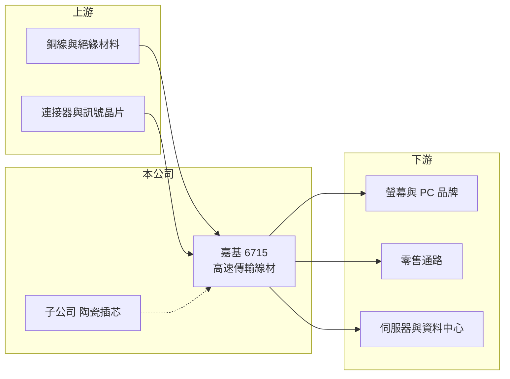

# 6715 嘉基

> 上市｜[[產業索引-電子零組件業|電子零組件業]]｜上市（櫃）日期 2019/12/12

# 第一章：企業模式與商業藍圖

> [!info] 撰寫說明
> 精簡版，由 Claude 依公開資料整理，架構比照 [[2330台積電]] 的四章研究，資料截至 2026-10-08。來源：Goodinfo 經營績效頁、富果研究 2026 年 6 月法說會整理、證交所開放資料快照（基本資料、每月營收、股利、2026 年第二季損益與資產負債）。法說整理為第三方 AI 摘要，產品營收比重未揭露。#待校對

嘉基科技是專做高速[[連接線]]的公司，以 Thunderbolt 線材起家，近年延伸到資料中心的高速銅纜與光連接。本章說明它的業務組成。

- **核心業務：** 嘉基成立於 2011 年，2019 年上市，英文名 Lintes。核心產品是高速傳輸線，包括 [[Thunderbolt]] 5、USB4、DisplayPort、HDMI 2.1 等消費性高速線，以及資料中心用的 DAC、[[AEC]] 等外部線纜與伺服器內部的 Riser、MCIO 線。高速線的難度在於線愈長、速度愈快，訊號衰減與干擾愈嚴重，因此材料、結構設計與測試能力決定能否做出長距離的被動式線材。
- **營收結構：** 公司未揭露各產品線的營收占比。依法說整理，2026 年第一季營收成長主要由螢幕用 Thunderbolt 5 線材帶動，1.5 米被動式線材已成為螢幕廠的標配。資料中心線纜（DAC、AEC 最高到 1.6T 規格）則是公司長期要放大的第二支柱。
- **營運據點：** 總部在新北中和。依法說整理，蘇州廠是主要量產基地；泰國廠為因應中美關稅，生產零售通路的 Thunderbolt 線材；中壢廠符合美國政府採購 TAA 規範，承接美國政府標案與伺服器、機器人線材。子公司另有生產光纖陶瓷插芯（ferrule）與檢測設備的業務。
- **長期方向：** 公司的長期路線是從「消費性高速線」走向「資料中心高速互連」。法說整理提到 1.6T AEC 與客戶共同開發中、3.2T 規劃於 2027 年開發，並以 on-board optics 光學連接座切入 AI 伺服器，預計 2027 年下半年小量出貨。這條路若成功，能讓營收不再只跟 PC 與螢幕景氣連動。

# 第二章：護城河深度與競爭優勢

高速線材的門檻在於規格認證與訊號完整性設計。本章分析嘉基的競爭位置。

- **競爭優勢：** 嘉基長期參與 [[INTC英特爾]] 的 Thunderbolt 生態系，新規格推出時能較早取得認證並供貨，這讓它在高規格 Thunderbolt 線材上具有時間優勢。被動式線材有效長度從 1 米延長到 1.5 米，能讓客戶少用中繼晶片、降低成本，是技術能力的具體表現。
- **主要對手：** 在資料中心高速線領域，主要競爭者包括 [[3665貿聯-KY]]、[[6197佳必琪]]、[[6290良維]] 等台灣線纜廠，以及美國 Amphenol、Molex 等國際連接器大廠，AEC 另有晶片商主導的新進者。這些對手規模都比嘉基大，嘉基的策略是以客製化與高規格利基產品切入。
- **觀察重點：** 第一，資料中心產品能否形成穩定營收，降低對 Thunderbolt 世代交替的依賴。第二，2022 年後營收連續下滑的趨勢是否已在 2026 年反轉。第三，on-board optics 等光學方案能否如期在 2027 至 2028 年量產。

# 第三章：財務體質與盈利規模

資料日期：2026-10-08，表格是撰寫當時的快照；最新月營收、毛利率、累計 EPS 由自動排程寫在本筆記的屬性欄位（月營收、毛利率、累計EPS 等）。#待校對

嘉基的財務呈現「毛利率上升、營收下滑」的組合：產品愈做愈高階，但總出貨量在 2022 年高峰後明顯縮小。

| 年度 | 營收（億元） | [[毛利率]] | [[營業利益率]] | EPS（元） | [[ROE]] |
|---|---|---|---|---|---|
| 2021 | 24.7 | 26.0% | 9.75% | 3.05 | 10.2% |
| 2022 | 33.7 | 33.8% | 20.8% | 9.42 | 24.9% |
| 2023 | 24.5 | 36.1% | 19.5% | 6.38 | 12.8% |
| 2024 | 22.4 | 38.4% | 17.1% | 5.26 | 8.87% |
| 2025 | 16.8 | 37.1% | 10.1% | 1.80 | 3.34% |
| 2026 上半年 | 9.21 | 32.5% | 6.77% | 0.89 | 未查得 |

- **營收規模：** 2020 年營收 24.0 億元，2025 年 16.8 億元，五年年複合成長率約 -7%（推算）。2022 年 33.7 億元是 Thunderbolt 4 與遠距辦公需求的高峰，之後連續三年下滑；2026 年 1 至 8 月累計營收年增約 10%，出現止跌跡象。
- **獲利：** 毛利率從 2021 年 26% 升到 2024 年 38%，但營收縮小使營業利益率從 20.8% 降到 10.1%，顯示費用結構跟不上營收萎縮。2021 至 2025 年平均 ROE 約 12%（推算），但 2025 年僅 3.3%。
- **財務特色：** 2026 年第二季末總資產 47.0 億元、權益 37.5 億元、負債 9.5 億元，負債比約 20%，依法說整理 2026 年第一季末現金約 13.5 億元，財務保守。114 年度配發現金股利每股 2 元，高於當年 EPS 1.80 元，代表公司以過去累積的盈餘維持配息。實收資本額約 6.83 億元。

**[[ROIC]] 與 [[WACC]]：** 有息負債明細未查得，假設約 3 億元（推估）。2025 年營業利益約 1.70 億元（16.8 億 × 10.1%），稅後約 1.36 億元，投入資本約 40.5 億元（權益 37.5 億 + 有息負債 3 億），ROIC 約 3.4%（推算）；2022 年高峰時營業利益約 7 億元，ROIC 約 15%（推算）。WACC 用 [[CAPM]] 推估：無風險利率 1.75%、市場風險溢酬 6%、β 取 1.0（線材連接器股常見值，假設），股東權益成本約 7.8%；負債成本 2.5%、稅率 20%，以權益 93%、負債 7% 加權，WACC 約 7.4%（推算）。結論是：嘉基在 2022 至 2023 年 ROIC 高於 WACC，2025 年則明顯低於 WACC；帳上大量現金拉低了資本報酬，資料中心新產品能否放量是 ROIC 回升的關鍵。

# 第四章：總體風險與地緣政治

嘉基的風險來自規格世代交替、消費性需求與新事業的執行。

- **產業週期：** Thunderbolt 等消費性高速線的需求，跟 PC、螢幕出貨與規格世代交替有關。新規格剛推出時單價高、毛利好，普及後價格下降、競爭者增加，2022 年後營收下滑就反映了這個週期。
- **營運風險：** 資料中心線纜由國際大廠與大型台灣線纜廠主導，嘉基規模較小，客戶認證與產能都需要時間累積；若 1.6T AEC 或光學連接座的開發延後，轉型會拉長。2026 年第一季營業現金流為小幅淨流出，營運資金的變化也需留意。
- **其他風險：** 主要產能在中國蘇州，美中關稅與供應鏈政策會影響成本與客戶下單地點，泰國與中壢廠是對沖布局。銅價與新台幣匯率也會影響毛利。

# 專有名詞解析

## 金融

- **[[ROIC]]**：投入資本報酬率，稅後營業利益除以股東權益加有息負債，衡量本業運用資本的效率。
- **[[WACC]]**：加權平均資金成本，依股東權益與負債的比重，加權計算公司取得資金的平均成本。

## 產業

- **[[連接線]]**：兩端接上連接器、用來傳遞訊號或電力的線材組件，從一般電腦線到資料中心高速線都屬此類。
- **[[Thunderbolt]]**：英特爾主導的高速傳輸介面規格，一條線同時傳輸資料、影像與電力，第 5 代最高可達 80 至 120Gbps。
- **[[AEC]]**：主動式電纜，在銅纜兩端加入訊號重整晶片，能以較低成本延長資料中心內高速銅纜的傳輸距離。

# 核心供應鏈

- 上游：銅線、絕緣與屏蔽材料、連接器端子、訊號重整晶片。
- 下游／客戶：螢幕與 PC 品牌、零售通路、伺服器與資料中心客戶、美國政府標案（具名客戶未查得）；生態系夥伴 [[INTC英特爾]]。
- 同業：[[3665貿聯-KY]]、[[6197佳必琪]]、[[6290良維]]、Amphenol、Molex。

## 最新新聞
<!-- news:start（自動產生，請勿手動編輯此範圍） -->
- 2026-10-19 🏛️ 重訊 15:57｜本公司有價證券於集中交易市場達公布注意交易資訊標準 故公布相關財務業務等重大訊息，以利投資人區別瞭解｜[觀測站](https://mops.twse.com.tw/mops/#/web/t05st01)

完整紀錄：[[6715嘉基 新聞]]
<!-- news:end -->

## 相關連結
- [公開資訊觀測站](https://mopsov.twse.com.tw/mops/web/t05st03?step=1&firstin=1&co_id=6715)
- [Goodinfo](https://goodinfo.tw/tw/StockDetail.asp?STOCK_ID=6715)
- [Yahoo 股市](https://tw.stock.yahoo.com/quote/6715)
- [鉅亨網新聞](https://www.cnyes.com/twstock/6715/news)
