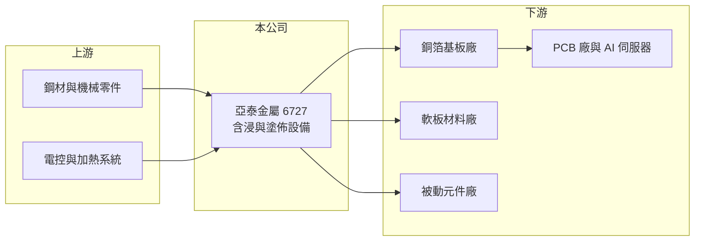

# 6727 亞泰金屬

> 上櫃｜[[產業索引-電子零組件業|電子零組件業]]｜上市（櫃）日期 2020/12/01

# 第一章：企業模式與商業藍圖

> [!info] 撰寫說明
> 精簡版，由 Claude 依公開資料整理，架構比照 [[2330台積電]] 的四章研究，資料截至 2026-10-08。來源：Goodinfo 經營績效頁、富果研究 2025 年 12 月法說會整理、財經新聞標題（優分析）、櫃買中心開放資料快照（基本資料、每月營收、2026 年第二季損益與資產負債）。公開資料有限，產品別營收比重與具名客戶未查得。#待校對

亞泰金屬是一家設備製造商，主力產品是生產[[銅箔基板]]用的[[含浸機]]與塗佈設備，雖然歸在電子零組件類股，實際上屬於 PCB 材料產業的上游設備廠。本章說明它的業務定位。

- **核心業務：** 亞泰金屬成立於 1973 年，2020 年上櫃，總部與工廠位於桃園楊梅。依法說整理，產品包括銅箔基板（CCL）設備、軟性銅箔基板（FCCL）設備、鐵氟龍（PTFE）高頻基板設備，以及 [[MLCC]] 與 LTCC 等被動元件設備。這些設備負責把玻纖布浸入樹脂、烘乾成膜，或在薄膜上精密塗佈與貼合，是材料廠最核心的產線設備之一。
- **營收結構：** 各類設備的營收比重未揭露，但從客戶與應用看，CCL 設備是主力。設備業的營收以「驗收台數」認列，每月營收會隨認列台數大幅跳動，因此看年度數字比月營收更有意義。
- **營運據點：** 台灣楊梅一廠、二廠負責研發、設計、組裝與生產；中國崑山設有安裝與售後服務據點；泰國春武里設立新服務據點，對應客戶往東南亞擴產。公司另設實驗工廠，讓客戶在量產前共同試做與驗證。
- **長期方向：** AI 伺服器與高速網通需要更低損耗的高頻高速基板，基板廠因此持續擴充新產能並更新設備，是亞泰金屬近年營收成長的主要動力。法說整理引用的市場研究預估，全球高速高頻銅箔基板市場 2025 至 2035 年年複合成長率約 10%。公司研發方向為超薄材料、低張力精密控制與高溫烘箱，目的是跟上更薄、更精密的材料規格。

# 第二章：護城河深度與競爭優勢

設備廠的護城河在於製程知識、交機實績與售後服務。本章分析亞泰金屬的競爭位置。

- **競爭優勢：** 含浸機的品質直接決定基板的樹脂含量與厚度均勻性，基板廠換設備商的風險很高，傾向沿用有實績的供應商。亞泰金屬五十年的機械製造經驗、實驗工廠與研發電控人員約占員工兩成，讓它能和基板廠共同開發新材料製程。客戶往泰國等地擴廠時，熟悉的設備商也較容易跟著出海。
- **主要對手：** 國際競爭者以日本、德國的塗佈與含浸設備廠為主，中國也有本土設備廠以低價搶市（具體公司未查得）。台灣同業中，[[6664群翊]]、[[2467志聖]] 主要做 PCB 製程的烘烤與壓合設備，與亞泰金屬在 PCB 設備領域有部分重疊。
- **觀察重點：** 第一，台灣與東南亞基板廠的擴產計畫能否延續到 2027 年以後。第二，FCCL、PTFE 與被動元件設備能否成為 CCL 以外的穩定營收來源。第三，合約負債（客戶預付款）的變化，這是設備訂單的領先指標。

# 第三章：財務體質與盈利規模

資料日期：2026-10-08，表格是撰寫當時的快照；最新月營收、毛利率、累計 EPS 由自動排程寫在本筆記的屬性欄位（月營收、毛利率、累計EPS 等）。#待校對

亞泰金屬的財報反映設備業的特性：毛利率不高、但資本需求少，客戶預付款讓公司能以很少的自有資金支撐營運。

| 年度 | 營收（億元） | [[毛利率]] | [[營業利益率]] | EPS（元） | [[ROE]] |
|---|---|---|---|---|---|
| 2021 | 12.5 | 22.9% | 13.4% | 5.75 | 16.8% |
| 2022 | 14.6 | 16.9% | 7.69% | 8.83 | 22.7% |
| 2023 | 13.1 | 16.4% | 7.38% | 4.60 | 10.6% |
| 2024 | 15.1 | 19.1% | 9.16% | 5.69 | 12.6% |
| 2025 | 16.3 | 22.8% | 12.5% | 6.80 | 13.5% |
| 2026 上半年 | 11.9 | 26.5% | 15.9% | 6.05 | 未查得 |

- **營收規模：** 2020 年營收 9.69 億元，2025 年 16.3 億元，五年年複合成長率約 11%（推算）。2026 年 1 至 8 月累計營收年增約 61%，反映 AI 帶動的基板擴產潮。
- **獲利：** 毛利率在 16% 至 27% 之間，屬於設備組裝業的正常水準，波動來自機種組合與原物料成本。2022 年營業利益率僅 7.7% 但 EPS 達 8.83 元，推估有較大的業外收益（未查得明細）。2021 至 2025 年平均 ROE 約 15.2%（推算）。
- **財務特色：** 2026 年第二季末總資產 61.6 億元、權益僅 14.5 億元、負債 47.0 億元，其中流動負債 46.4 億元。依法說整理，2025 年 9 月底合約負債已達 14.6 億元，推估目前大部分負債是客戶預付的設備款而非借款。這種「先收錢、後交機」的模式讓營運資金需求很低。實收資本額僅約 2.69 億元。

**[[ROIC]] 與 [[WACC]]：** 有息負債明細未查得，因負債以合約負債為主，假設有息負債約 2 億元（推估）。2025 年營業利益約 2.04 億元（16.3 億 × 12.5%），稅後約 1.63 億元，投入資本約 16.5 億元（權益 14.5 億 + 有息負債 2 億），ROIC 約 10%（推算）；2026 年上半年營業利益 1.89 億元年化後，ROIC 約 18%（推算）。WACC 用 [[CAPM]] 推估：無風險利率 1.75%、市場風險溢酬 6%、β 取 1.2（設備股常見值，假設），股東權益成本約 9%；負債成本 2.5%、稅率 20%，以權益 88%、負債 12% 加權，WACC 約 8.1%（推算）。結論是：亞泰金屬靠客戶預付款降低投入資本，ROIC 長期略高於 WACC，在擴產高峰期利差明顯擴大；但這種利差高度依賴客戶的資本支出週期。

# 第四章：總體風險與地緣政治

設備業是電子業中景氣波動最劇烈的環節之一。本章整理亞泰金屬的主要風險。

- **產業週期：** 基板廠只有在擴產時才買新設備，需求屬於「資本支出的資本支出」，比終端需求的波動更大。AI 帶動的擴產潮一旦結束，新訂單可能大幅減少，[[長鞭效應]]在設備業最明顯。
- **營運風險：** 營收以驗收認列，交機延遲或客戶驗收延後，會直接影響當季營收。客戶集中於少數基板大廠，單一客戶縮減擴產計畫的影響很大。大量合約負債雖然是好事，也代表公司必須按時交出大量設備，產能與供應鏈管理壓力高。
- **其他風險：** 鋼材、電控零件等原物料價格上漲會壓縮毛利；海外安裝涉及物流、海運與匯率變動。中國設備廠的低價競爭，可能在中國市場與東南亞市場壓縮報價。

# 專有名詞解析

## 金融

- **[[合約負債]]**：客戶預先支付但公司尚未交貨的款項，設備業的合約負債增加通常代表在手訂單增加。
- **[[長鞭效應]]**：終端需求的小幅變動，沿供應鏈往上游傳遞時被逐級放大，造成上游庫存與訂單劇烈波動。
- **[[ROIC]]**：投入資本報酬率，稅後營業利益除以股東權益加有息負債，衡量本業運用資本的效率。

## 產業

- **[[銅箔基板]]**：在絕緣基材兩面壓上銅箔的板材，是製造 PCB 的主要原料，台光電、聯茂、台燿為主要供應商。
- **[[含浸機]]**：把玻纖布浸入樹脂再加熱烘乾成半固化片的設備，是銅箔基板生產的關鍵產線設備。
- **[[MLCC]]**：積層陶瓷電容，以多層陶瓷介質與電極交疊製成，體積小、用量大，是最主要的被動元件。

# 核心供應鏈

- 上游：鋼材、機械加工零件、電控與加熱系統。
- 下游／客戶：銅箔基板廠，例如 [[2383台光電]]、[[6213聯茂]]、[[6274台燿]]（推估，未查得具名）；軟性銅箔基板與被動元件廠。
- 同業：[[6664群翊]]、[[2467志聖]]、日本與中國塗佈設備廠。

## 最新新聞
<!-- news:start -->
<!-- news:end -->

## 相關連結
- [公開資訊觀測站](https://mopsov.twse.com.tw/mops/web/t05st03?step=1&firstin=1&co_id=6727)
- [Goodinfo](https://goodinfo.tw/tw/StockDetail.asp?STOCK_ID=6727)
- [Yahoo 股市](https://tw.stock.yahoo.com/quote/6727)
- [鉅亨網新聞](https://www.cnyes.com/twstock/6727/news)
