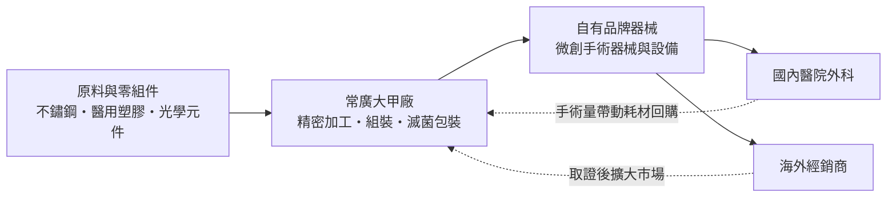
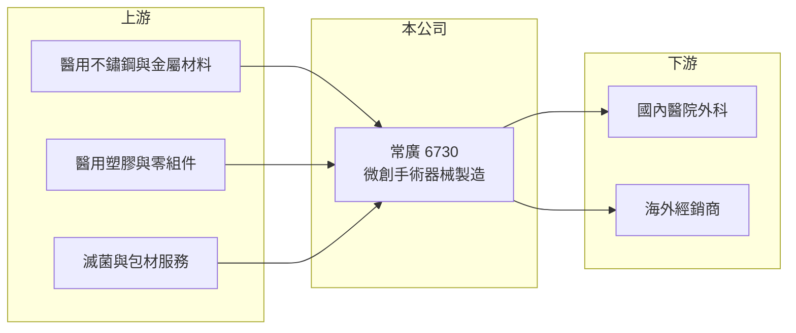

# 6730 常廣

> 上櫃｜[[產業索引-生技醫療業|生技醫療業]]｜上市（櫃）日期 2025/12/10

# 第一章：企業模式與商業藍圖

> [!info] 撰寫說明
> 本文由 Claude 依公開資料整理，架構比照 [[2330台積電]] 的四章研究，資料截至 2026-10-08。財務數字來源：櫃買中心開放資料快照（基本資料、2026 年第二季綜合損益與資產負債、每月營收、本益比殖利率）、Goodinfo 經營績效頁、nStock 公司簡介；業務描述另參考 2025 年 11 至 12 月上櫃前後的財經新聞標題（科技新報、ETtoday、優分析、工商時報）。公開資料有限，產品細節與營收結構未查得，產業描述為整理性內容，尚未逐條比對原始文件。#待校對

在評估單一個股的長期投資價值時，首要步驟是拆解企業的底層獲利邏輯。本章針對常廣股份有限公司（股票代號：6730，以下簡稱常廣）的商業模式進行定性分析，說明一家位於台中大甲的醫療器材廠，如何在由歐美大廠主導的[[微創手術]]器械市場中，以本土製造與自有品牌找到生存空間。

## 一、核心定位：本土微創手術器械製造商

常廣於 2004 年 3 月在台中大甲設立，2025 年 12 月 10 日正式在櫃買中心掛牌上櫃（櫃買中心基本資料）。依 nStock 整理的公司營業項目，常廣主要從事「手術用器械、設備及相關醫療器材之製造加工及買賣」，上櫃前後的新聞標題則一致把它定位為「微創手術醫材廠」與「台灣微創手術本土品牌」。

微創手術是指以內視鏡和細長器械，經由小切口完成手術，病患傷口小、恢復快，已成為腹腔、泌尿、婦科等外科手術的主流。這類手術需要大量專用器械，例如穿刺套管、抓鉗、剪刀、吸引沖洗器與能量器械，其中有不少是一次性使用的耗材。對常廣這樣的製造商來說，這代表兩個商業意義：

* **耗材帶來重複性營收：** 手術量增加，器械與耗材的使用量就跟著增加，營收不必依賴一次性的設備銷售，較能隨醫院手術量穩定成長。
* **精密加工決定品質門檻：** 手術器械要長期反覆使用或在人體內精準操作，對金屬加工、組裝與滅菌的要求很高，必須取得各國[[醫材許可證]]才能銷售，這是新進者難以快速跨越的門檻。

## 二、終端應用與產品板塊

常廣沒有在這次查到的公開資料中揭露產品別或地區別營收比重，因此本文不畫營收結構圖。從營業項目與新聞標題判斷，它的產品集中在微創手術使用的器械與相關設備（推估），客戶是醫院外科與經銷商。上櫃時的新聞標題提到「續拓海外市場拚雙位數成長」與「多引擎推升明年營運」，代表公司已有外銷業務，並計畫擴大海外市場與產品線（具體比重未查得）。

## 三、資本轉化邏輯：高毛利的精密製造

常廣的獲利結構接近「高毛利、中等營業利益率」的醫材製造模式。依 Goodinfo，2020 年至 2025 年的[[毛利率]]介於 43% 至 50%，[[營業利益率]]介於 14% 至 18.5%。毛利率高，代表產品不是一般代工品，而是有品牌或技術溢價的醫材；營業利益率明顯低於毛利率，則反映醫材公司必須長期投入法規、認證、業務推廣與研發費用。

## 四、企業長期藍圖

* **海外市場擴張：** 上櫃新聞標題把「續拓海外市場」列為主要成長方向。醫材外銷的節奏通常是先取得目標國家的許可證，再透過當地經銷商進入醫院，因此成長速度取決於取證進度與通路建置，而不是單純的產能。
* **資本市場籌資：** 2025 年底上櫃後，公司取得公開市場籌資管道，對需要持續投入新產品開發與海外認證的醫材廠來說，資金來源比過去更有彈性。
* **進口替代：** 台灣醫院使用的微創手術器械長期以歐美日品牌為主，本土品牌若能在品質與價格上取得平衡，有機會在健保支付壓力下取得醫院採購的份額（推估）。

# 第二章：護城河深度與競爭優勢

在長期價值投資中，「護城河」指企業抵禦競爭、維持超額利潤的保護機制。本章分析常廣在微創手術器械市場的競爭位置，以及它的優勢能守住多少。

## 一、常廣護城河的核心組成要素

常廣的規模不大，2025 年營收不到 5 億元，護城河屬於「窄護城河」，主要來自法規與客戶信任兩方面：

* **1. 法規認證累積：** 每一項手術器械都要取得各國主管機關的許可證，並維持品質管理系統的稽核。這些認證需要多年時間與費用累積，競爭者無法一夕複製，也讓既有產品在取證後能長期銷售。
* **2. 醫師使用習慣與轉換成本：** 外科醫師習慣某一套器械的手感與操作方式後，通常不會輕易更換。醫院採購也重視穩定供貨與售後服務，一旦常廣的產品進入醫院採購清單，就能帶來穩定的回購需求。
* **3. 本土製造的成本與服務彈性：** 相較進口品牌，本土廠在交期、客製化與售後服務上較有彈性，價格也較有競爭力，這在醫院成本控管趨嚴時是一項優勢（推估）。

## 二、全球主要競爭對手格局

| 對手 | 定位 | 對常廣的威脅 |
|---|---|---|
| 美敦力（Medtronic）、嬌生（Johnson & Johnson MedTech） | 全球外科與微創手術器械龍頭 | 品牌、產品線完整度與醫師教育資源遠大於常廣 |
| 卡爾史托斯（Karl Storz）、奧林巴斯（Olympus） | 內視鏡系統與配套器械 | 掌握內視鏡主機，配套器械容易綁定銷售 |
| 中國本土微創器械廠 | 以價格競爭為主 | 在新興市場與經銷通路上直接壓價 |
| [[4129聯合]]、[[4107邦特]] | 台灣骨科與醫療耗材同業 | 同樣爭取醫材精密加工人才與海外經銷資源 |

## 三、優勢轉化：哪些市場守得住、哪些守不住

* **守得住：** 已取得許可證、醫師已熟悉的產品，以及重視交期與服務的國內醫院與海外經銷客戶。這類市場價格敏感度較低，轉換成本較高。
* **守不住：** 需要搭配大型內視鏡主機或手術機器人的高階器械系統。國際大廠可以把主機與器械整包銷售，本土小廠很難在這個領域正面競爭。
* **觀察重點：** 第一，海外營收比重能否持續提高；第二，毛利率能否維持在 45% 以上，這代表產品沒有淪為純價格競爭；第三，上櫃後資金是否用於新產品與新市場，而非只擴大既有產能。

# 第三章：財務體質與盈利規模

資料日期：2026-10-08。數字取自 Goodinfo 經營績效頁與櫃買中心開放資料快照，表格是撰寫當時的快照；最新月營收、毛利率、累計 EPS 由自動排程寫在本筆記的屬性欄位（月營收、毛利率、累計EPS 等）。#待校對

財務報表是檢驗護城河是否真實存在的最終標準。本章用多年度的三率、[[ROE]] 與資本報酬，檢視常廣的獲利品質。

## 一、獲利能力的基石：三率

| 年度 | 營收（新台幣） | [[毛利率]] | [[營業利益率]] | EPS（元） | [[ROE]] |
|---|---|---|---|---|---|
| 2020 | 3.19 億 | 43.4% | 14.0% | 1.01 | 6.75% |
| 2021 | 3.93 億 | 45.4% | 16.5% | 1.53 | 10.1% |
| 2022 | 4.42 億 | 50.4% | 18.5% | 2.22 | 13.8% |
| 2023 | 4.60 億 | 47.6% | 16.8% | 2.00 | 11.9% |
| 2024 | 4.54 億 | 48.7% | 17.9% | 2.13 | 12.2% |
| 2025 | 4.88 億 | 48.4% | 18.0% | 2.14 | 10.3% |
| 2026 上半年 | 2.42 億 | 45.2% | 15.9% | 0.89 | 未查得 |

資料來源：2020 至 2025 年為 Goodinfo 經營績效頁（合併報表）；2026 上半年依櫃買中心綜合損益快照計算（營收 2.42 億元、營業毛利 1.09 億元、營業利益 0.39 億元）。

* **穩定的高毛利：** 六年來毛利率都在 43% 以上，2022 年後穩定在 47% 至 50%。對醫材製造商來說，毛利率長期穩定，比單一年度的高點更能說明產品具備定價能力。
* **成長溫和：** 營收從 2020 年的 3.19 億元成長到 2025 年的 4.88 億元，年複合成長率約 8.9%（推算）。成長主要集中在 2021 年至 2022 年，2023 年後進入每年個位數的溫和成長。
* **2026 年上半年的變化：** 上半年毛利率 45.2%、營業利益率 15.9%，都略低於 2025 年全年，可能與上櫃後費用增加或產品組合有關（推估）。EPS 0.89 元也可能受到上櫃前後股本變動的影響（推估）。

## 二、[[ROE]]：資本效率

常廣 2021 年至 2025 年的 ROE 依序為 10.1%、13.8%、11.9%、12.2%、10.3%，五年平均約 11.7%（推算）。這個水準代表公司本業穩定賺錢，但不算高報酬。要注意的是，2025 年底上櫃時通常伴隨承銷前現金增資（推估），股東權益擴大，短期內 ROE 會被稀釋，要等新資金轉成營收與獲利後才會回升。

依 2026 年第二季資產負債快照，常廣資產總計 11.67 億元，股東權益 7.40 億元，負債 4.27 億元，其中非流動負債 2.43 億元，每股淨值 20.38 元。

## 三、配息與現金流

櫃買中心本益比殖利率資料顯示常廣的每股股利為 1.5 元，以 2025 年 EPS 2.14 元計算，配息率約 70%（推算）。[[自由現金流]]的多年度數字未查得。

## 四、[[ROIC]] 與 [[WACC]]：價值創造利差

**ROIC 推算：** 以 2025 年營收 4.88 億元乘以營業利益率 18.0%，營業利益約 0.88 億元，稅後營業利益約 0.88 ×（1 − 20%）＝ 0.70 億元。有息負債金額未查得，以 2026 年第二季非流動負債 2.43 億元作為有息負債的上限近似，加上股東權益 7.40 億元，投入資本約 9.83 億元，ROIC 約 7.1%（推算）。若以 2026 年上半年營業利益 0.385 億元年化，ROIC 約 6.3%（推算）。

**WACC 推算：** 台灣 10 年期公債殖利率取 1.75%，市場風險溢酬 6%，β 取醫材製造業常見的 0.8 至 1.0（未查得常廣本身的 β），股東權益成本約 6.6% 至 7.8%。負債成本假設 2.5%，稅後 2.0%。市值以股價淨值比 1.56 倍乘股東權益 7.40 億元，約 11.5 億元；與 2.43 億元負債合計，權益占 83%、負債占 17%。WACC 約 5.8% 至 6.8%（推算）。

**解讀：** 常廣的 ROIC 約 6% 至 7%，與 WACC 大致相當，利差接近零（推算）。這代表本業有穩定獲利，但目前的資本規模還沒有轉化為更高的報酬。過去 ROE 在 10% 至 14% 時，ROIC 應高於資金成本；未來能否重新拉開利差，關鍵在募得資金能否帶來海外營收的成長。

# 第四章：總體風險與地緣政治

任何企業都無法脫離宏觀環境獨立存在。本章分析常廣未來必須面對的法規、產業與營運風險。

## 一、法規與地緣政治風險

* **各國醫材法規趨嚴：** 歐盟的 [[CE MDR]] 與美國 FDA 對臨床證據、品質系統與上市後監測的要求持續提高，認證成本與時間增加。對規模不大的醫材廠來說，每多一張許可證都是可觀的固定成本。
* **海外市場與匯率：** 外銷擴張後，營收會更受美元、歐元與新興市場貨幣影響，新台幣升值會壓縮以台幣計價的毛利。
* **貿易政策：** 若主要出口國調整關稅或推動醫材在地生產，外銷成本可能上升（推估）。

## 二、產業週期與市場結構風險

* **醫院採購與健保支付：** 台灣醫材價格受健保支付與醫院招標影響，價格壓力長期存在。手術量雖然有剛性需求，但器械單價可能被逐年壓低。
* **國際大廠的系統綁定：** 內視鏡主機與手術機器人越來越普及，若配套器械被主機廠綁定，獨立器械廠的市場空間會被壓縮。

## 三、營運環境的隱性風險

* **規模小、客戶集中度未知：** 營收規模不到 5 億元，單一經銷商或單一市場的變動就可能影響整體營收，客戶集中度在這次查到的資料中未揭露。
* **上櫃後的資本效率：** 上櫃前後若股本擴大（推估），而新產品或新市場的效益延遲，ROE 與 EPS 會被稀釋較長時間。
* **產品責任與召回：** 手術器械一旦發生瑕疵，可能面臨召回與法律責任，對中小型醫材廠的品牌傷害較大。

# 專有名詞解析

## 金融

- **[[毛利率]]**：營業毛利除以營業收入，反映產品扣除直接成本後的獲利空間。
- **[[ROIC]]**：投入資本報酬率，稅後營業利益除以股東權益加有息負債，衡量本業運用所有資金的效率。
- **[[WACC]]**：加權平均資金成本，股東與債權人要求報酬率依資本結構加權，是 ROIC 要超越的門檻。

## 產業

- **[[微創手術]]**：以內視鏡與細長器械經小切口完成的手術方式，傷口小、恢復快，需要大量專用器械與耗材。
- **[[醫材許可證]]**：醫療器材在各國銷售前必須取得的主管機關核准文件，取證需要檢測、臨床與品質系統資料。
- **[[CE MDR]]**：歐盟醫療器材法規，2021 年起全面取代舊指令，對臨床證據與上市後監測要求更嚴格。

# 核心供應鏈

## 1. 上游：材料與零組件
- 醫用不鏽鋼、精密金屬零件與醫用塑膠原料（供應商名稱未查得）
- 滅菌、包裝與檢測服務

## 2. 本公司
- 常廣：台中大甲的手術器械與設備製造、品牌與銷售

## 3. 下游：客戶與通路
- 國內醫院外科、婦科、泌尿科等使用微創手術的科別
- 海外醫材經銷商

## 4. 同業
- 國際：美敦力（Medtronic）、嬌生（Johnson & Johnson MedTech）、卡爾史托斯（Karl Storz）、奧林巴斯（Olympus）
- 台灣醫材同業：[[4129聯合]]、[[4107邦特]]

## 最新新聞
<!-- news:start -->
<!-- news:end -->

## 相關連結
- [公開資訊觀測站](https://mopsov.twse.com.tw/mops/web/t05st03?step=1&firstin=1&co_id=6730)
- [Goodinfo](https://goodinfo.tw/tw/StockDetail.asp?STOCK_ID=6730)
- [Yahoo 股市](https://tw.stock.yahoo.com/quote/6730)
- [鉅亨網新聞](https://www.cnyes.com/twstock/6730/news)
