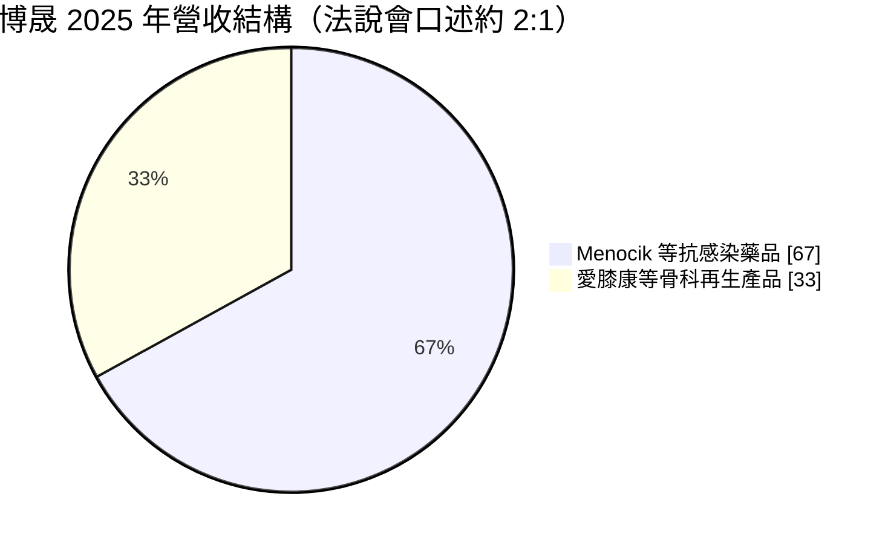
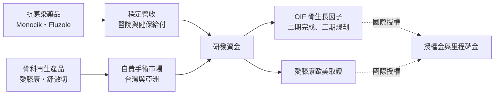
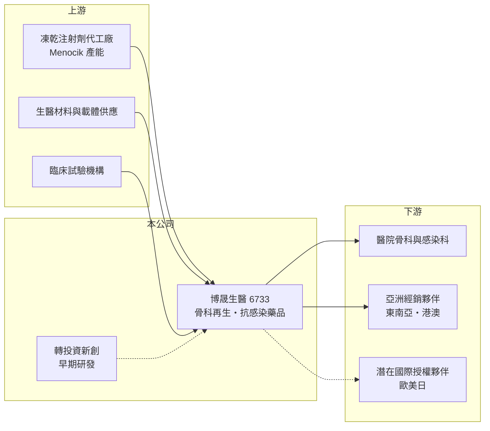

# 6733 博晟生醫

> 上櫃｜[[產業索引-生技醫療業|生技醫療業]]｜上市（櫃）日期 2021/01/28

# 第一章：企業模式與商業藍圖

> [!info] 撰寫說明
> 本文由 Claude 依公開資料整理，架構比照 [[2330台積電]] 的四章研究，資料截至 2026-10-08。財務數字來源：櫃買中心開放資料快照（基本資料、2026 年第二季綜合損益與資產負債、每月營收、本益比殖利率）、Goodinfo 經營績效頁、富果研究 2026 年 3 月法說會整理；產業描述為整理性內容，尚未逐條比對原始文件。#待校對

在評估單一個股的長期投資價值時，首要步驟是拆解企業的底層獲利邏輯。本章針對博晟生醫（股票代號：6733，以下簡稱博晟）的商業模式進行定性分析，說明一家以骨科再生為長期目標的生技公司，為什麼同時賣抗生素，又如何用這種「前菜加大菜」的組合支撐漫長的研發期。

## 一、核心定位：骨科再生為主軸、抗感染產品養研發

博晟成立於 2016 年 7 月，2021 年 1 月在櫃買中心掛牌（櫃買中心基本資料）。公司的長期目標是[[再生醫療]]中的骨科領域，也就是用生物材料、細胞或生長因子，讓受損的軟骨、骨骼或軟組織自行修復，而不是只用人工關節或金屬植入物取代。這類產品一旦證明療效，單價高、可申請國際授權，但開發與取證期很長。

為了在研發期間維持營運，博晟採取雙軌策略。依 2026 年 3 月法說會，公司把產品分成兩類：

* **短期現金流產品：** 以靜脈注射抗生素「美諾幸（Menocik）」與口腔念珠菌用藥 Fluzole 為主，屬於醫院端的抗感染藥品，能較快產生營收。Menocik 是台灣市場首發的[[學名藥]]，受惠於 2025 年起擴大的[[健保給付]]條件。
* **長期價值產品：** 以單次手術自體軟骨修復的「愛膝康（RevoCart）」與骨生長因子 OIF 為核心，目標是透過歐美日的國際授權或合資，實現較大的長期價值。

## 二、產品板塊與營收結構

依法說會說法，2025 年 Menocik 與愛膝康的營收比例約為 2 比 1，公司預期 2026 年會調整為約 1.2 比 0.8，代表骨科產品的比重正在提高。下圖依「約 2 比 1」的口述畫成，只代表大致結構。

* **愛膝康（RevoCart）：** 在手術中取出病患自體軟骨、處理後植回缺損處，一次手術完成軟骨修復。已在台灣、東南亞與港澳等地取得上市許可，導入超過 100 家醫院、200 位以上骨科醫師，累積超過 1,000 例（法說會）。
* **舒效切（Softcut）：** 萃取病患自體脂肪中的基質血管片段細胞，用於韌帶、椎間盤等軟組織修復，已取得台灣二類[[醫材許可證]]，2026 年完成自費價格申請後進入推廣。
* **骨生長因子 OIF：** 用於骨折不癒合與脊椎融合，三項二期臨床已完成，日本骨折不癒合三期試驗即將展開，台灣三期方案與主管機關溝通中（法說會）。
* **抗感染藥品：** Menocik 現有產能每批 8,000 瓶已滿載，公司與台灣凍乾廠合作建置每批 5 萬瓶的新產線，預計 2027 年下半年投產。

## 三、資本轉化邏輯：用學名藥現金流撐新藥與醫材研發

博晟的營運模式可以拆成三個重點：

* **以小規模商品化驗證臨床價值：** 愛膝康先在台灣與亞洲自費市場累積上千例病例，這些真實世界資料可以作為歐美取證與授權談判的基礎，比單純靠臨床試驗更有說服力。
* **抗生素產能是短期瓶頸：** Menocik 需求高於產能，公司在 2025 年調漲價格並擴產。新產線投產前，抗感染藥品的營收成長會受產能限制。
* **研發費用外部化：** 法說會提到公司透過投資外部新創進行早期研發，可以引入外部資金，也讓部分研發費用不直接進入母公司損益表。這種做法減輕財報壓力，但投資人需要留意轉投資的價值與風險。

## 四、企業長期藍圖

* **愛膝康國際化：** 歐洲取證已進入臨床文件審查最後階段，公司期望 2026 年底有結果；美國方面規劃設立子公司、進行約 30 人的小規模臨床試驗以取得白人族群資料，並取得載體的美國新專利（法說會）。
* **OIF 授權：** 已與歐美日潛在夥伴洽談，目前尚無完成的授權案。骨折不癒合與脊椎融合都是長期需求穩定的市場，若完成三期與授權，將是公司價值最大的來源。
* **產品延伸：** 愛膝康擴大到其他大關節，OIF 延伸到齒槽骨增生與骨鬆性骨折，並開發關節鏡器械與新一代水膠載體。

# 第二章：護城河深度與競爭優勢

在長期價值投資中，「護城河」指企業抵禦競爭、維持超額利潤的保護機制。本章分析博晟的護城河在哪裡，以及它在骨科再生與抗感染兩個市場中的位置。

## 一、博晟護城河的核心組成要素

博晟仍處於虧損期，護城河尚在建立中，目前可以觀察到三個要素：

* **1. 專利與取證：** 愛膝康在多個國家取得上市許可，並有載體相關的美國專利；OIF 已完成三項二期臨床。這些臨床與法規資產需要多年時間累積，是後進者難以快速複製的門檻。
* **2. 醫師使用經驗：** 超過 200 位骨科醫師、上千例手術的使用經驗，讓愛膝康在台灣沒有直接同類競品（法說會說法）。外科醫師熟悉一套手術流程後，轉換意願通常較低。
* **3. 抗生素製程與產能門檻：** Menocik 屬凍乾注射劑，製程與無菌產能要求高，公司認為短期內競爭者難以跨越。這讓抗感染藥品能維持相對穩定的價格與市占。

## 二、主要競爭對手格局

| 對手類型 | 代表 | 對博晟的威脅 |
|---|---|---|
| 國際軟骨修復與骨科生物製劑廠 | Vericel（MACI 自體軟骨細胞）、美敦力（骨生長因子產品） | 已在歐美取得主流市場，臨床資料與醫師教育資源領先 |
| 人工關節與骨科植入物廠 | 史賽克（Stryker）、捷邁邦美（Zimmer Biomet）、[[4129聯合]] | 若軟骨修復療效不足，患者最終仍走向人工關節置換 |
| 台灣再生醫療同業 | [[6794向榮生技]]、[[3224三顧]] | 爭取同一批骨科醫師與自費、特管市場 |
| 抗生素學名藥廠 | 國內外注射劑學名藥廠 | 健保藥價調降與新競爭者加入，壓縮價格 |

## 三、優勢轉化：哪些市場守得住、哪些守不住

* **守得住：** 台灣與亞洲的自費軟骨修復市場，以及已取得健保給付、產能有限的抗感染注射劑。這些市場由博晟先行建立，醫師與醫院已有使用經驗。
* **守不住或尚未證明：** 歐美主流市場。這些市場競爭對手更強，取證與給付要求更高，博晟目前的營收幾乎全部來自台灣，海外只有零星案例（法說會）。
* **觀察重點：** 第一，愛膝康歐洲取證是否如期取得；第二，OIF 能否在三期完成前談成國際授權；第三，Menocik 新產線能否在 2027 年下半年順利投產。

# 第三章：財務體質與盈利規模

資料日期：2026-10-08。數字取自 Goodinfo 經營績效頁與櫃買中心開放資料快照，表格是撰寫當時的快照；最新月營收、毛利率、累計 EPS 由自動排程寫在本筆記的屬性欄位（月營收、毛利率、累計EPS 等）。#待校對

財務報表是檢驗護城河是否真實存在的最終標準。對尚未獲利的生技公司，本章重點放在營收成長、虧損收斂速度、現金水位與研發投入。

## 一、獲利能力的基石：三率

| 年度 | 營收（新台幣） | [[毛利率]] | [[營業利益率]] | EPS（元） | [[ROE]] |
|---|---|---|---|---|---|
| 2020 | 0.01 億 | 52.5% | -9,592% | -1.67 | -22.5% |
| 2021 | 0.09 億 | 33.0% | -1,773% | -1.37 | -17.5% |
| 2022 | 0.31 億 | 72.4% | -697% | -1.79 | -24.5% |
| 2023 | 1.10 億 | 81.5% | -161% | -1.30 | -19.1% |
| 2024 | 1.68 億 | 77.8% | -72.9% | -0.95 | -13.3% |
| 2025 | 2.22 億 | 72.0% | -49.7% | -0.69 | -11.9% |
| 2026 上半年 | 1.14 億 | 71.2% | -45.1% | -0.31 | 未查得 |

資料來源：2020 至 2025 年為 Goodinfo 經營績效頁（合併報表）；2026 上半年依櫃買中心綜合損益快照計算（營收 1.14 億元、營業毛利 0.82 億元、營業費用 1.33 億元、營業損失 0.52 億元）。

* **營收快速成長、虧損逐年收斂：** 營收從 2021 年的不到 1,000 萬元成長到 2025 年的 2.22 億元，營業利益率從 -1,773% 收斂到 -49.7%，EPS 虧損也從 2022 年的 -1.79 元縮小到 2025 年的 -0.69 元。這代表商品化產品已經開始承擔部分營運成本。
* **毛利率高但下滑：** 毛利率在 2023 年達 81.5% 後降到 2025 年的 72%，法說會解釋是愛膝康推出「加量不加價」的載體方案，以及抗生素產能受限。高毛利顯示產品具備定價能力，但規模仍不足以支應研發與推廣費用。
* **研發費用：** 2026 年上半年營業費用 1.33 億元，高於營收 1.14 億元。研發費用的單獨金額與研發費用率未查得。

## 二、[[ROE]]：資本效率

博晟 2021 年至 2025 年的 ROE 都是負值，五年平均約 -17.3%（推算），但從 -24.5% 逐步改善到 -11.9%。依 2026 年第二季資產負債快照，歸屬母公司股東權益 10.67 億元，負債僅 0.46 億元，流動資產 9.71 億元，財務結構以股東資金為主、幾乎沒有借款。累積虧損（保留盈餘）為 -5.23 億元，每股淨值 7.95 元。

## 三、現金流與資金需求

以 2026 年上半年營業損失約 0.52 億元年化，每年本業現金消耗約 1 億元上下（推估，未計入營運資金與資本支出）；相較約 9.7 億元的流動資產，現有資金可支應數年營運（推估）。不過 OIF 三期試驗與美國子公司臨床的費用尚未完全反映，若同時展開，資金需求可能增加，未來是否再增資值得觀察。公司未配發股利，[[自由現金流]]長期為負（推估）。

## 四、[[ROIC]] 與 [[WACC]]：價值創造利差

**ROIC 推算：** 2025 年營業利益約為 2.22 億元 × -49.7% ＝ -1.10 億元，虧損期不計所得稅，稅後營業利益約 -1.10 億元。投入資本以 2026 年第二季權益合計 10.80 億元加上非流動負債 0.15 億元（有息負債未查得，以此近似），約 10.95 億元，ROIC 約 -10%（推算）。以 2026 年上半年營業損失 0.52 億元年化，ROIC 約 -9.4%（推算）。

**WACC 推算：** 台灣 10 年期公債殖利率取 1.75%，市場風險溢酬 6%，β 取生技股常見的 1.1 至 1.3（未查得博晟本身的 β），股東權益成本約 8.4% 至 9.6%。博晟幾乎沒有有息負債，WACC 約等於股東權益成本，約 8.3% 至 9.5%（推算）。

**解讀：** ROIC 為負、遠低於 WACC，表示目前每投入一元資本都在消耗價值。這是研發型生技公司的常態，投資人買的是未來授權或國際銷售的選擇權，而不是現在的獲利。要轉為創造價值，需要愛膝康與 OIF 取得國際授權或歐美上市，並讓營收規模大到足以覆蓋研發費用。

# 第四章：總體風險與地緣政治

任何企業都無法脫離宏觀環境獨立存在。本章分析博晟未來必須面對的法規、臨床、市場與資金風險。

## 一、法規與臨床風險

* **歐美取證不確定：** 愛膝康歐洲審查與美國臨床試驗都有延遲或失敗的可能。法規審查的時程常常超過公司預期，而每一次延遲都意味著更長的資金消耗期。
* **三期臨床風險：** OIF 雖完成二期，但三期試驗規模更大、費用更高，療效與安全性仍需重新證明。三期失敗會大幅影響公司長期價值。
* **健保藥價調整：** Menocik 受惠於健保給付，但台灣健保每年進行藥價調查與調降，學名藥價格長期有下行壓力。

## 二、市場與授權風險

* **授權談判的不確定性：** 國際授權的條件、時程與夥伴選擇都不在公司完全掌控之中。法說會提到與美國潛在夥伴的談判持續進行，但尚未簽約。
* **自費市場的景氣敏感度：** 愛膝康與舒效切以自費市場為主，消費者支出意願受景氣影響，且需要與人工關節、注射療法等方案競爭。
* **中國市場：** 公司過去曾透過合作夥伴間接接觸中國市場，目前無直接合作，兩岸關係與中國醫材法規都會影響未來布局（法說會）。

## 三、營運與資金風險

* **產能瓶頸：** 抗生素產能已滿載，2027 年下半年新產線投產前，營收成長受限；若新產線延遲，短期現金流會受到影響。
* **轉投資風險：** 透過外部新創進行早期研發，雖可減輕財報壓力，但轉投資若失敗，可能出現減損。
* **股權稀釋：** 研發期公司通常需要多次增資，若在股價低點籌資，對既有股東的稀釋較大。

# 專有名詞解析

## 金融

- **[[ROIC]]**：投入資本報酬率，稅後營業利益除以股東權益加有息負債，衡量本業運用所有資金的效率。
- **[[WACC]]**：加權平均資金成本，股東與債權人要求報酬率依資本結構加權，是 ROIC 要超越的門檻。

## 產業

- **[[再生醫療]]**：利用細胞、生物材料或生長因子，促使受損組織自行修復或再生的醫療領域。
- **[[學名藥]]**：原廠藥專利到期後，由其他藥廠生產的相同成分藥品，價格較低、競爭激烈。
- **[[健保給付]]**：全民健保對特定藥品或醫材給付費用的規定，給付條件與價格直接影響產品銷量。
- **[[醫材許可證]]**：醫療器材在各國銷售前必須取得的主管機關核准文件，取證需要檢測、臨床與品質系統資料。
- **[[授權金]]**：藥廠或醫材公司把產品開發或銷售權利授權給合作夥伴時，收取的簽約金、里程碑金與銷售分潤。

# 核心供應鏈

## 1. 上游：生產與臨床
- 凍乾注射劑產能：與台灣凍乾廠合作建置新產線（廠商名稱未查得）
- 生醫材料、水膠載體與手術器械零組件
- 臨床試驗醫院與 CRO

## 2. 本公司
- 博晟生醫：愛膝康、舒效切、OIF、Menocik、Fluzole 的研發、取證與銷售

## 3. 下游：客戶與通路
- 台灣醫院骨科、感染科與醫學中心（法說會提及臺大醫院等）
- 東南亞與港澳經銷夥伴，以及「粵港澳藥械通」管道
- 歐美日潛在授權夥伴（尚未簽約）

## 4. 同業
- 國際：Vericel、史賽克（Stryker）、捷邁邦美（Zimmer Biomet）
- 台灣：[[6794向榮生技]]、[[3224三顧]]、[[4129聯合]]

## 最新新聞
<!-- news:start（自動產生，請勿手動編輯此範圍） -->
- 2026-10-05 🏛️ 重訊 15:08｜調整本公司111年度現金增資之資金運用計畫項目｜[觀測站](https://mops.twse.com.tw/mops/#/web/t05st01)

完整紀錄：[[6733博晟生醫 新聞]]
<!-- news:end -->

## 相關連結
- [公開資訊觀測站](https://mopsov.twse.com.tw/mops/web/t05st03?step=1&firstin=1&co_id=6733)
- [Goodinfo](https://goodinfo.tw/tw/StockDetail.asp?STOCK_ID=6733)
- [Yahoo 股市](https://tw.stock.yahoo.com/quote/6733)
- [鉅亨網新聞](https://www.cnyes.com/twstock/6733/news)
