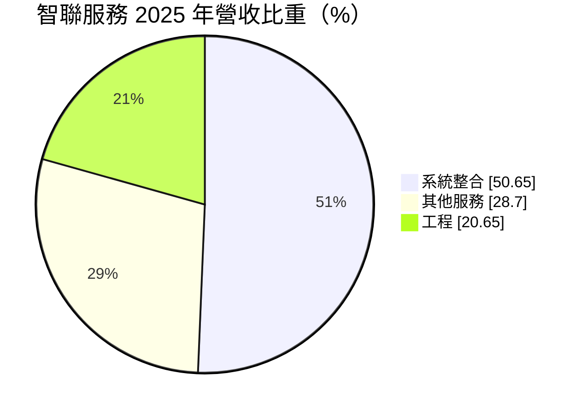
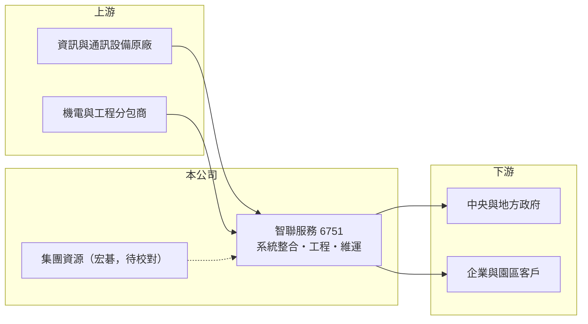

# 6751 智聯服務

> 上櫃｜[[產業索引-資訊服務業|資訊服務業]]｜上市（櫃）日期 2020/12/25

# 第一章：企業模式與商業藍圖

> [!info] 撰寫說明
> 精簡版，由 Claude 依公開資料整理，架構比照 [[2330台積電]]，資料截至 2026-10-08。來源：Goodinfo 經營績效年表（2019 至 2025 年）；富邦 e 點通（MoneyDJ）公司基本資料（2025 年營收比重）；櫃買中心開放資料快照（基本資料、2026 年第二季資產負債與上半年損益、每月營收、股利）。集團關係、服務領域與客戶依記憶與公司網域整理，標示待校對。#待校對

智聯服務成立於 2017 年 9 月、2020 年 12 月上櫃，總部在新竹縣竹北市，實收資本額約 2.22 億元，董事長施宣輝、總經理韓政達。從公司網域與歷史推估，它屬於 [[2353宏碁]] 集團旗下的系統整合公司（待校對），主要承接[[智慧城市]]、智慧建築與交通等公共與企業專案，2025 年營收約 17.6 億元。

- **核心業務：** 系統整合約占一半，是替政府與企業建置資訊、監控、通訊等系統；工程約占兩成，推估包括機電、弱電與網路佈線等現場施工；其他服務近三成，推估包括系統上線後的維運與管理服務（待校對）。這樣的組合代表智聯的角色偏向「資訊系統加上工程施工」的統包商。
- **營收結構：** 營收以專案為主，標案金額大、工期長，營收會隨大型案件的進度認列而起伏。維運與其他服務屬於[[經常性收入]]，比重近三成，是平衡專案波動的基礎。
- **營運據點與客戶產業：** 總部在新竹竹北，推估客戶以中央與地方政府、公共工程與企業園區為主（待校對）。政府客戶的優點是付款信用好、案件規模大，缺點是標案競爭激烈、價格壓力大。
- **長期方向：** 智慧城市、交通與能源管理的數位化是長期趨勢，政府持續投入預算。智聯的長期課題是把一次性的建置案轉成多年期維運合約，並藉由集團資源取得較大型的整合案。

# 第二章：護城河深度與競爭優勢

智聯的護城河偏窄：系統整合與工程統包的進入門檻主要是實績與資格，而非獨家技術。

- **競爭優勢：** 政府與公共工程標案通常要求投標廠商具備過去的同類實績與工程資格，已完成多件案子的業者在評選上較有優勢。若確實屬於宏碁集團（待校對），集團的品牌、財務背景與產品資源，也能協助它在大型案件中取得信任。
- **主要對手：** 系統整合與智慧城市領域的同業包括 [[2471資通]]、[[2453凌群]]、[[6811宏碁資訊]]、[[8099大世科]]、[[6214精誠]]，工程部分則與各類機電與弱電工程公司競爭。
- **觀察重點：** 第一，[[毛利率]]與[[營業利益率]]能否回到 2023 年的 18.8% 與 7.5%，2024 年營業利益率曾掉到 0.3%；第二，維運服務比重能否提高；第三，業外收益是否只是一次性，本業能否獨立撐起獲利。

# 第三章：財務體質與盈利規模

資料日期：2026-10-08，表格是撰寫當時的快照；最新月營收、毛利率、累計 EPS 由自動排程寫在本筆記的屬性欄位（月營收、毛利率、累計EPS 等）。#待校對

智聯的財務特色是營收規模成長快、但本業利潤率薄且波動大，EPS 常受業外收益影響。

| 年度 | 營收（億元） | [[毛利率]] | [[營業利益率]] | EPS（元） | [[ROE]] |
|---|---|---|---|---|---|
| 2019 | 10.7 | 12.8% | 3.48% | 3.00 | 19.2% |
| 2020 | 9.84 | 13.8% | 4.13% | 2.76 | 10.9% |
| 2021 | 12.4 | 10.8% | 3.12% | 2.44 | 8.74% |
| 2022 | 13.9 | 14.4% | 5.31% | 4.05 | 14.2% |
| 2023 | 17.4 | 18.8% | 7.52% | 3.07 | 11.2% |
| 2024 | 18.0 | 12.9% | 0.34% | 0.83 | 1.92% |
| 2025 | 17.6 | 14.1% | 2.72% | 5.20 | 12.8% |
| 2026 上半年 | 8.52 | 13.8% | 3.5% | 1.34 | 未查得 |

註：2019 至 2025 年取自 Goodinfo；2026 年上半年取自櫃買中心開放資料推算（營業毛利 1.18 億元、營業利益 0.29 億元）。2025 年營業利益率只有 2.72%，EPS 卻達 5.20 元，推估有較大的業外或一次性收益，待校對。

- **長期指標：** 2020 至 2025 年營收年複合成長率約 12.3%（推算），2021 至 2025 年平均 ROE 約 9.8%（推算）。櫃買中心快照顯示最近一年度現金股利 3.00 元，相對 2025 年 EPS 5.20 元，配息率約六成（推算）。2026 年 1 至 8 月累計營收較去年同期減少約 14%，反映專案認列時點的波動。
- **[[ROIC]] 與 [[WACC]]：** 2025 年營業利益約 0.48 億元（17.6 億 × 2.72%），稅後約 0.38 億元；2026 年第二季股東權益 9.84 億元，有息負債未查得，假設接近 0，ROIC 約 3.9%（推算）。以 2026 年上半年年化營業利益約 0.59 億元計算，ROIC 約 4.8%（推算）。WACC 以無風險利率 1.75%、市場風險溢酬 6%、β 0.9（系統整合股常見值）推得權益成本 7.15%，資本幾乎全為權益，WACC 約 7.2%（推算）。本業 ROIC 低於 WACC，代表單靠系統整合與工程本業還沒有賺回資金成本，股東報酬主要依賴業外收益，這是長期研究時最需要留意的地方。
- **財務特色：** 2026 年第二季總資產 14.47 億元、負債比率約 32%，[[每股淨值]] 41.88 元。專案型公司的資產中，應收帳款與合約資產比重通常較高，收款速度會影響現金流（推估）。

# 第四章：總體風險與地緣政治

智聯的風險集中在專案執行與政府預算，兩者都會讓獲利出現明顯的年度波動。

- **產業週期：** 政府資訊與工程預算有年度週期，選舉與政策調整可能讓案件延後。智慧城市需求長期成長，但個別年度的招標量變化很大。
- **營運風險：** 統包型專案的毛利取決於估價與工程管理，若發生工期延誤、材料上漲或驗收爭議，利潤會被侵蝕，2024 年營業利益率跌到 0.3% 就是例子。標案以最低價或最有利標決標，價格壓力持續存在。
- **其他風險：** 工程部分涉及工安與施工品質責任；公共系統涉及[[資安]]要求。若集團策略調整（待校對），公司的業務來源與資源可能受到影響。

# 專有名詞解析

## 應用

- **[[智慧城市]]**：運用感測器、通訊網路與資料平台，改善交通、能源、治安等城市管理效率的應用。
- **[[系統整合]]**：把不同廠牌的硬體、軟體與網路整合成可運作的資訊系統，並負責建置與後續維護的服務。
- **[[資安]]**：資訊安全，保護系統與資料不被入侵、竊取或破壞的技術與管理措施。

## 金融

- **[[經常性收入]]**：每年固定重複發生的收入，例如維運年約、訂閱費，能讓營收比一次性專案更穩定。
- **[[ROIC]]**：投入資本報酬率，稅後營業利益除以股東權益加有息負債，衡量本業運用資本的效率。
- **[[WACC]]**：加權平均資金成本，股東與債權人要求報酬率的加權平均，是 ROIC 要超越的門檻。

# 核心供應鏈

- 上游：資訊、監控與通訊設備原廠，以及機電與弱電工程分包商（具體名單未查得）。
- 下游／客戶：中央與地方政府、公共工程與企業園區（待校對）。
- 同業：[[2471資通]]、[[2453凌群]]、[[6811宏碁資訊]]、[[8099大世科]]、[[6214精誠]]；集團關係：[[2353宏碁]]（待校對）。

## 最新新聞
<!-- news:start（自動產生，請勿手動編輯此範圍） -->
- 2026-10-07 📰 媒體 11:50｜營收速報 - 智聯服務(6751)9月營收2.65億元年增率高達158.43％｜[鉅亨網](https://news.cnyes.com/news/id/6623533)

完整紀錄：[[6751智聯服務 新聞]]
<!-- news:end -->

## 相關連結
- [公開資訊觀測站](https://mopsov.twse.com.tw/mops/web/t05st03?step=1&firstin=1&co_id=6751)
- [Goodinfo](https://goodinfo.tw/tw/StockDetail.asp?STOCK_ID=6751)
- [Yahoo 股市](https://tw.stock.yahoo.com/quote/6751)
- [鉅亨網新聞](https://www.cnyes.com/twstock/6751/news)
