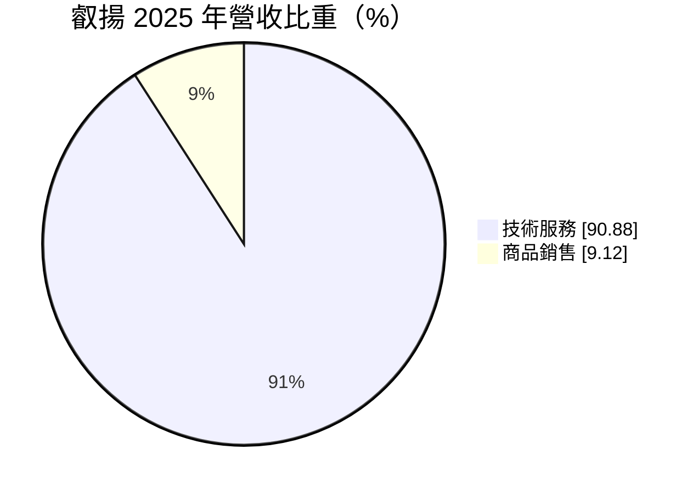
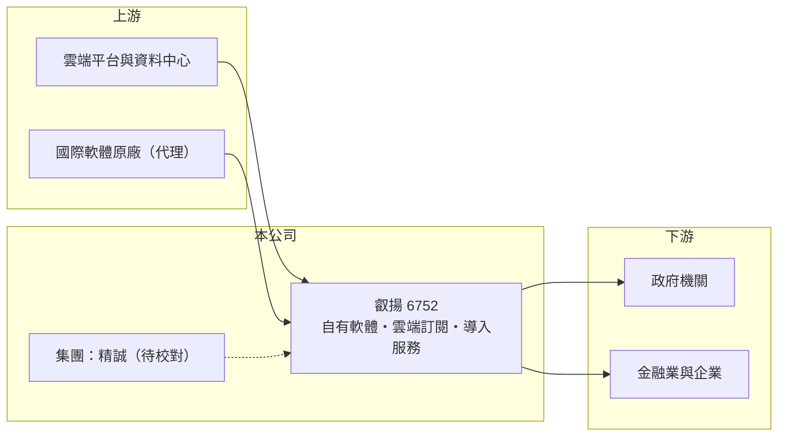

# 6752 叡揚

> 上櫃｜[[產業索引-資訊服務業|資訊服務業]]｜上市（櫃）日期 2020/12/10

# 第一章：企業模式與商業藍圖

> [!info] 撰寫說明
> 精簡版，由 Claude 依公開資料整理，架構比照 [[2330台積電]]，資料截至 2026-10-08。來源：Goodinfo 經營績效年表（2019 至 2025 年）；富邦 e 點通（MoneyDJ）公司基本資料（2025 年營收比重）；櫃買中心開放資料快照（基本資料、2026 年第二季資產負債與上半年損益、每月營收、股利）。產品線、代理品牌、客戶產業與集團關係依記憶整理，標示待校對。#待校對

叡揚（叡揚資訊，英文 GSS）成立於 1987 年 3 月、2020 年 12 月上櫃，總部在台北市中山區，實收資本額約 3.83 億元，董事長張培鏞、總經理陳世安。它是台灣少數以自有軟體產品為核心的資訊服務公司，產品涵蓋知識管理、客戶關係管理、[[資安]]與雲端應用，並被視為 [[6214精誠]] 集團成員（持股關係待校對）。2025 年營收約 20.2 億元，七年間成長超過一倍。

- **核心業務：** 叡揚的營收九成來自技術服務，包括自有軟體的授權與導入、客製開發、維護合約與雲端訂閱。自有產品線推估包括 Vitals 知識管理系列、客戶關係管理、電子表單與流程平台等（待校對），另外也代理部分國際軟體並提供導入服務（待校對）。
- **營收結構：** 自有軟體的商業模式是先賣授權與導入，之後每年收取維護費；雲端產品則以 [[SaaS]] 訂閱計費。這兩種都屬於[[經常性收入]]，客戶越多，每年基本盤就越大，這是叡揚營收能逐年墊高的主因。
- **營運據點與客戶產業：** 總部在台北，客戶推估以政府機關、金融業與中大型企業為主（待校對）。政府與金融客戶對系統穩定與資安要求高，一旦導入就長期使用，有利於累積維護收入。
- **長期方向：** 叡揚的長期成長來自三個方向：一是把既有客戶從買斷授權轉為雲端訂閱，提高經常性收入比重；二是資安與資料分析需求增加；三是把 AI 功能整合進既有的知識管理與客服產品，讓產品維持競爭力。

# 第二章：護城河深度與競爭優勢

叡揚的護城河來自自有軟體產品與龐大的客戶安裝基礎，這比單純做系統整合的同業更深一層。

- **競爭優勢：** 企業知識管理與流程系統一旦導入，客戶的文件、流程與使用者習慣都建立在上面，更換系統的成本與風險很高，形成轉換成本。自有產品讓叡揚每增加一個客戶的邊際成本較低，[[毛利率]]長年維持在 49% 至 52%，[[營業利益率]]也從 2019 年的 9.6% 穩定提升到 2025 年的 14.9%，顯示規模經濟正在發揮作用。
- **主要對手：** 本土同業包括 [[6214精誠]]（同集團，部分業務互補）、[[2471資通]]、[[2453凌群]]、[[6183關貿]]、[[7547碩網]] 等；國際上則與 Microsoft（[[MSFT微軟]]）、Salesforce 等雲端軟體大廠在企業應用市場競爭。
- **觀察重點：** 第一，雲端訂閱占營收的比重是否持續提高（具體比重未查得）；第二，營業利益率能否突破 15%；第三，面對國際 SaaS 大廠，本土產品能否以在地化、法規遵循與服務維持競爭力。

# 第三章：財務體質與盈利規模

資料日期：2026-10-08，表格是撰寫當時的快照；最新月營收、毛利率、累計 EPS 由自動排程寫在本筆記的屬性欄位（月營收、毛利率、累計EPS 等）。#待校對

叡揚的財務特色是營收穩定雙位數成長、毛利率高且穩、ROE 長年接近 20%，是資訊服務業中成長與品質兼具的例子。

| 年度 | 營收（億元） | [[毛利率]] | [[營業利益率]] | EPS（元） | [[ROE]] |
|---|---|---|---|---|---|
| 2019 | 9.68 | 52.1% | 9.6% | 3.66 | 19.5% |
| 2020 | 10.9 | 51.6% | 12.1% | 4.88 | 19.6% |
| 2021 | 11.8 | 49.2% | 12.1% | 4.70 | 17.2% |
| 2022 | 14.3 | 48.9% | 13.5% | 5.74 | 19.6% |
| 2023 | 15.9 | 52.3% | 14.5% | 6.14 | 19.7% |
| 2024 | 17.4 | 52.3% | 14.7% | 6.14 | 18.4% |
| 2025 | 20.2 | 50.1% | 14.9% | 7.41 | 20.5% |
| 2026 上半年 | 9.88 | 46.9% | 11.8% | 2.94 | 未查得 |

註：2019 至 2025 年取自 Goodinfo（2023 與 2024 年 EPS 同為 6.14 元，待校對）；2026 年上半年取自櫃買中心開放資料推算（營業毛利 4.63 億元、營業利益 1.17 億元）。軟體公司下半年常有較多驗收與授權認列，上半年利潤率通常低於全年（推估）。

- **長期指標：** 2020 至 2025 年營收年複合成長率約 13.1%（推算），2021 至 2025 年平均 ROE 約 19.1%（推算），EPS 從 2019 年的 3.66 元成長到 2025 年的 7.41 元。櫃買中心快照顯示最近一年度現金股利 4.80 元，相對 2025 年 EPS 7.41 元，配息率約六成五（推算），兼顧股東回報與保留資金擴展產品。2026 年 1 至 8 月累計營收較去年同期成長約 6%。
- **[[ROIC]] 與 [[WACC]]：** 2025 年營業利益約 3.01 億元（20.2 億 × 14.9%），稅後約 2.41 億元；2026 年第二季股東權益 13.56 億元，有息負債未查得，軟體公司借款通常很少，假設接近 0，ROIC 約 18%（推算）。WACC 以無風險利率 1.75%、市場風險溢酬 6%、β 0.8（企業軟體股常見值）推得權益成本約 6.55%，資本幾乎全為權益，WACC 約 6.5%（推算）。ROIC 高出 WACC 約 11 個百分點，代表叡揚長期穩定創造經濟價值，而且隨規模擴大仍在改善。
- **財務特色：** 2026 年第二季總資產 26.5 億元、負債 13.0 億元，其中流動負債 11.2 億元，推估多為預收的維護費與訂閱款等合約負債，這類負債反而代表客戶預先付款，是軟體公司現金流的優點。[[每股淨值]] 36.05 元。

# 第四章：總體風險與地緣政治

叡揚的風險主要來自國際雲端大廠的競爭與人才成本，產業週期影響相對溫和。

- **產業週期：** 企業與政府的軟體支出與景氣有關，但維護與訂閱收入在景氣下行時仍會持續，因此營收波動較小。新專案在景氣差時可能延後，影響成長速度。
- **營運風險：** 國際 SaaS 大廠持續在台灣擴張，並把 AI 功能整合進自家平台，本土軟體若產品更新跟不上，客戶可能轉向國際平台。研發與顧問人才是核心資產，薪資上升與人才流失會壓縮利潤率。
- **其他風險：** 政府與金融客戶比重高（待校對），採購規則與預算變化會影響訂單。資安產品與服務若發生重大事件，商譽受損。若與母集團的關係或分工改變（待校對），業務來源可能受影響。

# 專有名詞解析

## 應用

- **[[SaaS]]**：軟體即服務，使用者透過網路訂閱使用軟體，不必自行安裝與維護，廠商按月或按年收費。
- **[[資安]]**：資訊安全，保護系統與資料不被入侵、竊取或破壞的技術與管理措施。

## 金融

- **[[經常性收入]]**：每年固定重複發生的收入，例如維運年約、訂閱費，能讓營收比一次性專案更穩定。
- **[[ROIC]]**：投入資本報酬率，稅後營業利益除以股東權益加有息負債，衡量本業運用資本的效率。
- **[[WACC]]**：加權平均資金成本，股東與債權人要求報酬率的加權平均，是 ROIC 要超越的門檻。

# 核心供應鏈

- 上游：公有雲平台與資料中心服務，例如 [[MSFT微軟]]、[[AMZN亞馬遜]]、[[GOOGL谷歌]]（合作關係待校對），以及代理的國際軟體原廠。
- 下游／客戶：政府機關、金融業與中大型企業（待校對）。
- 同業：[[6214精誠]]、[[2471資通]]、[[2453凌群]]、[[6183關貿]]、[[7547碩網]]。

## 最新新聞
<!-- news:start -->
<!-- news:end -->

## 相關連結
- [公開資訊觀測站](https://mopsov.twse.com.tw/mops/web/t05st03?step=1&firstin=1&co_id=6752)
- [Goodinfo](https://goodinfo.tw/tw/StockDetail.asp?STOCK_ID=6752)
- [Yahoo 股市](https://tw.stock.yahoo.com/quote/6752)
- [鉅亨網新聞](https://www.cnyes.com/twstock/6752/news)
