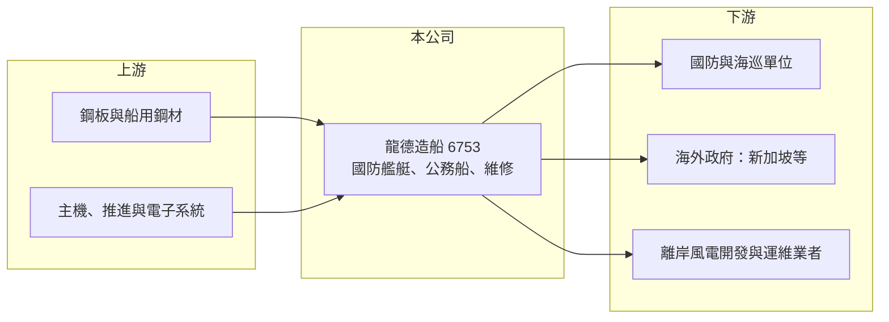

# 6753 龍德造船

> 上市｜[[產業索引-航運業|航運業]]｜上市（櫃）日期 2023/03/10

# 第一章：企業模式與商業藍圖

> [!info] 撰寫說明
> 精簡版，由 Claude 依公開資料整理，架構比照 [[2330台積電]] 的四章研究，資料截至 2026-10-08。來源：Goodinfo 年度經營績效頁、優分析龍德造船在手訂單與擴產報導、證交所開放資料（基本資料、2026 年第二季資產負債與綜合損益、營益分析、股利、每月營收）；廠區位置與歷史艦艇案依記憶整理，標示待校對。#待校對

龍德造船是台灣少數以國防艦艇與公務船為主力的民營造船廠，本章說明它的訂單來源、產能升級，以及為何它的營收與政府預算高度連動。

## 一、核心定位：國防與公務船的專業造船廠

龍德造船成立於 1976 年，2023 年 3 月上市，董事長為黃守真、總經理為黃守龍，實收資本額約 11.7 億元（證交所開放資料），廠區位於宜蘭蘇澳（待校對）。公司營收主要來自國防艦艇、各類公務船的建造，以及後續的維修保養服務（優分析）。和大型商船廠不同，龍德專注在 1,000 噸級以下、技術規格要求高的特種船，例如高速巡邏艇、巡防艇與工作船。

* **國防艦艇：** 依報導，龍德曾參與沱江級相關艦艇（優分析提及），並投入「慧龍」無人水下載具與「快奇」攻擊[[無人艇]]等新型國防計畫。這類訂單在[[國艦國造]]政策下，由國內廠商承造的比例提高。
* **公務船：** 海巡、漁政等政府機關的巡防艇與公務船，是另一個穩定的訂單來源（具體客戶與比重未查得）。
* **海外與新事業：** 取得新加坡巡邏艇訂單與長期維保合約，也發展[[離岸風電]]運維船（優分析）。

## 二、營運據點與產能升級

龍德的關鍵擴產是六廠北棟，資本支出約 15 億元，預計 2025 年下半年至 2026 年初陸續投產，建造能力由約 80 公尺、1,000 噸級，提升到 120 至 125 公尺、4,000 噸級（優分析）。這個升級讓公司可以競標中大型艦艇，打開原本只有大型船廠才能參與的市場。

## 三、資本轉化邏輯：先收款、按進度認列

造船合約通常金額大、工期長達數年，客戶依里程碑付款，公司在帳上會有大量的[[合約負債]]（預收款），營收則依完工進度認列。這代表兩件事：一是在手訂單能提供未來數年的營收能見度，二是單一大案的結算或成本追加，會讓某些季度的毛利率大幅波動。

## 四、企業長期藍圖

在手訂單由 2021 年約 50 億元、2022 年約 70 億元，成長到 2023 年突破 100 億元、2024 年約 105 億元（優分析），報導另提到詢價案 52 件、總額 429 億元，屬於潛在機會而非確定訂單。長期方向包括：以新廠產能承接中大型艦艇、擴大無人艇與無人載具的國防訂單、經營海外巡邏艇市場，以及以維修保養合約建立較穩定的經常性收入。

# 第二章：護城河深度與競爭優勢

造船是高度依賴技術與工期管理的產業，本章分析龍德在國防與公務船市場的競爭優勢與主要對手。

## 一、護城河的核心組成要素

* **國防案的資格與履約紀錄：** 國防艦艇有嚴格的保密、品質與交期要求，承造過同類艦艇的廠商在評選中具有明顯優勢。龍德長期累積的國防與公務船實績，是新進業者短期內難以複製的門檻。
* **特種船的設計能力：** 高速巡邏艇與無人艇需要輕量化船體、推進與電子系統整合，屬於少量多樣的工程型產品，靠的是設計與工程團隊的經驗，而不是規模。
* **產能升級帶來的新市場：** 六廠北棟完成後可建造 4,000 噸級船艦，讓龍德從小型艇延伸到中型艦，可競標的案件金額與數量都擴大。

## 二、主要競爭對手

| 對手 | 定位 | 與龍德的比較 |
|---|---|---|
| [[2208台船]] | 國營色彩的大型造船廠，承造潛艦與大型艦艇 | 規模大，承接大型國防與商船，與龍德在中型艦艇可能競爭 |
| 中信造船、慶富造船等民營船廠 | 公務船、漁船與艦艇 | 未上市，與龍德在公務船與巡防艇直接競標 |
| 國外艦艇廠 | 海外巡邏艇市場 | 在新加坡等海外市場與龍德競爭 |

## 三、守得住與守不住

* **守得住：** 國艦國造政策下的國內國防與公務船訂單。政府偏好由國內廠商承造，具備實績的業者能持續參與。
* **守不住：** 單一大案的毛利率。造船合約多為固定價格，原物料與人力成本上漲或設計變更時，利潤可能被侵蝕，2025 年毛利率就由前一年的 22.7% 降到 19.9%（Goodinfo）。
* **觀察重點：** 新廠產能能否如期滿載、無人艇等新型國防計畫能否轉為量產訂單，以及海外訂單是否形成穩定來源。

# 第三章：財務體質與盈利規模

資料日期：2026-10-08，表格是撰寫當時的快照；最新月營收、毛利率、累計 EPS 由自動排程寫在本筆記的屬性欄位（月營收、毛利率、累計EPS 等）。#待校對

本章用多年度數據檢視龍德的成長軌跡、獲利波動與資本報酬。

## 一、多年度三率與 ROE

| 年度 | 營收（新台幣） | [[毛利率]] | [[營業利益率]] | EPS（元） | [[ROE]] |
|---|---|---|---|---|---|
| 2020 | 19.4 億 | 14.2% | 10.1% | 2.01 | 10.9% |
| 2021 | 22.4 億 | 18.6% | 14.5% | 2.67 | 13.5% |
| 2022 | 38.3 億 | 15.5% | 12.4% | 2.93 | 16.0% |
| 2023 | 49.9 億 | 19.1% | 16.1% | 5.43 | 23.2% |
| 2024 | 51.2 億 | 22.7% | 19.6% | 6.25 | 21.0% |
| 2025 | 52.5 億 | 19.9% | 16.3% | 5.98 | 16.3% |
| 2026 上半年 | 28.5 億 | 39.19% | 34.20% | 6.55 | 未查得 |

註：2020 至 2025 年取自 Goodinfo；2026 上半年取自證交所營益分析與綜合損益。

* **成長：** 2020 至 2025 年營收年複合成長率約 22%（推算），反映在手訂單由 50 億元倍增到 100 億元以上。2026 年 1 至 8 月累計營收約 38.8 億元、年增約 25.6%（證交所每月營收）。
* **毛利率波動：** 2026 年上半年毛利率 39.19%、營業利益率 34.20%，遠高於過去五年 14% 至 23% 的區間，可能與特定案件結算或產品組合有關（推估）。造船業按進度認列營收，單一期間的高毛利不一定能延續，長期應以多年平均看待。
* **ROE：** 2021 至 2025 年平均 ROE 約 18%（推算），屬於資本效率良好的水準。

## 二、股利與資本配置

2025 年度配發現金股利 1.25 元，以 EPS 5.98 元計算配發率約 21%（證交所股利資料，推算）。低配息反映公司把盈餘保留給六廠北棟等擴產投資，屬於成長期的資本配置。2026 年第二季底權益總計約 53.2 億元、總負債約 55.2 億元，負債中包含大量合約負債（預收款），並非全部為有息負債。

## 三、[[ROIC]] 與 [[WACC]]

**ROIC 推算：** 2025 年營業利益約 52.5 億元 × 16.3% ≈ 8.56 億元，稅後約 6.85 億元。投入資本以權益 53.2 億元加上假設有息負債約 15 億元（推估，對應擴產融資）計算，約 68 億元，ROIC 約 10%（推算）。

**WACC 推算：** 公債殖利率 1.75%、市場風險溢酬 6%、β 取國防與造船小型股常見值 1.0，權益成本約 7.75%；負債成本 2.5%、稅後 2.0%，以權益約 78%、負債約 22% 加權，WACC 約 6.5%（推算）。

**結論：** ROIC 高於 WACC 約 3 至 4 個百分點，代表龍德在擴產期仍在創造價值。若 2026 年的高毛利能部分延續，加上新廠帶來的中大型艦艇訂單，利差有機會擴大；反之若新廠產能閒置，折舊會拉低資本報酬。

# 第四章：總體風險與地緣政治

本章整理龍德長期面對的政策、產業週期與營運風險。

## 一、政策與地緣政治

* **國防預算依賴：** 龍德的訂單高度依賴國防與公務預算，預算編列、立法審議與採購政策的變動，會直接影響接單節奏。
* **兩岸情勢的雙面性：** 兩岸緊張推升國防支出，對龍德是長期支撐；但地緣衝突本身也可能衝擊台灣的營運環境與供應鏈。

## 二、產業週期

* **訂單集中與空窗期：** 造船訂單金額大、件數少，大案交船後若新案銜接不上，營收可能出現明顯下滑。
* **離岸風電節奏：** 運維船需求取決於台灣離岸風場的開發進度，政策或開發商延宕會影響這個新事業的成長。

## 三、營運風險

* **固定價格合約的成本風險：** 鋼材、主機與電子系統價格上漲，或設計變更、交期延誤，可能使合約毛利率下降，甚至提列損失。
* **新廠產能利用：** 六廠北棟投入約 15 億元，若中大型艦艇訂單不如預期，新增折舊將壓縮獲利。
* **人力與供應鏈：** 造船需要大量焊接與技術工人，台灣製造業缺工可能影響工期；部分國防系統零件仰賴進口，也有交期與出口管制風險。

# 專有名詞解析

## 應用

- **[[無人艇]]**：不需人員搭乘、可遙控或自主航行的水面或水下載具，用於偵察、巡邏與攻擊任務。

## 金融

- **[[合約負債]]**：客戶依合約先付款、但企業尚未交付商品或服務的金額，造船、建設等長工期產業常見。
- **[[ROIC]]**：投入資本報酬率，衡量企業用股東與債權人投入的資本，每年能產生多少稅後營業利益。
- **[[WACC]]**：加權平均資金成本，股東要求報酬與負債利息依資本結構加權後的平均值，是判斷是否創造價值的門檻。

## 產業

- **[[國艦國造]]**：政府推動由國內造船廠設計與建造海軍與海巡艦艇的政策，目的是培養本土國防產業與供應鏈。
- **[[離岸風電]]**：在海上設置風力發電機組，需要專用的運維船載運人員與零件到風場進行維修。

# 核心供應鏈

- 上游：船用鋼板（如 [[2002中鋼]] 等鋼廠，非指名供應商）、主機與推進系統、雷達與通訊電子系統。
- 下游／客戶：國防與海巡單位、新加坡等海外政府、離岸風電運維業者。
- 同業：[[2208台船]]、中信造船、慶富造船；國防供應鏈相關的 [[2634漢翔]]。

## 最新新聞
<!-- news:start -->
<!-- news:end -->

## 相關連結
- [公開資訊觀測站](https://mopsov.twse.com.tw/mops/web/t05st03?step=1&firstin=1&co_id=6753)
- [Goodinfo](https://goodinfo.tw/tw/StockDetail.asp?STOCK_ID=6753)
- [Yahoo 股市](https://tw.stock.yahoo.com/quote/6753)
- [鉅亨網新聞](https://www.cnyes.com/twstock/6753/news)
