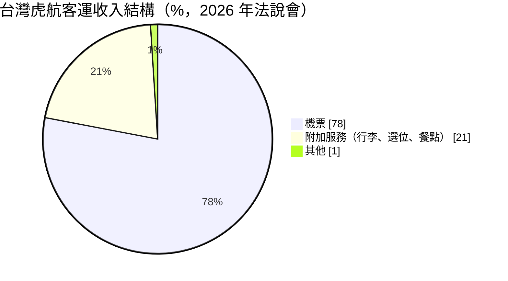
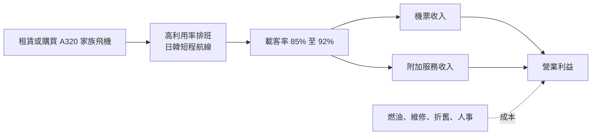
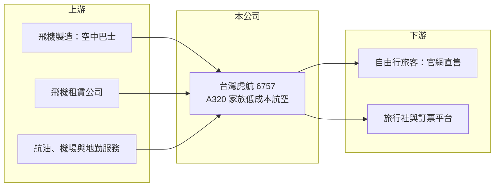

# 6757 台灣虎航

> 上市｜[[產業索引-航運業|航運業]]｜上市（櫃）日期 2024/11/29

# 第一章：企業模式與商業藍圖

> [!info] 撰寫說明
> 精簡版，由 Claude 依公開資料整理，架構比照 [[2330台積電]] 的四章研究，資料截至 2026-10-08。來源：富果研究 2026 年 6 月法說會整理、自由時報 2025 年 3 月年報報導、證交所開放資料（基本資料、2026 年第二季資產負債與綜合損益、營益分析、股利、每月營收）；Goodinfo 頁面查詢時暫停服務，2023 年及更早的年度數據未查得。與華航的股權關係依記憶整理，標示待校對。#待校對

台灣虎航是台灣唯一上市的[[低成本航空]]公司，本章說明它以單一機型、高利用率與附加服務收入為核心的商業模式，以及它為何高度集中在日本航線。

## 一、核心定位：以日韓短程航線為主的低成本航空

台灣虎航成立於 2014 年，2023 年 8 月上市，董事長為黃世惠、總經理為邱彰信，實收資本額約 46 億元（證交所開放資料），由 [[2610華航]] 集團持股（待校對）。低成本航空的核心邏輯是用最簡單的產品把每座位公里的成本壓到最低：只用單一機型以降低維修與訓練成本、提高每架飛機每天的飛行時數、機票只含基本運送，行李、選位與餐點另外收費。

* **航網：** 共 29 個航點、45 條航線，其中 19 條為獨飛航線，日本與韓國航線約占客運收入 95%，日本單一市場就占 83.7%（富果研究，2026 年 6 月法說會）。
* **收入結構：** 客運收入中，機票約占 78%、[[附加服務收入]]約占 21%（富果研究）。附加服務的毛利率通常高於機票，是低成本航空獲利的關鍵。

## 二、機隊與營運據點

機隊全數為空中巴士 A320 家族，預計 2026 年底達 20 架，並以省油的 A320neo 汰換舊型 A320ceo；2028 年起引進 A321neo、全面退役 A320ceo，至 2036 年機隊最多可達 34 架（若不執行購機選擇權則為 22 架）（富果研究）。2025 年 12 月公司宣布增租購 15 架 A321neo、總值近 400 億元（優分析報導標題）。主要基地為桃園，並擴大高雄與台南出發的日本航線。

## 三、資本轉化邏輯：座位利用率決定獲利

航空業的固定成本很高，飛機起飛後多賣一個座位的邊際成本極低，因此[[載客率]]是獲利的核心指標。2025 年全年載客率 86.59%，2026 年第一季升到 92.2%（富果研究）。成本結構中，燃油約占 22% 至 25%、維修約 18%、折舊約 13% 至 16%，燃油價格與匯率是最大的外部變數。

## 四、企業長期藍圖

公司把策略分成三階段：2024 至 2026 年以機隊汰舊換新為主，停飛虧損的澳門航線、把運能集中到日韓；2027 至 2029 年發展轉機航線，接駁東南亞旅客經台灣轉往日韓，可能與其他低成本航空合作；2030 年後以新一代機型飛往印尼等較遠的東南亞航點，並評估經日本銜接跨太平洋航線的合作（富果研究）。

# 第二章：護城河深度與競爭優勢

低成本航空的競爭本質是成本競爭，本章分析台灣虎航的成本優勢、市場地位與對手。

## 一、護城河的核心組成要素

* **單一機型的成本優勢：** 全機隊使用 A320 家族，飛行員、空服與維修人員可以互通，零件庫存與訓練成本也較低，這是低成本航空能把票價壓低的基礎。
* **桃園與南部機場的時刻與航權：** 機場起降時刻與日本二線城市的航權有限，先取得熱門時段與獨飛航線的業者具有先占優勢。台灣虎航 45 條航線中有 19 條為獨飛。
* **母集團資源：** 依股權關係（待校對），台灣虎航可在維修、地勤與採購上取得集團支援，降低獨立營運的成本。

## 二、主要競爭對手

| 對手 | 定位 | 與台灣虎航的比較 |
|---|---|---|
| [[2618長榮航]]、[[2610華航]] | 全服務航空 | 日本航線票價較高，但服務完整，搶商務與高端旅客 |
| 星宇航空 | 新興全服務航空 | 積極擴張日本航線，搶同一批旅客 |
| 樂桃、捷星、酷航、日本與韓國低成本航空 | 外籍低成本航空 | 在台日、台韓航線直接價格競爭 |

## 三、守得住與守不住

* **守得住：** 台灣出發日本二線城市的獨飛航線與高載客率。台灣赴日旅遊需求長期穩定，加上日圓偏弱，台灣虎航在這個市場有明確定位。
* **守不住：** 熱門航線的票價。東京、大阪等主要航線有多家航空競爭，運能增加時票價會被壓低；2025 年營收年增僅 2.9%、稅後淨利由 27.72 億元降到 24.67 億元，反映單位收益的壓力。
* **觀察重點：** 新機交付後的單位成本能否下降、附加服務收入占比能否提升，以及轉機與東南亞航線能否降低對日本市場的依賴。

# 第三章：財務體質與盈利規模

資料日期：2026-10-08，表格是撰寫當時的快照；最新月營收、毛利率、累計 EPS 由自動排程寫在本筆記的屬性欄位（月營收、毛利率、累計EPS 等）。#待校對

本章用可查得的年度數據檢視台灣虎航的成長與資本報酬。公司 2014 年成立、疫情期間嚴重虧損，2023 年才隨國境開放轉為大幅獲利，因此可比較的年度有限。

## 一、多年度三率與 ROE

| 年度 | 營收（新台幣） | [[毛利率]] | [[營業利益率]] | EPS（元） | [[ROE]] |
|---|---|---|---|---|---|
| 2021 | 未查得 | 未查得 | 未查得 | 未查得 | 未查得 |
| 2022 | 未查得 | 未查得 | 未查得 | 未查得 | 未查得 |
| 2023 | 約 124.7 億（推算） | 未查得 | 未查得 | 未查得 | 未查得 |
| 2024 | 164.23 億 | 未查得 | 未查得 | 6.16 | 未查得 |
| 2025 | 168.99 億 | 未查得 | 未查得 | 5.37 | 約三成（推算） |
| 2026 上半年 | 103.2 億 | 29.31% | 20.51% | 3.65 | 未查得 |

註：2024 年取自自由時報（稅後淨利 27.72 億元，營收年增 31.7%）；2023 年營收依年增率回推；2025 年取自富果研究（稅後淨利 24.67 億元）；2026 上半年取自證交所營益分析。2025 年 ROE 以稅後淨利除以 2026 年第二季底權益約 78.9 億元粗估。

* **營收成長：** 2026 年 1 至 8 月累計營收約 138.8 億元、年增約 22.7%（證交所每月營收），反映新機加入與高載客率。
* **獲利能力：** 2026 年上半年毛利率 29.31%、營業利益率 20.51%、稅後純益率 16.25%，在航空業中屬於很高的水準，主要來自高載客率與第一季燃油價格回落。
* **股利：** 2024 年度配發 6.05 元（現金股利 4.89 元加資本公積 1.16 元），2025 年度董事會決議現金股利約 2.42 元，以 EPS 5.37 元計算配發率約 45%（推算），配息比率下降可能與購機資本支出增加有關（推估）。

## 二、資產負債與現金流

2026 年第二季底總資產約 286.9 億元、總負債約 208.1 億元、權益約 78.9 億元（證交所資產負債）。負債中包含飛機的[[租賃負債]]、旅客預收票款與維修準備，屬於航空業常見的高負債結構。2025 年底宣布的 15 架 A321neo 計畫總值近 400 億元，未來數年的資本支出與租賃負債將明顯增加，自由現金流可能轉弱（推估）。

## 三、[[ROIC]] 與 [[WACC]]

**ROIC 推算：** 以 2025 年稅後淨利 24.67 億元近似稅後營業利益（航空業的租賃利息會使兩者有差距，此為粗估）。投入資本以權益約 75 億元加上租賃負債與借款約 80 億至 100 億元（推估）計算，約 155 億至 175 億元，ROIC 約 14% 至 16%（推算）。

**WACC 推算：** 公債殖利率 1.75%、市場風險溢酬 6%、β 取航空股常見值 1.1，權益成本約 8.35%；租賃與負債成本假設 4%、稅後 3.2%，以權益約 45%、負債約 55% 加權，WACC 約 5.5% 至 6%（推算）。

**結論：** 在國境開放後的高需求期，台灣虎航的 ROIC 明顯高於 WACC，處於創造價值的階段。但航空業的資本報酬波動極大，疫情期間曾連續虧損，長期平均報酬會遠低於高峰年度；評估時應把燃油、匯率與需求衝擊納入考量。

# 第四章：總體風險與地緣政治

航空業是外部衝擊最多的產業之一，本章整理台灣虎航長期必須面對的風險。

## 一、需求與市場集中

* **日本市場集中：** 日本航線占客運收入八成以上，日圓匯率、日本觀光政策、地震等天災，或台日關係的任何變化，都會直接衝擊營收。
* **公共衛生與突發事件：** 疫情期間國境封鎖使航空業營收歸零，這類尾端風險雖然罕見，但對高負債的航空公司打擊最大。

## 二、成本與營運

* **燃油價格：** 燃油占成本兩成以上，2026 年第二季因地緣衝突油價大漲，公司已表示燃油成本明顯上升（富果研究）。
* **匯率：** 飛機租金、燃油與維修多以美元計價，收入則以新台幣與日圓為主，新台幣或日圓貶值都可能壓縮利潤。
* **機隊交付與引擎問題：** 空中巴士交機延誤或新型引擎的檢修問題，可能使運能擴張不如預期，公司已備有 7 具備用引擎以降低影響。

## 三、其他風險

* **價格競爭：** 國籍與外籍航空持續增加日本航線運能，可能引發票價戰。
* **地緣政治：** 台海情勢緊張可能影響國際旅客意願與航線安排。
* **環保法規：** 國際間推動[[永續航空燃油]]與碳排放規範，長期可能增加燃油成本。

# 專有名詞解析

## 金融

- **[[租賃負債]]**：企業以租賃方式取得資產（如飛機、店面）時，依會計準則認列的未來租金現值負債。
- **[[ROIC]]**：投入資本報酬率，衡量企業用股東與債權人投入的資本，每年能產生多少稅後營業利益。
- **[[WACC]]**：加權平均資金成本，股東要求報酬與負債利息依資本結構加權後的平均值，是判斷是否創造價值的門檻。

## 產業

- **[[低成本航空]]**：以單一機型、高飛機利用率與精簡服務壓低成本的航空公司，機票只含基本運送，其他服務另外收費。
- **[[載客率]]**：實際售出座位占可售座位的比例，航空業固定成本高，載客率是獲利的核心指標。
- **[[附加服務收入]]**：機票以外的收入，例如托運行李、選位、機上餐點與保險，低成本航空的重要利潤來源。
- **[[永續航空燃油]]**：以廢棄油脂、生質原料或合成方式製造的航空燃油，可降低碳排放，但價格高於傳統燃油。

# 核心供應鏈

- 上游：空中巴士（飛機製造）、飛機租賃公司、航油供應商（如 [[6505台塑化]] 等，非指名）、機場與地勤服務。
- 下游／客戶：以官網直售的自由行旅客為主，另透過旅行社如 [[2731雄獅]]、[[2734易飛網]] 銷售。
- 同業：[[2610華航]]、[[2618長榮航]]、星宇航空，以及樂桃、捷星、酷航等外籍低成本航空。

## 最新新聞
<!-- news:start（自動產生，請勿手動編輯此範圍） -->
- 2026-10-08 📰 媒體 17:24｜營收速報 - 台灣虎航(6757)9月營收17.39億元年增率高達36.15％｜[鉅亨網](https://news.cnyes.com/news/id/6625037)

完整紀錄：[[6757台灣虎航 新聞]]
<!-- news:end -->

## 相關連結
- [公開資訊觀測站](https://mopsov.twse.com.tw/mops/web/t05st03?step=1&firstin=1&co_id=6757)
- [Goodinfo](https://goodinfo.tw/tw/StockDetail.asp?STOCK_ID=6757)
- [Yahoo 股市](https://tw.stock.yahoo.com/quote/6757)
- [鉅亨網新聞](https://www.cnyes.com/twstock/6757/news)
