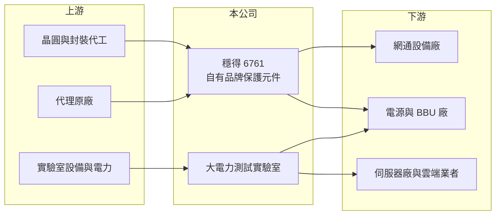

# 6761 穩得

> 上櫃｜[[產業索引-電子零組件業|電子零組件業]]｜上市（櫃）日期 2021/11/08

# 第一章：企業模式與商業藍圖

> [!info] 撰寫說明
> 精簡版，由 Claude 依公開資料整理，架構比照 [[2330台積電]] 的四章研究，資料截至 2026-10-08。來源：Goodinfo 經營績效頁、方格子（vocus）2026 年 4 月法說會整理、櫃買中心開放資料快照（基本資料、每月營收、2026 年第二季損益與資產負債）。法說整理為第三方 AI 摘要，部分數字（如 2025 年毛利率）與 Goodinfo 不一致，以 Goodinfo 為準；產品細項需回到公司原始簡報核對。#待校對

穩得實業原本是電子零件代理商，近年轉型為以自有品牌[[保護元件]]與電源元件為主、並經營大電力測試實驗室的公司。本章說明它的業務組成與轉型方向。

- **核心業務：** 穩得成立於 1979 年，2021 年上櫃，總部位於新北新店。依法說整理，公司自行設計[[突波保護]]、濾波與整流等元件，封裝委外生產，以自有品牌銷售，產品用於網通設備、電源與伺服器。2025 年底自有品牌的營收已超過代理業務，公司預估 2026 年自有品牌占比接近九成。從代理轉為自有品牌，意味著公司從賺取價差變成掌握產品設計與定價。
- **營收結構：** 依法說整理，自有品牌約占九成，其餘為代理；測試實驗室服務在 2026 年第一季約占營收 10%，公司目標在 2026 年底提高到 15% 至 20%。實驗室營收毛利率較高，是公司提升整體獲利結構的主要工具。
- **營運據點：** 土城的大電力實驗室（Mega-Lab）具備 1.2MW 高功率測試能力，2026 年 4 月取得 TAF 認證；龜山另設電池實驗室，專注儲能與車用電池測試。公司規劃第二座實驗室，資本支出重心放在實驗室，而不是零件製造。
- **長期方向：** AI 伺服器的耗電與電壓不斷提高，電源、[[BBU]] 與液冷系統都需要在出貨前做大電力、安規與電磁相容測試。穩得的策略是「元件加測試」一站式服務：同時賣保護元件，又替客戶做驗證，並與雲端業者洽談長期產能合約。公司另布局 AI 伺服器液冷系統的漏液偵測。

# 第二章：護城河深度與競爭優勢

穩得的競爭力來自兩個方向：保護元件的設計能力，以及大電力測試實驗室的稀缺性。本章分析這兩者的強弱。

- **競爭優勢：** 保護元件一旦被設計進電源或網通產品，在產品生命週期內很少更換，具有[[設計導入]]黏著度。大電力測試實驗室需要大量電力、場地與認證，建置時間長，依法說整理土城實驗室的測試電壓最高可達 1500V 直流、承重 6 噸，在台灣屬於少數。實驗室與元件銷售互相帶動，客戶送測時也更容易採用公司的元件。
- **主要對手：** 保護元件方面，國際大廠 Littelfuse、Bourns，以及台灣的 [[2428興勤]]、[[6224聚鼎]] 都是競爭者。測試服務方面，主要對手是國際驗證機構如 UL、SGS、TÜV 等，以及台灣的電子產品實驗室（具體公司未查得）。
- **觀察重點：** 第一，實驗室營收占比能否如期提高到兩成。第二，自有品牌毛利率能否站穩 38% 以上，公司目標是 2027 年挑戰 40%。第三，與雲端業者的長期產能合約是否實際簽訂。

# 第三章：財務體質與盈利規模

資料日期：2026-10-08，表格是撰寫當時的快照；最新月營收、毛利率、累計 EPS 由自動排程寫在本筆記的屬性欄位（月營收、毛利率、累計EPS 等）。#待校對

穩得的財務顯示轉型成效：營收成長不快，但毛利率逐年提高，ROE 長期維持在一成五上下。

| 年度 | 營收（億元） | [[毛利率]] | [[營業利益率]] | EPS（元） | [[ROE]] |
|---|---|---|---|---|---|
| 2021 | 18.9 | 30.9% | 12.9% | 8.54 | 24.6% |
| 2022 | 19.2 | 30.3% | 12.1% | 8.09 | 19.9% |
| 2023 | 17.4 | 28.9% | 8.49% | 4.04 | 10.1% |
| 2024 | 20.2 | 32.1% | 12.0% | 7.25 | 17.7% |
| 2025 | 19.7 | 36.4% | 15.5% | 7.34 | 15.4% |
| 2026 上半年 | 9.81 | 38.2% | 15.5% | 3.62 | 未查得 |

- **營收規模：** 2020 年營收 14.6 億元，2025 年 19.7 億元，五年年複合成長率約 6%（推算）。代理業務縮小、自有品牌與實驗室擴大，使營收總額成長有限，但組合明顯改善。
- **獲利：** 毛利率從 2023 年的 28.9% 升到 2026 年上半年 38.2%，營業利益率同步升到 15% 以上，反映自有品牌與測試服務比重提高。2021 至 2025 年平均 ROE 約 17.5%（推算），在中小型零組件公司中屬於穩定偏高。依法說整理，公司股利發放率目標為 70% 至 80%。
- **財務特色：** 2026 年第二季末總資產 31.3 億元、權益 17.1 億元、負債 14.2 億元，其中流動負債 12.3 億元。實收資本額約 3.50 億元，股本小、每股獲利高。

**[[ROIC]] 與 [[WACC]]：** 有息負債明細未查得，假設約 4 億元（推估）。2025 年營業利益約 3.05 億元（19.7 億 × 15.5%），稅後約 2.44 億元，投入資本約 21 億元（權益 17.1 億 + 有息負債 4 億），ROIC 約 11.6%（推算）。WACC 用 [[CAPM]] 推估：無風險利率 1.75%、市場風險溢酬 6%、β 取 1.0（電子零組件股常見值，假設），股東權益成本約 7.8%；負債成本 2.5%、稅率 20%，以權益 80%、負債 20% 加權，WACC 約 6.6%（推算）。結論是：穩得的 ROIC 長期高於 WACC，持續創造價值；實驗室屬於資本密集型投資，擴建後能否維持高報酬，是未來利差的關鍵。

# 第四章：總體風險與地緣政治

穩得的風險集中在轉型執行、實驗室投資回收與下游景氣。

- **產業週期：** 保護元件需求跟網通、電源與伺服器的出貨週期相關，下游去庫存時訂單會明顯減少，2023 年獲利下滑即為一例。實驗室業務則跟客戶的新產品開發節奏相關，AI 伺服器規格換代若放緩，送測需求也會下降。
- **營運風險：** 實驗室建置需要大量電力與資本支出，若客戶送測量不如預期，折舊會壓縮獲利。自有品牌元件委外封裝，產能與品質受外包廠影響。從代理轉為自有品牌的過程中，與原代理原廠的關係變化也可能影響營收。
- **其他風險：** 台灣電力供應的穩定度與電價，直接影響大電力實驗室的營運成本。外銷比重與匯率、國際驗證標準的變動，也會影響公司的接單與成本。

# 專有名詞解析

## 應用

- **[[BBU]]**：電池備援單元，資料中心在市電中斷時提供短時間電力的電池模組，AI 伺服器機櫃的標準配備之一。

## 金融

- **[[ROIC]]**：投入資本報酬率，稅後營業利益除以股東權益加有息負債，衡量本業運用資本的效率。
- **[[WACC]]**：加權平均資金成本，依股東權益與負債的比重，加權計算公司取得資金的平均成本。

## 產業

- **[[保護元件]]**：防止靜電、突波或過電流損壞電路的元件，例如 ESD 抑制器、壓敏電阻與保險絲。
- **[[突波保護]]**：在電壓瞬間異常升高時保護設備的電路或裝置，常見於延長線與電源處理器。
- **[[設計導入]]**：零組件在客戶新產品設計階段就被選用，一旦導入通常在整個產品生命週期內持續供貨。

# 核心供應鏈

- 上游：晶片與封裝代工廠、代理產品原廠、實驗室測試設備與電力。
- 下游／客戶：網通設備廠、電源與 BBU 廠、伺服器廠與雲端業者（具名客戶未查得）。
- 同業：[[2428興勤]]、[[6224聚鼎]]、Littelfuse、Bourns；測試服務對手為 UL、SGS 等國際驗證機構。

## 最新新聞
<!-- news:start -->
<!-- news:end -->

## 相關連結
- [公開資訊觀測站](https://mopsov.twse.com.tw/mops/web/t05st03?step=1&firstin=1&co_id=6761)
- [Goodinfo](https://goodinfo.tw/tw/StockDetail.asp?STOCK_ID=6761)
- [Yahoo 股市](https://tw.stock.yahoo.com/quote/6761)
- [鉅亨網新聞](https://www.cnyes.com/twstock/6761/news)
