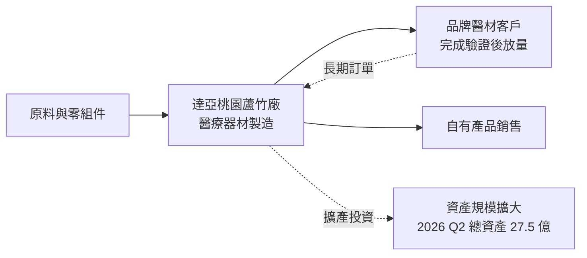
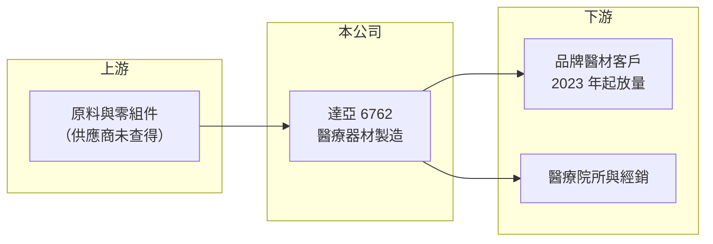

# 6762 達亞

> 上櫃｜[[產業索引-生技醫療業|生技醫療業]]｜上市（櫃）日期 2020/12/18

# 第一章：企業模式與商業藍圖

> [!info] 撰寫說明
> 本文由 Claude 依公開資料整理，架構比照 [[2330台積電]] 的四章研究，資料截至 2026-10-08。財務數字來源：櫃買中心開放資料快照（基本資料、2026 年第二季綜合損益與資產負債、每月營收、本益比殖利率）、Goodinfo 經營績效頁、nStock 公司簡介；業務描述另參考新聞標題（自由時報 2020 年上櫃報導、2023 年 8 月客戶認證報導）。公開資料有限，產品品項、客戶與營收結構未查得，部分描述為推估，產業描述為整理性內容，尚未逐條比對原始文件。#待校對

在評估單一個股的長期投資價值時，首要步驟是拆解企業的底層獲利邏輯。本章針對達亞（股票代號：6762）的商業模式進行定性分析。由於這次查到的公開資料很少，本章著重說明可以確認的事實，以及從財務數字能推論出的商業模式變化。

## 一、核心定位：醫療器材製造商

達亞於 2004 年 11 月設立，總部與工廠位於桃園蘆竹，2020 年 12 月 18 日在櫃買中心掛牌（櫃買中心基本資料）。依 nStock 整理的公司營業項目，達亞主要從事「醫療器材之製造與銷售」。2020 年上櫃時，自由時報以「黑手也能打世界盃」為標題報導，顯示公司出身於製造與加工技術，並以國際市場為目標（具體產品未查得）。

醫療器材製造的商業特性是：產品必須通過嚴格的品質系統與法規認證，客戶一旦完成驗證就很少更換供應商，但在驗證完成前，新客戶的營收貢獻往往要等上一到兩年。這個特性可以幫助理解達亞近年的財務變化。

## 二、營收結構與商業模式的轉變

達亞沒有在這次查到的資料中揭露產品別營收比重，因此本文不畫營收結構圖。不過從 Goodinfo 的歷年數字，可以看到明顯的模式轉變：

* **2020 年至 2022 年：高毛利期。** 毛利率介於 48% 至 59%，2020 年 EPS 高達 10.67 元。2021 年 12 月的新聞提到台灣醫材廠因應變種病毒需求而受惠，推估當時部分產品與防疫需求相關（推估，未確認達亞的具體角色）。
* **2023 年起：放量但低毛利期。** 2023 年 8 月新聞標題指出兩家醫材客戶完成認證並開始放量；之後營收從 2023 年的 5.08 億元增加到 2025 年的 6.94 億元，但毛利率降到 24% 至 28%。營收增加而毛利率下降，通常代表產品組合轉向量大、單價較低的代工訂單（推估）。

## 三、資本轉化邏輯

依 2026 年第二季資產負債快照，達亞資產總計 27.49 億元，遠大於 2025 年全年 6.94 億元的營收；負債 14.45 億元，其中流動負債 9.59 億元。資產規模相對營收偏大，推估公司近年投入大量資本在廠房或轉投資（推估，具體項目未查得）。這類投資的效益要靠新客戶放量與產能利用率提高才能顯現，在此之前會拉低資本報酬率。

## 四、企業長期藍圖

這次查到的資料沒有公司對長期策略的說明。從財務數字判斷，達亞的長期方向是擴大醫材客戶的認證與量產，以規模換取成長（推估）。2026 年 8 月單月營收年增 35%（櫃買中心每月營收），顯示營收仍在成長，但能否同時拉回毛利率，才是評估這個策略是否成功的關鍵。

# 第二章：護城河深度與競爭優勢

在長期價值投資中，「護城河」指企業抵禦競爭、維持超額利潤的保護機制。本章依有限資料，說明醫材製造業的護城河來源與達亞面對的競爭。

## 一、醫材製造商的護城河要素

* **1. 客戶驗證帶來的轉換成本：** 醫材客戶更換製造商，需要重新做製程確效、法規變更與品質稽核，往往耗時一年以上。2023 年完成驗證的兩家客戶，只要品質穩定，通常會長期合作，這是達亞最主要的護城河。
* **2. 品質系統與法規認證：** 醫療器材工廠須符合 ISO 13485 與各國主管機關的稽核要求，新進者需要時間與資金建立，這是產業共通的門檻。
* **3. 製造技術：** 上櫃時以「黑手」形容的製造背景，代表公司的核心能力在製程與加工（推估），這類能力需要長時間累積。

## 二、主要競爭對手格局

達亞的具體產品未查得，因此無法列出直接對手。以台灣醫材製造同業來看，可參考以下公司：

| 同業 | 定位 | 說明 |
|---|---|---|
| [[4107邦特]] | 醫療耗材與導管製造 | 同為醫材製造、外銷為主 |
| [[4129聯合]] | 骨科植入物 | 精密加工型醫材 |
| [[4104佳醫]] | 醫材代理與製造 | 醫療通路與醫材製造兼具 |
| 中國與東南亞醫材代工廠 | 低成本製造 | 在代工價格上形成壓力 |

## 三、優勢轉化：哪些守得住、哪些守不住

* **守得住：** 已完成驗證的客戶訂單，以及需要嚴格品質系統的產品。這類訂單轉換成本高，只要不出品質問題，能提供穩定的營收基礎。
* **守不住：** 2020 年至 2022 年那種高毛利水準。從毛利率由 59% 降到 24% 至 28% 來看，達亞目前的業務定價能力明顯低於過去，在代工價格上面臨競爭壓力。
* **觀察重點：** 毛利率能否回到 30% 以上、資產周轉率能否提升，以及公司是否揭露更清楚的產品與客戶結構。

# 第三章：財務體質與盈利規模

資料日期：2026-10-08。數字取自 Goodinfo 經營績效頁與櫃買中心開放資料快照，表格是撰寫當時的快照；最新月營收、毛利率、累計 EPS 由自動排程寫在本筆記的屬性欄位（月營收、毛利率、累計EPS 等）。#待校對

財務報表是檢驗護城河是否真實存在的最終標準。本章用多年度的三率、[[ROE]] 與資本報酬，檢視達亞的獲利品質變化。

## 一、獲利能力的基石：三率

| 年度 | 營收（新台幣） | [[毛利率]] | [[營業利益率]] | EPS（元） | [[ROE]] |
|---|---|---|---|---|---|
| 2020 | 5.54 億 | 59.2% | 47.6% | 10.67 | 27.3% |
| 2021 | 5.31 億 | 48.4% | 34.0% | 6.04 | 12.0% |
| 2022 | 4.63 億 | 50.5% | 28.7% | 6.62 | 15.3% |
| 2023 | 5.08 億 | 41.1% | 21.8% | 3.31 | 7.1% |
| 2024 | 5.81 億 | 24.1% | 6.42% | 1.87 | 4.53% |
| 2025 | 6.94 億 | 27.7% | 7.8% | 0.67 | 1.8% |
| 2026 上半年 | 3.43 億 | 22.2% | 5.37% | 0.21 | 未查得 |

資料來源：2020 至 2025 年為 Goodinfo 經營績效頁（合併報表）；2026 上半年依櫃買中心綜合損益快照計算（營收 3.43 億元、營業毛利 0.76 億元、營業利益 0.18 億元、業外損失 0.10 億元）。

* **營收成長、獲利下滑：** 2020 年至 2025 年營收年複合成長率約 4.6%（推算），但 EPS 從 10.67 元降到 0.67 元，營業利益率從 47.6% 降到 7.8%。這是典型的「以量換價」，營收規模擴大的同時，單位獲利大幅縮小。
* **業外拖累：** 2026 年上半年營業利益 0.18 億元，但業外損失 0.10 億元，稅前淨利只剩 0.09 億元。業外損失可能與借款利息或轉投資損益有關（推估）。

## 二、[[ROE]]：資本效率

達亞 2021 年至 2025 年的 ROE 依序為 12.0%、15.3%、7.1%、4.53%、1.8%，五年平均約 8.1%（推算），但趨勢是逐年下滑。依 2026 年第二季資產負債快照，權益總計 13.03 億元、負債 14.45 億元，負債比率約 53%（推算），每股淨值 37.06 元。和 2020 年代初期相比，公司的資產與負債規模都明顯擴大，但獲利沒有同步成長，是 ROE 下降的主因。

## 三、配息與現金流

櫃買中心本益比殖利率資料顯示每股股利約 1.0 元，以 2025 年 EPS 0.67 元計算，配息率超過 100%（推算），代表股利部分來自過去累積的盈餘。[[自由現金流]]與資本支出的多年度數字未查得，但總資產擴大的幅度顯示近年資本支出偏高（推估）。

## 四、[[ROIC]] 與 [[WACC]]：價值創造利差

**ROIC 推算：** 2025 年營業利益約為 6.94 億元 × 7.8% ＝ 0.54 億元，稅後營業利益約 0.43 億元。有息負債金額未查得，因此用兩種口徑估算：若只把非流動負債 4.87 億元視為有息負債，投入資本為 13.03 ＋ 4.87 ＝ 17.90 億元，ROIC 約 2.4%；若把全部負債 14.45 億元都算入，投入資本 27.48 億元，ROIC 約 1.6%（皆為推算）。以 2026 年上半年營業利益 0.18 億元年化，ROIC 約 1.1% 至 1.6%（推算）。

**WACC 推算：** 台灣 10 年期公債殖利率取 1.75%，市場風險溢酬 6%，β 取醫材製造業常見的 0.9 至 1.1（未查得達亞本身的 β），股東權益成本約 7.2% 至 8.4%。負債成本假設 2.5%，稅後 2.0%。市值以股價淨值比 4.21 倍乘權益 13.03 億元，約 54.9 億元；負債以 4.87 億元至 14.45 億元計，負債比重約 8% 至 21%。WACC 約 6.0% 至 7.9%（推算）。

**解讀：** ROIC 約 1% 至 2.5%，明顯低於 WACC 約 6% 至 8%（推算），表示目前擴大的資本規模還沒有創造足夠的報酬。對照 2020 年至 2022 年 ROE 超過 12% 的時期，達亞正處於投資期或轉型期；未來能否回到創造價值的狀態，取決於新客戶放量後毛利率能否回升，以及龐大的資產能否被充分利用。

# 第四章：總體風險與地緣政治

任何企業都無法脫離宏觀環境獨立存在。本章分析達亞未來必須面對的產業、營運與財務風險。

## 一、產業週期與市場結構風險

* **防疫需求退潮的教訓：** 2020 年至 2022 年的高獲利，與之後的大幅下滑，顯示公司部分業務曾受短期需求影響（推估）。若營收來源仍集中在少數客戶或品類，類似的需求波動可能再次發生。
* **代工價格壓力：** 醫材代工的價格受客戶議價與海外低成本工廠競爭影響，毛利率長期承受壓力。

## 二、營運環境的隱性風險

* **客戶集中：** 2023 年的放量來自兩家醫材客戶，推估營收對少數客戶依賴度高（推估）。主要客戶的訂單調整、轉單或產品換代，會直接影響營收。
* **資本效率：** 資產規模遠大於營收，若產能利用率無法提升，折舊與利息會持續壓低獲利。
* **資訊揭露有限：** 這次查到的公開資料無法確認產品、客戶與資本支出用途，投資人評估時需要另外查閱年報與法說會資料。

## 三、其他風險

* **財務槓桿：** 負債比率約 53%（推算），且 2026 年上半年業外出現損失，若利率上升，利息負擔會加重。
* **匯率與法規：** 若主要客戶在海外，新台幣升值與各國醫材法規變動，都會影響訂單與利潤（推估）。

# 專有名詞解析

## 金融

- **[[ROIC]]**：投入資本報酬率，稅後營業利益除以股東權益加有息負債，衡量本業運用所有資金的效率。
- **[[WACC]]**：加權平均資金成本，股東與債權人要求報酬率依資本結構加權，是 ROIC 要超越的門檻。

## 產業

- **[[OEM]]**：原廠委託製造，由製造商依品牌客戶的設計與規格生產，產品以客戶品牌銷售。
- **[[醫材許可證]]**：醫療器材在各國銷售前必須取得的主管機關核准文件，取證需要檢測、臨床與品質系統資料。
- **[[ISO 13485]]**：醫療器材品質管理系統的國際標準，是醫材製造商接單與取證的基本要求。

# 核心供應鏈

## 1. 上游
- 原料與零組件供應商（未查得）

## 2. 本公司
- 達亞：桃園蘆竹的醫療器材製造與銷售

## 3. 下游
- 完成驗證的品牌醫材客戶（名稱未查得）
- 醫療院所與經銷通路（推估）

## 4. 同業
- 台灣醫材製造同業：[[4107邦特]]、[[4129聯合]]、[[4104佳醫]]

## 最新新聞
<!-- news:start -->
<!-- news:end -->

## 相關連結
- [公開資訊觀測站](https://mopsov.twse.com.tw/mops/web/t05st03?step=1&firstin=1&co_id=6762)
- [Goodinfo](https://goodinfo.tw/tw/StockDetail.asp?STOCK_ID=6762)
- [Yahoo 股市](https://tw.stock.yahoo.com/quote/6762)
- [鉅亨網新聞](https://www.cnyes.com/twstock/6762/news)
