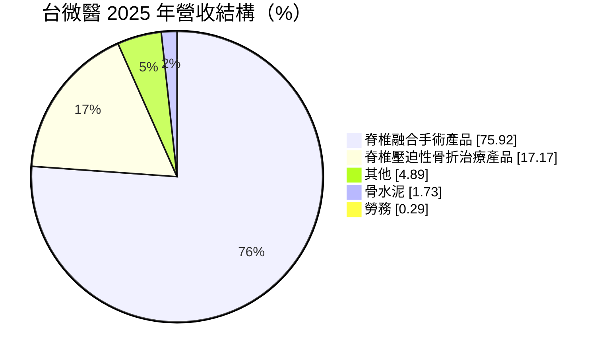
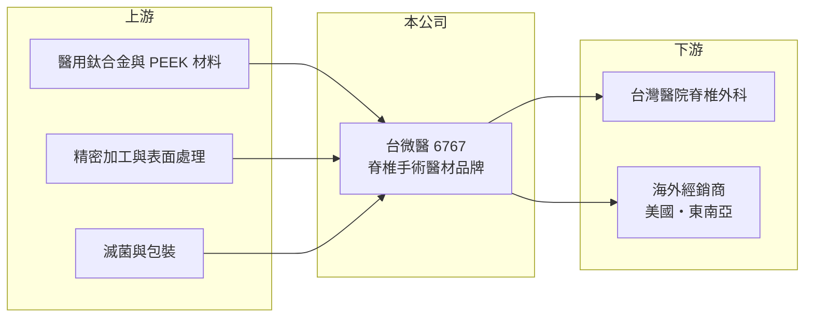

# 6767 台微醫

> 上櫃｜[[產業索引-生技醫療業|生技醫療業]]｜上市（櫃）日期 2021/01/25

# 第一章：企業模式與商業藍圖

> [!info] 撰寫說明
> 本文由 Claude 依公開資料整理，架構比照 [[2330台積電]] 的四章研究，資料截至 2026-10-08。財務數字來源：櫃買中心開放資料快照（基本資料、2026 年第二季綜合損益與資產負債、每月營收、本益比殖利率）、Goodinfo 經營績效頁與公告標題、MoneyDJ（富邦 e 點通）公司基本資料與 2025 年營收比重；產業描述為整理性內容，尚未逐條比對原始文件。#待校對

在評估單一個股的長期投資價值時，首要步驟是拆解企業的底層獲利邏輯。本章針對台灣微創醫療器材（股票代號：6767，以下簡稱台微醫）的商業模式進行定性分析，說明一家專做脊椎手術醫材的台灣公司，如何在由美國骨科巨頭主導的市場中，以高毛利的自有品牌產品立足。

## 一、核心定位：專注脊椎手術的自有品牌醫材公司

台微醫成立於 2009 年 12 月，位於新竹縣竹北的生醫園區，2021 年 1 月 25 日在櫃買中心掛牌（櫃買中心基本資料）。依 MoneyDJ 資料，公司的主要業務是脊椎相關醫療產品，包括[[脊椎融合]]手術產品、脊椎壓迫性骨折治療產品與骨水泥。

脊椎手術醫材屬於[[骨科植入物]]中技術門檻較高的一類，因為植入物要長期留在人體內、承受脊椎的負重，對材料、設計與臨床資料的要求都很嚴格。台微醫自行設計、取證並以自有品牌銷售，這帶來兩個商業意義：

* **高毛利：** 自有品牌醫材不賺代工費，而是賺產品本身的價值，台微醫的[[毛利率]]長期在 70% 以上。
* **高費用：** 自有品牌需要自己負擔研發、法規、臨床教育與業務推廣，營業費用占營收比重很高，因此毛利雖高，營業利益卻常在損益兩平附近。

## 二、產品板塊與營收結構

依 MoneyDJ 的 2025 年營收比重，脊椎融合手術產品是絕對主力：

* **脊椎融合手術產品：** 用於椎間盤退化、脊椎滑脫等需要把兩節脊椎固定融合的手術，包括椎弓螺釘、連桿與椎間融合器等植入物（品項為產業通用分類，台微醫的具體品項待校對）。高齡化讓退化性脊椎疾病的手術量長期增加。
* **脊椎壓迫性骨折治療產品：** 主要用於骨質疏鬆造成的椎體壓迫性骨折，以微創方式撐開塌陷的椎體並注入骨水泥固定。2026 年 7 月，公司的 Tripod-Fix 可擴張椎體強化系統取得新加坡衛生科學局上市許可（Goodinfo 公告標題）。
* **骨水泥：** 搭配椎體強化手術使用的耗材，比重小但能與植入物一起銷售。

## 三、資本轉化邏輯：輕資產、重研發與推廣

台微醫的資產規模不大，2026 年第二季資產總計 6.96 億元，負債僅 1.24 億元（櫃買中心快照）。這是典型的輕資產醫材品牌模式：資本支出不高，主要成本在人與法規。每一張新的國家許可證都是一次性的投入，取證後就能在該市場長期銷售，因此營收規模擴大後，營業利益率有機會明顯改善。

## 四、企業長期藍圖

* **擴大國際取證：** 2026 年取得新加坡許可，顯示公司持續把產品推向海外市場。脊椎醫材的國際市場以美國最大，亞洲則成長較快。
* **高齡化帶動的長期需求：** 骨質疏鬆性骨折與退化性脊椎疾病都隨人口老化而增加，台灣與亞洲多國正快速進入超高齡社會，這是台微醫最根本的長期動能。
* **經營層調整：** 2026 年 8 月公告董事長兼任技術長（Goodinfo 公告標題），代表公司在產品技術上的投入由最高層直接負責。

# 第二章：護城河深度與競爭優勢

在長期價值投資中，「護城河」指企業抵禦競爭、維持超額利潤的保護機制。本章分析台微醫的護城河構成，以及它與國際骨科大廠的競爭關係。

## 一、台微醫護城河的核心組成要素

台微醫的規模遠小於國際骨科大廠，護城河屬於「窄護城河」，主要由三個要素組成：

* **1. 產品許可證與臨床資料：** 脊椎植入物在各國都屬於高風險醫材，取證需要完整的測試與臨床證據。台微醫已在多國取得許可，這些法規資產是新進者需要多年才能累積的門檻。
* **2. 醫師使用習慣：** 脊椎外科醫師對植入系統與手術器械的操作非常熟悉，換用不同品牌需要重新學習與適應。一旦醫師接受台微醫的系統，通常會持續使用，形成穩定的手術回購。
* **3. 價格與服務優勢：** 在健保與醫院成本控管壓力下，本土品牌在價格、交期與臨床支援上比進口品牌更有彈性（推估）。

## 二、主要競爭對手格局

| 對手 | 定位 | 對台微醫的威脅 |
|---|---|---|
| 美敦力（Medtronic） | 全球脊椎植入物龍頭 | 產品線最完整，並結合導航與手術機器人系統 |
| 史賽克（Stryker）、Globus Medical | 美國骨科與脊椎大廠 | 以手術導航、機器人綁定植入物銷售 |
| 嬌生 DePuy Synthes | 骨科與脊椎產品線 | 全球通路與醫師教育資源強大 |
| [[4129聯合]] | 台灣骨科植入物廠 | 以人工關節為主，在台灣骨科通路上競爭 |
| [[6612奈米醫材]] | 台灣骨科與骨填補材料 | 在骨填補與椎體相關產品上有部分重疊（待校對） |

## 三、優勢轉化：哪些市場守得住、哪些守不住

* **守得住：** 台灣與亞洲的中階脊椎融合與椎體強化手術市場。這些市場重視性價比與在地服務，本土品牌有機會取得穩定份額。
* **守不住：** 高階的機器人輔助脊椎手術市場。國際大廠把植入物、導航與機器人整合成一套系統，醫院採購主機後，植入物也會跟著綁定。
* **觀察重點：** 第一，營收能否突破 4 億元以上，讓營業利益率穩定轉正；第二，海外營收比重能否提高；第三，椎體強化產品在新市場的取證與銷售進度。

# 第三章：財務體質與盈利規模

資料日期：2026-10-08。數字取自 Goodinfo 經營績效頁、MoneyDJ 與櫃買中心開放資料快照，表格是撰寫當時的快照；最新月營收、毛利率、累計 EPS 由自動排程寫在本筆記的屬性欄位（月營收、毛利率、累計EPS 等）。#待校對

財務報表是檢驗護城河是否真實存在的最終標準。本章用多年度的三率、[[ROE]] 與資本報酬，檢視台微醫從虧損走向損益兩平的過程。

## 一、獲利能力的基石：三率

| 年度 | 營收（新台幣） | [[毛利率]] | [[營業利益率]] | EPS（元） | [[ROE]] |
|---|---|---|---|---|---|
| 2020 | 1.02 億 | 64.5% | -44.8% | -0.51 | -3.78% |
| 2021 | 1.44 億 | 70.9% | -24.2% | -1.64 | -12.9% |
| 2022 | 2.07 億 | 75.7% | -4.73% | -0.58 | -4.5% |
| 2023 | 2.83 億 | 78.8% | -6.51% | 0.05 | 0.4% |
| 2024 | 3.35 億 | 78.8% | -14.4% | -1.62 | -10.2% |
| 2025 | 3.12 億 | 78.0% | -9.11% | -0.49 | -3.28% |
| 2026 上半年 | 1.67 億 | 77.5% | 1.42% | -0.02 | 未查得 |

資料來源：2020 至 2025 年為 Goodinfo 經營績效頁（合併報表）；2026 上半年依櫃買中心綜合損益快照計算（營收 1.67 億元、營業毛利 1.29 億元、營業費用 1.27 億元）。

* **毛利率持續提升：** 毛利率從 2020 年的 64.5% 提升到 2023 年後的 78% 左右，代表產品組合與生產效率都在改善，自有品牌的定價能力穩定。
* **規模仍不足以覆蓋費用：** 營收從 2020 年的 1.02 億元成長到 2025 年的 3.12 億元，年複合成長率約 25%（推算），但營業利益率多數年度為負。2024 年營收創高、虧損卻擴大，顯示費用增加的速度一度超過營收。
* **2026 年上半年接近損益兩平：** 營業利益率轉為 1.42%，但業外損失使稅前仍小幅虧損。營收若能穩定在每年 3.5 億元以上，有機會轉為穩定獲利（推估）。

## 二、[[ROE]]：資本效率

台微醫 2021 年至 2025 年的 ROE 只有 2023 年小幅為正，五年平均約 -6.1%（推算）。依 2026 年第二季資產負債快照，股東權益 5.72 億元，負債 1.24 億元，負債比例 17.83%（MoneyDJ），累積虧損 1.45 億元，每股淨值 14.60 元。財務結構保守，沒有沉重的借款壓力，但累積虧損也代表短期內不會配發股利。

## 三、研發與現金流

研發費用的單獨金額與研發費用率未查得。以營業費用占營收約 76%（2026 年上半年，推算）來看，研發、法規與業務推廣是公司最主要的支出。[[自由現金流]]的多年度數字未查得；以流動資產 4.79 億元相對於每年小額營業虧損，現有資金可支應營運（推估）。

## 四、[[ROIC]] 與 [[WACC]]：價值創造利差

**ROIC 推算：** 2025 年營業利益約為 3.12 億元 × -9.11% ＝ -0.28 億元，虧損期不計所得稅。投入資本以 2026 年第二季股東權益 5.72 億元加上非流動負債 0.78 億元（有息負債未查得，以此近似），約 6.50 億元，2025 年 ROIC 約 -4.4%（推算）。2026 年上半年營業利益 0.024 億元年化後，稅後約 0.04 億元，ROIC 約 0.6%（推算）。

**WACC 推算：** 台灣 10 年期公債殖利率取 1.75%，市場風險溢酬 6%，β 取醫材股常見的 1.0 至 1.2（未查得台微醫本身的 β），股東權益成本約 7.8% 至 9.0%。負債比重很低，WACC 約 7.3% 至 8.5%（推算）。

**解讀：** 台微醫的 ROIC 從負值回到接近零，仍明顯低於 WACC，表示公司尚未創造經濟價值。不過它的毛利率高、資本需求低，一旦營收規模越過損益兩平點，增加的營收大部分會轉為營業利益，ROIC 改善的速度可能很快。這是輕資產醫材品牌的特性，也是投資人觀察的重點。

# 第四章：總體風險與地緣政治

任何企業都無法脫離宏觀環境獨立存在。本章分析台微醫未來必須面對的法規、市場與營運風險。

## 一、法規與地緣政治風險

* **國際取證成本：** 美國 FDA 與歐盟 [[CE MDR]] 對植入物的臨床證據要求越來越高，取證時間與費用增加。中小型醫材公司每推一個新產品到新市場，都要承擔可觀的固定成本。
* **健保支付壓力：** 台灣脊椎植入物多數有健保給付或差額負擔規定，健保核價與醫院招標會壓低售價。
* **匯率與海外市場：** 海外營收增加後，匯率與當地法規變動對獲利的影響會擴大。

## 二、產業與市場結構風險

* **國際大廠的系統綁定：** 手術導航與機器人越來越普及，若醫院採購國際大廠的系統，植入物也容易一起綁定，獨立品牌的空間會被壓縮。
* **價格競爭：** 中國與韓國脊椎植入物廠也在亞洲市場以低價競爭（推估），可能影響台微醫在新興市場的定價。

## 三、營運環境的隱性風險

* **費用控制：** 2024 年營收成長但虧損擴大的經驗顯示，費用投入與營收成長的節奏若不一致，會延後獲利時點。
* **產品責任：** 植入物一旦發生瑕疵或召回，可能面臨法律責任與品牌損失。
* **人才：** 醫材研發、法規與臨床推廣人才有限，人才流動會影響新產品與新市場進度。

# 專有名詞解析

## 金融

- **[[毛利率]]**：營業毛利除以營業收入，反映產品扣除直接成本後的獲利空間。
- **[[ROIC]]**：投入資本報酬率，稅後營業利益除以股東權益加有息負債，衡量本業運用所有資金的效率。
- **[[WACC]]**：加權平均資金成本，股東與債權人要求報酬率依資本結構加權，是 ROIC 要超越的門檻。

## 產業

- **[[脊椎融合]]**：以植入物把兩節以上脊椎固定，讓骨頭長在一起，用於治療椎間盤退化、脊椎滑脫等疾病的手術。
- **[[骨科植入物]]**：植入人體內、用於固定或取代骨骼與關節的醫材，例如人工關節、骨板、骨釘與脊椎植入物。
- **[[CE MDR]]**：歐盟醫療器材法規，2021 年起全面取代舊指令，對臨床證據與上市後監測要求更嚴格。

# 核心供應鏈

## 1. 上游：材料與加工
- 醫用鈦合金、PEEK 等植入物材料（供應商未查得）
- 精密 CNC 加工、表面處理、滅菌與包裝服務

## 2. 本公司
- 台微醫：脊椎融合、椎體強化與骨水泥產品的研發、取證與銷售

## 3. 下游：客戶與通路
- 台灣醫院神經外科與骨科脊椎團隊
- 海外經銷商（2026 年取得新加坡許可）

## 4. 同業
- 國際：美敦力（Medtronic）、史賽克（Stryker）、Globus Medical、DePuy Synthes
- 台灣：[[4129聯合]]、[[6612奈米醫材]]

## 最新新聞
<!-- news:start -->
<!-- news:end -->

## 相關連結
- [公開資訊觀測站](https://mopsov.twse.com.tw/mops/web/t05st03?step=1&firstin=1&co_id=6767)
- [Goodinfo](https://goodinfo.tw/tw/StockDetail.asp?STOCK_ID=6767)
- [Yahoo 股市](https://tw.stock.yahoo.com/quote/6767)
- [鉅亨網新聞](https://www.cnyes.com/twstock/6767/news)
