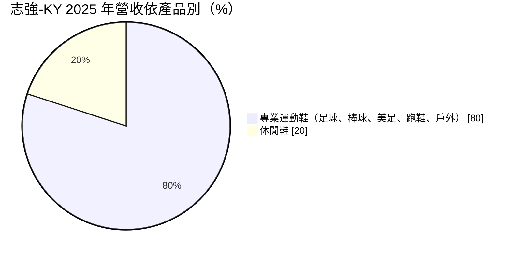
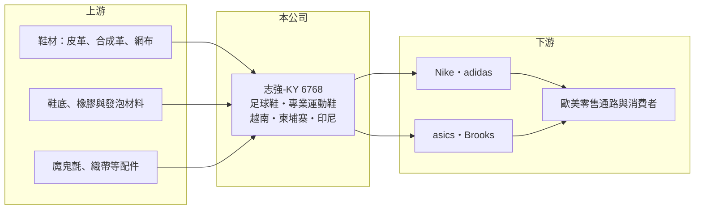

# 6768 志強-KY

> 上市｜[[產業索引-運動休閒|運動休閒]]｜上市（櫃）日期 2021/04/22

# 第一章：企業模式與商業藍圖

> [!info] 撰寫說明
> 精簡版，由 Claude 依公開資料整理，架構比照 [[2330台積電]]，資料截至 2026-10-08。來源：MoneyDJ 理財網財務比率年表（2018 至 2025 年）；富果研究 2026 年 3 月法說會備忘錄（產品、客戶、產地、市占、2025 年財務數字）；證交所開放資料快照（基本資料、2026 年上半年資產負債與損益、2025 年度股利）。部分營收以每股營業額乘以約 2.0 億股推算。#待校對

志強國際是開曼群島註冊的[[KY股]]控股公司，控股公司成立於 2017 年 3 月、2021 年 4 月上市，台灣據點在台中，董事長陳維家、總經理馬世正，實收資本額約 20 億元。志強是全球足球鞋代工的重要廠商，替 Nike、adidas、asics、Brooks 等品牌生產專業運動鞋，是一家典型的品牌鞋 [[OEM]] 代工廠。

- **核心業務：** 志強生產專業運動鞋，包括足球鞋、棒球鞋、美式足球鞋、跑鞋與戶外鞋，另有約兩成休閒鞋。足球鞋等「釘鞋」需要鞋底與鞋面精密貼合、承受高強度動作，製程比一般休閒鞋複雜，代工廠家數較少。
- **營收結構：** 依富果整理的 2026 年 3 月法說會，2025 年專業運動鞋約占 80%、休閒鞋約 20%；銷售地區以歐洲 36.4% 最大、美國 31.8%、美洲（不含美國）12.1%。客戶分工上，adidas 主要下單足球鞋與戶外鞋，Nike 為足球鞋與休閒鞋，Brooks 專注跑鞋，asics 為跑鞋與棒球、橄欖球鞋。依 2019 年資料，志強約占全球足球鞋產量 21%，Nike 足球鞋約 35%、adidas 足球鞋約 38% 由志強生產。
- **營運據點：** 生產基地在越南、柬埔寨與印尼。印尼廠 2025 年底開幕，目標三年內達年產 600 萬雙、總規劃 1,200 萬雙；替 asics 在越南平順省興建的新廠預計 2027 年初貢獻營收。另在德國（FIL）與葡萄牙（SGP）設研發中心，葡萄牙廠 2025 年 3 月開幕，定位為研發與小量生產。
- **長期方向：** 志強採「一廠一品牌」的合作模式，讓每家大客戶都有專屬產線與團隊，降低品牌間的機密疑慮。未來幾年的產量成長主要來自印尼廠與越南新廠，同時在歐洲據點發展自動化與數位化製程，再把成果導回亞洲廠區。股利政策承諾配發五至七成獲利。

# 第二章：護城河深度與競爭優勢

志強的護城河在於足球鞋這個利基市場的高市占與製程經驗，以及與四大品牌的長期關係。

- **競爭優勢：** 足球鞋的鞋釘、鞋底與輕量鞋面需要特殊模具與工藝，品牌每一季的新款開發都需要代工廠同步參與，志強在這個領域長期累積的開發經驗，讓它成為 Nike 與 adidas 足球鞋的主要供應商。大型品牌換供應商需要重新驗證品質、產能與社會責任稽核，轉換成本高。德國與葡萄牙研發據點貼近歐洲品牌總部，也有助於縮短開發時間。
- **主要對手：** 運動鞋代工的大廠包括 [[9904寶成]]、[[9910豐泰]]、[[9802鈺齊-KY]]、[[6890來億-KY]] 與 [[6965中傑-KY]]，以及中國的華利集團。寶成與豐泰規模遠大於志強，但志強在足球鞋品類的專業度較高。
- **觀察重點：** 2025 年營收創新高，但毛利率由 20.7% 降到 19.8%，主因新廠投入初期效率較低。長期要看印尼廠與越南新廠能否如期爬坡、asics 與 Brooks 等第二梯隊客戶能否持續放大，以及大型運動賽事（世界盃）帶動的足球鞋需求週期。

# 第三章：財務體質與盈利規模

資料日期：2026-10-08，表格是撰寫當時的快照；最新月營收、毛利率、累計 EPS 由自動排程寫在本筆記的屬性欄位（月營收、毛利率、累計EPS 等）。#待校對

志強的毛利率約 17% 至 23%、營業利益率約 3% 至 12%，獲利隨品牌庫存週期波動，2025 年營收創歷史新高。

| 年度 | 營收（億元） | [[毛利率]] | [[營業利益率]] | EPS（元） | [[ROE]] |
|---|---|---|---|---|---|
| 2021 | 未查得 | 19.74% | 6.45% | 3.42 | 5.66% |
| 2022 | 約 189（推算） | 23.13% | 12.16% | 9.22 | 13.76% |
| 2023 | 約 145（推算） | 16.66% | 3.38% | 2.78 | 3.89% |
| 2024 | 約 184（推算） | 20.70% | 8.72% | 8.15 | 11.07% |
| 2025 | 203.7 | 19.82% | 8.42% | 6.78 | 8.93% |

註：2024 年以 2025 年營收除以 1.105（年增 10.5%）推算；2022、2023 年以每股營業額乘以約 2.0 億股推算；2021 年上市當年股數變動，未推算。

- **長期指標：** 近 5 年平均 ROE 約 8.7%（推算），2023 年品牌去庫存時降到 3.9%。2022 至 2025 年營收年複合成長率約 2.5%（推算）。2025 年度現金股利約 5.16 元、配發率約 76%（證交所資料），每股現金流量 2018 至 2025 年皆為正。
- **[[ROIC]] 與 [[WACC]]：** 2025 年營業利益 17.15 億元，稅後約 13.7 億元（稅率 20%）。投入資本以 2026 年第二季權益總計 147.1 億元，加有息負債推估約 30 億元計算（負債總計 92.9 億元，官方快照未拆分），ROIC 約 7.8%（推算）。WACC 約 6.2%（推算：無風險利率 1.75%、市場風險溢酬 6%、β 取 0.9，股東權益成本 7.15%；稅前負債成本 3%、稅率 20%，以市值約 128 億元與負債 30 億元計算權重約 81：19）。ROIC 只略高於 WACC，代表在擴廠期間價值創造幅度有限，新廠爬坡後能否拉高 ROIC 是關鍵。
- **財務特色：** 2026 年第二季總資產 240.0 億元、負債 92.9 億元，負債比率約 39%，每股淨值 73.51 元，股價淨值比約 0.87 倍（證交所資料）。2026 年上半年營收 107.9 億元、毛利率 16.8%、營業利益率 5.9%、EPS 2.67 元，新廠成本仍壓抑獲利。

# 第四章：總體風險與地緣政治

志強的風險在於品牌庫存週期、客戶集中，以及東南亞擴廠的執行。

- **產業週期：** 運動鞋代工的訂單取決於品牌商的庫存水位，2023 年 Nike、adidas 等品牌去庫存時，代工廠營收與獲利大幅下滑，這是典型的[[長鞭效應]]。足球鞋需求另受世界盃、歐洲盃等大型賽事帶動，具有明顯的賽事週期。
- **營運風險：** 營收集中在四大品牌，其中 Nike 與 adidas 的比重最高，任何一家調整供應鏈策略都會影響志強。印尼新廠需要大量招募與訓練工人，爬坡期間毛利率會承壓；製鞋是勞力密集產業，東南亞工資上漲會持續推高成本。
- **其他風險：** 美國對越南、柬埔寨、印尼的關稅政策會影響品牌商的產地配置；品牌商對供應鏈的勞動與環保稽核日益嚴格。營收以美元計價，新台幣與當地貨幣匯率影響獲利。作為 KY 公司，法律適用與資訊揭露與本國公司不同。

# 專有名詞解析

## 金融

- **[[KY股]]**：在台灣上市櫃、但註冊於開曼群島等境外地區的公司，適用的公司法與揭露規範與本國公司不同。
- **[[長鞭效應]]**：終端需求的小幅變動，沿供應鏈往上游傳遞時被逐級放大，造成上游庫存與訂單劇烈波動。
- **[[ROIC]]**：投入資本報酬率，稅後營業利益除以股東權益加有息負債，衡量本業運用資本的效率。
- **[[WACC]]**：加權平均資金成本，股東與債權人要求報酬率的加權平均，是 ROIC 要超越的門檻。

## 產業

- **[[OEM]]**：原廠委託製造，代工廠依品牌客戶的設計與規格生產，產品掛品牌商的商標。

# 核心供應鏈

- 上游：皮革、合成革、網布等鞋面材料；鞋底與發泡材料；配件供應商如 [[9938百和]]（實際往來未查得）。
- 下游／客戶：Nike、adidas、asics、Brooks。
- 同業：[[9904寶成]]、[[9910豐泰]]、[[9802鈺齊-KY]]、[[6890來億-KY]]、[[6965中傑-KY]]；中國華利集團。

## 最新新聞
<!-- news:start（自動產生，請勿手動編輯此範圍） -->
- 2026-10-12 🏛️ 重訊 16:14｜代重要子公司Can Sports Shoes Co., Ltd.(志寨) 公告受當地稅務局罰款｜[觀測站](https://mops.twse.com.tw/mops/#/web/t05st01)

完整紀錄：[[6768志強-KY 新聞]]
<!-- news:end -->

## 相關連結
- [公開資訊觀測站](https://mopsov.twse.com.tw/mops/web/t05st03?step=1&firstin=1&co_id=6768)
- [Goodinfo](https://goodinfo.tw/tw/StockDetail.asp?STOCK_ID=6768)
- [Yahoo 股市](https://tw.stock.yahoo.com/quote/6768)
- [鉅亨網新聞](https://www.cnyes.com/twstock/6768/news)
