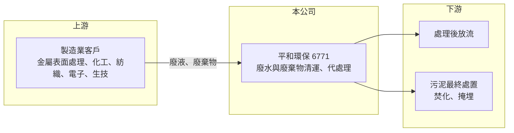

# 6771 平和環保-創

> 創新板｜[[產業索引-綠能環保|綠能環保]]｜上市（櫃）日期 2024/05/17

# 第一章：企業模式與商業藍圖

> [!info] 撰寫說明
> 精簡版，由 Claude 依公開資料整理，架構比照 [[2330台積電]] 的四章研究，資料截至 2026-10-08。來源：Goodinfo 年度經營績效頁、工商時報 2024 年 7 月報導、證交所開放資料（基本資料、2026 年第二季資產負債與綜合損益、營益分析、股利、每月營收）。創新板／新掛牌，公開資料有限；業務別營收比重、處理許可量與廠區細節未查得。#待校對

平和環保是一家在高雄經營事業廢水與廢棄物代處理的環保服務公司，本章說明它的商業模式與長期方向。

## 一、核心定位：替中小製造業處理廢水的代處理廠

平和環保成立於 2006 年，總部與廠區位於高雄市岡山區，2024 年 5 月在證交所[[創新板]]掛牌，實收資本額約 3.1 億元，董事長吳明陽（證交所開放資料）。公司屬於「代處理清運廠」，替客戶清運並處理[[事業廢棄物]]，業務與客戶產生的廢水量密切相關（工商時報）。

* **[[工業廢水處理]]委外服務：** 許多中小型工廠沒有能力自建符合法規的廢水處理設施，便把廢液交給合格的代處理業者。平和環保收取處理費，再以物理、化學方式處理到符合排放標準（處理工法細節未查得）。
* **客戶分散在多種產業：** 下游客戶涵蓋金屬表面處理、化工、紡織、電子與生技醫療等產業（工商時報），單一產業景氣變化對公司的衝擊相對有限。

## 二、商業模式：許可證與處理量決定營收

環保代處理是高度特許的行業。業者必須取得環保主管機關核發的處理許可，並受處理量上限與排放標準限制。這代表兩件事：第一，新進者很難取得新的處理許可，現有業者的區域地位相對穩固；第二，公司營收的上限受許可量與廠區產能約束，要成長就必須擴充許可或廠區。

公司營收自 2019 年以來穩定在 5 億至 7 億元之間，毛利率長期在 45% 以上、營業利益率 25% 至 35%（Goodinfo），呈現特許行業典型的高利潤、低成長特性。

## 三、長期方向

公司認為台灣製造業約 96% 為中小企業，隨著環保法規趨嚴，廢水委外處理的需求會持續增加（工商時報）。長期成長來源包括：擴大客戶產業別、提高處理量，以及可能的新廠區或新處理項目（具體擴產計畫未查得）。

# 第二章：護城河深度與競爭優勢

環保代處理的護城河主要來自法規，本章分析平和環保的優勢與限制。

## 一、護城河的核心組成要素

* **處理許可的稀缺性：** 廢水與廢棄物處理需要環保主管機關核准，地方居民也常反對新設處理廠，因此新許可很難取得。既有許可本身就是長期的進入障礙。
* **地理位置：** 廢液運輸成本高，客戶傾向選擇距離近的處理廠。位於高雄岡山工業區附近，讓公司在南部製造業聚落有地利優勢（推估）。
* **客戶黏著度：** 工廠更換廢水處理商需要重新申報清理計畫，轉換成本不低，合作關係通常長期穩定。

## 二、主要競爭對手

| 對手 | 定位 | 對平和環保的威脅 |
|---|---|---|
| [[8341日友]] | 醫療與事業廢棄物焚化 | 規模大，部分廢棄物項目重疊 |
| [[8422可寧衛]] | 廢棄物最終處置與掩埋 | 在事業廢棄物處理競爭 |
| [[6803崑鼎]] | 焚化廠與環保工程 | 大型焚化與環保服務 |
| 地方型代處理業者 | 區域性廢水處理廠 | 在南部客戶上直接競爭 |

## 三、守得住與守不住

* **守得住：** 毛利率。2021 至 2025 年毛利率在 45% 至 56% 之間（Goodinfo），即使營收持平，利潤率也相對穩定。
* **守不住：** 成長。營收多年停在 6 億元上下，2026 年 1 至 8 月累計約 3.81 億元、年減約 11%（證交所每月營收），客戶的生產量減少時，處理量也會跟著下降。
* **觀察重點：** 是否有新廠區或新許可帶動處理量成長，以及營業利益率能否維持在 25% 以上。

# 第三章：財務體質與盈利規模

資料日期：2026-10-08，表格是撰寫當時的快照；最新月營收、毛利率、累計 EPS 由自動排程寫在本筆記的屬性欄位（月營收、毛利率、累計EPS 等）。#待校對

本章用多年度數據檢視平和環保「高利潤、低成長、高配息」的財務特性。

## 一、多年度三率與 ROE

| 年度 | 營收（新台幣） | [[毛利率]] | [[營業利益率]] | EPS（元） | [[ROE]] |
|---|---|---|---|---|---|
| 2021 | 6.00 億 | 55.8% | 34.9% | 5.44 | 23.3% |
| 2022 | 6.73 億 | 44.9% | 27.0% | 5.20 | 21.0% |
| 2023 | 6.09 億 | 48.4% | 28.4% | 4.76 | 18.8% |
| 2024 | 6.35 億 | 46.1% | 25.6% | 3.89 | 14.5% |
| 2025 | 6.18 億 | 46.9% | 25.5% | 3.64 | 12.8% |
| 2026 上半年 | 2.78 億 | 46.82% | 25.81% | 1.47 | 未查得 |

註：2021 至 2025 年取自 Goodinfo；2026 上半年取自證交所營益分析與綜合損益。Goodinfo 另有 2017 至 2020 年資料，營收 4.8 億至 5.4 億元、營業利益率 29% 至 35%。

* **營收幾乎不成長：** 2021 至 2025 年營收年複合成長率約 0.7%（推算），規模受處理許可與產能限制。
* **利潤率緩降：** 營業利益率從 34.9% 降到 25.5%，可能與人力、藥劑與能源成本上升有關（推估）。
* **ROE 下滑：** 2021 至 2025 年平均 ROE 約 18.1%（推算），但逐年下滑至 12.8%，部分原因是掛牌募資後權益變大、EPS 被稀釋。

## 二、股利與財務結構

2025 年度配發現金股利 3.20 元，以 EPS 3.64 元計算配發率約 88%（證交所股利資料，推算），屬於高配息公司。2026 年第二季底總資產約 14.2 億元、總負債約 5.8 億元（幾乎全為流動負債，可能包含應付股利，推估）、權益約 8.4 億元，每股淨值 26.59 元（證交所資產負債）。

## 三、[[ROIC]] 與 [[WACC]]

**ROIC 推算：** 2025 年營業利益約 6.18 億 × 25.5% ≈ 1.58 億元，稅後約 1.26 億元。有息負債未查得，假設總負債 5.8 億元的一半約 2.9 億元為有息負債（實際可能更低），加上權益 8.4 億元，投入資本約 11.3 億元，ROIC 約 11.2%（推算）。

**WACC 推算：** 台灣 10 年期公債 1.75%、市場風險溢酬 6%、β 取環保服務同業常見值 0.8，權益成本約 6.6%；負債成本 3%、稅率 20%，權益占比約 74%，WACC 約 5.5%（推算）。

**結論：** ROIC 約為 WACC 的兩倍，利差約 5 至 6 個百分點，代表特許經營的廢水處理業務能長期創造價值。不過營收沒有成長，價值創造主要以高配息的方式回到股東手上。

# 第四章：總體風險與地緣政治

本章整理平和環保長期面對的法規、產業與營運風險。

## 一、產業週期

* **製造業景氣：** 處理量取決於客戶的生產量，金屬表面處理、化工、電子等產業景氣轉弱時，廢水量會跟著下降。
* **產業外移：** 若台灣中小製造業持續外移或關廠，長期廢水處理需求可能萎縮。

## 二、營運風險

* **許可與環保稽查：** 公司本身也受嚴格環保稽查，若發生違規排放或處理失當，可能被罰款、停工，甚至影響許可。
* **工安：** 處理化學廢液涉及有毒與腐蝕性物質，工安事故會造成營運中斷與商譽損失。
* **成長受限：** 擴充處理量需要新的許可與廠區，時程長且常遇地方反對。

## 三、其他風險

* **法規變動：** 環保標準提高會增加處理成本，但也可能推升委外需求，影響方向需視個案而定。
* **能源與藥劑成本：** 電價與處理藥劑價格上漲，會壓縮利潤率。

# 專有名詞解析

## 金融

- **[[創新板]]**：證交所 2021 年設立的板塊，讓尚未獲利但具技術或創新能力的公司掛牌，初期限合格投資人交易。
- **[[ROIC]]**：投入資本報酬率，衡量企業用股東與債權人投入的資本，每年能產生多少稅後營業利益。
- **[[WACC]]**：加權平均資金成本，股東要求報酬與負債利息依資本結構加權後的平均值，是判斷是否創造價值的門檻。

## 產業

- **[[事業廢棄物]]**：工廠、醫院等事業機構在營運中產生的廢棄物，依法須交由合格業者清運、處理，不能混入一般垃圾。
- **[[工業廢水處理]]**：把工廠排出的含重金屬、酸鹼或有機物廢水處理到符合排放標準的程序，可自建設施或委外處理。

# 核心供應鏈

- 上游（廢棄物來源，也就是付費客戶）：金屬表面處理、化工、紡織、電子、生技醫療等產業的中小型工廠。
- 下游：處理後放流水；處理產生的污泥再交由焚化或掩埋業者最終處置（合作業者未查得）。
- 同業：[[8341日友]]、[[8422可寧衛]]、[[6803崑鼎]]、[[8473山林水]]、地方型代處理業者。

## 最新新聞
<!-- news:start（自動產生，請勿手動編輯此範圍） -->
- 2026-10-08 🏛️ 重訊 15:08｜公告本公司買回庫藏股執行完畢｜[觀測站](https://mops.twse.com.tw/mops/#/web/t05st01)

完整紀錄：[[6771平和環保-創 新聞]]
<!-- news:end -->

## 相關連結
- [公開資訊觀測站](https://mopsov.twse.com.tw/mops/web/t05st03?step=1&firstin=1&co_id=6771)
- [Goodinfo](https://goodinfo.tw/tw/StockDetail.asp?STOCK_ID=6771)
- [Yahoo 股市](https://tw.stock.yahoo.com/quote/6771)
- [鉅亨網新聞](https://www.cnyes.com/twstock/6771/news)
