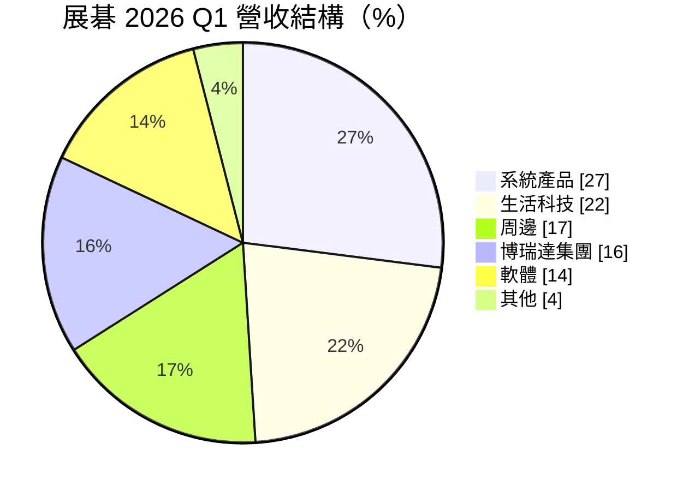
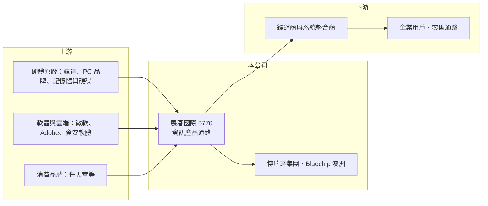

# 6776 展碁國際

> 上市｜[[產業索引-電子通路業|電子通路業]]｜上市（櫃）日期 2021/03/31

# 第一章：企業模式與商業藍圖

> [!info] 撰寫說明
> 精簡版，由 Claude 依公開資料整理，架構比照 [[2330台積電]] 的四章研究，資料截至 2026-10-08。來源：富果研究 2026-06-29 法說會摘要、Goodinfo 經營績效頁、證交所開放資料快照（基本資料、2026 年第二季損益與資產負債、本益比殖利率）。與宏碁的集團關係為憑記憶撰寫。#待校對

展碁國際是台灣規模最大的資訊產品通路商之一，從電腦與零組件一路擴展到軟體授權、雲端服務與海外併購。本章說明它的產品組合與成長路徑。

- **核心業務：** 展碁成立於 1977 年，2021 年在證交所上市，屬於宏碁集團的通路公司（待校對）。它是專業的[[資訊產品通路]]，銷售系統產品（PC、筆電、工作站）、IT 周邊、軟體、生活科技產品，並提供系統整合服務。代理或經銷的品牌包括 [[NVDA輝達]] 專業繪圖卡與工作站、任天堂遊戲主機、Adobe 與 [[MSFT微軟]] 的訂閱軟體，以及記憶體與硬碟等零組件。
- **營收結構：** 2026 年第一季，系統產品約占 27%、生活科技 22%、周邊 17%、博瑞達集團（PAM Group）16%、軟體 14%。系統產品是成長最快的板塊，軟體占比也在上升；軟體與雲端訂閱屬於[[經常性收入]]，比一次性硬體銷售更穩定。
- **營運據點：** 以台灣為基地，透過子公司博瑞達經營其他市場，2026 年 4 月起併入澳洲通路商 Bluechip，正式跨足澳洲，並把東南亞列為下一個擴張目標。
- **長期方向：** 公司聚焦 AI、雲端與資安三大方向，以併購擴大區域版圖。管理層表示配息率約七成，除非有大型併購，否則不打算辦理增資，資本配置偏向「穩定配息＋選擇性併購」。

# 第二章：護城河深度與競爭優勢

資訊通路是「規模經濟」生意，展碁的護城河主要來自規模、品牌代理廣度與經銷網路。本章分析其優勢與競爭格局。

- **競爭優勢：** 原廠要觸及台灣數以千計的經銷商與系統整合商，最有效率的方式是交給少數大型通路商，這讓展碁、聯強這類業者有規模上的優勢。展碁的產品線橫跨硬體、軟體與雲端，能替經銷商一次備齊整套方案，提高客戶黏著度。
- **主要對手：** 台灣最大的資訊通路是 [[2347聯強]]，另有 [[2414精技]]、6112邁達特、[[2480敦陽科]] 等在企業與系統整合市場競爭。在軟體與雲端領域，展碁也要面對原廠直接銷售與其他雲端代理商的競爭。
- **觀察重點：** 第一，軟體與雲端訂閱的占比能否持續上升，提升毛利率與收入穩定度。第二，Bluechip 等海外併購的整合成效，是否能維持獲利而不只是增加營收。第三，維持七成配息率的同時，是否有足夠資金支應營運資金與併購需求。

# 第三章：財務體質與盈利規模

資料日期：2026-10-08，表格是撰寫當時的快照；最新月營收、毛利率、累計 EPS 由自動排程寫在本筆記的屬性欄位（月營收、毛利率、累計EPS 等）。#待校對

展碁的財務特色是毛利率只有 6% 至 7%、營業利益率約 2%，但靠高周轉創造兩成上下的 ROE。本章用多年度數據檢視它的獲利模式。

| 年度 | 營收（億元） | [[毛利率]] | [[營業利益率]] | EPS（元） | [[ROE]] |
|---|---|---|---|---|---|
| 2021 | 213 | 5.80% | 1.49% | 4.28 | 20.2% |
| 2022 | 233 | 7.30% | 2.25% | 5.09 | 20.4% |
| 2023 | 228 | 6.78% | 2.17% | 5.06 | 17.6% |
| 2024 | 255 | 6.53% | 1.78% | 4.11 | 14.5% |
| 2025 | 293 | 5.97% | 1.55% | 4.20 | 12.0% |
| 2026 上半年 | 188.7 | 7.77% | 1.99% | 2.45 | 未查得 |

- **營收規模：** 2021 至 2025 年營收從 213 億元成長到 293 億元，年複合成長率約 8.3%（推算），是這批通路公司中少數長期成長的一家。2026 年上半年營收 188.7 億元，加上併購與記憶體漲價，全年規模可望再上一個台階。
- **獲利：** 毛利率與營業利益率長期很薄，但近 5 年平均 ROE 約 16.9%（推算）。ROE 從 2022 年的 20.4% 降到 2025 年的 12.0%，顯示毛利率下滑與股本、權益擴大後，資本效率有所稀釋。
- **財務特色：** 2026 年第二季末總資產 139.7 億元、負債總計 106.9 億元、權益總計 32.8 億元，負債多為應付帳款等營運負債，這是通路業以供應商帳期支應營運資金的典型結構。Goodinfo 顯示近年平均現金股利約 2.81 元，搭配約七成的配息率目標，股利紀錄相對穩定。

**[[ROIC]] 與 [[WACC]]：** 有息負債明細未查得，假設約 20 億元（推估，主要為短期借款）。2025 年稅後營業利益約 3.63 億元（293 億 × 1.55% × 0.8），投入資本為權益 32.8 億元加有息負債 20 億元，約 52.8 億元，ROIC 約 6.9%（推算）；若有息負債只有 10 億元，ROIC 約 8.5%。WACC 用 CAPM 推估：無風險利率 1.75%、市場風險溢酬 6%、β 取通路股常見值 0.8（假設），股東權益成本約 6.6%；負債成本 2.5%、稅率 20%，以權益六成、負債四成加權，WACC 約 4.8%（推算）。結論是：展碁 ROIC 長期高於 WACC，靠周轉而非毛利創造價值；但 2022 年後利差縮小，需要觀察軟體、雲端與併購能否把報酬率拉回。

# 第四章：總體風險與地緣政治

展碁的風險主要來自 PC 景氣、原廠政策與併購整合。本章整理需要長期關注的部分。

- **產業週期：** 系統產品與周邊合計約占四成，仍受 PC 與消費性電子的換機週期影響。企業換機需求較穩定，但消費市場轉弱時，生活科技與周邊產品的銷售會明顯下滑。
- **營運風險：** 通路商的獲利取決於原廠給的折讓與代理條件，原廠若改為直營或調整雲端合作模式，展碁的利潤空間會被壓縮。營業利益率只有約 2%，存貨跌價或呆帳就可能吃掉大部分獲利。
- **其他風險：** 併購 Bluechip 後承擔澳洲市場的匯率與經營風險；博瑞達集團的業績受油價與地緣政治影響。記憶體價格大幅波動時，庫存評價也可能帶來利益或損失。

# 專有名詞解析

## 金融

- **[[ROIC]]**：投入資本報酬率，稅後營業利益除以股東權益加有息負債，衡量本業運用資本的效率。
- **[[WACC]]**：加權平均資金成本，股東權益成本與負債成本依資本結構加權，是 ROIC 必須超越的門檻。

## 產業

- **[[資訊產品通路]]**：向原廠採購電腦、周邊與軟體，再批發給經銷商與系統整合商的中間商，靠規模與周轉獲利。
- **[[經常性收入]]**：訂閱、維護合約等按期重複收取的收入，比一次性銷售更穩定、可預測。

# 核心供應鏈

- 上游：[[NVDA輝達]]、[[MSFT微軟]]、Adobe、任天堂、PC 品牌（集團關係上與 [[2353宏碁]] 相關，待校對）。
- 下游／客戶：台灣經銷商、系統整合商、零售通路與企業用戶；澳洲與其他海外市場客戶。
- 同業：[[2347聯強]]、[[2414精技]]、6112邁達特、[[2480敦陽科]]。

## 最新新聞
<!-- news:start -->
<!-- news:end -->

## 相關連結
- [公開資訊觀測站](https://mopsov.twse.com.tw/mops/web/t05st03?step=1&firstin=1&co_id=6776)
- [Goodinfo](https://goodinfo.tw/tw/StockDetail.asp?STOCK_ID=6776)
- [Yahoo 股市](https://tw.stock.yahoo.com/quote/6776)
- [鉅亨網新聞](https://www.cnyes.com/twstock/6776/news)
