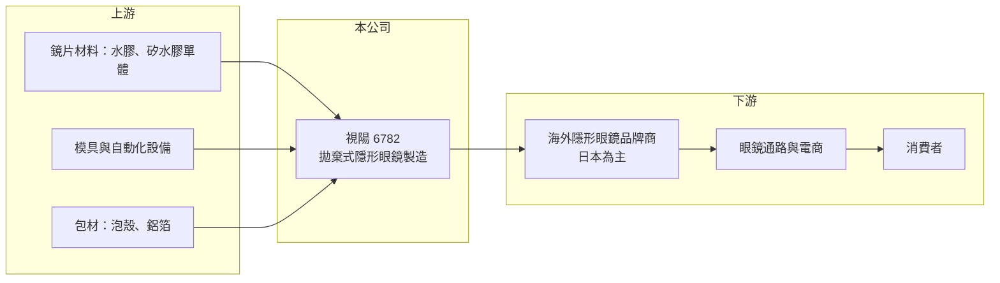

# 6782 視陽

> 上市｜[[產業索引-生技醫療業|生技醫療業]]｜上市（櫃）日期 2022/11/28

# 第一章：企業模式與商業藍圖

> [!info] 撰寫說明
> 精簡版，由 Claude 依公開資料整理，架構比照 [[2330台積電]] 的四章研究，資料截至 2026-10-08。來源：證交所開放資料（基本資料、2026 年第二季綜合損益與資產負債、營益分析）、Goodinfo 經營績效頁、nStock 公司頁。業務結構（代工與品牌比重、主要市場）的描述有部分憑產業常識撰寫，已標「待校對」。#待校對

視陽光學（以下簡稱視陽）是台灣上市的拋棄式[[隱形眼鏡]]製造商，本章說明它靠什麼賺錢、產品往哪個方向升級，以及為何近幾年獲利能力大幅提高。

- **核心業務：** 視陽成立於 1998 年，總部與工廠位於桃園龜山，2022 年 11 月在證交所上市，主要業務是拋棄式隱形眼鏡的製造與銷售。隱形眼鏡屬於醫療器材，每個市場都要個別取得許可，量產則需要高度自動化的模具與水合、滅菌產線，因此新進者要花多年才能做到穩定良率。
- **營收結構：** 公開資料沒有查到最新的產品別比重。依產業報導，視陽以替海外品牌的代工（[[OEM]]／[[ODM]]）為主，日本是最重要的市場，產品從日拋水膠鏡片逐步轉向[[矽水膠]]與[[彩色隱形眼鏡]]（待校對）。這個轉變的意義是單價與[[毛利率]]都較高，也較能綁住要求嚴格的日本客戶。
- **營運據點：** 生產集中在桃園，以台灣製造、外銷為主。集中單一廠區的好處是管理與品質一致，代價是擴產時程與天災風險都集中在同一地點。
- **長期方向：** 公司的成長路徑是「擴產能、提高矽水膠與彩片比重、增加市場分散度」。2025 年營收 42.2 億元，相較 2020 年的 15.3 億元，五年年複合成長約 22.5%（推算），顯示產能擴充與產品升級是長期成長的主要引擎。

# 第二章：護城河深度與競爭優勢

隱形眼鏡製造看起來是標準化產品，實際上門檻在良率、法規與客戶驗證。本章分析視陽的競爭優勢與限制。

- **競爭優勢：** 第一是製程與良率，日拋鏡片單價低、用量大，單位成本差一點就決定能否接到大單，視陽 2025 年[[營業利益率]]達 27.3%，代表規模化後的成本控制已經到位。第二是客戶驗證，日本品牌商對外觀、舒適度與批次一致性要求嚴格，一旦通過驗證就不容易換供應商，形成轉換成本。
- **主要對手：** 台灣同業包括 [[6491晶碩]]、[[1565精華]]、[[4771望隼]]，國際上則是嬌生、愛爾康、庫博等自有品牌大廠。台廠多數以代工與彩片見長，國際大廠則掌握品牌與通路，台廠的機會在於替缺乏產能的品牌商代工。
- **護城河的限制：** 代工模式的議價權終究有限，客戶集中度高時，單一品牌商調整庫存就會直接影響營收。2023 年營收從 27.8 億元降到 24.0 億元、EPS 從 11.11 元降到 4.79 元，就是客戶調整庫存與新產能折舊同時發生時的典型樣貌。
- **觀察重點：** 長期應追蹤矽水膠產品的比重、日本以外市場的開發進度，以及擴產後產能利用率能否維持。這三點決定視陽能否從「好的代工廠」走向「不可替代的供應商」。

# 第三章：財務體質與盈利規模

資料日期：2026-10-08，表格是撰寫當時的快照；最新月營收、毛利率、累計 EPS 由自動排程寫在本筆記的屬性欄位（月營收、毛利率、累計EPS 等）。#待校對

財務數字是檢驗護城河的最終標準。視陽的財報呈現典型的「產能擴張型製造業」：投資期獲利波動，量產規模到位後利潤率快速提升。

| 年度 | 營收（億元） | [[毛利率]] | [[營業利益率]] | EPS（元） | [[ROE]] |
|---|---|---|---|---|---|
| 2020 | 15.3 | 36.0% | 10.6% | 2.35 | 15.2% |
| 2021 | 19.6 | 42.7% | 20.7% | 8.11 | 45.5% |
| 2022 | 27.8 | 44.4% | 25.6% | 11.11 | 29.1% |
| 2023 | 24.0 | 35.7% | 13.9% | 4.79 | 9.67% |
| 2024 | 36.7 | 38.8% | 21.5% | 10.10 | 19.1% |
| 2025 | 42.2 | 45.2% | 27.3% | 14.08 | 21.7% |
| 2026 上半年 | 24.96 | 47.3% | 29.0% | 8.45 | 未查得 |

- **獲利能力：** 毛利率從 2020 年的 36% 提升到 2026 年上半年的 47% 左右，背後是產品組合往高單價鏡片移動，加上產能放大後固定成本被攤薄。2021 年 ROE 高達 45.5% 是上市前股本較小所致，上市增資後 ROE 回到 20% 上下，較能代表長期水準。
- **長期指標：** 2021 至 2025 年平均 ROE 約 25%（推算），營收五年年複合成長約 22.5%（推算）。依 Goodinfo，2020 至 2026 年股利發放期間現金股利一般平均 4.19 元，配發穩定度屬中上，但擴產期資本支出大，自由現金流是否長期為正未查得。
- **財務結構：** 2026 年第二季底股東權益 44.4 億元、負債總計 24.0 億元，每股淨值 70.46 元（證交所資料），有息負債金額開放資料未拆分。

**[[ROIC]] 與 [[WACC]]：** 以 2025 年營業利益約 11.5 億元（42.2 億元 × 27.3%）、稅率 20% 計，稅後營業利益約 9.2 億元；投入資本以 2026 年第二季股東權益 44.4 億元加上有息負債（未查得，假設 0 至 5 億元）計算，ROIC 約 19% 至 21%（推算）。WACC 以 CAPM 推估：無風險利率 1.75%、市場風險溢酬 6%、β 取醫材製造同業常見值 1.0，權益成本約 7.75%，負債比重低，WACC 約 7.5% 至 8%（推算）。ROIC 明顯高於 WACC，代表視陽在目前的產品組合下長期創造價值，但 2023 年的低谷提醒這個利差會隨客戶庫存週期大幅擺動。

# 第四章：總體風險與地緣政治

隱形眼鏡需求長期穩定成長，但代工廠的營運會被客戶庫存與產能投資週期放大。本章整理視陽需要面對的主要風險。

- **產業週期：** 終端消費相對穩定，但品牌商會依庫存水位調整下單，造成代工廠營收出現明顯的年度起伏，2023 年的衰退即為一例。擴產期新產線的折舊先發生、營收後到，也會讓毛利率短期下滑。
- **營運風險：** 客戶與市場集中在日本，單一大客戶轉單或日本消費轉弱，影響會直接反映在營收。生產集中在桃園單一地區，地震、停電或缺水都可能中斷出貨。
- **匯率與法規：** 外銷比重高，新台幣對日圓與美元升值會壓縮以台幣計算的獲利。各國醫療器材法規趨嚴時，新產品取證時程拉長，也會延後新市場的營收貢獻。
- **競爭風險：** 台灣與中國同業持續擴充產能，若產業供給成長快於需求，代工報價可能下滑，矽水膠與彩片的技術領先能否維持是長期關鍵。

# 專有名詞解析

## 應用

- **[[隱形眼鏡]]**：直接配戴在眼球表面的矯正或美容鏡片，屬醫療器材，需取得衛生主管機關許可。
- **[[彩色隱形眼鏡]]**：在鏡片中加入色料圖案、可改變虹膜外觀的隱形眼鏡，兼具矯正與美容用途，日本與亞洲需求大。

## 金融

- **[[ROIC]]**：投入資本報酬率，稅後營業利益除以投入資本（股東權益加有息負債），衡量本業創造報酬的能力。
- **[[WACC]]**：加權平均資金成本，依權益與負債比重加權的資金成本，是 ROIC 需要超越的門檻。

## 產業

- **[[矽水膠]]**：在水膠中加入矽成分的隱形眼鏡材料，透氧率遠高於傳統水膠，是高階鏡片的主流材質。
- **[[OEM]]**：代工生產，依客戶的設計與規格製造，產品掛客戶品牌銷售。
- **[[ODM]]**：委託設計製造，代工廠負責產品設計與生產，客戶以自有品牌銷售。

# 核心供應鏈

- 上游：鏡片原料（水膠與矽水膠單體、色料）、模具與自動化設備、包材供應商，多數高階材料仰賴進口（待校對）。
- 下游／客戶：以日本等海外隱形眼鏡品牌商為主，經由眼鏡行、藥妝與電商通路賣給消費者（待校對）。
- 同業：[[6491晶碩]]、[[1565精華]]、[[4771望隼]]；國際品牌大廠嬌生、愛爾康、庫博。

## 最新新聞
<!-- news:start（自動產生，請勿手動編輯此範圍） -->
- 2026-10-16 📰 媒體 16:10｜鉅亨速報 - Factset 最新調查：視陽(6782-TW)目標價調升至288元，幅度約7.46%｜[鉅亨網](https://news.cnyes.com/news/id/6632077)
- 2026-10-15 📰 媒體 10:52｜〈焦點股〉視陽日本及中國市場帶動Q4有望迎高峰 漲逾半根停板｜[鉅亨網](https://news.cnyes.com/news/id/6630945)
- 2026-10-12 📰 媒體 17:00｜視陽(6782) 產能三級跳、供不應求看到2027！48.8% 毛利率是天花板還是起點？｜[鉅亨網](https://news.cnyes.com/news/id/6628174)
- 2026-10-12 📰 媒體 08:10｜鉅亨速報 - Factset 最新調查：視陽(6782-TW)目標價調升至265.5元，幅度約3.71%｜[鉅亨網](https://news.cnyes.com/news/id/6627740)

完整紀錄：[[6782視陽 新聞]]
<!-- news:end -->

## 相關連結
- [公開資訊觀測站](https://mopsov.twse.com.tw/mops/web/t05st03?step=1&firstin=1&co_id=6782)
- [Goodinfo](https://goodinfo.tw/tw/StockDetail.asp?STOCK_ID=6782)
- [Yahoo 股市](https://tw.stock.yahoo.com/quote/6782)
- [鉅亨網新聞](https://www.cnyes.com/twstock/6782/news)
