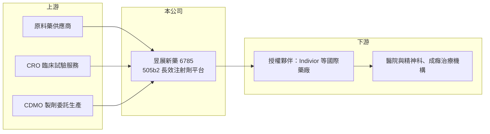

# 6785 昱展新藥

> 上櫃｜[[產業索引-生技醫療業|生技醫療業]]｜上市（櫃）日期 2024/01/24

# 第一章：企業模式與商業藍圖

> [!info] 撰寫說明
> 精簡版，由 Claude 依公開資料整理，架構比照 [[2330台積電]] 的四章研究，資料截至 2026-10-08。來源：櫃買中心開放資料（基本資料、2026 年第二季綜合損益與資產負債）、Goodinfo 經營績效頁、富果研究昱展新藥個股報告（含 2025、2026 年法說會整理）。新藥公司營收以授權金為主，年度間波動極大。#待校對

昱展新藥（以下簡稱昱展）是以改良型新藥為主軸的台灣新藥公司，本章說明它的開發策略、產品線與主要收入來源。

- **核心業務：** 昱展成立於 2016 年，總部在台中，2024 年 1 月在櫃買中心掛牌。創辦人林東和董事長與文永順總經理都出身 [[1795美時]]，2016 年離開美時後共同創立昱展。公司以 [[505(b)(2)]] 途徑開發新藥，也就是用已上市成分做新劑型或新給藥方式，比從零開發新分子的時間短、失敗率低。
- **技術平台：** 核心是 In-Relar 長效注射劑平台，把每天口服的中樞神經藥物改成一次注射可維持數週到一個月的劑型，用來解決病患忘記服藥、血中藥物濃度起伏大的問題。依 2026 年法說會資料，公司另有長效胜肽平台，動物試驗中可應用在 GLP-1 類藥物，單次注射藥效維持一個月以上。
- **產品線：** ALA-1000 用於鴉片類藥物成癮治療，2023 年授權給 Indivior，研發與銷售里程碑合計約新台幣 276 億元，是台灣生技史上金額最大的[[新藥授權]]之一；2026 年雙方修訂協議，昱展收回美國以外的全球權利。ALA-3000 為長效型氯胺酮，針對難治型憂鬱症，2026 年公布一期臨床達成所有主要安全性終點。
- **營收結構：** 平時幾乎沒有產品銷售，收入來自[[授權金]]與[[里程碑金]]。2023 年因 Indivior 授權認列 4.69 億元營收，其他年度營收多在數百萬元以下，因此不適合用單年營收評估公司。
- **長期方向：** 昱展的長期路徑是把平台技術延伸到更多中樞神經與代謝疾病藥物，並在 ALA-1000 收回美國以外權利後，自行或另找夥伴推進其他市場。

# 第二章：護城河深度與競爭優勢

新藥公司的護城河在於專利、平台技術與臨床數據，以及能否找到大藥廠買單。本章分析昱展的優勢與競爭位置。

- **競爭優勢：** 長效注射劑的難處在於讓藥物在體內穩定緩慢釋放，配方與製程 know-how 高，也能申請新專利延長保護期。經營團隊有數十年學名藥與改良劑型開發經驗，2023 年的大型授權案也證明平台獲得國際藥廠認可。
- **主要對手：** 國際上做長效注射劑的公司很多，包括大型藥廠自行開發的劑型，以及專門做緩釋技術的平台公司。台灣同樣走 505(b)(2) 或長效注射劑路線的公司有 [[6576逸達]]、[[6535順藥]] 等，彼此適應症不同，但都在爭取國際授權夥伴。
- **護城河的限制：** 單一授權夥伴的策略調整就會改變公司命運，2026 年 ALA-1000 協議修訂即是例子；昱展收回權利後，需要自己承擔更多開發成本與執行風險。
- **觀察重點：** ALA-1000 在美國的開發與上市進度、ALA-3000 能否進入二期並找到授權夥伴，以及長效胜肽平台能否在 GLP-1 熱潮中取得合作案。

# 第三章：財務體質與盈利規模

資料日期：2026-10-08，表格是撰寫當時的快照；最新月營收、毛利率、累計 EPS 由自動排程寫在本筆記的屬性欄位（月營收、毛利率、累計EPS 等）。#待校對

新藥公司的財報要看「現金能撐多久」與「授權收入何時進來」，而不是單季損益。昱展的數字呈現典型的研發型公司樣貌。

| 年度 | 營收（億元） | [[毛利率]] | [[營業利益率]] | EPS（元） | [[ROE]] |
|---|---|---|---|---|---|
| 2020 | 0.01 | 100% | -28,461% | -2.86 | -36.2% |
| 2021 | 0 | 未查得 | 未查得 | -1.13 | -11.3% |
| 2022 | 0.01 | 100% | -5,816% | -0.35 | -3.79% |
| 2023 | 4.69 | 100% | 82.2% | 6.71 | 54.2% |
| 2024 | 0.06 | 65.2% | -1,168% | 0.27 | 1.07% |
| 2025 | 0.03 | 77.7% | -6,095% | -1.19 | -3.26% |
| 2026 上半年 | 0.015 | 90.3% | 營業損失 0.59 億元 | -0.29 | 未查得 |

- **獲利結構：** 營收極小的年度，營業利益率會出現數千個百分點的負值，這只是分母太小造成的，實際意義是「研發費用幾乎全部由現金支應」。2026 年第一季研發費用 6,268 萬元，占營業費用約 96%（富果整理），研發是唯一主要支出。
- **現金與財務結構：** 2025 年底現金及約當現金約 23.03 億元；2026 年第二季底股東權益 23.8 億元、負債總計僅 0.72 億元（櫃買中心資料），幾乎沒有借款。以近年每年約 2 至 3 億元的營業虧損推估，現金可支應多年研發（推估）。
- **股利：** Goodinfo 顯示 2021 至 2026 年現金股利一般平均約 0.31 元，主要來自 2023 年授權收入後的配發，不具穩定性。

**[[ROIC]] 與 [[WACC]]：** 2025 年營業損失約 1.83 億元（0.03 億元營收 × -6,095%），虧損年度不計稅盾，投入資本以股東權益約 23.8 億元、有息負債約 0 計，ROIC 約 -7.7%（推算）；2023 年授權入帳時營業利益約 3.86 億元，當年 ROIC 為明顯正值（推算）。WACC 以 CAPM 推估：無風險利率 1.75%、市場風險溢酬 6%、β 取生技新藥同業常見值 1.2，幾乎無負債，WACC 約 9%（推算）。目前 ROIC 低於 WACC，屬研發型公司常態，是否創造價值取決於未來授權與里程碑金能否超過累積研發投入，而非單年數字。

# 第四章：總體風險與地緣政治

新藥開發的風險高度集中在臨床、法規與合作夥伴。本章整理昱展長期需要面對的風險。

- **產業週期：** 生技授權市場受資本市場景氣影響，利率高、生技募資冷的時期，大藥廠的授權條件會變得保守，簽約金也較低。
- **臨床與法規風險：** ALA-3000 仍在早期臨床，二期以後失敗率高；氯胺酮屬管制藥品，法規與濫用疑慮會增加審查難度。505(b)(2) 雖然風險較低，但仍需證明新劑型的安全性與療效。
- **合作夥伴風險：** 授權收入依賴夥伴推進開發，2026 年 ALA-1000 協議修訂顯示夥伴的策略轉變可能使原本預期的里程碑金延後或消失。
- **其他風險：** 長效胜肽平台面對全球大藥廠在 GLP-1 領域的激烈競爭，技術能否差異化仍待驗證；營收以美元計價的授權金為主，匯率也會影響認列金額。

# 專有名詞解析

## 金融

- **[[ROIC]]**：投入資本報酬率，稅後營業利益除以投入資本（股東權益加有息負債），衡量本業創造報酬的能力。
- **[[WACC]]**：加權平均資金成本，依權益與負債比重加權的資金成本，是 ROIC 需要超越的門檻。

## 產業

- **[[505(b)(2)]]**：美國 FDA 的新藥申請路徑之一，可引用已上市成分的既有資料，常用於改良劑型或新給藥途徑。
- **[[新藥授權]]**：新藥公司把特定區域或適應症的開發與銷售權授權給其他藥廠，以換取簽約金、里程碑金與權利金。
- **[[授權金]]**：技術或產品授權時，被授權方依合約支付的費用，包括簽約金與後續權利金。
- **[[里程碑金]]**：授權合約中，當藥物達成臨床進展、取得藥證或銷售目標等特定里程碑時，被授權方支付的款項。

# 核心供應鏈

- 上游：原料藥供應商、臨床試驗委託研究機構（CRO）、製劑委託生產廠，均為一般性外包服務，昱展專注在配方平台與臨床策略。
- 下游／客戶：以國際授權夥伴為主，2023 年與 Indivior 簽訂 ALA-1000 授權，2026 年修訂協議；最終使用者為精神科與成癮治療的醫療機構。
- 同業：[[6576逸達]]、[[6535順藥]]；[[1795美時]] 為創辦團隊出身的學名藥廠。

## 最新新聞
<!-- news:start（自動產生，請勿手動編輯此範圍） -->
- 2026-10-15 🏛️ 重訊 14:07｜公告本公司法人說明會將於115年12月17日召開｜[觀測站](https://mops.twse.com.tw/mops/#/web/t05st01)

完整紀錄：[[6785昱展新藥 新聞]]
<!-- news:end -->

## 相關連結
- [公開資訊觀測站](https://mopsov.twse.com.tw/mops/web/t05st03?step=1&firstin=1&co_id=6785)
- [Goodinfo](https://goodinfo.tw/tw/StockDetail.asp?STOCK_ID=6785)
- [Yahoo 股市](https://tw.stock.yahoo.com/quote/6785)
- [鉅亨網新聞](https://www.cnyes.com/twstock/6785/news)
