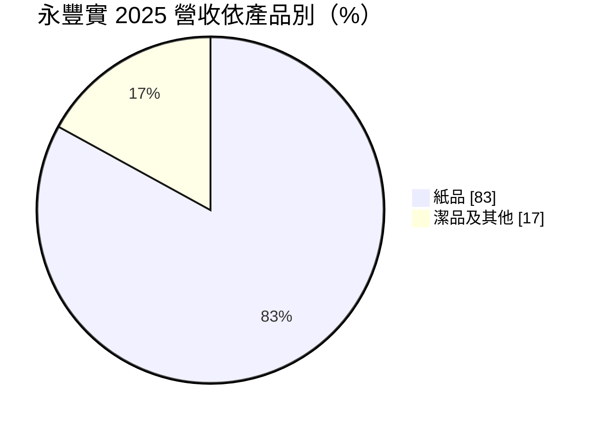
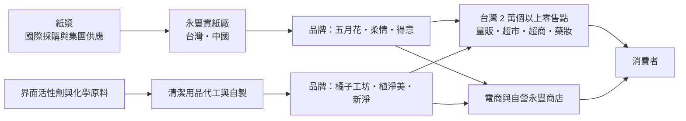
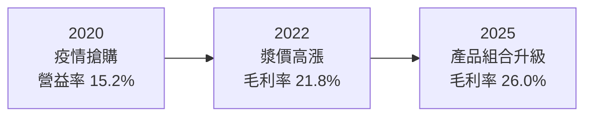
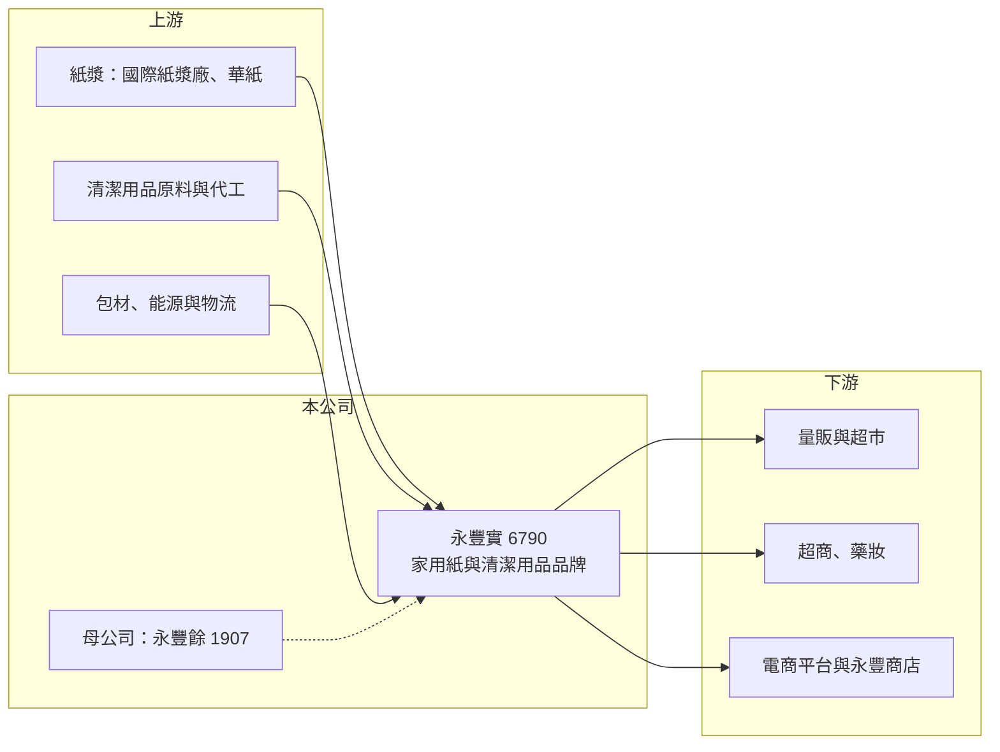

# 6790 永豐實

> 上市｜[[產業索引-造紙工業|造紙工業]]｜上市（櫃）日期 2021/09/29

# 第一章：企業模式與商業藍圖

> [!info] 撰寫說明
> 本文由 Claude 依公開資料整理，架構比照 [[2330台積電]] 的四章研究，資料截至 2026-10-08。財務數字來源：Goodinfo 年度經營績效頁、富果研究 2026 年 2 月法說會整理（品牌、營收比重、策略、2025 年財務與股利）、證交所開放資料（基本資料、2026 年第二季資產負債與營益分析、股利、本益比）；產業描述為整理性內容，尚未逐條比對原始文件。#待校對

在評估單一個股的長期投資價值時，首要步驟是拆解企業的底層獲利邏輯。本章針對永豐餘消費品實業（股票代號：6790，以下簡稱永豐實）的商業模式進行定性分析，說明一家從紙廠分割出來的消費品公司，如何靠品牌與通路在競爭激烈的家用紙市場維持穩定獲利。

## 一、核心定位：家用紙與清潔用品的雙品類品牌商

永豐實成立於 1986 年，2007 年承接 [[1907永豐餘]] 分割出來的家庭用品事業，2021 年 9 月上市，實收資本額約 26.7 億元。依公司法說會的說法，永豐實是台灣第一家同時經營[[家庭用紙]]與清潔用品的公司，業務涵蓋台灣與中國大陸。

它的品牌組合分為兩大類：

* **家庭用紙：** 五月花（主打創新與高品質，代表產品為厚棒、極上系列）、柔情（溫暖愉悅的生活體驗）、得意（超值實惠）。
* **清潔用品：** 橘子工坊（天然、高效，強調健康安全）、植淨美（天然香氛）、新淨與得意（高 CP 值）。

這種「高、中、低」價位帶分明的多品牌策略，讓永豐實可以同時服務重視品質的消費者與價格敏感的消費者，在通路上占據更多貨架。

## 二、營收結構

2025 年的營收結構如下（富果法說會整理）：

* **依產品：** 紙品 83%、潔品及其他 17%，潔品占比逐年增加。
* **依地區：** 台灣 73%、中國大陸 27%，台灣占比近年持續提升。中國市場需求疲弱、價格競爭激烈，公司選擇穩價而不降價，因此營收略減。
* **新品節奏：** 2024 年推出五月花厚棒全紙包裝抽取式衛生紙、橘子工坊洗衣膠囊；2025 年推出得意掛式廚房紙巾、橘子工坊洗碗錠與洗手乳，持續以新品提高單價與毛利。

## 三、資本轉化邏輯：品牌、通路與物流

* **通路覆蓋是核心資產：** 產品遍及台灣超過 20,000 個零售點，加上自營電商「永豐商店」。家用紙體積大、單價低，通路覆蓋率與物流效率決定能不能賺錢。
* **[[紙漿]]是最大成本：** 紙漿價格自 2025 年第四季起上漲，公司的策略是在漲價初期建立相對低價的庫存，漲勢趨緩時調整採購量，並搭配彈性促銷，長期來看漿價波動對獲利的影響相對穩定。
* **物流「去節點化」：** 減少倉儲與配送的中間節點，降低物流成本，這是消費品公司長期提高營業利益率的重要手段。

## 四、企業長期藍圖

公司在法說會提出四大方向：

1. **紙品升級：** 聚焦高階抽取式衛生紙與廚房紙巾，優化產品組合與毛利。
2. **潔品擴張：** 從洗衣延伸到家庭清潔與個人清潔，目標把橘子工坊打造為全方位健康品牌。
3. **代理與代營運服務：** 運用自身通路與營運能力替其他品牌提供服務，創造額外營收。
4. **供應鏈效益：** 推動生產自動化、節能降耗與倉儲物流效率提升。

整體來看，永豐實的成長策略不是追求營收規模，而是透過產品組合升級與高毛利的潔品，提高單位獲利。

# 第二章：護城河深度與競爭優勢

本章分析永豐實的競爭優勢，說明家用紙這個看似同質的市場，護城河從何而來。

## 一、護城河的核心組成要素

* **品牌認知：** 五月花是台灣家用紙的老品牌，消費者熟悉度高；橘子工坊在天然清潔用品中有清楚定位。在貨架上，品牌是消費者快速選購的依據，也讓公司有一定定價空間。
* **通路與物流規模：** 台灣 2 萬個以上零售點的覆蓋，加上自有物流與倉儲，使新品牌很難在短時間內取得相同的鋪貨能力。這也是公司能推出代理與代營運服務的基礎。
* **多品牌、多價位：** 高中低價位帶的品牌組合，讓永豐實在景氣好壞時都有對應的產品，不容易被單一價格帶的競爭者打敗。
* **集團與原料支援：** 作為永豐餘集團的一員，與集團內的紙漿與紙業資源有協同效果（具體供應比例未查得）。

## 二、主要競爭對手格局

| 競爭對手 | 主要市場 | 與永豐實的比較 |
|---|---|---|
| 金百利克拉克（舒潔、可麗舒） | 台灣、全球 | 國際品牌，高價位帶主要對手 |
| [[1904正隆]]（家用紙品牌，待校對） | 台灣 | 工紙廠跨足家用紙 |
| 通路自有品牌 | 台灣 | 量販與超市的自有品牌，以低價搶市 |
| 花王、P&G、白蘭等 | 台灣清潔用品 | 清潔用品主要國際品牌 |
| 維達、恆安、中順潔柔 | 中國 | 中國家用紙龍頭，規模遠大於永豐實 |

## 三、優勢轉化：守得住、守不住與觀察重點

* **守得住：** 台灣家用紙的品牌與通路。家用紙是日常必需品，需求穩定，永豐實 2021 至 2025 年 ROE 都在 13% 以上，證明它在台灣市場有穩定的超額報酬。
* **守不住：** 中國市場的價格。中國家用紙產能過剩、本地品牌強勢，永豐實的中國營收占比逐年下降。
* **觀察重點：** 潔品占比能否持續提高、高階紙品能否帶動毛利率，以及漿價上漲時能否順利轉嫁。

# 第三章：財務體質與盈利規模

資料日期：2026-10-08。數字取自 Goodinfo 年度經營績效頁、富果法說會整理與證交所開放資料，表格是撰寫當時的快照；最新月營收、毛利率、累計 EPS 由自動排程寫在本筆記的屬性欄位（月營收、毛利率、累計EPS 等）。#待校對

財務報表是檢驗護城河是否真實存在的最終標準。本章用多年度的三率、ROE 與資本報酬，檢視永豐實的品牌生意是否真的穩定賺錢。

## 一、獲利能力的基石：三率

| 年度 | 營收（新台幣） | [[毛利率]] | [[營業利益率]] | EPS（元） | [[ROE]] |
|---|---|---|---|---|---|
| 2019 | 105 億 | 22.4% | 7.38% | 1.92 | 17.4% |
| 2020 | 101 億 | 31.9% | 15.2% | 6.12 | 42.6% |
| 2021 | 98.9 億 | 27.1% | 12.5% | 4.24 | 22.7% |
| 2022 | 101 億 | 21.8% | 8.85% | 2.55 | 12.9% |
| 2023 | 103 億 | 25.6% | 11.0% | 3.62 | 17.6% |
| 2024 | 109 億 | 22.8% | 8.47% | 2.78 | 13.1% |
| 2025 | 106.5 億 | 26.0% | 9.37% | 3.03 | 14.0% |
| 2026 上半年 | 53.6 億 | 28.03% | 8.88% | 1.52 | 未查得 |

註：2019 至 2020 年為上市前數字，2020 年 EPS 與 ROE 偏高，可能與疫情搶購衛生紙及當時的股本規模有關（推估）。

* **[[毛利率]]：** 毛利率主要隨紙漿成本反向波動。2022 年漿價高漲時降到 21.8%，2025 年漿價較低加上高階產品比重提高，回升到 26%；2026 年上半年進一步升到 28.03%（證交所營益分析）。
* **[[營業利益率]]：** 長期維持在 8% 至 12%，波動遠小於工紙或紙漿廠，顯示品牌消費品的獲利穩定度。2025 年營業費用年增 13.6%，屬於對通路、物流與數位化的策略性投資。
* **營收趨勢：** 2021 至 2025 年營收大致在 100 億至 110 億元之間，年複合成長率約 1.7%（推算），屬於成熟市場的低成長。

## 二、[[ROE]]：資本效率

2021 至 2025 年平均 ROE 約 16.1%（推算），在台灣紙業中遙遙領先。高 ROE 的原因是品牌消費品不需要像紙漿或工紙那樣大量投入重資產，加上高配息讓股東權益不會無限膨脹。2026 年第二季底每股淨值約 20.92 元，股價淨值比約 1.79 倍（證交所開放資料），是台灣紙業中唯一明顯高於 1 倍的公司之一。

## 三、資本支出、自由現金流與股利

永豐實的資本支出以紙機維護、自動化與倉儲物流為主，規模相對營收不高，自由現金流長期為正（推估，具體金額未查得）。股利方面，2025 年度配發現金股利 2.65 元，[[配發率]] 87.5%；2026 年 10 月初殖利率約 7.10%（證交所本益比資料）。高配發率與穩定的營業利益，讓永豐實成為典型的高殖利率民生股。

## 四、[[ROIC]] 與 [[WACC]]：價值創造利差

**ROIC 推算：** 2025 年營業利益約 10.0 億元，扣除 20% 稅率後約 8.0 億元。2026 年第二季底權益總計約 55.9 億元，總負債約 52.8 億元，其中包含大量應付帳款等營運負債，假設約 40% 為有息負債（推估，約 21 億元），投入資本約 77 億元，ROIC 約 10.4%（推算）。

**WACC 推算：** 假設台灣 10 年期公債殖利率 1.75%、市場風險溢酬 6%、β 取民生消費品常見值 0.6，股東權益成本約 5.35%。負債成本假設 2.0%，稅後約 1.6%；以帳面價值計，權益約占 73%，WACC 約 4.3%（推算）。

**結論：** 永豐實的 ROIC 約為 WACC 的兩倍以上，利差約 6 個百分點，代表它長期持續創造價值。這種利差來自品牌與通路帶來的定價能力，而不是產能規模。只要品牌地位與通路優勢不被侵蝕，永豐實可以在低成長的環境下維持穩定的超額報酬。

# 第四章：總體風險與地緣政治

任何企業都無法脫離宏觀環境獨立存在。本章分析永豐實長期必須面對的原料、市場結構、地緣政治與營運風險。

## 一、原料與成本

* **紙漿價格：** 紙漿是家用紙的主要原料，國際漿價上漲時毛利率會被壓縮，雖然公司以庫存與促銷策略平滑影響，但漿價大漲的年份仍會明顯影響獲利。
* **能源與物流成本：** 抄紙需要大量能源，家用紙體積大、運費占比高，電價、燃料與人力成本上升都會壓縮利潤。

## 二、產業結構與競爭

* **通路議價力：** 量販、超市與電商平台掌握消費者流量，通路的上架費、促銷要求與自有品牌，都會擠壓品牌商的利潤。
* **價格戰：** 家用紙在促銷檔期常出現價格戰，國際品牌與通路品牌的低價策略，可能迫使永豐實跟進。
* **人口結構：** 台灣人口減少與高齡化，長期會限制家用紙的總需求，成長必須靠產品升級與新品類。

## 三、地緣政治與中國市場

* **中國業務：** 中國營收約占 27%，中國家用紙市場產能過剩、價格競爭激烈，公司選擇穩價導致營收下滑，未來可能需要調整中國的產能或經營策略。
* **兩岸關係：** 兩岸關係變化會影響中國子公司的經營與資產價值。

## 四、營運與法規

* **品牌經營：** 消費者偏好變化快，新品開發與行銷投資若效果不如預期，費用率上升會壓縮營業利益率。
* **環保法規：** 包裝減塑、碳費與廢水排放標準，都會要求增加環保投資。

# 專有名詞解析

## 金融

- **[[配發率]]**：現金股利占每股盈餘的比例，代表公司把多少獲利以現金發給股東。
- **[[ROIC]]**：投入資本報酬率，稅後營業利益除以股東權益與有息負債的合計，衡量本業對所有資金提供者的報酬。
- **[[WACC]]**：加權平均資金成本，依股東權益與負債的比重加權計算的資金成本，ROIC 高於它才代表創造價值。

## 產業

- **[[家庭用紙]]**：衛生紙、面紙、廚房紙巾等日常生活用紙，需求穩定但品牌與通路競爭激烈。
- **[[紙漿]]**：由木材或回收紙分離出的纖維，是各種紙張的基本原料，國際價格由大型紙漿廠主導。
- **[[自有品牌]]**：公司以自己的品牌銷售產品，掌握定價與通路，但需負擔行銷與售後服務成本。

# 核心供應鏈

## 1. 上游：原料與代工
- 紙漿：國際紙漿廠、集團內的 [[1905華紙]]（供應比例未查得）
- 清潔用品原料與代工廠、包材與物流業者

## 2. 中游：永豐實本身與集團
- 母公司：[[1907永豐餘]]
- 競爭品牌：金百利克拉克、花王、P&G、通路自有品牌

## 3. 下游：零售通路
- 量販、超市、超商、藥妝與電商平台

## 最新新聞
<!-- news:start -->
<!-- news:end -->

## 相關連結
- [公開資訊觀測站](https://mopsov.twse.com.tw/mops/web/t05st03?step=1&firstin=1&co_id=6790)
- [Goodinfo](https://goodinfo.tw/tw/StockDetail.asp?STOCK_ID=6790)
- [Yahoo 股市](https://tw.stock.yahoo.com/quote/6790)
- [鉅亨網新聞](https://www.cnyes.com/twstock/6790/news)
