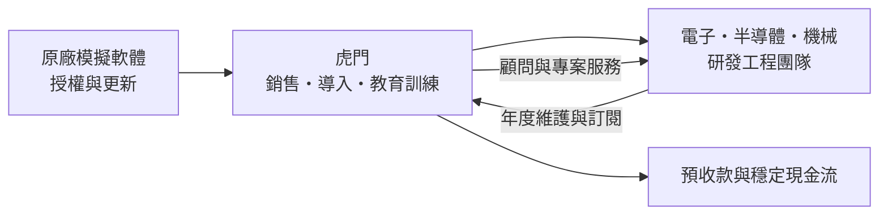
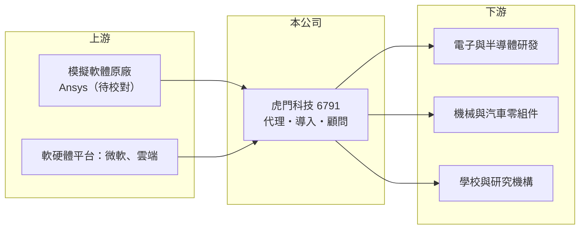

# 6791 虎門科技

> 上櫃｜[[產業索引-資訊服務業|資訊服務業]]｜上市（櫃）日期 2022/11/14

# 第一章：企業模式與商業藍圖

> [!info] 撰寫說明
> 本文由 Claude 依公開資料整理，架構比照 [[2330台積電]] 的四章研究，資料截至 2026-10-08。財務數字來源：Goodinfo 年度經營績效頁、櫃買中心開放資料（基本資料、2026 年第二季資產負債與綜合損益、本益比殖利率）；代理品牌與業務內容主要憑記憶整理，標示「待校對」者尚未比對原始文件。公開資料有限。#待校對

拆解一家軟體代理商的價值，關鍵在於它賣的是別人的軟體，還是自己累積的工程知識。本章說明虎門科技（股票代號：6791，以下簡稱虎門）如何以工程模擬軟體代理為核心，靠技術服務與客戶黏著度經營四十多年。

## 一、核心定位：工程模擬軟體的代理與技術服務商

虎門成立於 1980 年，2022 年 11 月在櫃買中心掛牌，實收資本額約 2.08 億元，是一家規模不大但歷史很長的資訊服務公司。依記憶，虎門的主力是代理美國 Ansys 的[[CAE]]（電腦輔助工程）模擬軟體，客戶用它在電腦上模擬結構強度、流體、散熱與電磁行為，以減少實體打樣的次數與成本（待校對）。

這類軟體的價值不只在授權本身。模擬軟體門檻高，客戶需要有人教會工程師建模、設定邊界條件與解讀結果，因此代理商的技術團隊、教育訓練與顧問服務，往往才是客戶選擇通路的理由。虎門的[[毛利率]]長期維持在 40% 左右，明顯高於一般硬體代理商，反映的就是這種以技術服務加值的商業模式。

## 二、營收結構與客戶

公開資料未查得虎門的營收比重。就產業常態推估，收入可分為三類：一是新授權銷售，二是年度維護與訂閱續約，屬於[[經常性收入]]，三是顧問、教育訓練與專案模擬服務。客戶以電子、半導體、機械、汽車零組件與學研單位為主，台灣電子業在散熱、訊號完整性與封裝可靠度上的模擬需求，是近年營收成長的主要來源（推估，待校對）。

## 三、資本轉化邏輯：輕資產、預收款與現金流

* **輕資產：** 虎門不需要工廠或大型設備，主要資產是人才與客戶關係，2026 年第二季底資產總計約 8.6 億元。資本支出很小，獲利多半能轉為現金。
* **預收款特性：** 軟體授權與維護通常按年預收，2026 年第二季底流動負債約 3.25 億元，推估大部分是合約負債與應付原廠款項，而非銀行借款。這讓公司在帳上看起來負債不低，實際上是客戶先付錢的結構。

## 四、長期方向

依記憶，Ansys 已在 2025 年被 [[SNPS新思科技]] 併購（待校對）。原廠易主可能帶來兩種影響：正面是模擬軟體與晶片設計工具整合，台灣半導體客戶的需求擴大；負面是原廠可能調整通路政策、改走直銷或重新分配代理區域。虎門長期能否維持地位，取決於它能否把自身定位從「代理商」提升為「客戶不可或缺的模擬技術夥伴」。2025 年營收 8.06 億元、年增約 19%，顯示目前需求仍在擴張。

# 第二章：護城河深度與競爭優勢

軟體代理商的護城河通常不深，因為產品不是自己的。本章分析虎門靠什麼維持客戶，以及最大的威脅在哪裡。

## 一、護城河的組成

* **技術服務與人才：** 模擬分析需要物理、機械、電機背景的應用工程師，培養一位能獨立支援客戶的工程師需要數年。虎門累積數十年的案例與教學經驗，是新進通路短期內難以複製的。
* **轉換成本：** 客戶的工程師一旦熟悉某一套模擬軟體，累積的模型、流程與驗證資料都綁在該平台上，更換軟體要重新訓練與驗證，因此續約率通常很高。
* **長期代理關係：** 原廠在一個地區通常只保留少數通路，長期合作的代理權本身就是一種准入門檻。

## 二、主要競爭對手

| 對手 | 定位 | 與虎門的比較 |
|---|---|---|
| 原廠直銷團隊 | 大型客戶由原廠直接服務 | 原廠若擴大直銷，代理商的空間會被壓縮 |
| 其他模擬軟體（如西門子、達梭系統、Altair、COMSOL 的代理商） | 提供同類型模擬工具 | 在特定應用（流體、多物理）直接競爭 |
| [[8416實威]] | 3D 設計軟體代理，延伸到模擬模組 | 服務同一群機械與電子研發客戶 |

## 三、守得住與守不住

* **守得住：** 已導入的研發客戶與續約收入。只要原廠產品維持技術領先，客戶不會輕易更換。
* **守不住：** 代理權本身。原廠的通路政策是虎門無法控制的最大變數，一旦原廠收回代理或改為直營，營收可能大幅下滑。
* **觀察重點：** 原廠被併購後的通路政策、[[營業利益率]]能否回到 15% 以上，以及自有顧問服務占比是否提高。

# 第三章：財務體質與盈利規模

資料日期：2026-10-08，表格是撰寫當時的快照；最新月營收、毛利率、累計 EPS 由自動排程寫在本筆記的屬性欄位（月營收、毛利率、累計EPS 等）。#待校對

財務數字是檢驗代理商價值的最好工具：毛利率看加值能力，營業利益率看費用控制，ROE 看資本效率。

## 一、多年度財務表

| 年度 | 營收（新台幣） | [[毛利率]] | [[營業利益率]] | EPS（元） | [[ROE]] |
|---|---|---|---|---|---|
| 2021 | 4.72 億 | 45.8% | 18.9% | 3.85 | 22.9% |
| 2022 | 5.36 億 | 41.2% | 15.7% | 3.87 | 19.0% |
| 2023 | 6.02 億 | 40.9% | 14.3% | 3.87 | 17.8% |
| 2024 | 6.76 億 | 38.4% | 12.4% | 4.16 | 18.6% |
| 2025 | 8.06 億 | 41.0% | 10.4% | 4.16 | 17.7% |
| 2026 上半年 | 4.01 億 | 40.5% | 13.7% | 2.65 | 未查得 |

資料來源：Goodinfo；2026 上半年為櫃買中心開放資料。

* **營收穩定成長：** 2020 至 2025 年營收從 4.54 億元增加到 8.06 億元，年複合成長率約 12.2%（推算），屬於中小型軟體代理商中成長較快的一群。
* **毛利率穩、營益率下滑：** 毛利率維持 38% 至 46%，但營業利益率從 2021 年的 18.9% 降到 2025 年的 10.4%，代表營收成長的同時，人力與營業費用增加得更快。2026 上半年營益率回到 13.7%，是否持續值得追蹤。
* **配息：** Goodinfo 統計 2021 至 2026 年平均現金股利約 3.37 元，以近年 EPS 約 4 元計算，配息率約八成（推算），符合輕資產公司高配息的特性。

## 二、ROE 與長期指標

2021 至 2025 年平均 ROE 約 19.2%（推算）。虎門幾乎沒有借款，ROE 主要來自高周轉與穩定獲利，而非財務槓桿，品質相對好。自由現金流推估長期為正，因為資本支出極低、收入以預收為主（具體金額未查得）。

## 三、[[ROIC]] 與 [[WACC]]

**ROIC 推算：** 2025 年營業利益 0.84 億元，扣除 20% 稅率後約 0.67 億元。2026 年第二季底權益總計約 5.04 億元，有息負債未查得，推估接近零（負債以合約負債與應付帳款為主），投入資本約 5.04 億元，ROIC 約 13%（推算）。若以 2026 上半年營業利益 0.55 億元年化，ROIC 約 17%（推算）。

**WACC 推算：** 台灣 10 年期公債殖利率假設 1.75%、市場風險溢酬 6%、β 取資訊服務業常見值 0.8（同業估計值，非公司數字），股東權益成本約 6.55%。公司幾乎沒有有息負債，WACC 約等於股東權益成本，約 6.5%（推算）；若考量小型股的規模溢酬，實際資金成本可能在 8% 上下。

**結論：** 虎門的 ROIC 約為 WACC 的兩倍，代表它長期在創造價值。但這個利差建立在代理權之上，屬於「借來的護城河」，投資人應把原廠政策視為最大的價值風險。

# 第四章：總體風險與地緣政治

軟體代理商的風險多半不是景氣，而是對單一原廠的依賴。本章整理虎門長期要面對的風險。

## 一、產業週期

* **研發預算週期：** 客戶購買模擬軟體屬於研發支出，電子與機械產業景氣下滑時，新授權採購可能延後，但維護與訂閱收入相對穩定，能緩衝衝擊。
* **授權模式轉變：** 軟體業從永久授權轉向訂閱制，短期可能讓營收認列變得平緩，長期則提高收入的可預測性。

## 二、營運風險

* **原廠集中：** 營收高度依賴單一原廠的產品線（待校對），原廠併購、改組或調整代理政策，都會直接衝擊虎門。
* **人才流失：** 應用工程師是核心資產，若被原廠、客戶或競爭對手挖角，服務品質與客戶關係會受影響。
* **費用率上升：** 2021 至 2025 年營益率持續下滑，若人力成本持續上升而毛利率無法提高，獲利成長會落後營收。

## 三、其他風險

* **匯率：** 授權成本多以美元計價，新台幣貶值時進貨成本上升，若無法轉嫁會壓縮毛利。
* **出口管制：** 高階工程模擬軟體可能受美國出口管制規範，客戶若涉及受管制地區，銷售會受到限制。
* **AI 與雲端模擬：** AI 加速的模擬工具與雲端訂閱可能降低使用門檻，原廠更容易直接面對客戶，代理商的中間角色可能被弱化。

# 專有名詞解析

## 應用

- **[[CAE]]**：電腦輔助工程，用電腦模擬產品的結構、流體、散熱與電磁行為，以減少實體打樣與測試成本。

## 金融

- **[[毛利率]]**：營業毛利占營收的比例，反映產品定價能力與生產成本控制。
- **[[營業利益率]]**：扣除營業費用後的營業利益占營收的比例，衡量本業整體獲利能力。
- **[[ROE]]**：股東權益報酬率，稅後淨利除以股東權益，衡量公司運用股東資金的效率。
- **[[ROIC]]**：投入資本報酬率，稅後營業利益除以股東權益與有息負債的合計，衡量本業對所有資金提供者的報酬。
- **[[WACC]]**：加權平均資金成本，依股東權益與負債的比重加權計算的資金成本，ROIC 高於它才代表創造價值。

## 產業

- **[[經常性收入]]**：每年按合約重複收取的收入，例如軟體維護費、訂閱費，可預測性高於一次性銷售。
- **[[軟體代理商]]**：取得原廠授權，在特定地區銷售軟體並提供導入、教育訓練與技術支援的公司。
- **[[合約負債]]**：客戶已預付、但公司尚未提供完商品或服務的款項，軟體業的預收維護費多列於此。

# 核心供應鏈

## 1. 上游：軟體原廠
- 模擬軟體原廠：Ansys（待校對），2025 年起為 [[SNPS新思科技]] 旗下（待校對）
- 作業系統與雲端平台：[[MSFT微軟]]

## 2. 中游：虎門與同業
- 3D 設計與模擬軟體代理：[[8416實威]]
- 其他模擬軟體代理商與原廠直銷團隊

## 3. 下游：研發客戶
- 電子、半導體、機械、汽車零組件廠商的研發與工程部門
- 大專院校與研究機構

## 最新新聞
<!-- news:start -->
<!-- news:end -->

## 相關連結
- [公開資訊觀測站](https://mopsov.twse.com.tw/mops/web/t05st03?step=1&firstin=1&co_id=6791)
- [Goodinfo](https://goodinfo.tw/tw/StockDetail.asp?STOCK_ID=6791)
- [Yahoo 股市](https://tw.stock.yahoo.com/quote/6791)
- [鉅亨網新聞](https://www.cnyes.com/twstock/6791/news)
