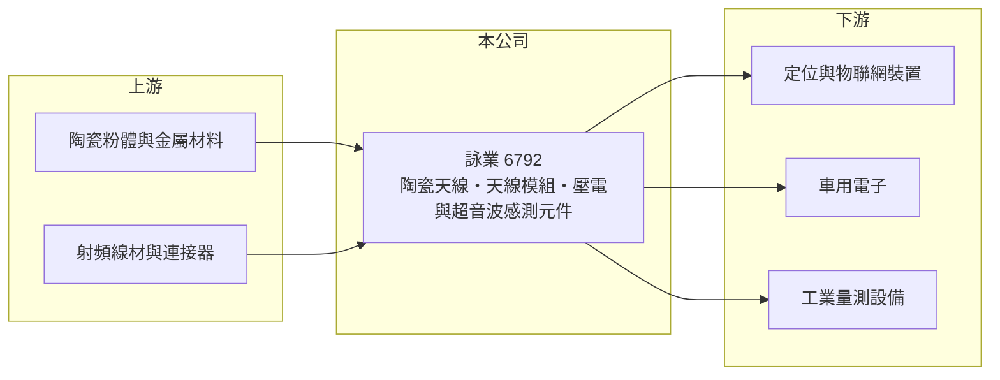

# 6792 詠業

> 上市｜[[產業索引-通信網路業|通信網路業]]｜上市（櫃）日期 2021/12/08

# 第一章：企業模式與商業藍圖

> [!info] 撰寫說明
> 本文由 Claude 依公開資料整理，架構比照 [[2330台積電]] 的四章研究，資料截至 2026-10-08。財務數字來源：Goodinfo 年度經營績效頁與基本資料頁、證交所開放資料（基本資料、2026 年第二季資產負債與損益、營益分析、股利、本益比殖利率）。產品應用與客戶描述部分憑記憶整理，已標「待校對」。#待校對

評估一家天線與感測元件廠，要看它的材料與設計能力能否跟著無線通訊與車用電子的世代升級，打進更多終端產品。本章說明詠業科技（股票代號：6792，以下簡稱詠業）的商業模式。

## 一、核心定位：陶瓷天線與壓電感測元件

詠業成立於 1988 年，2021 年在證交所上市，總部與工廠位於新竹縣關西鎮，實收資本額約 4.8 億元。依公司揭露的主要業務，詠業有兩條產品線：一是高頻天線元件及模組，二是壓電元件與超音波傳感器，兩者都由公司自行研究、開發、生產與銷售，另外也銷售電子零組件與無線通訊產品。

詠業的根基是陶瓷材料。高頻天線中常見的[[陶瓷天線]]，用高介電常數的陶瓷縮小天線尺寸，廣泛用在衛星定位（[[GNSS]]）、物聯網與車載通訊；壓電陶瓷則能把電能轉為振動、再把回波轉回電訊號，是[[超音波感測器]]的核心材料，可用於倒車雷達、液位與流量量測（應用細節待校對）。同一套陶瓷配方與燒結製程能支撐兩條產品線，是詠業的特色。

## 二、產品世代：從定位天線走向多頻與車用

天線產品的世代更替，來自定位系統從單頻走向多頻多系統、物聯網連線從 4G 走向 5G 與低功耗廣域網路，以及汽車加裝更多通訊與感測元件。每一次升級都需要重新設計天線與調校頻段，讓具備設計服務能力的元件廠能持續拿到新案。各產品的營收比重未查得。

## 三、長期方向

詠業的長期方向是把陶瓷材料能力延伸到更多高頻與感測應用，並提高模組化產品的比重，從賣單一元件走向賣整合方案。這個方向的價值在於，模組的單價與設計門檻都比單一元件高，較能擺脫標準品的價格競爭。

# 第二章：護城河深度與競爭優勢

在長期價值投資中，「護城河」指企業抵禦競爭、維持超額利潤的保護機制。本章分析詠業的優勢與限制。

## 一、護城河的組成

* **自有陶瓷材料與製程：** 從陶瓷粉體配方、成型到燒結都自行掌握，能依客戶頻段需求快速調整材料特性。這讓詠業在小批量、多樣化的工業與車用訂單上具有彈性。
* **設計導入的轉換成本：** 天線與感測器要配合終端產品的機構與頻段一起設計，通過測試後很少中途更換，產品生命週期內訂單相對穩定。
* **毛利率相對高：** 2020 至 2025 年毛利率維持在 28% 至 42%，高於一般網通組裝廠，反映元件設計的附加價值。

## 二、主要競爭對手

| 對手 | 定位 | 對詠業的威脅 |
|---|---|---|
| [[3138耀登]] | 天線設計與量測 | 在天線設計案直接競爭 |
| 6284佳邦 | 天線與保護元件 | 產品線部分重疊 |
| [[3152璟德]] | 陶瓷高頻元件 | 陶瓷材料技術相近 |
| 日系與中國大陸天線、壓電元件廠 | 規模大、價格競爭 | 壓縮標準品價格 |

## 三、守得住／守不住／觀察重點

守得住的是需要客製設計的工業、車用與定位產品。守不住的是消費性與標準品天線的價格，2024 年毛利率降到 28.5%、營業利益率僅 2.35%，說明需求轉弱時仍會承壓。長期觀察重點是車用與超音波感測產品能否成為第二成長引擎，以及營業利益率能否回到 2021 至 2022 年的兩成水準。

# 第三章：財務體質與盈利規模

資料日期：2026-10-08，表格是撰寫當時的快照；最新月營收、毛利率、累計 EPS 由自動排程寫在本筆記的屬性欄位（月營收、毛利率、累計EPS 等）。#待校對

財務報表是檢驗護城河是否真實存在的最終標準。本章用六年的三率、ROE 與資本報酬，檢視詠業的獲利品質。

## 一、多年度經營績效

| 年度 | 營收（新台幣） | [[毛利率]] | [[營業利益率]] | EPS（元） | [[ROE]] |
|---|---|---|---|---|---|
| 2020 | 12.9 億 | 37.6% | 14.0% | 4.01 | 17.2% |
| 2021 | 17.1 億 | 42.4% | 20.4% | 6.60 | 20.7% |
| 2022 | 15.0 億 | 39.5% | 17.1% | 5.68 | 15.6% |
| 2023 | 13.8 億 | 36.1% | 14.9% | 4.18 | 11.5% |
| 2024 | 12.3 億 | 28.5% | 2.35% | 2.10 | 5.95% |
| 2025 | 13.2 億 | 32.0% | 8.77% | 2.23 | 6.71% |
| 2026 上半年 | 7.17 億 | 35.7% | 12.4% | 1.68 | 未查得 |

詠業的營收規模在 12 至 17 億元之間波動，2020 至 2025 年營收年複合成長率約 0.5%（推算），成長並不明顯。獲利的變化主要來自毛利率：2021 年毛利率 42% 時營業利益率超過兩成，2024 年毛利率降到 28.5% 時營業利益率只剩 2%。2021 至 2025 年平均 ROE 約 12.1%（推算），但呈現逐年下滑。2025 年度配發現金股利每股 2.5 元，其中 1.5 元來自盈餘、1.0 元來自[[資本公積]]，盈餘配發率約 67%（推算），總配發額高於當年 EPS，顯示公司重視股利但部分靠資本公積支應。2026 年上半年毛利率回到 35.7%，EPS 1.68 元已接近 2025 全年的四分之三。

## 二、[[ROIC]] 與 [[WACC]]：價值創造利差

**ROIC 推算：** 2025 年營業利益約 1.16 億元（13.2 億 × 8.77%），稅後約 0.93 億元。2026 年第二季股東權益約 15.9 億元，負債約 5.3 億元，假設有息負債約 1.5 億元（推估），投入資本約 17.4 億元，2025 年 ROIC 約 5.3%（推算）；以 2026 年上半年營業利益 0.89 億元年化，ROIC 約 8.2%（推算）。

**WACC 推算：** 台灣 10 年期公債 1.75%、市場風險溢酬 6%、β 取電子零組件同業常見值 1.0，股東權益成本約 7.8%；負債成本 2.5%、稅後 2.0%；權益占投入資本約 91%，WACC 約 7.2%（推算）。

**結論：** 詠業在 2020 至 2023 年的 ROIC 明顯高於 WACC，2024 至 2025 年則低於資金成本。2026 年上半年的回升讓利差重新轉正，能否維持取決於毛利率是否穩定在 35% 以上。

# 第四章：總體風險與地緣政治

任何企業都無法脫離宏觀環境獨立存在。本章分析詠業長期必須面對的風險。

## 一、終端需求週期

天線與感測元件分散在定位、物聯網、工業與車用等多種終端，單一市場的影響有限，但整體仍跟著消費電子與工業庫存週期起伏。2024 年的獲利下滑就是庫存調整的結果。

## 二、技術與競爭風險

無線通訊頻段與定位系統持續演進，若新世代產品轉向整合在晶片或模組內的天線設計，獨立天線元件的需求可能被取代。中國大陸元件廠在標準品上的價格競爭也會持續。

## 三、匯率與成本

產品以外銷為主（推估），新台幣升值會壓縮毛利率；陶瓷原料與能源成本上漲也會影響燒結製程的成本。

# 專有名詞解析

## 應用

- **[[陶瓷天線]]**：以高介電陶瓷材料製作的小型天線，體積小、頻率穩定，常用於定位與物聯網裝置。
- **[[GNSS]]**：全球導航衛星系統，包含美國 GPS、歐盟 Galileo、中國北斗等定位系統的統稱。
- **[[超音波感測器]]**：發出超音波並接收回波來量測距離或流量的元件，核心是壓電陶瓷，常用於倒車雷達。

## 金融

- **[[資本公積]]**：股東繳入超過面額的部分等非盈餘來源的權益，可依法發放現金，但不是公司本業賺來的錢。
- **[[ROIC]]**：投入資本報酬率，稅後營業利益除以股東權益與有息負債的合計，衡量本業對所有資金提供者的報酬。
- **[[WACC]]**：加權平均資金成本，依股東權益與負債的比重加權計算的資金成本，ROIC 高於它才代表創造價值。

# 核心供應鏈

## 1. 上游：材料
- 陶瓷粉體、銀漿等電極材料與射頻線材供應商

## 2. 中游：詠業與同業
- 同業：[[3138耀登]]、6284佳邦、[[3152璟德]]

## 3. 下游：客戶
- 定位與物聯網裝置品牌、車用電子與工業量測設備廠（具體客戶未查得）

## 最新新聞
<!-- news:start -->
<!-- news:end -->

## 相關連結
- [公開資訊觀測站](https://mopsov.twse.com.tw/mops/web/t05st03?step=1&firstin=1&co_id=6792)
- [Goodinfo](https://goodinfo.tw/tw/StockDetail.asp?STOCK_ID=6792)
- [Yahoo 股市](https://tw.stock.yahoo.com/quote/6792)
- [鉅亨網新聞](https://www.cnyes.com/twstock/6792/news)
