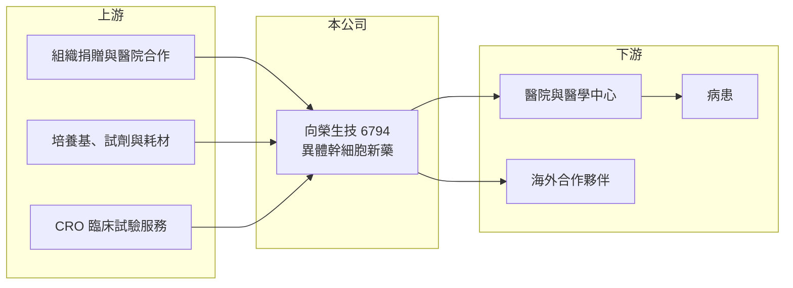

# 6794 向榮生技

> 上市｜[[產業索引-生技醫療業|生技醫療業]]｜上市（櫃）日期 2025/10/16

# 第一章：企業模式與商業藍圖

> [!info] 撰寫說明
> 精簡版，由 Claude 依公開資料整理，架構比照 [[2330台積電]] 的四章研究，資料截至 2026-10-08。來源：證交所開放資料（基本資料、2026 年第二季綜合損益與資產負債、營益分析）、Goodinfo 經營績效頁、nStock 公司頁。公開資料有限，產品名稱與臨床細節部分憑記憶撰寫，已標「待校對」。#待校對

向榮生技（以下簡稱向榮）是以異體幹細胞為核心的台灣[[再生醫療]]公司，本章說明它的業務來源、技術路線與產品線。

- **核心業務：** 向榮成立於 2018 年 3 月，同年 7 月承接麗彤生醫（原翔宇生醫）分割出來的生醫事業部，總部在台北內湖。主要業務是幹細胞[[新藥]]研發，以及人體組織來源幹細胞的檢測、萃取、儲存與技術開發。證交所資料顯示上市日期為 2024 年 5 月，依 nStock 整理，2025 年 10 月轉列一般板上市（待校對）。
- **技術路線：** 向榮的核心是[[異體幹細胞]]，也就是從捐贈者取得細胞、擴增後做成可以給多位病人使用的現成產品，產品名稱為 ELIXCYTE（待校對）。和自體細胞相比，異體產品可以標準化量產，成本與品質一致性較佳，是幹細胞產業走向藥品化的主流方向。
- **產品線：** 膝骨關節炎適應症已進入三期臨床，2023 年完成首位受試者收案；慢性腎衰竭適應症也在臨床試驗中。膝關節退化是高齡化社會的大市場，若能證明延緩退化的效果，商業潛力大，但三期試驗耗時長、成本高。
- **營收結構：** 營收規模很小，2025 年全年約 0.30 億元，來源主要是細胞相關技術服務與檢測儲存業務（待校對），還不足以支應研發。
- **長期方向：** 向榮的長期目標是讓幹細胞產品取得藥證，並配合台灣再生醫療相關法規開放，先以法規允許的[[細胞治療]]服務產生收入，再逐步走向藥品銷售與國際授權。2023 年 [[2023燁輝]] 投資約 2.08 億元，是公司研發資金的重要來源之一。

# 第二章：護城河深度與競爭優勢

再生醫療的競爭重點在於細胞製程、臨床數據與法規進度。本章分析向榮的優勢、對手與限制。

- **競爭優勢：** 異體幹細胞要做到批次間品質一致，需要符合 GTP／GMP 規範的細胞製程與品管體系，這類經驗與設施需要多年累積。向榮的膝骨關節炎已走到三期臨床，在台灣幹細胞新藥公司中屬於進度較前面的一群。
- **主要對手：** 台灣做細胞治療與再生醫療的上市櫃公司有 [[4743合一]]、[[6733博晟生醫]]、[[6712長聖]] 等，國際上則有日本、韓國已取得有條件上市許可的幹細胞產品。膝關節領域還要面對玻尿酸注射、高濃度血小板血漿（PRP）與人工關節置換等既有療法。
- **護城河的限制：** 幹細胞療效常有個體差異，若三期數據不夠明確，療效難以說服醫師與保險給付單位。技術本身也不像小分子藥物有清楚的專利邊界，對手容易用不同細胞來源切入相同適應症。
- **觀察重點：** 膝骨關節炎三期試驗的解盲時程與結果、細胞治療服務收入能否穩定成長，以及海外合作是否有具體授權金額。

# 第三章：財務體質與盈利規模

資料日期：2026-10-08，表格是撰寫當時的快照；最新月營收、毛利率、累計 EPS 由自動排程寫在本筆記的屬性欄位（月營收、毛利率、累計EPS 等）。#待校對

研發型公司的財報重點是虧損幅度與現金存量。向榮過去六年都處於研發投入期，虧損幅度相對穩定。

| 年度 | 營收（億元） | [[毛利率]] | [[營業利益率]] | EPS（元） | [[ROE]] |
|---|---|---|---|---|---|
| 2020 | 0.04 | 58.7% | -2,796% | -3.07 | -34.2% |
| 2021 | 0.08 | 71.3% | -1,068% | -2.29 | -28.5% |
| 2022 | 0.14 | 56.9% | -640% | -2.20 | -30.5% |
| 2023 | 0.25 | 72.8% | -392% | -1.56 | -18.1% |
| 2024 | 0.32 | 64.5% | -323% | -1.62 | -14.5% |
| 2025 | 0.30 | 63.0% | -433% | -1.89 | -14.8% |
| 2026 上半年 | 0.11 | 62.1% | -510.7% | -0.76 | 未查得 |

- **虧損結構：** 營收從 2020 年的 400 萬元成長到 2024 年約 3,200 萬元，但每年營業虧損仍在 1 億元以上，代表臨床試驗費用才是主要支出。毛利率維持在 60% 上下，顯示細胞服務本身有利潤，只是規模太小。
- **財務結構：** 2026 年第二季底股東權益約 8.19 億元，累積虧損約 7.68 億元，負債總計僅 0.77 億元（證交所資料），幾乎沒有借款。以每年約 1 億元以上的營業虧損推估，現金可支應數年，但三期試驗後段與上市準備可能需要再募資（推估）。
- **股利：** 歷年無配發股利。

**[[ROIC]] 與 [[WACC]]：** 2025 年營業損失約 1.30 億元（0.30 億元 × -433%），虧損不計稅盾，投入資本以股東權益約 8.19 億元、有息負債約 0 計，ROIC 約 -16%（推算）。WACC 以 CAPM 推估：無風險利率 1.75%、市場風險溢酬 6%、β 取生技新藥同業常見值 1.2，幾乎無負債，WACC 約 9%（推算）。ROIC 遠低於 WACC，表示目前仍在消耗股東資本，長期能否創造價值完全取決於幹細胞產品能否取證並商業化。

# 第四章：總體風險與地緣政治

再生醫療的風險集中在臨床結果、法規與資金。本章整理向榮長期面對的主要風險。

- **臨床風險：** 三期臨床是新藥開發中金額最大、失敗代價最高的階段，若主要療效指標未達標，公司價值會大幅修正。細胞產品的療效評估也較主觀，例如疼痛與關節功能分數，容易受安慰劑效應影響。
- **法規風險：** 台灣再生醫療相關法規近年才逐步建立，審查標準、給付方式與跨國互認都還在演變。法規收緊或審查時程延長，都會延後收入。
- **資金風險：** 公司長期處於虧損，研發資金依賴現金增資與策略投資人，生技股市場冷清時募資成本會大幅上升，股權也可能被稀釋。
- **其他風險：** 細胞製程對設備、無菌環境與人員訓練要求高，製程偏差可能造成批次報廢；海外市場拓展需要配合各國法規，執行難度高。

# 專有名詞解析

## 金融

- **[[ROIC]]**：投入資本報酬率，稅後營業利益除以投入資本（股東權益加有息負債），衡量本業創造報酬的能力。
- **[[WACC]]**：加權平均資金成本，依權益與負債比重加權的資金成本，是 ROIC 需要超越的門檻。

## 產業

- **[[再生醫療]]**：利用細胞、生物材料或生長因子，促使受損組織自行修復或再生的醫療領域。
- **[[異體幹細胞]]**：取自捐贈者、經擴增後可供多位病人使用的幹細胞，可標準化量產，是幹細胞藥品化的主流路線。
- **[[細胞治療]]**：把經過處理或擴增的細胞輸回人體以治療疾病的醫療方式，台灣依特管辦法與再生醫療法規管理。
- **[[新藥]]**：尚未在市場上市、需經臨床試驗並取得藥證才能販售的藥品。

# 核心供應鏈

- 上游：捐贈組織來源（醫院合作）、細胞培養基與試劑、臨床試驗委託研究機構；2023 年策略投資人為 [[2023燁輝]]。
- 下游／客戶：醫院與醫學中心（細胞治療服務與臨床試驗）、未來的海外授權或合作夥伴。
- 同業：[[4743合一]]、[[6733博晟生醫]]、[[6712長聖]]。

## 最新新聞
<!-- news:start -->
<!-- news:end -->

## 相關連結
- [公開資訊觀測站](https://mopsov.twse.com.tw/mops/web/t05st03?step=1&firstin=1&co_id=6794)
- [Goodinfo](https://goodinfo.tw/tw/StockDetail.asp?STOCK_ID=6794)
- [Yahoo 股市](https://tw.stock.yahoo.com/quote/6794)
- [鉅亨網新聞](https://www.cnyes.com/twstock/6794/news)
