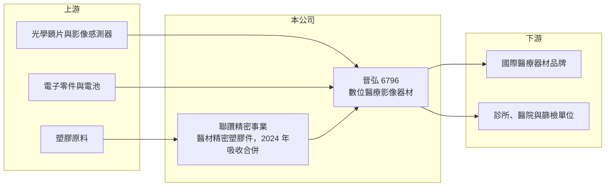

# 6796 晉弘

> 上市｜[[產業索引-生技醫療業|生技醫療業]]｜上市（櫃）日期 2022/06/01

# 第一章：企業模式與商業藍圖

> [!info] 撰寫說明
> 精簡版，由 Claude 依公開資料整理，架構比照 [[2330台積電]] 的四章研究，資料截至 2026-10-08。來源：證交所開放資料（基本資料、2026 年第二季綜合損益與資產負債、營益分析）、Goodinfo 經營績效頁、nStock 公司頁。公開資料有限，產品細項與客戶型態部分憑記憶撰寫，已標「待校對」。#待校對

晉弘科技（以下簡稱晉弘）是新竹科學園區的數位醫療影像器材公司，本章說明它的產品、營收來源與長期策略。

- **核心業務：** 晉弘成立於 2010 年，2022 年 6 月上市，主要業務是設計、製造與銷售數位醫療影像診斷器材。代表性產品是手持式[[眼底攝影機]]，另有數位耳鏡、皮膚鏡等基層診斷用的影像設備，以及內視鏡相關產品（待校對）。
- **營收結構：** 公開資料沒有查到產品別比重。晉弘的營收以外銷為主，除自有品牌外，也替國際醫療器材品牌做[[ODM]]（待校對）。2024 年 1 月 1 日晉弘吸收合併原本就是子公司的聯讚精密，聯讚的業務是醫療器材精密塑膠零組件的模具、射出與模組生產，合併後零組件代工成為公司內部的一個事業單位。
- **營運據點：** 總部與研發在新竹科學園區，合併聯讚後擁有自己的模具與射出產能，可以把光學設計、電子與機構件的開發整合在集團內。
- **長期方向：** 晉弘的策略是從單一眼底攝影產品，擴大到更多基層診所與[[遠距醫療]]用的影像設備，並延伸到拋棄式內視鏡等耗材型產品（待校對）。耗材型產品的意義在於每次使用都產生收入，營收比一次性設備銷售穩定。

# 第二章：護城河深度與競爭優勢

醫療影像器材的競爭關鍵在光學設計、法規認證與通路。本章分析晉弘的優勢與限制。

- **競爭優勢：** 手持式眼底攝影機要在小體積內做到清晰對焦與照明，光學與影像處理門檻高。產品需要取得美國 FDA、歐盟 CE 等[[醫療器材]]許可，取證過程耗時，一旦通過，國際品牌客戶通常會長期合作，形成轉換成本。
- **主要對手：** 眼底攝影市場由日本與歐美眼科設備大廠主導，桌上型設備功能完整但昂貴；晉弘以手持、低價、適合基層與篩檢的定位切入。台灣醫材同業如 [[6569醫揚]]、[[4116明基醫]] 在醫療電子領域有部分重疊，但產品線不同。
- **護城河的限制：** 晉弘規模小，2025 年營收 6.61 億元，研發與認證費用占比高，營收成長若停滯，獲利就會被費用吃掉。2024 年起營業利益率掉到 3% 以下，毛利率也從 50% 以上降到 43% 左右，原因公開資料未說明，推估與產品組合中低毛利品項比重上升、價格競爭有關。
- **觀察重點：** 高毛利的自有影像產品能否恢復成長、耗材型產品的放量進度，以及零組件業務能否提升效率並帶來較好的獲利。

# 第三章：財務體質與盈利規模

資料日期：2026-10-08，表格是撰寫當時的快照；最新月營收、毛利率、累計 EPS 由自動排程寫在本筆記的屬性欄位（月營收、毛利率、累計EPS 等）。#待校對

晉弘的財報可以分成兩段：2020 至 2023 年毛利率維持 50% 以上、營業利益率 12% 至 18%，2024 年起毛利率下滑、本業接近損益兩平，獲利結構明顯改變。

| 年度 | 營收（億元） | [[毛利率]] | [[營業利益率]] | EPS（元） | [[ROE]] |
|---|---|---|---|---|---|
| 2020 | 4.02 | 54.5% | 16.1% | 2.41 | 14.9% |
| 2021 | 4.86 | 52.6% | 17.8% | 2.30 | 15.2% |
| 2022 | 5.02 | 50.7% | 11.9% | 2.20 | 12.3% |
| 2023 | 5.37 | 57.3% | 17.1% | 2.20 | 10.3% |
| 2024 | 5.39 | 43.5% | -0.70% | 0.16 | 0.73% |
| 2025 | 6.61 | 42.3% | 2.71% | 0.20 | 1.04% |
| 2026 上半年 | 3.09 | 37.3% | -9.4% | -0.54 | 未查得 |

- **獲利能力：** 毛利率從 2023 年的 57% 降到 2026 年上半年的 37%，營業利益率由正轉負，公開資料未拆解原因，推估與低毛利品項比重上升及費用增加有關。2021 至 2025 年平均 ROE 約 7.9%（推算），營收五年年複合成長約 10.5%（推算）。
- **股利：** Goodinfo 顯示 2021 至 2026 年發放期間現金股利平均約 1.26 元、股票股利約 0.60 元，但近兩年獲利下滑，配發能力已明顯降低。
- **財務結構：** 2026 年第二季底股東權益約 8.52 億元、負債總計 8.02 億元，其中非流動負債 3.62 億元（證交所資料），負債比重比上市初期高，有息負債金額開放資料未拆分。

**[[ROIC]] 與 [[WACC]]：** 2025 年營業利益約 0.18 億元（6.61 億元 × 2.71%），稅率 20% 後約 0.14 億元；投入資本以股東權益 8.52 億元加上有息負債（未查得，假設 0 至 3.62 億元）計，ROIC 約 1.2% 至 1.7%（推算），2026 年上半年營業虧損則使 ROIC 轉負。WACC 以 CAPM 推估：無風險利率 1.75%、市場風險溢酬 6%、β 取醫材同業常見值 1.0，權益成本約 7.75%；負債成本假設 2.5%、稅後 2%，負債占資本約 0% 至 30%，WACC 約 6% 至 7.75%（推算）。2020 至 2023 年 ROIC 估計高於 WACC，2024 年起明顯低於 WACC，代表目前的業務組合並未創造價值，需要觀察產品組合調整與費用控制的成效。

# 第四章：總體風險與地緣政治

小型醫材公司的風險來自產品集中、法規與規模不足。本章整理晉弘長期面對的主要風險。

- **產業週期：** 醫療設備採購受各國醫療預算與基層篩檢政策影響，景氣不好時診所會延後汰換設備。代工零組件業務則受客戶庫存調整影響，波動比自有產品更大。
- **營運風險：** 營收規模小，少數大客戶或單一產品出問題就會造成全年虧損。吸收合併聯讚後的產線整合、人員與成本控制，是決定獲利能否回升的關鍵。
- **法規風險：** 美國 FDA、歐盟 MDR 等法規持續趨嚴，新產品認證成本提高，時程拉長。
- **其他風險：** 外銷比重高，新台幣升值會壓縮獲利；國際大廠若推出低價手持產品，晉弘的價格優勢可能被削弱。

# 專有名詞解析

## 應用

- **[[眼底攝影機]]**：拍攝視網膜影像的設備，可用於糖尿病視網膜病變、青光眼等眼疾篩檢。

## 金融

- **[[ROIC]]**：投入資本報酬率，稅後營業利益除以投入資本（股東權益加有息負債），衡量本業創造報酬的能力。
- **[[WACC]]**：加權平均資金成本，依權益與負債比重加權的資金成本，是 ROIC 需要超越的門檻。

## 產業

- **[[醫療器材]]**：用於診斷、治療或矯正的器具與設備，上市前需取得各國衛生主管機關許可，生產須符合品質系統規範。
- **[[ODM]]**：委託設計製造，代工廠負責產品設計與生產，客戶以自有品牌銷售。
- **[[遠距醫療]]**：利用影像與網路傳輸，讓醫師在遠端判讀與診斷，適合偏鄉與基層篩檢。

# 核心供應鏈

- 上游：光學鏡片、影像感測器、電子零件與塑膠原料供應商。
- 下游／客戶：國際醫療器材品牌（ODM）、經銷商，以及診所、醫院、眼科與基層篩檢單位（待校對）。
- 同業：[[6569醫揚]]、[[4116明基醫]]；國際眼科設備大廠。

## 最新新聞
<!-- news:start -->
<!-- news:end -->

## 相關連結
- [公開資訊觀測站](https://mopsov.twse.com.tw/mops/web/t05st03?step=1&firstin=1&co_id=6796)
- [Goodinfo](https://goodinfo.tw/tw/StockDetail.asp?STOCK_ID=6796)
- [Yahoo 股市](https://tw.stock.yahoo.com/quote/6796)
- [鉅亨網新聞](https://www.cnyes.com/twstock/6796/news)
