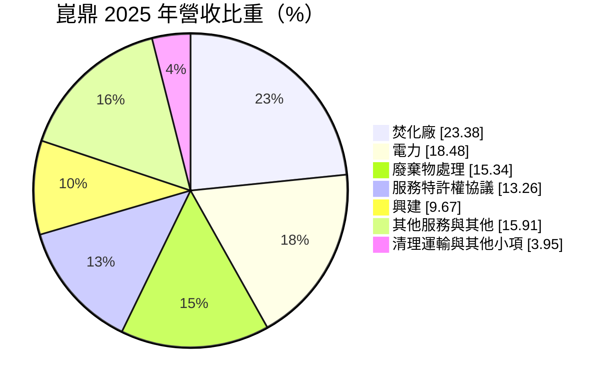
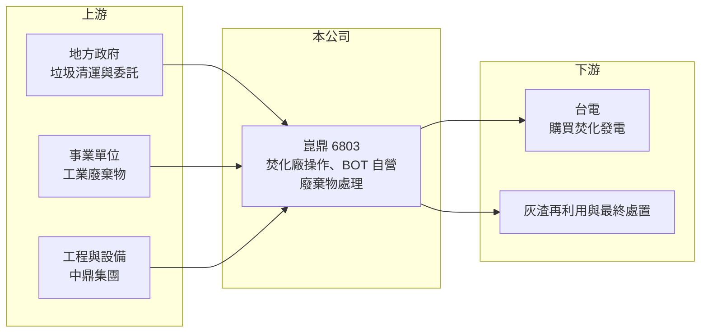

# 6803 崑鼎

> 上櫃｜[[產業索引-綠能環保|綠能環保]]｜上市（櫃）日期 2010/05/27

# 第一章：企業模式與商業藍圖

> [!info] 撰寫說明
> 精簡版，由 Claude 依公開資料整理，架構比照 [[2330台積電]]，資料截至 2026-10-08。來源：富邦 MoneyDJ 財務比率年表（2018 至 2025 年）與基本資料（2025 年營收比重）；櫃買中心開放資料快照（基本資料、2026 年上半年資產負債與損益、本益比殖利率、每月營收）；CMoney、股感、優分析文章標題。母公司關係、BOT 廠名稱與特許年限為憑記憶整理，已標「待校對」；歷年營收由每股營業額推算。#待校對

崑鼎投資控股成立於 1999 年 12 月、2010 年 5 月上櫃，董事長廖俊吉、總經理刁秀華，是工程集團 [[9933中鼎]] 旗下的環境資源事業（持股比例待校對）。它的核心是興建與操作垃圾焚化廠，把都市垃圾燒掉的同時發電賣給台電，再延伸到事業廢棄物處理、清運與再生能源，是台灣規模最大的焚化廠營運商之一。

- **核心業務：** 2025 年營收中焚化廠操作占 23.38%、電力占 18.48%、廢棄物處理占 15.34%、服務特許權協議占 13.26%、興建占 9.67%。崑鼎有兩種焚化廠模式：一是受地方政府委託代操作公有焚化廠，收取操作費；二是以[[BOT]]或 BOO 方式自建自營，擁有長期特許權，新聞稱它握有台灣「唯二」的 BOT 焚化廠（廠名待校對）。焚化同時產生蒸汽發電，售電收入讓它兼具環保與能源公司的性質。
- **營收結構：** 依每股營業額推算，2025 年營收約 96.8 億元（推算），2018 年以來每年都成長，2025 年年增 13.2%。營收的大宗來自與地方政府的長期合約與特許權協議，數量與價格多半在合約中約定，因此波動遠小於一般工業公司。
- **營運據點：** 業務遍及台灣北中南多座公有焚化廠與自有焚化廠（廠數待校對），並有子公司負責事業廢棄物清運與處理。焚化廠屬於地方公共建設，合約期滿時需重新投標，續約能力是營運的關鍵。
- **長期方向：** 台灣多座焚化廠已運轉二、三十年，面臨[[焚化廠整改]]與延役，地方政府需要委外整修並延長操作合約，這是崑鼎「興建」營收的來源。公司也發展太陽能等再生能源與資源回收（細節待校對），把焚化與發電的經驗延伸到綠電與循環經濟。

# 第二章：護城河深度與競爭優勢

崑鼎的護城河來自長期特許權、焚化廠操作經驗與母公司工程能力，屬於收入可預測性很高的公用事業型企業。

- **競爭優勢：** 焚化廠的操作與整改需要燃燒控制、空污防制與發電設備的專業經驗，地方政府招標時重視過往實績，新進者很難取得資格。BOT 自有廠擁有長達數十年的特許權（年限待校對），在特許期間垃圾處理與售電收入相對穩定。母公司中鼎是大型統包工程商，能支援焚化廠興建與整改工程，形成集團綜效。
- **主要對手：** 焚化廠操作的競爭者包括達和環保等民營業者，以及日商與歐洲環保集團在台據點（名單待校對）；事業廢棄物處理則與 [[8422可寧衛]]、[[8341日友]]、[[8476台境]] 等業者重疊。整體而言，台灣焚化廠數量有限，市場呈寡占結構。
- **觀察重點：** [[毛利率]]從 2018 年的 26.98% 逐年下滑到 2025 年的 19.26%，原因可能是興建工程等低毛利營收比重上升（推估）。觀察重點是整改工程完工後，能否換得更長的操作合約與更高的處理費，讓毛利率止跌；以及 BOT 特許期滿時的續約或移轉安排。

# 第三章：財務體質與盈利規模

資料日期：2026-10-08，表格是撰寫當時的快照；最新月營收、毛利率、累計 EPS 由自動排程寫在本筆記的屬性欄位（月營收、毛利率、累計EPS 等）。#待校對

崑鼎是台灣少見營收與 EPS 連續多年成長、ROE 穩定在兩成上下的高配息公用事業股。

| 年度 | 營收（億元） | [[毛利率]] | [[營業利益率]] | EPS（元） | [[ROE]] |
|---|---|---|---|---|---|
| 2021 | 約 62.4（推算） | 24.25% | 21.33% | 13.15 | 18.67% |
| 2022 | 約 72.6（推算） | 22.55% | 20.20% | 14.91 | 20.74% |
| 2023 | 約 77.6（推算） | 21.23% | 19.16% | 16.36 | 20.64% |
| 2024 | 約 85.9（推算） | 20.24% | 18.22% | 17.43 | 20.28% |
| 2025 | 約 96.8（推算） | 19.26% | 17.99% | 18.44 | 19.95% |

註：營收以每股營業額乘以約 7,279 萬股推算，股本近年未明顯變動。2026 年上半年營收 47.10 億元、毛利率約 19.3%、營業利益率約 17.8%、EPS 8.96 元（櫃買中心資料，比率由損益表計算）。

- **長期指標：** 2021 至 2025 年營收年複合成長率約 11.6%（推算），近 5 年平均 [[ROE]] 約 20.1%（推算），每年都在 18.6% 至 20.8% 之間，穩定度極高。最近一次年度現金股利約 15.78 元（櫃買中心殖利率資料），約為 2025 年 EPS 18.44 元的 86%，新聞也提到股利長年發放 9 元以上。每股現金流量 2018 至 2025 年皆為正值，[[自由現金流]]長期為正（推估）。
- **[[ROIC]] 與 [[WACC]]：** 2025 年稅後營業利益約 13.9 億元（營業利益率 17.99% × 營收約 96.8 億元 × 0.8），投入資本約 139 億元（2026 年第二季權益總計 75.90 億元，加上以總負債 105.11 億元的六成推估的有息負債約 63.1 億元，BOT 廠多以專案融資興建），ROIC 約 10%（推算）。WACC 約 4.5%（推算：無風險利率 1.75%、市場風險溢酬 6%、β 取公用事業型常見值 0.6，股東權益成本 5.35%；稅前負債成本 2.5%、稅率 20%；權益比重約 55%）。ROIC 長期高於 WACC 約 5 個百分點，代表特許權資產持續創造價值。
- **財務特色：** 2026 年第二季負債比率約 58%（負債 105.11 億元 ÷ 資產 181.02 億元），比 2024 年的 44.6% 明顯上升，反映整改與興建工程的資金需求。非控制權益 7.44 億元，代表部分子公司有外部股東；資本公積 32.43 億元。營業費用僅約營收的 1.4%，成本結構以廠務操作為主，規模經濟明顯。

# 第四章：總體風險與地緣政治

崑鼎的風險不在景氣，而在合約、政策與焚化廠老化。

- **產業週期：** 垃圾量與人口、消費相關，幾乎不受景氣影響，這是崑鼎最大的防禦性。但台灣推動垃圾減量與資源回收，長期可能壓低可焚化量；另一方面，焚化廠處理量吃緊時，處理費反而有調漲空間。
- **營運風險：** 代操作合約到期需重新投標，若失去大型焚化廠合約，營收會階段性下降。老舊焚化廠故障或停爐歲修，會同時減少處理費與售電收入；整改工程若超支或延誤，也會侵蝕興建毛利。
- **其他風險：** 售電價格受政府費率政策影響；空污與戴奧辛排放標準趨嚴，需要持續投資防制設備；地方政府財政與政治變動可能影響合約條件。BOT 特許期滿後資產移轉給政府，屆時獲利結構會改變（期滿年份待校對）。

# 專有名詞解析

## 金融

- **[[ROIC]]**：投入資本報酬率，稅後營業利益除以股東權益加有息負債，衡量本業運用資本的效率。
- **[[WACC]]**：加權平均資金成本，股東與債權人要求報酬率的加權平均，是 ROIC 要超越的門檻。
- **[[自由現金流]]**：營業活動現金流減去資本支出，代表企業可自由用於配息、還債或併購的現金。

## 產業

- **[[BOT]]**：興建、營運、移轉，民間出資興建公共建設並在特許期內營運收費，期滿後移轉給政府的模式。
- **[[焚化廠整改]]**：針對運轉多年的焚化廠更新爐體、發電與空污設備，以延長使用年限並提高效率的工程。

# 核心供應鏈

- 上游：母公司 [[9933中鼎]]（工程與設備支援），委託方為各縣市政府環保局。
- 下游／客戶：台灣電力公司（售電）、地方政府（處理費）、事業廢棄物委託廠商。
- 同業：[[8422可寧衛]]、[[8341日友]]、[[8476台境]]、[[6923中台]]。

## 最新新聞
<!-- news:start -->
<!-- news:end -->

## 相關連結
- [公開資訊觀測站](https://mopsov.twse.com.tw/mops/web/t05st03?step=1&firstin=1&co_id=6803)
- [Goodinfo](https://goodinfo.tw/tw/StockDetail.asp?STOCK_ID=6803)
- [Yahoo 股市](https://tw.stock.yahoo.com/quote/6803)
- [鉅亨網新聞](https://www.cnyes.com/twstock/6803/news)
