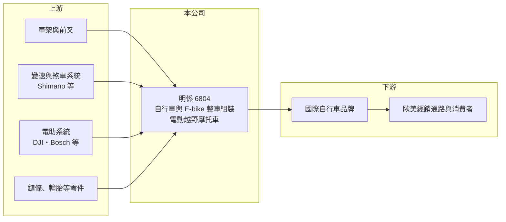

# 6804 明係

> 上櫃｜[[產業索引-運動休閒|運動休閒]]｜上市（櫃）日期 2022/03/31

# 第一章：企業模式與商業藍圖

> [!info] 撰寫說明
> 精簡版，由 Claude 依公開資料整理，架構比照 [[2330台積電]]，資料截至 2026-10-08。來源：MoneyDJ 理財網財務比率年表（2018 至 2025 年）；工商時報 2026 年 7 月報導（業務、電動越野摩托車、DJI 電助系統專案）；櫃買中心開放資料快照（基本資料、2026 年上半年資產負債與損益、2026 年 8 月營收、股利）。公開資料有限，客戶名稱、營收比重與生產據點細節未查得；年度營收因股數與月營收資料對不上，未推算。#待校對

明係事業成立於 1985 年 12 月、2022 年 3 月上櫃，總部在彰化大村，董事長江永平、總經理黃慶忠，實收資本額 4.75 億元。明係是台灣中部自行車產業聚落中的整車組裝代工廠（公司網址為 axman.com.tw，AXMAN 為相關品牌名稱，待校對），近年經歷自行車去庫存的虧損期，正嘗試以[[電動越野摩托車]]開拓新市場。

- **核心業務：** 明係替國際自行車品牌組裝傳統自行車與 [[E-bike]] 整車，也就是把車架、變速系統、輪組、電動輔助系統等零件組成完整的車再出貨。整車組裝屬於自行車供應鏈中附加價值較低的一段，毛利率長期約 8% 至 10%（2018 至 2023 年），靠規模與交期取勝。
- **營收結構：** 各產品與客戶比重未查得。依工商時報 2026 年 7 月報導，多家客戶指定採用 DJI（大疆）電助系統平台的 E-bike 組裝專案，顯示公司已跟上電動輔助系統的新平台；另積極切入高性能電動越野摩托車，規格最高可達 42 匹馬力、極速每小時 75 英里。
- **營運據點：** 公司登記於彰化大村，位於台灣中部自行車產業聚落，生產據點細節未查得（推估以台灣組裝為主，待校對）。在美國關稅政策下，台灣組裝的自行車相對中國與越南具優勢，報導指出美國詢單增加。
- **長期方向：** 明係的長期策略是「傳統自行車與 E-bike 組裝維持基本盤、電動越野摩托車拉高產品單價」，並投入智慧製造與製程優化。能否從低毛利組裝廠轉型為高附加價值的電動車輛製造商，是公司未來十年最大的課題。

# 第二章：護城河深度與競爭優勢

明係的競爭優勢主要是台灣產地與組裝彈性，在整車組裝這個低門檻環節中，護城河相對淺。

- **競爭優勢：** 整車組裝需要協調數十種零件的到料時程、品質檢驗與小量多樣的生產排程，台灣中部聚落零件供應商密集，能縮短交期。台灣產地在美國關稅與「非中國製造」要求下具有原產地優勢，是近年接單的主要賣點。
- **主要對手：** 整車代工與自有品牌的大廠如 [[9921巨大]]、[[9914美利達]] 規模遠大於明係；其他還有 [[8933愛地雅]] 等台灣整車廠，以及越南、中國的組裝廠。電動越野摩托車領域則面對 Sur-Ron、Talaria 等中國品牌與歐美電動機車廠。
- **觀察重點：** 2024 至 2025 年毛利率跌到 4% 與 1.8%，營業利益率轉為 -7% 左右，反映自行車產業去庫存後訂單大減、產能閒置。長期要看訂單量能否恢復到 2022 年水準、電動越野摩托車能否量產出貨並貢獻較高毛利。

# 第三章：財務體質與盈利規模

資料日期：2026-10-08，表格是撰寫當時的快照；最新月營收、毛利率、累計 EPS 由自動排程寫在本筆記的屬性欄位（月營收、毛利率、累計EPS 等）。#待校對

明係在 2022 年自行車熱潮時 EPS 達 5.82 元，2024 至 2025 年轉為虧損，2026 年上半年小幅轉盈。

| 年度 | 營收（億元） | [[毛利率]] | [[營業利益率]] | EPS（元） | [[ROE]] |
|---|---|---|---|---|---|
| 2021 | 未查得 | 9.34% | 4.00% | 1.85 | 7.04% |
| 2022 | 未查得 | 10.60% | 5.74% | 5.82 | 18.68% |
| 2023 | 未查得 | 9.16% | 4.49% | 3.62 | 9.39% |
| 2024 | 未查得 | 3.96% | -7.71% | -2.14 | -5.74% |
| 2025 | 未查得 | 1.80% | -6.86% | -2.83 | -8.64% |

註：MoneyDJ 每股營業額 2021 至 2025 年依序為 65.65、110.75、96.09、55.29、38.28 元，趨勢顯示營收在 2022 年達高峰後連續三年下滑；但以目前 4,750 萬股換算的 2025 年營收與櫃買中心月營收累計對不上，故不推算金額。

- **長期指標：** 2021 至 2025 年平均 ROE 約 4.1%（推算），前三年為正、後兩年為負，顯示獲利高度依賴產業景氣。每股現金流量 2021 年與 2025 年為負，自由現金流不穩定。最近一次每股股利 0.5 元（櫃買中心本益比殖利率資料）。
- **[[ROIC]] 與 [[WACC]]：** 2025 年營業利益率 -6.86%，以每股營業額 38.28 元與 4,750 萬股推估營業損失約 1.2 億元（推算，金額可能高估）；投入資本以 2026 年第二季權益 12.7 億元加有息負債推估約 2 億元計算，ROIC 約 -8%（推算）。WACC 約 7.5%（推算：無風險利率 1.75%、市場風險溢酬 6%、β 取 1.0，股東權益成本 7.75%；負債比重低，稅率 20%）。ROIC 明顯低於 WACC，代表近兩年在消耗資本；2026 年上半年營業利益率回到約 2.7%，但仍低於資金成本。
- **財務特色：** 2026 年第二季總資產 17.8 億元、負債 5.1 億元，負債比率約 29%，每股淨值 26.79 元，股價淨值比約 0.69 倍（櫃買中心資料），財務結構保守。2026 年上半年營收 7.84 億元、毛利率約 10.9%、EPS 0.38 元，毛利率已回到疫情前水準。

# 第四章：總體風險與地緣政治

明係的風險在於自行車產業週期、低毛利的組裝模式，以及新產品轉型的不確定性。

- **產業週期：** 自行車在 2020 至 2022 年疫情期間需求暴增，品牌大量下單，之後 2023 至 2025 年全球通路庫存過高，整車訂單大幅減少。整車組裝位在供應鏈下游、直接承接品牌訂單，受週期影響非常直接。
- **營運風險：** 組裝業毛利率低，產能利用率一旦下滑就容易虧損；客戶集中在少數品牌（名稱未查得），單一客戶轉單影響大。電動越野摩托車屬於新產品，需投入研發、認證與通路，若市場接受度不如預期會成為新的成本負擔。
- **其他風險：** 美國關稅政策變化會影響台灣產地優勢能否延續；電動車產品涉及電池安全與各國法規認證。E-bike 核心零件仰賴 Shimano、Bosch、DJI 等系統供應商，零件供應與價格不在公司掌控之中。

# 專有名詞解析

## 應用

- **[[電動越野摩托車]]**：以電池與馬達驅動、用於越野地形的輕型摩托車，近年在歐美休閒市場快速成長。

## 金融

- **[[ROIC]]**：投入資本報酬率，稅後營業利益除以股東權益加有息負債，衡量本業運用資本的效率。
- **[[WACC]]**：加權平均資金成本，股東與債權人要求報酬率的加權平均，是 ROIC 要超越的門檻。

## 產業

- **[[E-bike]]**：電動輔助自行車，騎乘者踩踏時由電機提供輔助動力，在歐洲是成長最快的自行車品類。

# 核心供應鏈

- 上游：車架與前叉廠；變速與煞車系統 Shimano；電助系統 DJI、Bosch；鏈條 [[5306桂盟]]、輪胎 [[2106建大]] 等零件廠（實際往來未查得）。
- 下游／客戶：國際自行車品牌（名稱未查得）、歐美經銷通路。
- 同業：[[9921巨大]]、[[9914美利達]]、[[8933愛地雅]]；越南與中國的整車組裝廠。

## 最新新聞
<!-- news:start（自動產生，請勿手動編輯此範圍） -->
- 2026-10-07 🏛️ 重訊 17:38｜公告本公司買回庫藏股執行完畢。｜[觀測站](https://mops.twse.com.tw/mops/#/web/t05st01)
- 2026-10-07 🏛️ 重訊 17:36｜公告本公司庫藏股買回數量達已發行股份總數百分之二。｜[觀測站](https://mops.twse.com.tw/mops/#/web/t05st01)

完整紀錄：[[6804明係 新聞]]
<!-- news:end -->

## 相關連結
- [公開資訊觀測站](https://mopsov.twse.com.tw/mops/web/t05st03?step=1&firstin=1&co_id=6804)
- [Goodinfo](https://goodinfo.tw/tw/StockDetail.asp?STOCK_ID=6804)
- [Yahoo 股市](https://tw.stock.yahoo.com/quote/6804)
- [鉅亨網新聞](https://www.cnyes.com/twstock/6804/news)
