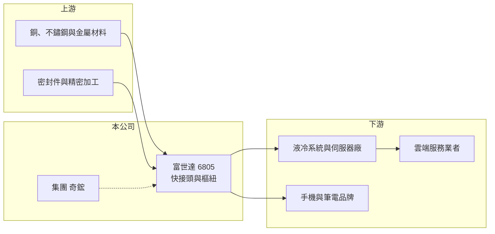

# 6805 富世達

> 上市｜[[產業索引-電子零組件業|電子零組件業]]｜上市（櫃）日期 2023/11/09

# 第一章：企業模式與商業藍圖

> [!info] 撰寫說明
> 精簡版，由 Claude 依公開資料整理，架構比照 [[2330台積電]] 的四章研究，資料截至 2026-10-08。來源：Goodinfo 經營績效頁、經濟日報 2026 年 9 月報導、證交所開放資料快照（基本資料、每月營收、股利、2026 年第二季損益與資產負債）。公開資料有限，樞紐產品細節、母公司持股與生產據點為憑記憶補充，標「待校對」。#待校對

富世達是精密機構件廠，早年以筆電與折疊手機的[[樞紐]]為主，近年因 AI 伺服器[[液冷散熱]]用的[[快接頭]]爆發，伺服器產品已成為最大營收來源。本章說明它的業務轉變。

- **核心業務：** 富世達成立於 2001 年，2023 年 11 月上市，總部在新北新莊。傳統產品是筆電與折疊手機的樞紐，這類轉軸需要在極小空間內兼顧扭力、手感與數十萬次開合的耐用度（待校對）。2024 年起，公司把精密加工能力延伸到 AI 伺服器液冷系統的快接頭（QD），也就是讓冷卻液管路可以快速插拔又不漏液的接頭，這成為公司營收規模在兩年內放大數倍的主因。
- **營收結構：** 依經濟日報 2026 年 9 月報導，伺服器相關產品占營收比重在 2026 年第二季約 50% 至 60%，第三季提高到 80% 以上；其餘主要為手機與筆電樞紐。伺服器產品比重提高，也是毛利率從 2024 年 22% 升到 2026 年上半年 33% 的主因。
- **營運據點：** 生產據點在本次查到的資料中未載明，推估以中國大陸與東南亞工廠為主（待校對）。富世達與散熱大廠 [[3017奇鋐]] 屬同一集團，奇鋐為主要股東（待校對），在液冷系統的客戶與設計上有協同效應。
- **長期方向：** 報導指出，富世達的快接頭月產能約 300 萬顆，預期 2026 年第四季再增加約 50%。[[NVDA輝達]] 新一代平台把液冷管路從交換器托盤延伸到運算托盤與分歧管，每櫃使用的快接頭數量與單價都提高。若液冷成為 AI 資料中心的標準配置，快接頭會從小眾零件變成大量消耗的標準件。

# 第二章：護城河深度與競爭優勢

富世達的護城河建立在精密加工、防漏可靠度與集團綜效。本章分析它在液冷零件市場的位置。

- **競爭優勢：** 快接頭必須在高壓下反覆插拔而不漏液，一旦漏液就可能損壞整櫃伺服器，因此客戶極重視可靠度與實績。富世達擁有樞紐業務累積的精密金屬加工與量產能力，加上集團散熱業務帶來的系統設計經驗，能較快取得雲端客戶認證。依報導，雲端客戶 [[AMZN亞馬遜]]、[[META臉書]]、[[GOOGL谷歌]]、[[MSFT微軟]] 都在 AI 伺服器導入液冷方案。
- **主要對手：** 快接頭的國際傳統大廠包括 Danfoss、Parker Hannifin、Stäubli、CPC（Colder Products）等工業流體接頭公司，台灣則有多家散熱與機構廠投入。樞紐方面，主要對手是 [[3548兆利]]、[[3376新日興]]。
- **觀察重點：** 第一，快接頭在新平台的市占率與單價能否維持，特別是新規格是否改變供應商名單。第二，產能擴充的速度是否跟得上需求。第三，傳統樞紐業務能否維持穩定獲利，作為伺服器景氣波動時的緩衝。

# 第三章：財務體質與盈利規模

資料日期：2026-10-08，表格是撰寫當時的快照；最新月營收、毛利率、累計 EPS 由自動排程寫在本筆記的屬性欄位（月營收、毛利率、累計EPS 等）。#待校對

富世達是這批公司中成長最快的一家，營收從 2019 年不到 9 億元成長到 2025 年 124 億元，獲利能力也同步提升。

| 年度 | 營收（億元） | [[毛利率]] | [[營業利益率]] | EPS（元） | [[ROE]] |
|---|---|---|---|---|---|
| 2021 | 50.2 | 23.8% | 16.1% | 9.29 | 36.1% |
| 2022 | 50.1 | 23.3% | 15.5% | 9.33 | 25.3% |
| 2023 | 56.4 | 23.3% | 15.6% | 10.18 | 18.0% |
| 2024 | 81.9 | 22.3% | 14.6% | 17.90 | 24.2% |
| 2025 | 124.0 | 26.3% | 20.3% | 31.00 | 33.4% |
| 2026 上半年 | 79.2 | 33.1% | 27.3% | 25.77 | 未查得 |

- **營收規模：** 2021 年營收 50.2 億元，2025 年 124 億元，四年年複合成長率約 25%（推算）；2020 至 2025 年則約 41%（推算）。2026 年 1 至 8 月累計營收年增約 50%。
- **獲利：** 2021 至 2024 年毛利率穩定在 22% 至 24%，屬於機構件廠的正常水準；2025 年起隨快接頭放量，毛利率與營業利益率同步跳升，2026 年上半年營業利益率達 27.3%。2021 至 2025 年平均 ROE 約 27.4%（推算），屬於極高水準。
- **財務特色：** 2026 年第二季末總資產 159.8 億元、權益 83.5 億元、負債 76.3 億元，其中流動負債 69.4 億元，推估多為應付帳款等營運負債。114 年度配發現金股利每股 10.5 元，約為 2025 年 EPS 的三成多，公司保留較多盈餘支應擴產。實收資本額約 6.86 億元。

**[[ROIC]] 與 [[WACC]]：** 有息負債明細未查得，假設約 10 億元（推估）。2025 年營業利益約 25.2 億元（124 億 × 20.3%），稅後約 20.1 億元；以 2025 年平均權益約 63 億元（由 ROE 與淨利回推）加有息負債 10 億元，投入資本約 73 億元，ROIC 約 27%（推算）。2026 年上半年營業利益 21.6 億元年化後稅後約 34.6 億元，除以目前權益加有息負債約 93.5 億元，ROIC 約 37%（推算）。WACC 用 [[CAPM]] 推估：無風險利率 1.75%、市場風險溢酬 6%、β 取 1.3（AI 散熱族群常見值，假設），股東權益成本約 9.6%；負債成本 2.5%、稅率 20%，以權益 90%、負債 10% 加權，WACC 約 8.8%（推算）。結論是：富世達的 ROIC 遠高於 WACC，是明確的價值創造者；但高 ROIC 來自 AI 液冷需求爆發，利差能維持多久取決於競爭者進入的速度。

# 第四章：總體風險與地緣政治

富世達的風險在於高度集中於 AI 伺服器液冷，以及新進者帶來的價格競爭。

- **產業週期：** 伺服器產品占比已超過八成，營運幾乎與雲端業者的 AI 資本支出綁在一起。資本支出一旦放緩或進入庫存調整，訂單可能急速下滑，[[長鞭效應]]會放大衝擊。
- **營運風險：** 快接頭的高毛利會吸引大量競爭者投入，國際流體接頭大廠與台灣散熱、機構廠都在擴產，長期可能壓低單價。新平台規格改變時，供應商需要重新認證，若未入選，營收可能大幅變動。快速擴產也帶來良率與品質管理的壓力，任何漏液事件都會嚴重影響商譽。
- **其他風險：** 生產地點若集中在中國，美國關稅與供應鏈政策會影響成本與客戶下單地點（待校對）。銅、不鏽鋼等金屬原料價格與新台幣匯率也會影響毛利。樞紐業務則受手機與筆電市場成熟、價格競爭的影響。

# 專有名詞解析

## 金融

- **[[ROIC]]**：投入資本報酬率，稅後營業利益除以股東權益加有息負債，衡量本業運用資本的效率。
- **[[WACC]]**：加權平均資金成本，依股東權益與負債的比重，加權計算公司取得資金的平均成本。
- **[[長鞭效應]]**：終端需求的小幅變動，沿供應鏈往上游傳遞時被逐級放大，造成上游庫存與訂單劇烈波動。

## 產業

- **[[樞紐]]**：讓螢幕或筆電上蓋能開合、旋轉並固定在任意角度的轉軸機構，需兼顧扭力、手感與耐用度。
- **[[液冷散熱]]**：以液體流經冷板帶走晶片熱量的散熱方式，散熱效率高於氣冷，是高功耗 AI 伺服器的主流方向。
- **[[快接頭]]**：液冷管路上可快速插拔、斷開時自動封閉不漏液的接頭，英文常稱 QD（Quick Disconnect）。

# 核心供應鏈

- 上游：銅、不鏽鋼等金屬材料、密封件、精密加工與表面處理。
- 下游／客戶：液冷系統與伺服器廠；終端雲端服務業者 [[AMZN亞馬遜]]、[[META臉書]]、[[GOOGL谷歌]]、[[MSFT微軟]]；手機與筆電品牌（具名未查得）。
- 同業：[[3017奇鋐]]（同集團）、[[3324雙鴻]]、[[3653健策]]；樞紐同業 [[3548兆利]]、[[3376新日興]]；國際快接頭廠 Danfoss、Parker Hannifin、Stäubli。

## 最新新聞
<!-- news:start（自動產生，請勿手動編輯此範圍） -->
- 2026-10-16 🏛️ 重訊 17:36｜(補充公告)針對本公司特定員工被要求協助釐清股票內線交易案件 之澄清說明。｜[觀測站](https://mops.twse.com.tw/mops/#/web/t05st01)
- 2026-10-14 📰 媒體 08:10｜鉅亨速報 - Factset 最新調查：富世達(6805-TW)EPS預估上修至63.07元，預估目標價為2717.5元｜[鉅亨網](https://news.cnyes.com/news/id/6629906)
- 2026-10-07 📰 媒體 20:33｜奇鋐、富世達新莊廠區遭調查局搜索 與富世達2023年申請上市有關｜[鉅亨網](https://news.cnyes.com/news/id/6624007)
- 2026-10-07 🏛️ 重訊 18:45｜公告法務部調查局至本公司新莊廠區對員工進行搜索及調查。｜[觀測站](https://mops.twse.com.tw/mops/#/web/t05st01)

完整紀錄：[[6805富世達 新聞]]
<!-- news:end -->

## 相關連結
- [公開資訊觀測站](https://mopsov.twse.com.tw/mops/web/t05st03?step=1&firstin=1&co_id=6805)
- [Goodinfo](https://goodinfo.tw/tw/StockDetail.asp?STOCK_ID=6805)
- [Yahoo 股市](https://tw.stock.yahoo.com/quote/6805)
- [鉅亨網新聞](https://www.cnyes.com/twstock/6805/news)
