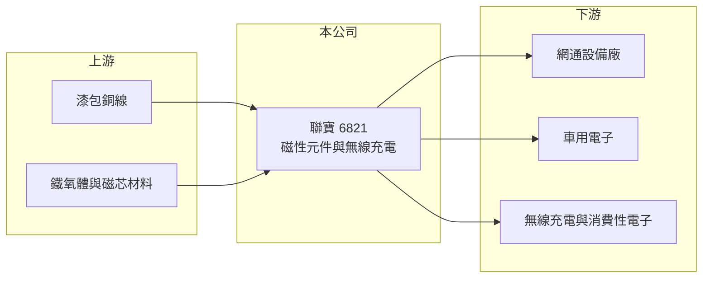

# 6821 聯寶

> 上櫃｜[[產業索引-電子零組件業|電子零組件業]]｜上市（櫃）日期 2023/05/22

# 第一章：企業模式與商業藍圖

> [!info] 撰寫說明
> 精簡版，由 Claude 依公開資料整理，架構比照 [[2330台積電]] 的四章研究，資料截至 2026-10-08。來源：Goodinfo 經營績效頁、nStock 公司簡介與新聞摘要、櫃買中心開放資料快照（基本資料、每月營收、2026 年第二季損益與資產負債）。公開資料有限，產品別營收比重、生產據點與具名客戶未查得。#待校對

聯寶電子是一家小型磁性元件廠，產品包括[[電感]]、[[變壓器]]等磁性元件與無線充電線圈模組。本章說明它的業務定位。

- **核心業務：** 聯寶成立於 1988 年，2023 年 5 月轉上櫃，總部位於新北新店，主要營業項目是磁性元件、無線充電及其他電子零件的製造。磁性元件以銅線繞在磁芯上，用來轉換電壓、儲存能量或過濾雜訊，是電源與通訊電路不可缺少的[[被動元件]]。
- **營收結構：** 產品別營收比重在本次查到的資料中未揭露。依 nStock 整理的新聞，公司的成長主軸是網通與無線充電，2022 年車用磁性元件打入美系車廠供應鏈。
- **營運據點：** 生產據點未查得。2022 年董事改選後，由自動化設備廠出身的經理人參與經營，方向是提高生產自動化程度，以降低對人工繞線的依賴。
- **長期方向：** 磁性元件需求隨電子產品的電源轉換量增加而成長，車用電子、充電與網通設備是相對高附加價值的市場。對聯寶這樣的小廠來說，長期關鍵在於能否在利基應用（車用、無線充電）取得穩定的設計導入，而不是在標準品上和大廠拚價格。

# 第二章：護城河深度與競爭優勢

磁性元件產業以標準品為主，價格競爭激烈，小廠必須靠客製化與利基應用生存。本章分析聯寶的位置。

- **競爭優勢：** 客製化磁性元件需要依客戶電路設計繞線、選擇磁芯並通過驗證，一旦導入，在產品生命週期內通常不會更換。聯寶規模小、彈性高，適合承接量少樣多的客製案件；2022 年打入美系車廠供應鏈，代表其品質系統已達車用門檻。毛利率長期在 28% 至 37% 之間，高於一般組裝型電子零件廠。
- **主要對手：** 台灣磁性元件與電感廠包括 [[3236千如]]、奇力新（已併入國巨集團，待校對）、[[2327國巨]] 集團、[[2308台達電]] 的零組件部門等，規模都遠大於聯寶；無線充電模組也面臨中國廠商的價格競爭。
- **觀察重點：** 第一，車用與無線充電業務的實際營收比重。第二，營業利益率能否回到 2022 年的 8% 以上，而不是依賴業外收益。第三，自動化投資能否降低人工成本。

# 第三章：財務體質與盈利規模

資料日期：2026-10-08，表格是撰寫當時的快照；最新月營收、毛利率、累計 EPS 由自動排程寫在本筆記的屬性欄位（月營收、毛利率、累計EPS 等）。#待校對

聯寶的營收規模長期停留在 5 至 6 億元，毛利率穩定，但費用占比高，營業利益率偏低。

| 年度 | 營收（億元） | [[毛利率]] | [[營業利益率]] | EPS（元） | [[ROE]] |
|---|---|---|---|---|---|
| 2021 | 4.92 | 28.6% | 5.50% | 1.12 | 6.23% |
| 2022 | 5.52 | 32.2% | 8.60% | 2.25 | 12.0% |
| 2023 | 5.54 | 34.9% | 8.29% | 1.69 | 8.44% |
| 2024 | 5.66 | 32.9% | 3.65% | 1.19 | 5.70% |
| 2025 | 5.82 | 36.6% | 7.32% | 1.13 | 5.46% |
| 2026 上半年 | 2.85 | 36.3% | 6.01% | 1.03 | 未查得 |

- **營收規模：** 2020 年營收 4.38 億元，2025 年 5.82 億元，五年年複合成長率約 5.8%（推算）。2026 年 1 至 8 月累計營收年減約 10%。
- **獲利：** 毛利率從 2021 年 28.6% 提高到 2025 年 36.6%，但營業利益率只有 4% 至 9%，顯示管銷與研發費用占營收的比重偏高，規模不足以攤提。2026 年上半年稅後淨利約 3,270 萬元，高於營業利益約 1,711 萬元，差額來自業外收益。2021 至 2025 年平均 ROE 約 7.6%（推算）。
- **財務特色：** 2026 年第二季末總資產 12.1 億元、權益 8.07 億元、負債 4.03 億元，負債比約 33%。依 nStock 資料，2024 年度現金股利 0.99 元、配發率約八成，配息意願高。實收資本額約 3.59 億元。

**[[ROIC]] 與 [[WACC]]：** 有息負債明細未查得，假設約 2 億元（推估）。2025 年營業利益約 0.43 億元（5.82 億 × 7.32%），稅後約 0.34 億元，投入資本約 10.1 億元（權益 8.07 億 + 有息負債 2 億），ROIC 約 3.4%（推算）。WACC 用 [[CAPM]] 推估：無風險利率 1.75%、市場風險溢酬 6%、β 取 0.9（小型被動元件股常見值，假設），股東權益成本約 7.2%；負債成本 2.5%、稅率 20%，以權益 80%、負債 20% 加權，WACC 約 6.1%（推算）。結論是：聯寶的 ROIC 長期低於 WACC，本業尚未創造足夠的價值；改善的關鍵在於擴大營收規模，讓費用率下降。

# 第四章：總體風險與地緣政治

聯寶的風險來自規模小、產品同質性高與下游需求波動。

- **產業週期：** 磁性元件屬於被動元件，需求跟網通、消費性電子與汽車的庫存週期同步。下游去化庫存時，訂單會先於終端需求下滑，[[長鞭效應]]明顯。
- **營運風險：** 營收規模小，少數客戶或專案的變動就會造成營收大幅起伏，2026 年 8 月單月營收年減約三成即為一例。繞線製程仍需要大量人工，人工成本上升與自動化投資的效益都會影響獲利。
- **其他風險：** 銅線與磁芯材料價格波動直接影響成本；中國磁性元件廠的低價競爭壓縮報價；外銷比重與匯率變化也會影響毛利。

# 專有名詞解析

## 金融

- **[[長鞭效應]]**：終端需求的小幅變動，沿供應鏈往上游傳遞時被逐級放大，造成上游庫存與訂單劇烈波動。
- **[[ROIC]]**：投入資本報酬率，稅後營業利益除以股東權益加有息負債，衡量本業運用資本的效率。

## 產業

- **[[被動元件]]**：不需外加電源即可運作的電子零件，主要包括電阻、電容與電感。
- **[[電感]]**：以線圈儲存磁能的被動元件，用於電源轉換、濾波與抑制雜訊。
- **[[變壓器]]**：以線圈與磁芯轉換電壓高低的磁性元件，是電源供應器的核心零件。

# 核心供應鏈

- 上游：漆包銅線、鐵氧體與金屬粉末磁芯材料。
- 下游／客戶：網通設備廠、美系車廠供應鏈、無線充電與消費性電子廠（具名客戶未查得）。
- 同業：[[3236千如]]、[[2327國巨]]（含奇力新）、[[2308台達電]]。

## 最新新聞
<!-- news:start -->
<!-- news:end -->

## 相關連結
- [公開資訊觀測站](https://mopsov.twse.com.tw/mops/web/t05st03?step=1&firstin=1&co_id=6821)
- [Goodinfo](https://goodinfo.tw/tw/StockDetail.asp?STOCK_ID=6821)
- [Yahoo 股市](https://tw.stock.yahoo.com/quote/6821)
- [鉅亨網新聞](https://www.cnyes.com/twstock/6821/news)
