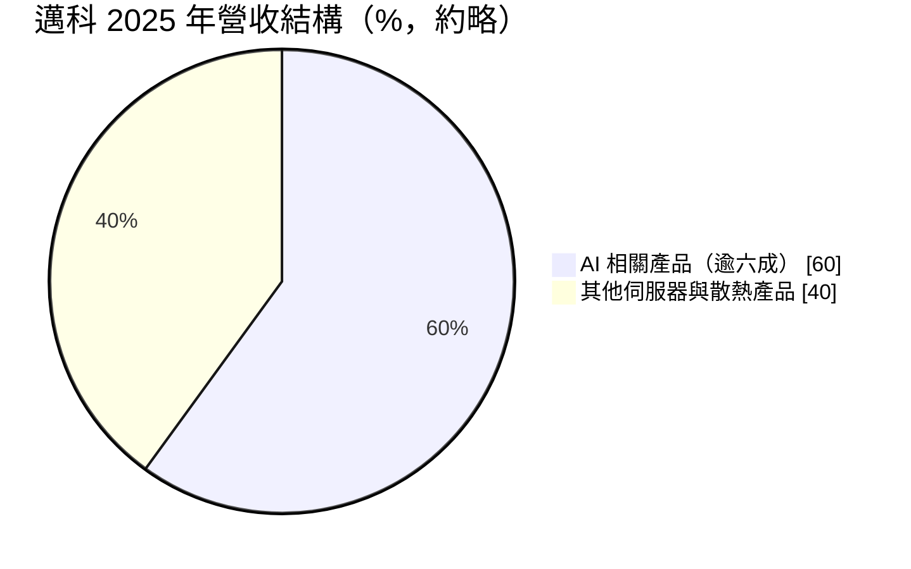
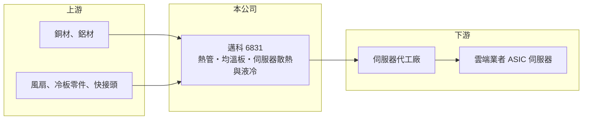

# 6831 邁科

> 上市｜[[產業索引-電腦及週邊設備業|電腦及週邊設備業]]｜上市（櫃）日期 2025/11/25

# 第一章：企業模式與商業藍圖

> [!info] 撰寫說明
> 精簡版，由 Claude 依公開資料整理，架構比照 [[2330台積電]]，資料截至 2026-10-08。來源：證交所開放資料快照（基本資料、2026 年第二季資產負債與損益、股利）、Goodinfo 經營績效頁、優分析 2026 年 3 月報導。產品線（熱管、均溫板）與英文名稱憑記憶整理，已標「待校對」。#待校對

邁科科技（以下簡稱邁科）是專攻伺服器散熱的中型廠，理解它的關鍵在於：它原本是做熱管、均溫板等散熱元件的零件廠，近幾年乘著 AI 伺服器的功耗提升，把產品重心轉到雲端業者的 ASIC 伺服器，營收在五年內放大四倍。

- **核心業務：** 邁科成立於 2002 年，主要產品為[[熱管]]、[[均溫板]]與伺服器[[散熱模組]]（英文名 Microloops，待校對）。依優分析報導，公司從高階氣冷散熱出發，2026 年下半年開始出貨[[液冷散熱]]產品。晶片功耗愈高，散熱件的規格與單價就愈高，這是邁科營收與毛利同步提升的根本原因。
- **營收結構：** 依優分析報導，2025 年 AI 相關產品占營收超過六成，公司預期 2026 年提高到約七成，液冷產品約占 2026 年營收兩成。最大的成長來源是[[CSP]]（雲端服務供應商）自研晶片的 ASIC 伺服器，而不是一般通用伺服器。產品結構的轉變，讓邁科從零件廠變成 AI 資料中心供應鏈的一環。
- **營運據點：** 總部位於台灣，2026 年資本支出約為 2025 年的兩倍，主要用於在越南新建工廠，以就近服務 CSP 客戶並分散生產地（優分析）。原有生產據點細節未查得。雲端業者普遍要求供應商具備中國以外的產能，越南廠是邁科爭取訂單的基本門票。
- **長期方向：** 邁科 2025 年 11 月由興櫃轉上市，資本市場的資金有助擴充產能。長期方向是從氣冷元件延伸到冷板、液冷模組等更完整的散熱方案，並深化與 ASIC 伺服器供應鏈的合作。

# 第二章：護城河深度與競爭優勢

邁科的護城河屬於「窄護城河」，來自散熱設計導入後的轉換成本與 AI 伺服器客戶的認證，但液冷世代的競爭者眾多，優勢仍在建立中。

- **競爭優勢：** 散熱模組必須依每一代伺服器的晶片位置、機構與風道客製，供應商從設計階段就參與，一旦通過雲端業者驗證，通常會供應整個產品世代。邁科在 ASIC 伺服器的布局較早，2025 年[[營業利益率]]由 5.9% 提升到 11.05%，顯示高階產品比重提高後的營運槓桿。
- **主要對手：** 台灣散熱大廠 [[3017奇鋐]]、[[3324雙鴻]]、[[6230尼得科超眾]]、[[3653健策]]、8996高力 都積極搶攻 AI 伺服器散熱與液冷，規模多半大於邁科。邁科營收 37 億元，與一線大廠相比仍屬中型，必須靠特定客戶與 ASIC 平台的深度合作競爭。
- **觀察重點：** 長期最該追蹤的是液冷產品能否如期放量，以及越南廠的量產進度。液冷系統的價值量遠高於氣冷，但需要冷板、管路與快接頭等新能力，若邁科只停留在氣冷元件，AI 伺服器全面走向液冷時可能被邊緣化。另一個重點是客戶集中度，單一 CSP 的平台轉換可能造成營收大幅波動。

# 第三章：財務體質與盈利規模

資料日期：2026-10-08，表格是撰寫當時的快照；最新月營收、毛利率、累計 EPS 由自動排程寫在本筆記的屬性欄位（月營收、毛利率、累計EPS 等）。#待校對

邁科的財務呈現「高成長、毛利率穩定、營益率隨規模擴張」的樣貌：毛利率長期在 22% 至 23% 左右，營收放大後費用被攤薄，獲利成長快於營收。

| 年度 | 營收（億元） | [[毛利率]] | [[營業利益率]] | EPS（元） | [[ROE]] |
|---|---|---|---|---|---|
| 2021 | 15.2 | 18.3% | 2.52% | 1.22 | 6.84% |
| 2022 | 16.1 | 22.6% | 6.72% | 2.23 | 9.90% |
| 2023 | 16.4 | 23.4% | 6.64% | 2.03 | 9.34% |
| 2024 | 20.1 | 23.1% | 6.36% | 1.80 | 7.82% |
| 2025 | 37.0 | 23.4% | 11.5% | 4.94 | 13.7% |

（來源：Goodinfo 經營績效頁；優分析報導的 2025 年營業利益率為 11.05%，與 Goodinfo 略有差異。2026 年上半年依證交所資料，營收 19.0 億元、毛利率約 20.0%、營業利益率約 8.9%、EPS 1.66 元。）

- **營收規模：** 2020 年營收 8.92 億元，2025 年 37.0 億元，年複合成長率約 33%（推算），2025 年單年成長約 85%。2026 年 1 至 8 月累計營收約 29.7 億元、年增約 22%（證交所月營收資料），成長速度放緩但規模持續擴大。
- **獲利：** 2021 至 2025 年平均 ROE 約 9.5%（推算），2025 年達 13.7%。2025 年稅後淨利約 3.01 億元，年增 1.84 倍（優分析）。2026 年上半年毛利率降到約 20%，推估與液冷產品導入初期與擴產成本有關（推估）。
- **財務特色：** 2026 年第二季總資產約 54.4 億元、負債約 27.0 億元，負債比約 50%，每股淨值 40.67 元。流動負債 24.6 億元占負債大部分，推估多為應付帳款與短期借款（推估）。依證交所股利資料，114 年度現金股利 3.0 元，約為 2025 年 EPS 的 61%。擴產期間資本支出倍增，自由現金流短期可能轉弱（推估）。
- **[[ROIC]] 與 [[WACC]]：** 以 2025 年營業利益約 4.09 億元（37.03 億元 × 11.05%）、稅率 20% 計算，稅後營業利益約 3.27 億元；有息負債未查得，投入資本以股東權益 27.4 億元到總資產 54.4 億元為區間，ROIC 約 6.0% 至 11.9%（推算）。2024 年營業利益率約 6%，同法 ROIC 明顯較低（推算）。WACC 以 [[CAPM]] 推估：無風險利率 1.75%、市場風險溢酬 6%、β 假設 1.2（AI 散熱股波動較大），權益成本約 9.0%；稅後負債成本 2%、負債占三成，WACC 約 6.9%（推算）。2025 年起 ROIC 大致高於 WACC，代表 AI 轉型開始創造價值，但能否維持取決於擴產後的資本效率。

# 第四章：總體風險與地緣政治

邁科的風險集中在 AI 資本支出週期、客戶集中與技術世代轉換，屬於高成長但波動大的散熱股。

- **產業週期：** 營收高度連動雲端業者的 AI 資本支出。CSP 在 AI 投資高峰時大量下單，一旦放緩或平台換代，散熱零件廠的訂單會比終端需求更劇烈地調整，這是典型的[[長鞭效應]]。
- **營運風險：** 客戶集中在少數 CSP 的 ASIC 伺服器平台，單一平台延遲或改由其他供應商承接，營收可能大幅波動。液冷產品技術門檻與品質要求高，漏液等可靠度問題會帶來重大損失。越南新廠初期良率與成本控制也會影響毛利。
- **其他風險：** 主要原料為銅材，銅價上漲會壓縮毛利。營收以美元計價為主，新台幣升值不利獲利。美國關稅與對中國產能的限制，可能讓擴產支出高於預期。

# 專有名詞解析

## 應用

- **[[CSP]]**：雲端服務供應商，例如亞馬遜、微軟、谷歌、Meta，是 AI 伺服器的最大買家。

## 金融

- **[[長鞭效應]]**：終端需求的小幅變動，沿供應鏈往上游傳遞時被逐級放大，造成上游庫存與訂單劇烈波動。

## 產業

- **[[熱管]]**：內含工作液體的密封金屬管，藉液體蒸發與凝結快速傳遞熱量，是風冷散熱模組的核心零件。
- **[[均溫板]]**：扁平版的熱管，可把晶片熱量均勻擴散到較大面積，常見於高階 GPU 與筆電散熱。
- **[[散熱模組]]**：由熱管、鰭片、風扇或冷板組成的散熱組件，裝在筆電、伺服器與遊戲機中帶走晶片熱量。
- **[[液冷散熱]]**：以液體帶走晶片熱量的散熱方式，散熱效率高於風冷，適用高功耗 AI 伺服器。

# 核心供應鏈

- 上游：銅、鋁等金屬材料，以及風扇、冷板零件與液冷管路元件供應商。
- 下游／客戶：伺服器代工廠與雲端業者的 ASIC 伺服器平台，例如 [[2382廣達]]、[[3231緯創]]、[[6669緯穎]] 等代工體系（具體客戶未點名，#待校對）；雲端業者如 [[AMZN亞馬遜]]、[[GOOGL谷歌]]、[[META臉書]]。
- 同業：[[3017奇鋐]]、[[3324雙鴻]]、[[6230尼得科超眾]]、[[3653健策]]、8996高力。

## 最新新聞
<!-- news:start（自動產生，請勿手動編輯此範圍） -->
- 2026-10-14 🏛️ 重訊 19:19｜公告本公司董事會決議辦理現金增資發行新股｜[觀測站](https://mops.twse.com.tw/mops/#/web/t05st01)
- 2026-10-14 🏛️ 重訊 19:16｜公告本公司董事會決議增資子公司Microloops Vietnam Corp. Company Limited｜[觀測站](https://mops.twse.com.tw/mops/#/web/t05st01)
- 2026-10-07 📰 媒體 19:08｜邁科Q3營收14.86億元創單季高 看好第四季優於第三季｜[鉅亨網](https://news.cnyes.com/news/id/6623879)

完整紀錄：[[6831邁科 新聞]]
<!-- news:end -->

## 相關連結
- [公開資訊觀測站](https://mopsov.twse.com.tw/mops/web/t05st03?step=1&firstin=1&co_id=6831)
- [Goodinfo](https://goodinfo.tw/tw/StockDetail.asp?STOCK_ID=6831)
- [Yahoo 股市](https://tw.stock.yahoo.com/quote/6831)
- [鉅亨網新聞](https://www.cnyes.com/twstock/6831/news)
