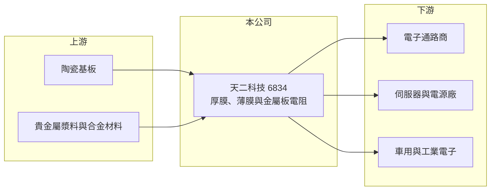

# 6834 天二科技

> 上市｜[[產業索引-電子零組件業|電子零組件業]]｜上市（櫃）日期 2022/09/01

# 第一章：企業模式與商業藍圖

> [!info] 撰寫說明
> 精簡版，由 Claude 依公開資料整理，架構比照 [[2330台積電]] 的四章研究，資料截至 2026-10-08。來源：Goodinfo 經營績效頁、nStock 公司簡介、財經新聞標題（科技新報、CMoney、Yahoo 股市）、證交所開放資料快照（基本資料、每月營收、股利、2026 年第二季損益與資產負債）。公開資料有限，產品別營收比重、客戶與集團關係未查得。#待校對

天二科技（Everohms）是高雄的專業電阻廠，產品包括厚膜與薄膜[[晶片電阻]]，以及用於大電流量測的金屬板[[電流感測電阻]]。本章說明它的業務定位。

- **核心業務：** 天二成立於 1970 年，2022 年 9 月上市，總部與工廠位於高雄前鎮。依 nStock 資料，主要業務是研發、製造及銷售厚膜電阻、薄膜電阻與金屬板電阻。電阻是用量最大的[[被動元件]]之一，一般規格的晶片電阻高度標準化，價格競爭激烈；薄膜電阻精度高，金屬板電阻則能承受大電流，兩者屬於附加價值較高的利基產品。
- **營收結構：** 產品別營收比重在本次查到的資料中未揭露。財經新聞標題以「專業晶片電阻廠」描述天二，市場討論也將其列為 AI 伺服器相關的電阻供應商，推估金屬板電流感測電阻在伺服器電源與電池管理的應用是近年成長來源（推估）。
- **營運據點：** 以高雄廠為主要生產基地（推估），其他海外據點未查得。
- **長期方向：** AI 伺服器、電動車與儲能系統的功率愈來愈高，需要大量低阻值、高精度的電流感測電阻來監控電流與保護電路，這類產品的規格與單價都高於一般電阻。天二若能把產品組合往這些應用移動，就能擺脫標準品的價格戰。2026 年 9 月單月營收創歷史新高，1 至 9 月累計營收年增約 61%，顯示需求正在放大。

# 第二章：護城河深度與競爭優勢

電阻產業由少數大廠主導標準品市場，中小廠必須靠利基規格建立差異。本章分析天二的位置。

- **競爭優勢：** 電流感測電阻需要特殊合金材料與精密加工，阻值愈低、精度愈高，製程門檻愈高。天二有五十多年的電阻製造經驗，同時具備厚膜、薄膜與金屬板三種製程，能提供客戶較完整的產品線。被動元件一旦設計進伺服器電源或車用模組，在產品生命週期內通常不會更換。
- **主要對手：** 全球電阻市場由 [[2327國巨]] 主導，台灣同業還有 [[2478大毅]]、[[3624光頡]]、[[2492華新科]]；國際上有日本與美國的電阻廠（如 Vishay、KOA 等），在高階電流感測電阻市場競爭。天二規模較小，需在利基規格上取得領先。
- **觀察重點：** 第一，2026 年營收大增能否轉為長期的產品組合改善，而不只是一次性的缺貨拉貨。第二，毛利率能否維持在 25% 以上，與 2023 至 2025 年的低獲利期明顯區隔。第三，產能擴充與良率。

# 第三章：財務體質與盈利規模

資料日期：2026-10-08，表格是撰寫當時的快照；最新月營收、毛利率、累計 EPS 由自動排程寫在本筆記的屬性欄位（月營收、毛利率、累計EPS 等）。#待校對

天二的獲利波動非常大，2023 年曾出現毛利率僅 2.6% 的虧損年度，2026 年上半年則大幅轉好。

| 年度 | 營收（億元） | [[毛利率]] | [[營業利益率]] | EPS（元） | [[ROE]] |
|---|---|---|---|---|---|
| 2021 | 12.7 | 29.8% | 15.8% | 2.25 | 13.6% |
| 2022 | 11.0 | 22.9% | 5.10% | 1.26 | 6.94% |
| 2023 | 9.43 | 2.61% | -17.2% | -1.09 | -6.36% |
| 2024 | 12.7 | 17.7% | 2.45% | 0.64 | 3.95% |
| 2025 | 14.3 | 17.9% | 3.12% | 0.50 | 3.06% |
| 2026 上半年 | 10.0 | 26.0% | 10.8% | 1.60 | 未查得 |

- **營收規模：** 2020 年營收 8.87 億元，2025 年 14.3 億元，五年年複合成長率約 10%（推算）。2026 年上半年營收已達 10 億元，約為 2025 年全年的七成。
- **獲利：** 電阻廠的固定成本高，產能利用率對毛利率的影響很大：2023 年需求下滑時毛利率跌到 2.6%、營業利益率 -17%，2026 年上半年稼動率回升，毛利率回到 26%。2026 年上半年稅前純益率 16.3% 高於營業利益率 10.8%，有部分業外收益。2021 至 2025 年平均 ROE 約 4.2%（推算），長期資本報酬偏低。
- **財務特色：** 2026 年第二季末總資產 26.0 億元、權益 15.4 億元、負債 10.6 億元，負債多為流動負債。證交所股利資料顯示 114 年度盈餘配發現金股利每股 0.2 元（nStock 列為 0.4 元，待校對）。實收資本額約 8.85 億元，股本相對獲利規模偏大，使 EPS 偏低。

**[[ROIC]] 與 [[WACC]]：** 有息負債明細未查得，假設約 4 億元（推估）。2025 年營業利益約 0.45 億元（14.3 億 × 3.12%），稅後約 0.36 億元，投入資本約 19.4 億元（權益 15.4 億 + 有息負債 4 億），ROIC 約 1.8%（推算）；2026 年上半年營業利益 1.09 億元年化後，ROIC 約 9%（推算）。WACC 用 [[CAPM]] 推估：無風險利率 1.75%、市場風險溢酬 6%、β 取 1.1（被動元件股常見值，假設），股東權益成本約 8.4%；負債成本 2.5%、稅率 20%，以權益 80%、負債 20% 加權，WACC 約 7.1%（推算）。結論是：天二在 2022 至 2025 年 ROIC 明顯低於 WACC，沒有創造價值；2026 年景氣回升後 ROIC 才首次高於 WACC，能否維持取決於高階電阻比重能否持續提高。

# 第四章：總體風險與地緣政治

天二的風險集中在被動元件週期與標準品價格競爭。

- **產業週期：** 電阻是典型的被動元件週期產業，缺貨時客戶超額下單、價格上漲，供過於求時價格崩跌、稼動率下降。2021 年高峰、2023 年虧損與 2026 年回升，完整呈現了這個週期，[[長鞭效應]]明顯。
- **營運風險：** 規模遠小於國巨等大廠，在標準品上缺乏價格優勢；若高階產品的認證或擴產不如預期，獲利容易隨景氣大幅波動。固定成本高，營收下滑時虧損擴大得很快。
- **其他風險：** 貴金屬與合金材料（如銀、銅、鎳鉻合金）價格上漲會推升成本；外銷以美元計價，新台幣升值會壓縮毛利。中國電阻廠擴產也可能長期壓低標準品報價。

# 專有名詞解析

## 金融

- **[[長鞭效應]]**：終端需求的小幅變動，沿供應鏈往上游傳遞時被逐級放大，造成上游庫存與訂單劇烈波動。
- **[[ROIC]]**：投入資本報酬率，稅後營業利益除以股東權益加有息負債，衡量本業運用資本的效率。
- **[[WACC]]**：加權平均資金成本，依股東權益與負債的比重，加權計算公司取得資金的平均成本。

## 產業

- **[[被動元件]]**：不需外加電源即可運作的電子零件，主要包括電阻、電容與電感。
- **[[晶片電阻]]**：表面黏著用的小型電阻，以厚膜或薄膜製程製造，是電子產品用量最大的電阻。
- **[[電流感測電阻]]**：阻值極低、精度高的電阻，串接在電源迴路中量測電流，用於電池管理與伺服器電源保護。

# 核心供應鏈

- 上游：氧化鋁陶瓷基板、銀鈀等貴金屬漿料、錳銅與鎳鉻等合金材料。
- 下游／客戶：電子零件通路商、伺服器電源廠、車用與工業電子廠（具名客戶未查得）。
- 同業：[[2327國巨]]、[[2478大毅]]、[[3624光頡]]、[[2492華新科]]、Vishay、KOA。

## 最新新聞
<!-- news:start（自動產生，請勿手動編輯此範圍） -->
- 2026-10-14 🏛️ 重訊 15:30｜係因本公司有價證券於集中交易市場達公布注意交易資訊 標準， 故公布相關財務業務等重大訊息，以利投資人區別 瞭解。｜[觀測站](https://mops.twse.com.tw/mops/#/web/t05st01)
- 2026-10-07 📰 媒體 18:53｜營收速報 - 天二科技(6834)9月營收2.72億元年增率高達132.4％｜[鉅亨網](https://news.cnyes.com/news/id/6623874)

完整紀錄：[[6834天二科技 新聞]]
<!-- news:end -->

## 相關連結
- [公開資訊觀測站](https://mopsov.twse.com.tw/mops/web/t05st03?step=1&firstin=1&co_id=6834)
- [Goodinfo](https://goodinfo.tw/tw/StockDetail.asp?STOCK_ID=6834)
- [Yahoo 股市](https://tw.stock.yahoo.com/quote/6834)
- [鉅亨網新聞](https://www.cnyes.com/twstock/6834/news)
