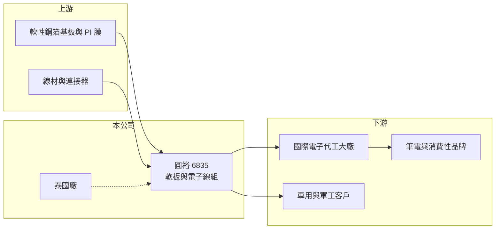

# 6835 圓裕

> 上市｜[[產業索引-電子零組件業|電子零組件業]]｜上市（櫃）日期 2022/11/10

# 第一章：企業模式與商業藍圖

> [!info] 撰寫說明
> 精簡版，由 Claude 依公開資料整理，架構比照 [[2330台積電]] 的四章研究，資料截至 2026-10-08。來源：Goodinfo 經營績效頁、優分析 2026 年 1 月營收報導、證交所開放資料快照（基本資料、每月營收、股利、2026 年第二季損益與資產負債）。公開資料有限，產品與應用別營收比重、具名客戶未查得。#待校對

圓裕是一家同時生產[[軟板]]與電子[[線束]]（線組）的零組件廠，主要客戶是國際電子代工大廠，終端應用以筆電為大宗。本章說明它的業務定位。

- **核心業務：** 圓裕成立於 1980 年，2022 年 11 月上市，總部在新北新店。依優分析報導，公司兼具軟板與電子線組的生產與焊接能力，能把軟板、線材與連接器組成一整套內部連接方案交給客戶。這種「軟板加線組」的整合能力，讓客戶可以向同一家供應商採購多種連接零件，是圓裕接單的主要賣點。
- **營收結構：** 應用分為商用筆電、消費性電子、軍工規與車用電子四大類，各類占比未揭露。從報導描述推估，筆電仍是最大應用（推估）。軍工規與車用屬於驗證嚴格、價格較穩的利基市場，是公司刻意培養的方向。
- **營運據點：** 台灣廠區明細未查得。泰國廠是第二生產基地，生產軟板與線材，依報導 2026 年 1 月進入驗收、第一季後段 SMT 小量試產、下半年量產，目的是因應客戶供應鏈移出中國的需求。
- **長期方向：** 公司布局高頻高速、醫療、高階商用與 AI 穿戴裝置等利基產品，並新設高頻高速實驗室，從設計初期就參與客戶開發，爭取國際代工大廠更多料號。長期來看，關鍵是能否降低對筆電的依賴，並讓泰國廠成為新的成長引擎。

# 第二章：護城河深度與競爭優勢

軟板與線組都是競爭激烈的產業，圓裕的優勢在於整合能力與客戶關係，而非規模。本章分析它的競爭位置。

- **競爭優勢：** 筆電內部的連接零件需配合每一款機種客製化設計，供應商要能在短時間內打樣、驗證並量產。圓裕與國際代工大廠長期合作，具備軟板與線組一次供應的能力，可以降低客戶的採購與管理成本，這是它的主要[[設計導入]]黏著度。軍工規與車用產品的驗證期長，一旦取得認證，訂單較穩定。
- **主要對手：** 軟板方面，大廠如 [[4958臻鼎-KY]]、[[6269台郡]]、[[6153嘉聯益]] 規模遠大於圓裕，主攻手機等大量產品；線組方面，對手包括 [[3023信邦]]、[[3665貿聯-KY]] 等線束廠，以及中國大陸大量的線材廠。圓裕的策略是在筆電與利基應用中提供整合服務。
- **觀察重點：** 第一，泰國廠量產後的良率與獲利。第二，非筆電應用（車用、軍工、醫療、AI 穿戴）營收占比能否提高。第三，毛利率能否從 2026 年上半年的 16% 回到 2023 至 2024 年的 26% 以上。

# 第三章：財務體質與盈利規模

資料日期：2026-10-08，表格是撰寫當時的快照；最新月營收、毛利率、累計 EPS 由自動排程寫在本筆記的屬性欄位（月營收、毛利率、累計EPS 等）。#待校對

圓裕過去五年營收大致持平，獲利在 2022 至 2024 年維持穩定，2025 年起因筆電需求轉弱與泰國廠投資而明顯下滑。

| 年度 | 營收（億元） | [[毛利率]] | [[營業利益率]] | EPS（元） | [[ROE]] |
|---|---|---|---|---|---|
| 2021 | 27.9 | 19.7% | 7.07% | 2.72 | 14.8% |
| 2022 | 27.2 | 20.3% | 7.85% | 4.05 | 18.1% |
| 2023 | 22.0 | 27.1% | 11.7% | 3.57 | 14.9% |
| 2024 | 24.4 | 26.2% | 11.2% | 4.06 | 15.2% |
| 2025 | 23.8 | 21.6% | 5.93% | 0.97 | 3.40% |
| 2026 上半年 | 11.7 | 16.1% | -0.37% | -0.23 | 未查得 |

- **營收規模：** 2020 年營收 24.8 億元，2025 年 23.8 億元，五年年複合成長率約 -0.8%（推算），基本上沒有成長。依報導，2025 年記憶體短缺使消費型筆電客戶拉貨放緩；2026 年 1 至 8 月累計營收年減約 7%。
- **獲利：** 毛利率在 2023 至 2024 年達到 26% 至 27%，2025 年降到 21.6%，2026 年上半年再降到 16.1%，營業利益轉為小幅虧損，推估與泰國廠開辦成本、產能利用率下降有關（推估）。2021 至 2025 年平均 ROE 約 13.3%（推算），但 2025 年以後明顯下滑。
- **財務特色：** 2026 年第二季末總資產 41.3 億元、權益 17.6 億元、負債 23.7 億元，負債比約 57%，其中非流動負債 10.1 億元，推估多為泰國廠的長期借款。114 年度配發現金股利每股 1 元，與 2025 年 EPS 0.97 元相當。實收資本額約 6.62 億元。

**[[ROIC]] 與 [[WACC]]：** 有息負債明細未查得，假設約 12 億元（推估）。2025 年營業利益約 1.41 億元（23.8 億 × 5.93%），稅後約 1.13 億元，投入資本約 29.6 億元（權益 17.6 億 + 有息負債 12 億），ROIC 約 3.8%（推算）；2026 年上半年營業利益為 -0.04 億元，ROIC 約為 0 或小幅負值（推算）。2023 至 2024 年營業利益率約 11%，當時 ROIC 約 8% 至 9%（推算）。WACC 用 [[CAPM]] 推估：無風險利率 1.75%、市場風險溢酬 6%、β 取 0.9（電子零組件股常見值，假設），股東權益成本約 7.2%；負債成本 2.5%、稅率 20%，以權益 60%、負債 40% 加權，WACC 約 5.1%（推算）。結論是：圓裕在 2023 至 2024 年 ROIC 高於 WACC，2025 年起跌破 WACC；泰國廠的投資能否在量產後帶來足夠報酬，決定未來是否回到價值創造。

# 第四章：總體風險與地緣政治

圓裕的風險集中在筆電需求、客戶集中度與泰國廠的執行。

- **產業週期：** 筆電需求有明顯的換機週期，商用筆電受企業換機與作業系統更新影響，消費型筆電則受零組件短缺與景氣影響。下游代工廠調整庫存時，連接零件訂單會先被削減，[[長鞭效應]]明顯。
- **營運風險：** 客戶以少數國際代工大廠為主，單一客戶或機種的轉單影響很大。泰國廠從驗收到量產需要時間，初期良率與費用會拉低毛利率；負債比偏高，若虧損延續，財務壓力會上升。
- **其他風險：** 銅、PI 膜等原物料價格影響成本；外銷以美元計價，新台幣升值會壓縮毛利。美中貿易政策與關稅是設立泰國廠的原因，也是未來客戶分配訂單的變數。

# 專有名詞解析

## 金融

- **[[長鞭效應]]**：終端需求的小幅變動，沿供應鏈往上游傳遞時被逐級放大，造成上游庫存與訂單劇烈波動。
- **[[ROIC]]**：投入資本報酬率，稅後營業利益除以股東權益加有息負債，衡量本業運用資本的效率。

## 產業

- **[[軟板]]**：以可彎折的聚醯亞胺等薄膜為基材的電路板，用於手機、穿戴裝置與電池模組等狹小或活動空間。
- **[[線束]]**：把多條電線、端子與連接器組合成一束的配線組件，用於汽車與設備內部的配電與訊號傳輸。
- **[[設計導入]]**：零組件在客戶新產品設計階段就被選用，一旦導入通常在整個產品生命週期內持續供貨。

# 核心供應鏈

- 上游：軟性銅箔基板、PI 膜、線材、連接器與端子。
- 下游／客戶：國際電子代工大廠，例如 [[2382廣達]]、[[2324仁寶]]、[[3231緯創]]（推估，未查得具名）；終端為筆電與消費性電子品牌，以及車用、軍工客戶。
- 同業：軟板廠 [[4958臻鼎-KY]]、[[6269台郡]]、[[6153嘉聯益]]；線組廠 [[3023信邦]]、[[3665貿聯-KY]]。

## 最新新聞
<!-- news:start（自動產生，請勿手動編輯此範圍） -->
- 2026-10-12 📰 媒體 20:35｜記憶體缺貨持續影響筆電客戶拉貨 圓裕9月營收探7個月來低點｜[鉅亨網](https://news.cnyes.com/news/id/6628771)

完整紀錄：[[6835圓裕 新聞]]
<!-- news:end -->

## 相關連結
- [公開資訊觀測站](https://mopsov.twse.com.tw/mops/web/t05st03?step=1&firstin=1&co_id=6835)
- [Goodinfo](https://goodinfo.tw/tw/StockDetail.asp?STOCK_ID=6835)
- [Yahoo 股市](https://tw.stock.yahoo.com/quote/6835)
- [鉅亨網新聞](https://www.cnyes.com/twstock/6835/news)
