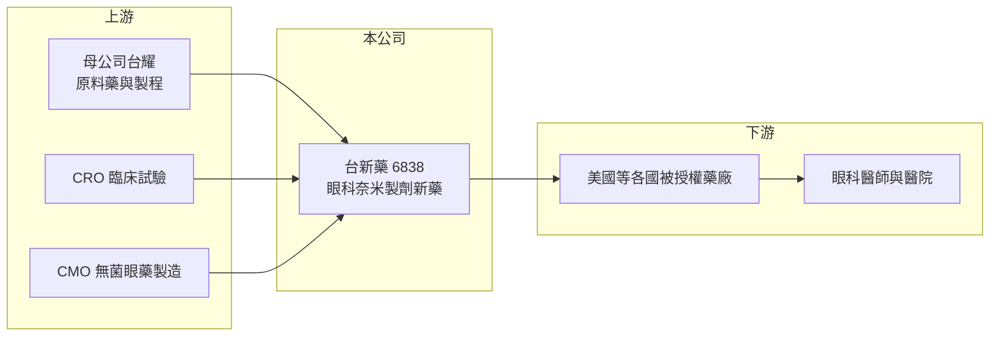

# 6838 台新藥

> 上市｜[[產業索引-生技醫療業|生技醫療業]]｜上市（櫃）日期 2024/08/13

# 第一章：企業模式與商業藍圖

> [!info] 撰寫說明
> 精簡版，由 Claude 依公開資料整理，架構比照 [[2330台積電]] 的四章研究，資料截至 2026-10-08。來源：證交所開放資料（基本資料、2026 年第二季綜合損益與資產負債、營益分析、每月營收）、Goodinfo 經營績效頁、nStock 公司頁。藥品代號、核准日期與被授權廠商名稱憑記憶撰寫，已標「待校對」。#待校對

台新藥是 [[4746台耀]] 旗下的新藥開發公司，本章說明它的商業模式、主要產品與收入來源。

- **核心業務：** 台新藥成立於 2010 年 12 月，總部在台北，2024 年 8 月在證交所上市，母公司台耀持股約 40.66%。主要業務是新藥開發與技術移轉，也就是自己做到臨床或藥證階段，再透過[[新藥授權]]把銷售權交給各國藥廠，賺取[[授權金]]、[[里程碑金]]與銷售分潤。
- **技術平台：** 公司以[[奈米製劑]]技術為核心，把難溶於水的藥物做成奈米顆粒懸浮液，提高眼睛等局部部位的藥物吸收（平台名稱 APNT，待校對）。這類改良劑型多半走 [[505(b)(2)]] 路徑，開發時間與失敗率都低於全新分子。
- **主要產品：** 代表產品是眼科用類固醇奈米懸浮液 APP13007，用於眼科手術後的發炎與疼痛（待校對）。2023 年 7 月美國 FDA 受理上市申請，同年 8 月授權給美國藥廠，授權總值逾新台幣 26 億元；依記憶，FDA 於 2024 年 3 月核准上市（待校對）。
- **營收結構：** 營收全部來自授權相關收入，金額隨里程碑達成時點跳動。2024 年營收 1.43 億元，2025 年只有約 900 萬元，2026 年上半年 4,845 萬元，單年數字無法代表長期水準。
- **長期方向：** 台新藥的長期路徑是把眼科產品授權到更多國家，並以同一套奈米製劑平台開發下一代產品，讓授權收入從單一產品分散到多個產品與地區。

# 第二章：護城河深度與競爭優勢

改良型新藥公司的護城河在於製劑技術、專利與授權網絡。本章分析台新藥的優勢與限制。

- **競爭優勢：** 把類固醇做成穩定的眼用奈米懸浮液，涉及粒徑控制、穩定性與無菌製程，技術門檻高，也能以新劑型專利延長保護。母公司台耀是原料藥與製程開發公司，在原料供應與化學製程上提供支援，降低開發成本。
- **主要對手：** 眼科術後抗發炎市場已有多種類固醇與非類固醇眼藥水，包括國際大藥廠的品牌藥與學名藥。台新藥的差異化在於較低的藥物濃度與較少的每日點藥次數（待校對），必須靠醫師接受度與給付條件打開市場。
- **護城河的限制：** 授權模式下，產品賣得好不好取決於被授權廠商的行銷能力；被授權方若財務或策略出問題，里程碑與分潤就會延後。台新藥目前收入集中在單一產品，抗風險能力有限。
- **觀察重點：** 美國以外市場的授權與上市進度、銷售分潤是否開始穩定入帳，以及奈米平台第二個產品的臨床進度。

# 第三章：財務體質與盈利規模

資料日期：2026-10-08，表格是撰寫當時的快照；最新月營收、毛利率、累計 EPS 由自動排程寫在本筆記的屬性欄位（月營收、毛利率、累計EPS 等）。#待校對

台新藥的財報是典型的授權型新藥公司：營收跳動、長年虧損，但虧損幅度隨產品取證而收斂。

| 年度 | 營收（億元） | [[毛利率]] | [[營業利益率]] | EPS（元） | [[ROE]] |
|---|---|---|---|---|---|
| 2020 | 0 | 未查得 | 未查得 | -3.12 | -97.6% |
| 2021 | 0.29 | 99.1% | -1,332% | -4.33 | -135% |
| 2022 | 0.01 | 25.3% | -29,024% | -3.86 | -94.4% |
| 2023 | 0.31 | 87.7% | -908% | -2.59 | -40.0% |
| 2024 | 1.43 | 83.0% | -123% | -1.43 | -14.9% |
| 2025 | 0.09 | -16.8% | -1,797% | -0.55 | -5.56% |
| 2026 上半年 | 0.48 | 71.9% | -178.2% | -0.55 | 未查得 |

- **虧損收斂：** EPS 從 2021 年的 -4.33 元收斂到 2025 年的 -0.55 元，ROE 從 -135% 改善到 -5.6%。這一方面是臨床後期費用下降，另一方面是 2024 年上市增資後股本擴大、每股虧損被攤薄。
- **財務結構：** 2026 年第二季底股東權益約 13.7 億元，累積虧損約 23.2 億元，負債總計 5.54 億元，其中非流動負債 4.59 億元（證交所資料）；有息負債金額開放資料未拆分，非流動負債可能包含遞延收入或借款。
- **股利：** 歷年無配發股利。

**[[ROIC]] 與 [[WACC]]：** 2025 年營業損失約 1.62 億元（0.09 億元 × -1,797%），虧損不計稅盾，投入資本以股東權益 13.7 億元加上有息負債（未查得，假設 0 至 4.59 億元）計，ROIC 約 -9% 至 -12%（推算）。WACC 以 CAPM 推估：無風險利率 1.75%、市場風險溢酬 6%、β 取生技新藥同業常見值 1.2，負債比重不高，WACC 約 8.5% 至 9%（推算）。目前 ROIC 低於 WACC，是否創造價值要看眼科產品的銷售分潤與新授權能否讓公司轉為持續獲利。

# 第四章：總體風險與地緣政治

授權型新藥公司的風險集中在夥伴、市場接受度與研發延續。本章整理台新藥長期面對的主要風險。

- **合作夥伴風險：** 美國市場的銷售由被授權廠商負責，若對方行銷資源不足或財務困難，產品放量會遠低於預期，里程碑金也可能落空（待校對對方近況）。
- **市場風險：** 眼科術後用藥競爭激烈且學名藥便宜，新產品要取得醫院處方集與保險給付需要時間，銷售成長往往比預期慢。
- **研發與資金風險：** 單一產品撐不起長期營運，下一代產品若進度落後，公司可能需要再增資，稀釋股東權益。
- **其他風險：** 授權收入以美元計價，匯率影響認列金額；美國藥價改革與藥品通路議價，也會壓縮分潤。

# 專有名詞解析

## 金融

- **[[ROIC]]**：投入資本報酬率，稅後營業利益除以投入資本（股東權益加有息負債），衡量本業創造報酬的能力。
- **[[WACC]]**：加權平均資金成本，依權益與負債比重加權的資金成本，是 ROIC 需要超越的門檻。

## 產業

- **[[505(b)(2)]]**：美國 FDA 的新藥申請路徑之一，可引用已上市成分的既有資料，常用於改良劑型或新給藥途徑。
- **[[新藥授權]]**：新藥公司把特定區域或適應症的開發與銷售權授權給其他藥廠，以換取簽約金、里程碑金與權利金。
- **[[授權金]]**：技術或產品授權時，被授權方依合約支付的費用，包括簽約金與後續權利金。
- **[[里程碑金]]**：授權合約中，當藥物達成臨床進展、取得藥證或銷售目標等特定里程碑時，被授權方支付的款項。
- **[[奈米製劑]]**：把藥物做成奈米尺度顆粒以提高溶解度與吸收的製劑技術，常用於眼科與注射劑。

# 核心供應鏈

- 上游：母公司 [[4746台耀]]（原料藥與化學製程）、臨床試驗委託研究機構、無菌眼藥委託製造廠。
- 下游／客戶：2023 年 8 月取得授權的美國藥廠及其他地區夥伴，最終使用者為眼科醫師與手術病患。
- 同業：[[6576逸達]]、[[6535順藥]] 等以改良劑型或 505(b)(2) 為主的台灣新藥公司。

## 最新新聞
<!-- news:start -->
<!-- news:end -->

## 相關連結
- [公開資訊觀測站](https://mopsov.twse.com.tw/mops/web/t05st03?step=1&firstin=1&co_id=6838)
- [Goodinfo](https://goodinfo.tw/tw/StockDetail.asp?STOCK_ID=6838)
- [Yahoo 股市](https://tw.stock.yahoo.com/quote/6838)
- [鉅亨網新聞](https://www.cnyes.com/twstock/6838/news)
