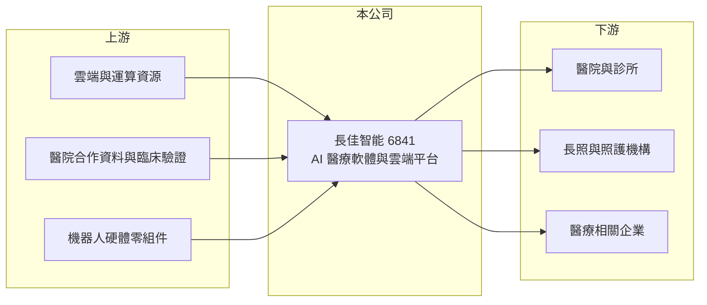

# 6841 長佳智能

> 上櫃｜[[產業索引-生技醫療業|生技醫療業]]｜上市（櫃）日期 2023/03/01

# 第一章：企業模式與商業藍圖

> [!info] 撰寫說明
> 精簡版，由 Claude 依公開資料整理，架構比照 [[2330台積電]] 的四章研究，資料截至 2026-10-08。來源：櫃買中心開放資料（基本資料、2026 年第二季綜合損益與資產負債、每月營收）、Goodinfo 經營績效頁、富果研究 2025 年 7 月法說會整理。公開資料有限，業務比重沒有查到有年份的數字，產品描述部分憑記憶撰寫並標「待校對」。#待校對

長佳智能（以下簡稱長佳）是台中的 AI 醫療科技公司，本章說明它的業務型態、收入來源與長期布局。

- **核心業務：** 長佳成立於 2018 年 6 月，總部在台中，2023 年 3 月在櫃買中心掛牌。公司以醫療資料與人工智慧為核心，提供 [[AI 醫療]]影像判讀、臨床輔助決策與醫療雲端平台等服務，客戶以醫院、診所與醫療相關業者為主（待校對）。
- **營收結構：** 依富果整理，雲端平台服務是最大的收入來源，但該比重沒有標示年份，因此不列數字。營收從 2020 年的 300 萬元成長到 2025 年的 3.79 億元，代表公司已從研發期進入商業化，收入型態偏向[[訂閱制]]與專案服務的混合（推估）。
- **集團結構：** 2026 年第二季底，合併報表的[[非控制權益]]約 7.25 億元，占權益總計約三成（櫃買中心資料），代表長佳透過持股未達百分之百的子公司或合資公司經營部分業務。投資人看合併營收時要注意，部分獲利屬於子公司的其他股東。
- **長期方向：** 依 2025 年 7 月法說會資料，公司預計 2025 年 9 月推出照護型機器人原型機，計畫 2026 年開始量產，把 AI 能力從軟體延伸到長照硬體。這個方向切中高齡化與照護人力不足的長期需求，但硬體開發與量產也是長佳過去較少接觸的領域。

# 第二章：護城河深度與競爭優勢

AI 醫療軟體的競爭關鍵在資料、臨床驗證與醫院導入關係。本章分析長佳的優勢與限制。

- **競爭優勢：** AI 模型需要大量經過標註的醫療資料訓練，與醫院長期合作取得資料、並完成臨床驗證與醫療器材軟體許可，是新進者難以短期複製的門檻。軟體一旦嵌入醫院工作流程，醫院更換系統的成本高，形成轉換成本。
- **主要對手：** 國內外都有大量 AI 醫療新創，國際醫療影像設備大廠也把 AI 功能內建到設備中。台灣同類上市櫃公司不多，醫療資訊與 AI 相關的 [[6811宏碁資訊]] 等資訊服務公司，以及醫院自行開發的系統，都是潛在競爭者（待校對）。
- **護城河的限制：** AI 演算法本身的差異化容易被追上，真正能留住客戶的是資料規模與臨床服務能力。台灣醫院市場規模有限，若要擴大營收需要走向海外，但海外法規與資料隱私規範各不相同。
- **觀察重點：** 雲端平台的經常性收入占比能否提高、照護機器人能否在 2026 年如期量產並取得訂單，以及子公司的獲利有多少能歸屬母公司股東。

# 第三章：財務體質與盈利規模

資料日期：2026-10-08，表格是撰寫當時的快照；最新月營收、毛利率、累計 EPS 由自動排程寫在本筆記的屬性欄位（月營收、毛利率、累計EPS 等）。#待校對

長佳的財報顯示營收快速成長、本業在 2024 年轉為獲利，但規模仍小，獲利率對費用變動非常敏感。

| 年度 | 營收（億元） | [[毛利率]] | [[營業利益率]] | EPS（元） | [[ROE]] |
|---|---|---|---|---|---|
| 2020 | 0.03 | 86.2% | -2,119% | -0.98 | -4.95% |
| 2021 | 0.38 | 79.7% | -207% | -0.61 | -3.51% |
| 2022 | 0.54 | 72.2% | -134% | 1.54 | 8.65% |
| 2023 | 0.94 | 49.6% | -114% | -0.44 | -2.40% |
| 2024 | 3.38 | 61.6% | 9.03% | 0.31 | 1.87% |
| 2025 | 3.79 | 59.4% | 9.34% | 0.89 | 5.45% |
| 2026 上半年 | 1.67 | 73.1% | 14.6% | 0.13 | 未查得 |

- **獲利能力：** 毛利率長期維持 50% 至 80%，屬軟體與服務的高毛利特性；2024 年營收跳增到 3.38 億元後營業利益轉正。2022 年營業虧損卻有 1.54 元 EPS，代表當年有較大的業外收益，不屬本業。2026 年上半年營業利益 2,447 萬元，但歸屬母公司的淨利僅約 900 多萬元，差異主要來自業外與非控制權益。
- **長期指標：** 2021 至 2025 年平均 ROE 約 2%（推算），2022 至 2025 年營收年複合成長約 91%（推算，基期很小）。Goodinfo 顯示 2022 至 2026 年現金股利一般平均約 1 元。
- **財務結構：** 2026 年第二季底歸屬母公司權益約 15.8 億元、權益總計約 23.1 億元，負債總計 5.71 億元且幾乎都是流動負債，非流動負債僅 170 萬元（櫃買中心資料），長期借款很少。

**[[ROIC]] 與 [[WACC]]：** 2025 年營業利益約 0.35 億元（3.79 億元 × 9.34%），稅率 20% 後約 0.28 億元；投入資本以權益總計約 23.1 億元、有息負債約 0（未查得，非流動負債極少）計，ROIC 約 1.2%（推算）。WACC 以 CAPM 推估：無風險利率 1.75%、市場風險溢酬 6%、β 取軟體與醫療科技同業常見值 1.1，幾乎無負債，WACC 約 8.4%（推算）。ROIC 遠低於 WACC，主因是帳上資本大、本業獲利規模小；長佳要創造價值，需要讓營收規模再放大數倍，或把閒置資金投入回報較高的業務。

# 第四章：總體風險與地緣政治

AI 醫療公司的風險來自法規、資料與商業化速度。本章整理長佳長期面對的主要風險。

- **法規與資料風險：** AI 醫療軟體多數屬於[[醫療器材]]軟體，需取得衛福部等主管機關許可；醫療資料的蒐集與使用受個資法規範，法規收緊會限制模型訓練與產品推出。
- **商業化風險：** 醫院採購流程長、預算有限，AI 工具若不能直接帶來健保給付或節省人力，醫院付費意願會受限，營收成長可能不如預期。
- **新事業風險：** 照護機器人涉及硬體設計、供應鏈與量產品質，與軟體業務差異大；若量產延後或市場接受度低，前期投入可能無法回收。
- **其他風險：** 集團結構中非控制權益比重高，子公司營運與資本決策若與母公司股東利益不一致，會影響母公司股東實際分到的獲利。

# 專有名詞解析

## 應用

- **[[AI 醫療]]**：把人工智慧用在醫療影像判讀、臨床輔助決策與健康管理，需經臨床驗證與主管機關許可。

## 金融

- **[[非控制權益]]**：合併報表中子公司股權屬於其他股東的部分，對應的獲利不歸母公司股東所有。
- **[[ROIC]]**：投入資本報酬率，稅後營業利益除以投入資本（股東權益加有息負債），衡量本業創造報酬的能力。
- **[[WACC]]**：加權平均資金成本，依權益與負債比重加權的資金成本，是 ROIC 需要超越的門檻。

## 產業

- **[[訂閱制]]**：客戶按月或按年付費使用軟體或服務的收費模式，收入穩定、可預測性高。
- **[[醫療器材]]**：用於診斷、治療或矯正的器具與設備，上市前需取得各國衛生主管機關許可，生產須符合品質系統規範。

# 核心供應鏈

- 上游：雲端運算資源、合作醫院提供的資料與臨床驗證、照護機器人所需的硬體零組件（待校對）。
- 下游／客戶：醫院、診所、長照機構與醫療相關企業（待校對）。
- 同業：[[6811宏碁資訊]] 等醫療資訊服務公司，以及國內外 AI 醫療新創（待校對）。

## 最新新聞
<!-- news:start（自動產生，請勿手動編輯此範圍） -->
- 2026-10-20 🏛️ 重訊 16:21｜代子公司長聯科技股份有限公司公告 決議購買富邦人壽保險股份有限公司累積次順位公司債｜[觀測站](https://mops.twse.com.tw/mops/#/web/t05st01)

完整紀錄：[[6841長佳智能 新聞]]
<!-- news:end -->

## 相關連結
- [公開資訊觀測站](https://mopsov.twse.com.tw/mops/web/t05st03?step=1&firstin=1&co_id=6841)
- [Goodinfo](https://goodinfo.tw/tw/StockDetail.asp?STOCK_ID=6841)
- [Yahoo 股市](https://tw.stock.yahoo.com/quote/6841)
- [鉅亨網新聞](https://www.cnyes.com/twstock/6841/news)
