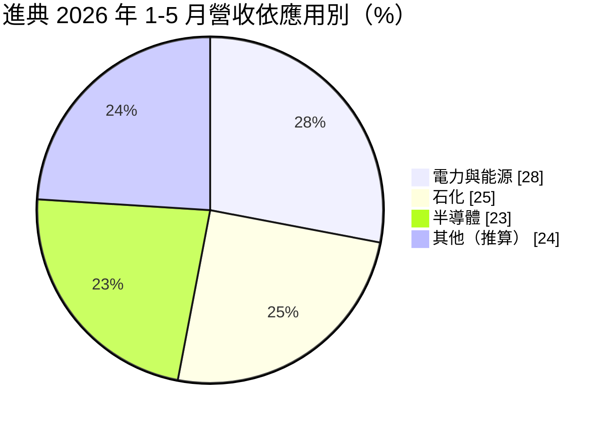
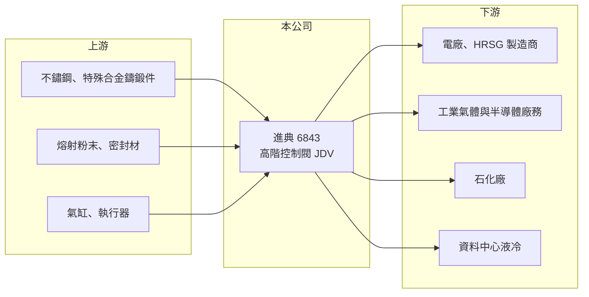

# 6843 進典

> 上櫃｜[[產業索引-電機機械|電機機械]]｜上市（櫃）日期 2022/11/21

# 第一章：企業模式與商業藍圖

> [!info] 撰寫說明
> 精簡版，由 Claude 依公開資料整理，架構比照 [[2330台積電]]，資料截至 2026-10-08。來源：櫃買中心開放資料快照（基本資料、2026 年第二季資產負債與損益、每月營收、本益比殖利率）、Goodinfo 經營績效頁、富果研究 2026 年 6 月法說會摘要。法說會摘要為 AI 整理內容，客戶與據點描述尚未逐條比對原始文件。#待校對

進典工業（以下簡稱進典）是台灣少數專做高階工業[[控制閥]]的上櫃公司，產品用在高溫、高壓、超低溫與強腐蝕的嚴苛環境。理解它的關鍵在於：進典正從依賴中國石化市場的代工廠，轉型為以自有品牌經營北美與日本電力、半導體與資料中心市場的閥門廠。

- **核心業務：** 進典成立於 1978 年，2022 年在櫃買中心上櫃，實收資本額約 3.33 億元，董事長兼總經理為范義鑫，總部位於桃園楊梅。產品包括蝶閥、球閥與控制閥，核心技術是 [[HVOF]] 高速火焰熔射噴塗與金屬密封研磨，讓閥門在極端工況下仍能密封不漏。閥門雖然是小零件，但一旦失效可能造成停機或安全事故，因此客戶重視可靠度更勝於價格。
- **營收結構：** 依 2026 年 1 至 5 月資料，電力與能源占 28%、石化占 25%、半導體占 23%。應用涵蓋燃氣電廠的[[熱回收蒸汽產生器]]（HRSG）、地熱發電、半導體廠務氣體與 EUV、CVD 機台溫控系統，以及 AI 資料中心的液冷系統。北美營收占比由 2023 年的 5.8% 提升到 23.3%，中國比重持續下降。
- **營運據點：** 台灣楊梅為總部與主要工廠，並規劃自建氣動元件廠，自製氣缸與執行器。美國德州休士頓已有兩條產線運作，日本則在 2024 年取得 KHK 高壓氣體認證，規劃 2026 年在東京灣地區設立第三個海外生產基地。
- **長期方向：** 公司目標是讓電力能源、半導體與 AI 算力中心三大領域各占約三分之一營收，降低石化比重。北美市場由過去替 AT Controls 代工，改為以自有品牌 JDV 直接經營，並在 2024 年併購一個事業單位以供應陶氏化學（Dow）。這是從代工走向品牌、從中國走向美日的雙重轉型。

# 第二章：護城河深度與競爭優勢

進典的護城河來自嚴苛工況的材料與表面處理技術，以及進入國際龍頭供應鏈所需的認證與實績。

- **競爭優勢：** 高溫高壓閥門必須通過客戶與國際規範的驗證，取得 Linde、Air Liquide、Air Products 等工業氣體大廠，以及 HRSG 製造商 Nooter Eriksen、Vogt Power 的合格供應商資格，需要多年實績累積。公司採取「先打進產業龍頭，再擴散到其他客戶」的策略，一旦取得資格，客戶的[[轉換成本]]就相當高。
- **主要對手：** 國際閥門大廠如 Emerson（Fisher）、Flowserve、日本與歐洲的專業閥門廠在高階市場占有主導地位，中國同業則在中低階市場以低價競爭（待校對）。台灣上市櫃公司中，專做高階控制閥的同業很少。
- **觀察重點：** 毛利率長期在 33% 至 44% 之間，代表產品有一定訂價能力；但 2024 年後海外擴張的銷管費用大增，營業利益率從 2023 年的 17.3% 降到 2026 年上半年的約 3%。長期要看北美與日本營收能否放大到足以攤平據點成本。

# 第三章：財務體質與盈利規模

資料日期：2026-10-08，表格是撰寫當時的快照；最新月營收、毛利率、累計 EPS 由自動排程寫在本筆記的屬性欄位（月營收、毛利率、累計EPS 等）。#待校對

進典的財務呈現「高毛利、轉型期費用上升」的樣貌：本業毛利穩定，但獲利被海外擴張的投入壓縮。

| 年度 | 營收（億元） | [[毛利率]] | [[營業利益率]] | EPS（元） | [[ROE]] |
|---|---|---|---|---|---|
| 2019 | 6.25 | 44.2% | 14.9% | 1.73 | 9.83% |
| 2020 | 6.44 | 37.1% | 13.4% | 2.16 | 12.2% |
| 2021 | 7.83 | 32.6% | 10.4% | 2.45 | 13.2% |
| 2022 | 9.23 | 36.1% | 16.7% | 4.41 | 19.9% |
| 2023 | 9.52 | 36.6% | 17.3% | 4.06 | 16.8% |
| 2024 | 7.43 | 37.2% | 13.9% | 2.38 | 9.55% |
| 2025 | 8.25 | 38.0% | 12.0% | 2.20 | 8.41% |
| 2026 上半年 | 3.71 | 38.9% | 3.01% | 0.61 | 未查得 |

（來源：Goodinfo 經營績效頁；2026 上半年取自櫃買中心開放資料。）

- **營收規模：** 2019 至 2023 年營收由 6.25 億元成長到 9.52 億元，2024 年因中國石化需求轉弱降到 7.43 億元。2021 至 2025 年年複合成長率約 1.3%（推算），轉型期營收大致持平。
- **獲利：** 2021 至 2025 年平均 ROE 約 13.6%（推算），2022 至 2023 年接近 20%，近兩年降到 8% 至 10%。2026 年上半年營業利益僅約 0.11 億元，主要是美國與日本據點的人力、產線與庫存投入。
- **財務特色：** 依 2026 年第二季資料，總資產約 15.0 億元、權益約 8.3 億元、負債約 6.7 億元，負債比約 45%，其中非流動負債約 4.2 億元，推估包含海外擴廠的長期借款。現金股利約 2 元，以 2025 年 EPS 2.2 元計算配息率約九成（推算），配息政策相當積極。
- **[[ROIC]] 與 [[WACC]]：** 2025 年營業利益約 0.99 億元，稅後約 0.79 億元（推算，稅率 20%），以權益 8.3 億元到「權益加全部負債」15.0 億元計算，ROIC 約 5.3% 至 9.5%（推算）；2026 年上半年年化後僅約 1.2% 至 2.1%。WACC 以 [[CAPM]] 推估：無風險利率 1.75%、市場風險溢酬 6%、β 假設 0.9（工業零組件股常見值），權益成本約 7.15%；假設有息負債占資本約 35%、稅前負債成本 2.5%，WACC 約 5.3%（推算）。2022 至 2023 年 ROIC 明顯高於 WACC，近期因轉型投入降到 WACC 附近或以下，海外布局能否回收是價值創造的關鍵。

# 第四章：總體風險與地緣政治

進典的風險來自海外擴張的執行、能源與半導體投資循環，以及中國市場的價格競爭。

- **產業週期：** 閥門需求跟著電廠、石化廠、半導體廠與資料中心的資本支出走，大型專案常集中在特定年份。石化業長期面臨中國產能過剩，北美燃氣電廠與資料中心建設則受電力需求與利率影響。
- **營運風險：** 同時在美國與日本建立產線，管理半徑與費用大幅擴大，若訂單放量慢於預期，費用會持續壓抑獲利。自有品牌取代代工後，客戶服務、庫存與保固責任都由公司自行承擔。
- **其他風險：** 美國關稅與在地製造要求、美元與日圓匯率波動、不鏽鋼與特殊合金原料價格，以及中國市場的低價競爭。

# 專有名詞解析

## 應用

- **[[熱回收蒸汽產生器]]**：HRSG，回收燃氣渦輪排氣餘熱產生蒸汽、再推動蒸汽渦輪發電的設備，是複循環電廠的核心。

## 金融

- **[[轉換成本]]**：客戶更換供應商時需要付出的時間、驗證與風險成本，越高代表客戶越不容易流失。
- **[[CAPM]]**：資本資產定價模型，以無風險利率加上 β 乘以市場風險溢酬，推估股東要求的報酬率。

## 產業

- **[[控制閥]]**：調節管線中流體流量、壓力或溫度的閥門，常由氣動或電動執行器驅動，用於電廠、石化與廠務系統。
- **[[HVOF]]**：高速火焰熔射，把金屬或陶瓷粉末以超音速噴塗在零件表面，形成耐磨、耐蝕的硬化塗層。

# 核心供應鏈

- 上游：不鏽鋼與特殊合金的鑄鍛件、熔射粉末與密封材料；氣缸與執行器過去外購，未來規劃自製。實際供應商未查得，#待校對。
- 下游／客戶：HRSG 製造商 Nooter Eriksen、Vogt Power；工業氣體廠 Linde、Air Liquide、Air Products；美國電力公司 AEP 與台電；資料中心通路 Ferguson；陶氏化學；台灣半導體大廠（未具名）。
- 同業：國際閥門大廠如 Emerson、Flowserve；台灣上市櫃中專做高階控制閥的同業很少。

## 最新新聞
<!-- news:start -->
<!-- news:end -->

## 相關連結
- [公開資訊觀測站](https://mopsov.twse.com.tw/mops/web/t05st03?step=1&firstin=1&co_id=6843)
- [Goodinfo](https://goodinfo.tw/tw/StockDetail.asp?STOCK_ID=6843)
- [Yahoo 股市](https://tw.stock.yahoo.com/quote/6843)
- [鉅亨網新聞](https://www.cnyes.com/twstock/6843/news)
