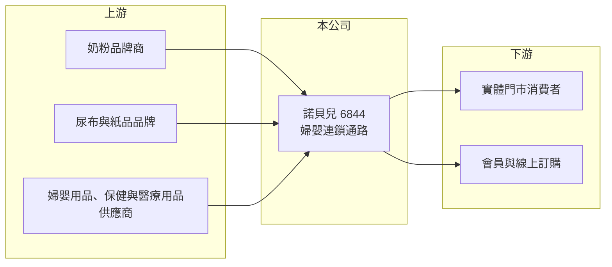

# 6844 諾貝兒

> 上櫃｜[[產業索引-生技醫療業|生技醫療業]]｜上市（櫃）日期 2024/03/08

# 第一章：企業模式與商業藍圖

> [!info] 撰寫說明
> 精簡版，由 Claude 依公開資料整理，架構比照 [[2330台積電]] 的四章研究，資料截至 2026-10-08。來源：櫃買中心開放資料（基本資料、2026 年第二季綜合損益與資產負債、每月營收）、Goodinfo 經營績效頁、nStock 公司頁。公開資料有限，門市數、地區分布與商品比重沒有查到，通路描述部分憑記憶撰寫並標「待校對」。#待校對

諾貝兒寶貝（以下簡稱諾貝兒）是以高雄為基地的婦嬰用品連鎖通路，本章說明它的商業模式與長期挑戰。

- **核心業務：** 諾貝兒成立於 1997 年，總部在高雄，2024 年 3 月在櫃買中心掛牌，主要業務是婦嬰用品、醫療用品、保健食品與化妝品的零售與批發。消費者熟悉的是「諾貝兒寶貝」婦嬰連鎖門市，以南台灣為主要據點（待校對）。
- **營收結構：** 公開資料沒有查到商品別比重。婦嬰通路的主力商品通常是奶粉、尿布等高頻消耗品，這些商品毛利不高但能帶來來客，再以副食品、用品、服飾與保健品提高客單價與毛利（產業常態，推估）。公司 [[毛利率]] 長年在 31% 至 34%，符合專業零售通路的水準。
- **營運模式：** 零售通路的獲利公式是「來客數 × 客單價 × 毛利率 − 租金與人事」。門市多為租賃，2026 年第二季底非流動負債約 10.7 億元，推估大部分是[[租賃負債]]，代表店面租金是長期固定成本。
- **長期方向：** 在[[少子化]]的環境下，婦嬰通路的成長只能靠提高市占、擴大商品範圍（例如醫療保健與藥妝）與發展會員經營。營業項目已涵蓋醫療用品與[[保健食品]]，顯示公司試圖從單純婦嬰店延伸為家庭健康通路（推估）。

# 第二章：護城河深度與競爭優勢

零售通路的護城河來自規模、地點、會員與供應商條件。本章分析諾貝兒的優勢與限制。

- **競爭優勢：** 在南台灣經營近三十年，累積的門市網絡與會員基礎讓它對奶粉、尿布品牌商有一定的採購議價力，也能取得較好的陳列與促銷條件。婦嬰商品講究信任，新手父母傾向在熟悉的專業門市購買，有助於回購。
- **主要對手：** 全台性的婦嬰連鎖通路、量販店與超市，以及 momo（[[8454富邦媒]]）等電商平台；藥妝與藥局通路如 [[6469大樹]]、[[4175杏一]]、[[5904寶雅]] 也販售婦嬰商品，童裝與用品品牌通路則有 [[2911麗嬰房]]。
- **護城河的限制：** 奶粉與尿布價格透明、比價容易，電商以低價與送貨到府搶走大量標準品需求，實體通路的價格優勢有限。從獲利趨勢看，營業利益率從 2022 年的 10.7% 降到 2025 年的 2.2%，代表過去的優勢正在被侵蝕。
- **觀察重點：** [[同店營收]]能否止跌、高毛利自有或獨家商品的比重，以及門市調整與線上線下整合的成效。

# 第三章：財務體質與盈利規模

資料日期：2026-10-08，表格是撰寫當時的快照；最新月營收、毛利率、累計 EPS 由自動排程寫在本筆記的屬性欄位（月營收、毛利率、累計EPS 等）。#待校對

諾貝兒的財報呈現「毛利率穩定、費用率上升」的通路典型困境：賣東西的利潤沒有變差，但營運成本吃掉了大部分獲利。

| 年度 | 營收（億元） | [[毛利率]] | [[營業利益率]] | EPS（元） | [[ROE]] |
|---|---|---|---|---|---|
| 2020 | 38.9 | 31.5% | 8.90% | 10.05 | 14.1% |
| 2021 | 38.1 | 32.2% | 8.59% | 8.79 | 12.3% |
| 2022 | 42.0 | 33.9% | 10.7% | 12.08 | 15.9% |
| 2023 | 36.0 | 34.1% | 6.91% | 6.21 | 7.83% |
| 2024 | 34.0 | 33.4% | 3.52% | 3.00 | 3.56% |
| 2025 | 34.5 | 34.0% | 2.20% | 2.35 | 2.71% |
| 2026 上半年 | 17.05 | 34.2% | 2.46% | 2.03 | 未查得 |

- **獲利能力：** 毛利率六年間穩定在 31% 至 34%，營業利益率卻從約 9% 至 11% 降到 2% 出頭，差距來自營業費用率上升（租金、人事與促銷），推估也與營收從 2022 年高點回落、固定成本無法同步縮減有關。2026 年上半年 EPS 2.03 元中，業外收益占相當比重（營業利益 0.42 億元、稅後淨利 0.76 億元）。
- **長期指標：** 2021 至 2025 年平均 ROE 約 8.5%（推算），營收五年年複合成長約 -2.4%（推算）。Goodinfo 顯示 2022 至 2026 年現金股利一般平均約 6.44 元，配息率高，但獲利下滑後股利能否維持是疑問。
- **財務結構：** 2026 年第二季底股東權益約 31.1 億元、負債總計 19.5 億元（櫃買中心資料），2024 年上櫃後權益擴大，每股淨值約 83 元。

**[[ROIC]] 與 [[WACC]]：** 2025 年營業利益約 0.76 億元（34.5 億元 × 2.2%），稅率 20% 後約 0.61 億元；投入資本以股東權益 31.1 億元加上有息負債（未查得，若把非流動負債 10.7 億元全部視為租賃與借款則為上限）計，ROIC 約 1.5% 至 2%（推算）。WACC 以 CAPM 推估：無風險利率 1.75%、市場風險溢酬 6%、β 取民生零售同業常見值 0.7，權益成本約 6%；負債成本假設 2.5%、稅後 2%，負債占資本約 0% 至 25%，WACC 約 5% 至 6%（推算）。2022 年營業利益率 10.7%、ROE 15.9%，推估當時 ROIC 明顯高於 WACC（當年投入資本未查得），2024 年起已低於 WACC，表示目前的通路規模與成本結構並未創造價值。

# 第四章：總體風險與地緣政治

婦嬰通路面對的是長期結構性壓力，而非短期景氣循環。本章整理諾貝兒的主要風險。

- **人口結構：** 台灣出生數持續下降，嬰幼兒用品的總需求逐年縮小，這是婦嬰通路最根本的長期風險，無法靠景氣回升解決。
- **通路競爭：** 電商與量販店以低價標準品搶客，實體門市的租金與人事成本固定，營收一旦下滑，獲利就會被放大壓縮。
- **營運風險：** 門市多為租賃，租約到期續約時的租金調漲、最低工資上升，都會推高費用率；門市集中在南部，區域經濟與競爭變化影響較大。
- **其他風險：** 奶粉等進口商品受匯率與國際原料價格影響；食品安全事件或品牌商通路策略改變（例如直營電商），都可能衝擊銷售。

# 專有名詞解析

## 金融

- **[[租賃負債]]**：企業承租店面或設備時，依會計準則把未來應付租金折現後列為負債，零售業通常金額很大。
- **[[ROIC]]**：投入資本報酬率，稅後營業利益除以投入資本（股東權益加有息負債），衡量本業創造報酬的能力。
- **[[WACC]]**：加權平均資金成本，依權益與負債比重加權的資金成本，是 ROIC 需要超越的門檻。

## 產業

- **[[少子化]]**：出生人數持續下降的人口趨勢，會縮小幼兒疫苗、教育、嬰幼兒用品等產業的國內市場。
- **[[同店營收]]**：只比較營業滿一定期間門市的營收變化，排除新開店與關店影響，衡量零售通路的真實成長。
- **[[保健食品]]**：以維持健康為訴求的膳食補充產品，受食品與廣告法規規範。

# 核心供應鏈

- 上游：國內外奶粉、尿布、嬰幼兒用品、[[保健食品]]與醫療用品的品牌商與代理商。
- 下游／客戶：新手父母與家庭消費者，透過實體門市與會員訂購購買（待校對）。
- 同業：[[2911麗嬰房]]、[[6469大樹]]、[[4175杏一]]、[[5904寶雅]]、[[8454富邦媒]]。

## 最新新聞
<!-- news:start -->
<!-- news:end -->

## 相關連結
- [公開資訊觀測站](https://mopsov.twse.com.tw/mops/web/t05st03?step=1&firstin=1&co_id=6844)
- [Goodinfo](https://goodinfo.tw/tw/StockDetail.asp?STOCK_ID=6844)
- [Yahoo 股市](https://tw.stock.yahoo.com/quote/6844)
- [鉅亨網新聞](https://www.cnyes.com/twstock/6844/news)
