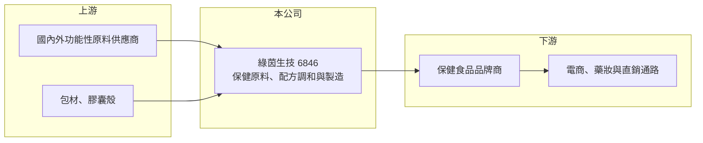

# 6846 綠茵

> 上櫃｜[[產業索引-食品工業|食品工業]]｜上市（櫃）日期 2023/05/15

# 第一章：企業模式與商業藍圖

> [!info] 撰寫說明
> 精簡版，由 Claude 依公開資料整理，架構比照 [[2330台積電]]，資料截至 2026-10-08。來源：櫃買中心開放資料快照（基本資料、2026 年上半年資產負債與綜合損益）、Goodinfo 歷年經營績效、nStock 公司簡介。公開資料有限，產品比重、客戶與廠區細節未查得。#待校對

綠茵生技是一家位於台中的保健食品原料商，主要替保健品牌提供原料與配方調和製造服務，屬於保健產業中「賣原料與配方給品牌」的中間角色。

- **核心業務：** 公司成立於 2012 年，2023 年 5 月上櫃，主要生產保健食品原料，並提供配方調和與製造服務。這類業務的價值在於替品牌商把多種原料依功能訴求配成可量產的配方，品牌商不必自建研發與工廠。
- **組織整併：** 2024 年 3 月，綠茵合併旗下兩家全資子公司康普森生技與鋒揚生醫，承受其資產與負債。整併讓集團的原料、研發與製造資源集中在同一法人之下，有助於降低管理成本並統一對客戶的服務窗口。
- **營收結構：** 產品別、通路別與地區別的營收比重在這次查到的資料中未揭露。新聞標題提到公司推動「雙引擎」策略並拓展海外與自有產品開發，具體內容未查得。#待校對
- **長期方向：** 台灣保健食品市場持續成長，品牌商數量多、產品更新快，對外部原料與配方服務的需求穩定。綠茵的長期成長取決於能否把客戶從台灣擴展到海外，並建立具專利或功效實證的獨家原料。

# 第二章：護城河深度與競爭優勢

綠茵的獲利能力顯示它在原料與配方上有一定的差異化，毛利率長年接近五成，遠高於一般食品代工。

- **競爭優勢：** 保健原料商若能掌握特定功效原料的來源、配方技術與法規文件，品牌商在產品上市後通常不會輕易更換供應商，因為換原料可能要重做檢驗與標示。綠茵毛利率維持在 47% 至 53%，說明其產品並非單純比價的大宗原料。
- **主要對手：** 國內保健原料與代工廠眾多，包括 [[1707葡萄王]]、[[1796金穎生技]]、[[4183福永生技]] 等，以及大量未上市的中小型代工廠；國際原料大廠也直接供貨給台灣品牌。競爭激烈代表綠茵必須持續推出新原料與配方。
- **觀察重點：** 營業利益率從 2020 至 2022 年的約 24% 降到 2024 至 2025 年的約 19% 至 21%，2026 年第二季單季約 12%。利潤率下滑是費用增加、價格競爭還是產品組合改變，是判斷護城河是否鬆動的關鍵。

# 第三章：財務體質與盈利規模

資料日期：2026-10-08，表格是撰寫當時的快照；最新月營收、毛利率、累計 EPS 由自動排程寫在本筆記的屬性欄位（月營收、毛利率、累計EPS 等）。#待校對

綠茵的財務特色是高毛利、高 ROE、營收穩定成長，但近年 ROE 逐年下滑，負債也明顯增加。

| 年度 | 營收（億元） | [[毛利率]] | [[營業利益率]] | EPS（元） | [[ROE]] |
|---|---|---|---|---|---|
| 2020 | 6.63 | 51.2% | 24.1% | 5.35 | 23.8% |
| 2021 | 6.94 | 51.6% | 24.4% | 5.46 | 23.5% |
| 2022 | 7.05 | 52.6% | 23.6% | 6.01 | 25.0% |
| 2023 | 8.01 | 49.0% | 20.1% | 5.04 | 19.2% |
| 2024 | 8.73 | 47.6% | 19.2% | 5.43 | 17.7% |
| 2025 | 9.15 | 48.1% | 20.6% | 5.39 | 15.9% |
| 2026 上半年 | 3.94 | 47.4% | 15.6% | 1.70 | 未查得 |

資料來源：Goodinfo 歷年經營績效；2026 上半年取自櫃買中心開放資料。

- **營收規模：** 2020 至 2025 年營收從 6.63 億元成長到 9.15 億元，年複合成長率約 6.7%（推算）。2026 年上半年營收約 3.9 億元，低於前一年同期，前三季累計也較前一年衰退，成長動能放緩。
- **獲利：** 近 5 年（2021 至 2025）平均 ROE 約 20%（推算），屬於高資本效率的企業，但 ROE 從 2022 年的 25% 降到 2025 年的 16%，部分原因是上櫃後股本與權益擴大。依 nStock 資料，近 5 年平均現金股利約 4.63 元，配息相對 EPS 的比例高。
- **財務特色：** 2026 年第二季底權益約 9.2 億元、負債約 15.5 億元，其中非流動負債約 12.3 億元，性質（銀行借款、租賃或可轉債）未查得。負債高於權益，與高毛利、輕資產的印象不同，可能與擴廠或購置土地廠房有關（推估）。
- **[[ROIC]] 與 [[WACC]]：** 有息負債未單獨查得，以約 13 億元推估。2025 年營業利益約 1.89 億元（9.15 億 × 20.6%），稅後約 1.51 億元，ROIC ≈ 1.51 ÷（9.2＋13）≈ 6.8%（推算）。WACC 以無風險利率 1.75%、市場風險溢酬 6%、β 取小型保健食品常見值 0.8，股東權益成本約 6.6%；稅後負債成本約 2%，權益占比約四成，WACC 約 4%（推算）。ROIC 仍高於 WACC，但若把新增負債計入，利差比單看 ROE 小得多，新投資能否帶來營收成長是關鍵。

# 第四章：總體風險與地緣政治

綠茵的風險在於成長放緩、利潤率下滑與負債增加同時出現，以及保健產業本身的競爭與法規。

- **產業週期：** 保健食品需求長期向上，但品牌商的新品週期與庫存調整會讓原料訂單出現波動，景氣不佳時消費者也會減少非必需的保健支出。
- **營運風險：** 客戶以國內品牌為主（推估），單一大客戶訂單變動可能明顯影響營收。若海外拓展不順，台灣市場的價格競爭會持續壓縮利潤率。
- **財務風險：** 負債大於權益，若新投資未能及時貢獻獲利，利息與折舊會拉低 ROE，也可能限制配息能力。
- **其他風險：** 保健食品的功效宣稱、標示與原料使用受衛福部法規規範，法規收緊會影響客戶產品上市；進口原料受匯率與國際供應影響；食品安全事件可能波及整個供應鏈。

# 專有名詞解析

## 金融

- **[[ROIC]]**：投入資本報酬率，稅後營業利益除以股東權益加有息負債，用來衡量公司運用所有資本的獲利能力。
- **[[WACC]]**：加權平均資金成本，股東權益成本與稅後負債成本依資本結構加權，ROIC 高於它才代表創造價值。

## 產業

- **[[保健食品原料]]**：用於製作膠囊、錠劑、粉包等保健品的功能性成分，例如植物萃取、益生菌、膠原蛋白等。
- **[[ODM]]**：原廠委託設計製造，代工廠提供配方與設計，品牌商貼牌銷售。

# 核心供應鏈

- 上游：國內外功能性原料、萃取物與包材供應商（具體名單未查得）。
- 下游／客戶：國內外保健食品品牌商，再經電商、藥妝、直銷等通路賣給消費者。
- 同業：[[1707葡萄王]]、[[1796金穎生技]]、[[4183福永生技]]。

## 最新新聞
<!-- news:start（自動產生，請勿手動編輯此範圍） -->
- 2026-10-19 📰 媒體 14:52｜綠茵台中潭子新廠產能擴充達3-5倍 積極擴充國際特色原料布局｜[鉅亨網](https://news.cnyes.com/news/id/6633375)

完整紀錄：[[6846綠茵 新聞]]
<!-- news:end -->

## 相關連結
- [公開資訊觀測站](https://mopsov.twse.com.tw/mops/web/t05st03?step=1&firstin=1&co_id=6846)
- [Goodinfo](https://goodinfo.tw/tw/StockDetail.asp?STOCK_ID=6846)
- [Yahoo 股市](https://tw.stock.yahoo.com/quote/6846)
- [鉅亨網新聞](https://www.cnyes.com/twstock/6846/news)
