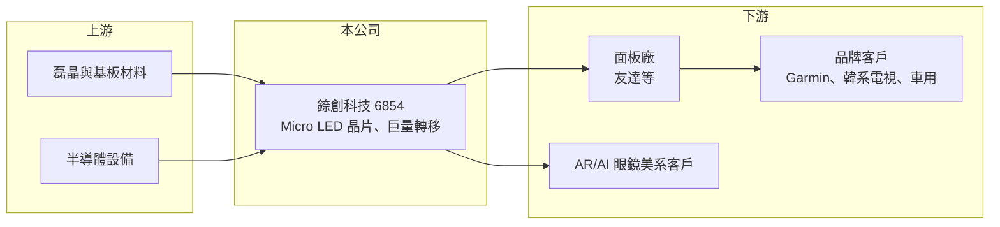

# 6854 錼創科技-KY創

> 創新板｜[[產業索引-半導體業|半導體業]]｜上市（櫃）日期 2022/08/18

# 第一章：企業模式與商業藍圖

> [!info] 撰寫說明
> 精簡版，由 Claude 依公開資料整理，架構比照 [[2330台積電]] 的四章研究，資料截至 2026-10-08。來源：Goodinfo 年度經營績效頁、優分析 2025 年 10 月報導、證交所開放資料（基本資料、2026 年第二季資產負債與綜合損益、營益分析、股利、每月營收）。創新板／新掛牌，公開資料有限；應用別完整營收比重與主要股東結構未查得，憑記憶撰寫者已標註。#待校對

錼創科技（PlayNitride）是台灣 Micro LED 技術的代表性公司，也是最早在創新板掛牌的公司之一。本章說明它的技術、產品與商業模式。

## 一、核心定位：Micro LED 顯示技術公司

錼創註冊於開曼群島，營運總部在苗栗竹南，2022 年 8 月在證交所[[創新板]]掛牌，實收資本額約 11.8 億元，董事長李允立（證交所開放資料）。公司專注 [[Micro LED]] 顯示技術，核心是 COC（Chip on Carrier）晶片與[[巨量轉移]]技術（優分析）。

* **Micro LED 為何重要：** Micro LED 把每個像素做成極小的 LED，自發光、亮度高、壽命長，被視為 OLED 之後的下一代顯示技術。難點在於要把數百萬顆微米級晶片精準搬到面板上，良率與成本一直是商業化的瓶頸。
* **掌握關鍵製程：** 錼創同時掌握 Micro LED 晶片與巨量轉移製程，能提供晶片、轉移設備與技術授權，而不只是單一零件。

## 二、應用市場

公司產品已量產的應用包括：韓系客戶的大尺寸電視（2025 年重啟拉貨）、Garmin 高階運動手錶 fenix 8 Pro（2025 年量產出貨），以及車用顯示（與車用客戶合作）；開發中的包括與美系客戶合作的 AR/VR 微型顯示器，以及最快 2027 年出貨的 AI 眼鏡（優分析）。法人預估 2026 年穿戴與車用同步成長。

## 三、商業模式轉向輕資本

公司正轉向[[輕資產]]模式，重點放在技術授權與高毛利的巨量轉移設備（機台與整廠方案）銷售，減少自建大型產能的資本支出（優分析）。同時，昆山新廠預計 2026 年第三季試產、第四季開始出貨電視與車用產品，並積極布局中國市場。

## 四、長期藍圖

Micro LED 的商業化節奏一再延後，錼創的長期價值取決於三件事：穿戴與車用能否穩定放量、AR 與 AI 眼鏡等微型顯示器能否在 2027 年後成為主流應用，以及授權與設備模式能否讓公司在不大量投資產能的情況下轉為長期獲利。

# 第二章：護城河深度與競爭優勢

Micro LED 仍處於產業早期，本章分析錼創的技術優勢、競爭者與風險所在。

## 一、護城河的核心組成要素

* **專利與量產經驗：** 錼創是全球少數已讓 Micro LED 產品進入消費性量產的公司，Garmin 手錶與韓系電視的出貨經驗，代表良率與可靠度已通過客戶驗證。
* **巨量轉移技術：** 轉移製程是 Micro LED 量產最難的環節，掌握這項技術讓公司可以賣設備、做授權，形成較高的技術門檻。
* **面板廠合作關係：** 錼創與台灣面板廠有長期合作，[[2409友達]]為重要股東與合作夥伴（待校對），有助於把技術導入面板量產線。

## 二、主要競爭對手

| 對手 | 定位 | 對錼創的威脅 |
|---|---|---|
| 三星電子、LG | 韓系面板與電視品牌 | 可自行開發 Micro LED，也是潛在客戶 |
| 中國 LED 與面板廠（如三安光電、京東方） | 政策支持、大舉投資 | 以規模與成本搶市場 |
| [[3714富采]] | 台灣 LED 晶粒廠 | 布局 Micro LED 晶粒 |
| OLED 面板陣營 | 現行主流顯示技術 | 持續降價，延後 Micro LED 的替代時點 |

## 三、守得住與守不住

* **守得住：** 已量產的高階穿戴與利基顯示應用，以及巨量轉移相關的專利與設備。
* **守不住：** 獲利穩定性。2024 年毛利率一度達 37.8%、營業利益率轉正，但 2025 年營收下滑、再度虧損（Goodinfo），2026 年上半年毛利轉為負值。
* **觀察重點：** 昆山新廠量產進度、AI 眼鏡客戶是否如期出貨，以及授權與設備收入占比能否提高。

# 第三章：財務體質與盈利規模

資料日期：2026-10-08，表格是撰寫當時的快照；最新月營收、毛利率、累計 EPS 由自動排程寫在本筆記的屬性欄位（月營收、毛利率、累計EPS 等）。#待校對

本章用多年度數據檢視錼創從研發期走向量產期的財務軌跡。

## 一、多年度三率與 ROE

| 年度 | 營收（新台幣） | [[毛利率]] | [[營業利益率]] | EPS（元） | [[ROE]] |
|---|---|---|---|---|---|
| 2021 | 2.05 億 | -89.8% | -592% | -14.14 | -54.9% |
| 2022 | 4.04 億 | -9.28% | -191% | -5.47 | -23.4% |
| 2023 | 9.43 億 | 10.6% | -59.6% | -4.78 | -23.3% |
| 2024 | 17.7 億 | 37.8% | 0.6% | 0.56 | 3.0% |
| 2025 | 13.5 億 | 42.4% | -10.2% | -1.02 | -3.94% |
| 2026 上半年 | 2.87 億 | -30.35% | -192.43% | -4.13 | 未查得 |

註：2021 至 2025 年取自 Goodinfo；2026 上半年取自證交所營益分析與綜合損益。

* **從研發期到量產期：** 營收從 2021 年的 2 億元成長到 2024 年的 17.7 億元，毛利率由負轉為接近四成，2024 年首度小幅獲利，代表技術已跨過量產門檻。
* **營收波動大：** 2025 年營收降到 13.5 億元，2026 年 1 至 8 月累計約 4.03 億元，去年同期約 7.23 億元（證交所每月營收），客戶拉貨節奏對營收影響很大。2026 年上半年毛利為負，可能與產能利用率偏低有關（推估）。

## 二、股利與財務結構

公司尚未配發股利（證交所股利資料）。2026 年第二季底總資產約 55.6 億元、總負債約 21.5 億元、權益約 34.1 億元，保留盈餘為 -63.1 億元，每股淨值 29.12 元（證交所資產負債）。累積虧損主要由歷年增資與溢價支應，有息負債金額未查得。

## 三、[[ROIC]] 與 [[WACC]]

**ROIC 推算：** 2025 年營業利益約 13.5 億 × -10.2% ≈ -1.38 億元（虧損不計稅）。假設總負債 21.5 億元的一半約 10.8 億元為有息負債，加上權益 34.1 億元，投入資本約 44.9 億元，ROIC 約 -3.1%（推算）。2024 年營業利益僅約 0.1 億元，ROIC 接近零。

**WACC 推算：** 台灣 10 年期公債 1.75%、市場風險溢酬 6%、β 取新興顯示技術公司常見值 1.3，權益成本約 9.6%；負債成本 3%、稅率 20%，權益占比約 76%，WACC 約 7.8%（推算）。

**結論：** ROIC 為負，遠低於 WACC，公司仍處於投入大於回收的階段。Micro LED 若在穿戴、車用與 AR 眼鏡普及，營收規模擴大後才有機會讓 ROIC 超過資金成本；在那之前，投資錼創本質上是押注技術商業化的時點。

# 第四章：總體風險與地緣政治

本章整理錼創長期面對的技術、市場與地緣風險。

## 一、產業週期與技術風險

* **商業化時點不確定：** Micro LED 的成本仍高於 OLED 與 LCD，若成本下降速度不如預期，大規模應用可能一再延後。
* **替代技術：** OLED 持續改良、Micro OLED 在 AR 眼鏡領域競爭，可能壓縮 Micro LED 的應用空間。

## 二、營運風險

* **客戶集中：** 營收依賴少數品牌客戶的專案，一個客戶的驗證延遲（如 2025 年韓系客戶）就會讓營收大幅下滑。
* **持續虧損：** 累積虧損逾 60 億元，若量產進度不如預期，可能需要再增資。
* **新廠執行：** 昆山新廠的試產、良率與客戶認證都需要時間。

## 三、其他風險

* **地緣政治：** 在中國設廠可接近當地客戶，但也面臨兩岸關係與美中科技管制的不確定性。
* **匯率：** 2025 年上半年曾因匯兌損失擴大虧損（優分析），以美元計價的營收受新台幣升值影響。

# 專有名詞解析

## 金融

- **[[創新板]]**：證交所 2021 年設立的板塊，讓尚未獲利但具技術或創新能力的公司掛牌，初期限合格投資人交易。
- **[[ROIC]]**：投入資本報酬率，衡量企業用股東與債權人投入的資本，每年能產生多少稅後營業利益。
- **[[WACC]]**：加權平均資金成本，股東要求報酬與負債利息依資本結構加權後的平均值，是判斷是否創造價值的門檻。

## 產業

- **[[Micro LED]]**：把 LED 縮小到數十微米以下、每顆直接作為一個像素的顯示技術，自發光、亮度高、壽命長，被視為下一代顯示技術。
- **[[巨量轉移]]**：把數百萬顆微小 LED 晶片從晶圓精準搬移到顯示背板的製程，是 Micro LED 量產最大的技術瓶頸。
- **[[輕資產]]**：企業不自建大量廠房設備，把生產外包，專注在設計、品牌與銷售的經營模式。

# 核心供應鏈

- 上游：氮化鎵磊晶與藍寶石、矽基板材料，半導體製程設備（供應商未查得）。
- 下游／客戶：面板廠（[[2409友達]]等，合作關係待校對）、Garmin、韓系電視品牌、車用客戶，以及開發 AR/VR 與 AI 眼鏡的美系客戶。
- 同業：三星電子、LG、三安光電、京東方、[[3714富采]]、[[3481群創]]。

## 最新新聞
<!-- news:start -->
<!-- news:end -->

## 相關連結
- [公開資訊觀測站](https://mopsov.twse.com.tw/mops/web/t05st03?step=1&firstin=1&co_id=6854)
- [Goodinfo](https://goodinfo.tw/tw/StockDetail.asp?STOCK_ID=6854)
- [Yahoo 股市](https://tw.stock.yahoo.com/quote/6854)
- [鉅亨網新聞](https://www.cnyes.com/twstock/6854/news)
