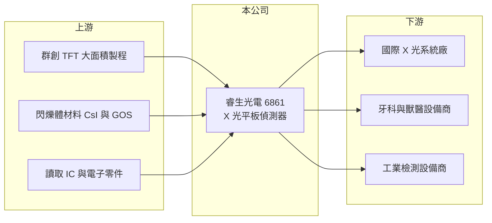

# 6861 睿生光電

> 上市｜[[產業索引-生技醫療業|生技醫療業]]｜上市（櫃）日期 2023/03/27

# 第一章：企業模式與商業藍圖

> [!info] 撰寫說明
> 精簡版，由 Claude 依公開資料整理，架構比照 [[2330台積電]] 的四章研究，資料截至 2026-10-08。來源：證交所開放資料（基本資料、2026 年第二季綜合損益與資產負債、營益分析）、Goodinfo 經營績效頁、nStock 公司頁。與群創的股權關係、應用別與客戶型態憑記憶撰寫，已標「待校對」。#待校對

睿生光電（以下簡稱睿生）是台灣的 X 光影像感測器公司，本章說明它的技術來源、產品應用與獲利模式。

- **核心業務：** 睿生於 2019 年 4 月設立，總部在南部科學園區台南新市，2023 年 3 月在證交所上市，主要從事光學儀器與[[醫療器材]]的製造與銷售。核心產品是[[X 光平板偵測器]]，把 X 光轉換成數位影像，取代傳統底片與影像板，是數位 X 光攝影系統的關鍵零組件。
- **技術來源：** 睿生源自 [[3481群創]] 的 X 光感測器事業，群創為主要股東（待校對）。平板偵測器的底層是大面積 [[TFT]] 感測陣列，製程與面板廠的 TFT 背板高度相似，因此睿生能借用面板產業的大面積製程能力，這是台灣廠商切入這個市場的獨特路徑。
- **營收結構：** 公開資料沒有查到應用別比重。平板偵測器的主要應用包括醫療放射科、牙科、獸醫與工業[[非破壞檢測]]，睿生以銷售給國際 X 光系統廠的模組為主，外銷比重高（待校對）。
- **長期方向：** 睿生的成長路徑是從醫療一般攝影，擴大到動態影像、牙科與工業檢測等更高單價或新興的應用，並從零組件往整機設計延伸。2025 年營收 22.94 億元，2026 年前 8 月營收已達 21.22 億元，年增約 46%（證交所月營收資料），顯示新應用帶動規模明顯放大。

# 第二章：護城河深度與競爭優勢

X 光偵測器的門檻在影像品質、可靠度、醫療法規與系統廠驗證。本章分析睿生的優勢與限制。

- **競爭優勢：** 第一是製程規模，背靠面板廠的大面積 TFT 製程，睿生在感測陣列的成本與產能上有先天優勢。第二是客戶驗證，偵測器要整合進 X 光系統並一起取得醫療器材許可，系統廠一旦選定供應商，通常會沿用整個產品週期，轉換成本高。
- **主要對手：** 國際主要競爭者包括美國 Varex Imaging、法國 Trixell、中國奕瑞科技、韓國 Rayence，以及日本醫療影像大廠自製的偵測器（待校對）。中國廠商在價格與政策支持下擴張快速，是長期最大的價格壓力來源。
- **護城河的限制：** 偵測器屬零組件，終端品牌與通路掌握在系統廠手中，睿生的議價力有限；[[毛利率]]長期在 19% 至 31% 之間，低於一般醫材公司，反映的正是零組件的定位。
- **觀察重點：** 新應用（如動態、牙科、工業檢測）的營收占比、毛利率能否站穩 27% 以上，以及面對中國同業低價競爭時的市占變化。

# 第三章：財務體質與盈利規模

資料日期：2026-10-08，表格是撰寫當時的快照；最新月營收、毛利率、累計 EPS 由自動排程寫在本筆記的屬性欄位（月營收、毛利率、累計EPS 等）。#待校對

睿生的財報特點是「毛利率偏低、資本小、ROE 高」：它更像電子零組件廠，而不是高毛利的醫材品牌。

| 年度 | 營收（億元） | [[毛利率]] | [[營業利益率]] | EPS（元） | [[ROE]] |
|---|---|---|---|---|---|
| 2020 | 23.6 | 19.4% | 6.19% | 8.30 | 61.6% |
| 2021 | 19.4 | 27.1% | 5.40% | 6.05 | 38.4% |
| 2022 | 18.9 | 30.9% | 4.57% | 5.62 | 27.3% |
| 2023 | 18.4 | 27.4% | 1.70% | 3.00 | 11.1% |
| 2024 | 19.9 | 27.8% | 1.68% | 3.75 | 11.5% |
| 2025 | 22.9 | 25.9% | 5.92% | 3.84 | 11.2% |
| 2026 上半年 | 15.48 | 27.4% | 11.8% | 4.44 | 未查得 |

- **獲利能力：** 2023 至 2024 年營業利益率不到 2%，但 EPS 仍有 3 元以上，代表業外收入（利息與匯兌等）占稅前獲利相當比重，本業獲利偏薄。2026 年上半年營收放大後營業利益率升到 11.8%，顯示營運槓桿明顯：固定的研發與管理費用被更大的營收攤薄。
- **長期指標：** 2021 至 2025 年平均 ROE 約 19.9%（推算），但早期 ROE 高是因為 2019 年剛設立時資本小；上市後 ROE 穩定在 11% 左右。營收五年年複合成長約 -0.6%（推算），2026 年才出現明顯成長。依 nStock，2024 年全年現金股利 1.8 元，2026 年 6 月除息的一次現金股利為 2 元，配發大致穩定。
- **財務結構：** 2026 年第二季底股東權益約 15.6 億元、負債總計 14.2 億元，其中流動負債 12.9 億元（證交所資料），流動負債高推估以應付帳款等營運負債為主，有息負債金額未查得。

**[[ROIC]] 與 [[WACC]]：** 2025 年營業利益約 1.36 億元（22.9 億元 × 5.92%），稅率 20% 後約 1.08 億元；投入資本以股東權益 15.6 億元、有息負債約 0（未查得）計，ROIC 約 7%（推算）；若以 2026 年上半年營業利益 1.83 億元年化，ROIC 可達約 19%（推算）。WACC 以 CAPM 推估：無風險利率 1.75%、市場風險溢酬 6%、β 取醫療電子零組件同業常見值 1.0，負債比重低，WACC 約 7.5% 至 8%（推算）。2023 至 2025 年本業 ROIC 約略等於或低於 WACC，價值創造主要靠業外收益；2026 年營收放大後利差轉正，能否維持是判斷睿生長期價值的關鍵。

# 第四章：總體風險與地緣政治

X 光偵測器市場受醫療投資週期、中國競爭與匯率影響。本章整理睿生的主要風險。

- **產業週期：** 醫院設備採購受各國醫療預算影響，疫情期間的設備需求高峰（2020 年營收 23.6 億元）之後，曾出現連續幾年的需求回落，顯示這個市場也有明顯的循環。
- **競爭風險：** 中國偵測器廠商在本土政策支持下快速擴產，價格競爭激烈，可能壓縮睿生在中國與新興市場的報價與市占。
- **營運風險：** 客戶以國際 X 光系統廠為主，客戶集中度高，大客戶轉單或延後新機種會直接影響營收。與群創的製程與產能關係，也使睿生的成本結構受母集團產能調整影響（待校對）。
- **其他風險：** 外銷比重高，新台幣升值會壓縮獲利；各國醫療器材法規變動、美中關稅與出口管制也可能影響供應鏈布局。

# 專有名詞解析

## 應用

- **[[X 光平板偵測器]]**：把 X 光轉換成數位影像訊號的平板感測器，用於數位放射攝影、牙科、獸醫與工業檢測。
- **[[非破壞檢測]]**：在不破壞物件的前提下檢查內部結構與缺陷的技術，X 光檢測常用於電子、鑄件與電池。

## 金融

- **[[ROIC]]**：投入資本報酬率，稅後營業利益除以投入資本（股東權益加有息負債），衡量本業創造報酬的能力。
- **[[WACC]]**：加權平均資金成本，依權益與負債比重加權的資金成本，是 ROIC 需要超越的門檻。

## 產業

- **[[TFT]]**：薄膜電晶體，面板與 X 光偵測器的基礎開關元件，可在大面積玻璃基板上製作感測陣列。
- **[[醫療器材]]**：用於診斷、治療或矯正的器具與設備，上市前需取得各國衛生主管機關許可，生產須符合品質系統規範。

# 核心供應鏈

- 上游：[[3481群創]]（TFT 感測陣列製程，待校對）、閃爍體材料、讀取 IC 與電子零件供應商。
- 下游／客戶：國際醫療 X 光系統廠、牙科與獸醫影像設備商、工業非破壞檢測設備商（待校對）。
- 同業：Varex Imaging、Trixell、奕瑞科技、Rayence（待校對）。

## 最新新聞
<!-- news:start -->
<!-- news:end -->

## 相關連結
- [公開資訊觀測站](https://mopsov.twse.com.tw/mops/web/t05st03?step=1&firstin=1&co_id=6861)
- [Goodinfo](https://goodinfo.tw/tw/StockDetail.asp?STOCK_ID=6861)
- [Yahoo 股市](https://tw.stock.yahoo.com/quote/6861)
- [鉅亨網新聞](https://www.cnyes.com/twstock/6861/news)
