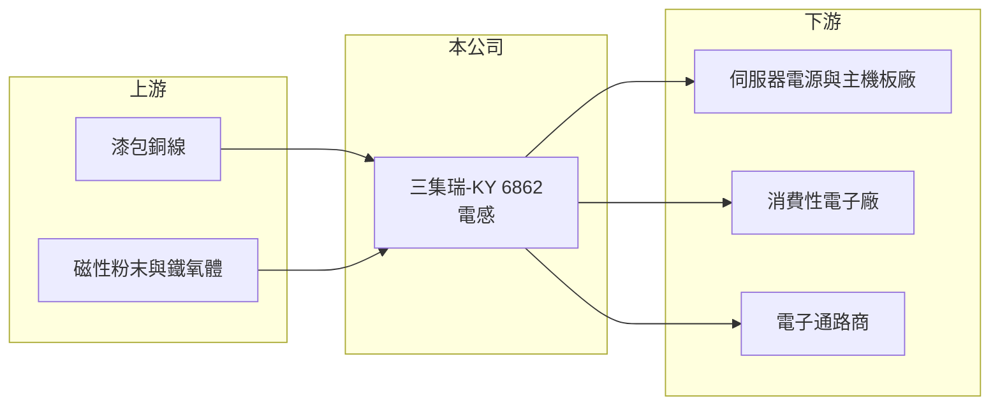

# 6862 三集瑞-KY

> 上市｜[[產業索引-電子零組件業|電子零組件業]]｜上市（櫃）日期 2024/10/23

# 第一章：企業模式與商業藍圖

> [!info] 撰寫說明
> 精簡版，由 Claude 依公開資料整理，架構比照 [[2330台積電]] 的四章研究，資料截至 2026-10-08。來源：Goodinfo 經營績效頁、nStock 公司簡介、財經新聞標題（中央社、優分析、經濟日報）、證交所開放資料快照（基本資料、每月營收、股利、2026 年第二季損益與資產負債）。公開資料有限，產品別營收比重、生產據點與具名客戶未查得。成立日期為開曼控股公司設立日，實際營運歷史較長。#待校對

三集瑞-KY 是專做[[電感]]的被動元件廠，以開曼控股公司形式在台灣上市，近年產品從消費性電子延伸到 AI 伺服器用的大功率電感。本章說明它的業務定位。

- **核心業務：** 三集瑞的開曼控股公司設立於 2021 年，2024 年 10 月在證交所上市。主要業務是電感元件的製造與銷售。電感以線圈儲存磁能，用來穩定電源電流、過濾雜訊，GPU 與 CPU 的供電電路需要大量高電流電感，因此 AI 伺服器的單機電感用量與規格都遠高於一般電子產品。
- **營收結構：** 產品與應用別營收比重未查得。依中央社 2024 年 9 月報導標題，公司上市前預估 2024 年第三季 AI 應用占營收比重可達約兩成；另依 2026 年財經新聞標題，伺服器用大功率電感於 2026 年第二季量產。AI 伺服器相關比重提升，是公司長期最主要的成長方向。
- **營運據點：** 以 KY 公司形式上市，推估主要生產基地在中國大陸（推估，未查得具體廠區）。台灣辦公室設於新北中和。
- **長期方向：** AI 伺服器的功耗快速上升，供電模組必須在更小空間內承載更大電流，帶動[[一體成型電感]]等高階產品需求。三集瑞若能在新一代 GPU 平台取得認證並放量，就能從消費性電感廠轉型為伺服器電源零件供應商，產品單價與毛利率也會更穩定。

# 第二章：護城河深度與競爭優勢

電感市場有大量中國與台灣廠商競爭，三集瑞的優勢在於高毛利的利基規格。本章分析它的競爭位置。

- **競爭優勢：** 三集瑞的毛利率在 2021 至 2025 年維持在 40% 至 46%，遠高於一般被動元件廠，顯示產品集中在附加價值較高的規格，並有一定的定價能力。高電流電感需要材料配方、繞線與成型技術，並須通過伺服器電源廠與晶片平台的驗證，一旦導入，在平台生命週期內不易被替換。
- **主要對手：** 電感市場的國際龍頭為日本村田、TDK、太陽誘電，台灣同業有 [[3236千如]]、奇力新（已併入國巨集團，待校對）、[[2327國巨]]、[[3026禾伸堂]] 等，中國大陸則有順絡電子、麥捷科技等大廠。AI 伺服器電感的競爭對手多為大型國際廠，三集瑞規模較小。
- **觀察重點：** 第一，伺服器大功率電感量產後的營收貢獻。第二，2026 年營收衰退是否只是消費性產品的短期調整。第三，毛利率能否維持在 35% 以上。

# 第三章：財務體質與盈利規模

資料日期：2026-10-08，表格是撰寫當時的快照；最新月營收、毛利率、累計 EPS 由自動排程寫在本筆記的屬性欄位（月營收、毛利率、累計EPS 等）。#待校對

三集瑞的財務特色是毛利率高、ROE 曾超過三成，但 2025 年起獲利能力明顯下滑。

| 年度 | 營收（億元） | [[毛利率]] | [[營業利益率]] | EPS（元） | [[ROE]] |
|---|---|---|---|---|---|
| 2021 | 15.2 | 41.9% | 27.5% | 8.08 | 39.4% |
| 2022 | 13.2 | 43.8% | 25.7% | 8.26 | 35.1% |
| 2023 | 15.9 | 46.2% | 30.5% | 9.02 | 30.1% |
| 2024 | 22.0 | 41.6% | 24.7% | 11.41 | 23.7% |
| 2025 | 22.7 | 40.2% | 24.6% | 8.29 | 14.1% |
| 2026 上半年 | 9.12 | 33.8% | 13.1% | 1.68 | 未查得 |

- **營收規模：** 2021 年營收 15.2 億元，2025 年 22.7 億元，四年年複合成長率約 10.5%（推算）。2026 年 1 至 8 月累計營收年減約 19%，上半年營收 9.12 億元，明顯低於前一年同期。
- **獲利：** 2021 至 2025 年營業利益率維持在 25% 至 30%，2026 年上半年降到 13.1%，毛利率也降到 33.8%，顯示營收下滑時固定成本攤提的壓力。ROE 從 2021 年 39.4% 逐年降到 2025 年 14.1%，一部分是 2024 年上市募資使權益擴大所致。2021 至 2025 年平均 ROE 約 28.5%（推算）。
- **財務特色：** 2026 年第二季末總資產 52.2 億元、權益 29.0 億元、負債 23.2 億元，其中非流動負債 10.7 億元。證交所股利資料顯示 114 年度配發現金股利每股 5 元，約為 2025 年 EPS 的六成；依 nStock 資料，2024 年度配息 6 元。實收資本額 5.0 億元。

**[[ROIC]] 與 [[WACC]]：** 有息負債明細未查得，假設約 10 億元（推估）。2025 年營業利益約 5.58 億元（22.7 億 × 24.6%），以稅率 20% 計稅後約 4.47 億元（KY 公司實際稅率可能較高），投入資本約 39 億元（權益 29.0 億 + 有息負債 10 億），ROIC 約 11.5%（推算）；2026 年上半年營業利益 1.20 億元年化後，ROIC 約 5%（推算）。WACC 用 [[CAPM]] 推估：無風險利率 1.75%、市場風險溢酬 6%、β 取 1.1（被動元件股常見值，假設），股東權益成本約 8.4%；負債成本 2.5%、稅率 20%，以權益 75%、負債 25% 加權，WACC 約 6.8%（推算）。結論是：三集瑞在 2025 年以前 ROIC 明顯高於 WACC，屬於價值創造者；2026 年上半年 ROIC 已低於 WACC，伺服器大功率電感能否放量是利差恢復的關鍵。

# 第四章：總體風險與地緣政治

三集瑞的風險包括被動元件週期、KY 公司的資訊透明度與 AI 認證的不確定性。

- **產業週期：** 電感屬被動元件，需求隨消費性電子、伺服器與汽車的庫存週期起伏。2026 年營收下滑，顯示消費性產品的需求調整仍明顯影響公司，[[長鞭效應]]會放大波動。
- **營運風險：** AI 伺服器電感由國際大廠主導，新平台認證若失利，轉型會延後。營收下滑時固定成本攤提壓力大，2026 年上半年營業利益率已從 25% 左右降到 13%。KY 公司的營運主體在海外，投資人取得營運細節的管道較少，資訊透明度相對有限。
- **其他風險：** 生產基地推估在中國大陸，美中關稅與供應鏈「去中國化」可能影響美系客戶下單；人民幣與新台幣匯率、銅線與磁性粉末原料價格也會影響獲利。

# 專有名詞解析

## 金融

- **[[長鞭效應]]**：終端需求的小幅變動，沿供應鏈往上游傳遞時被逐級放大，造成上游庫存與訂單劇烈波動。
- **[[ROIC]]**：投入資本報酬率，稅後營業利益除以股東權益加有息負債，衡量本業運用資本的效率。
- **[[WACC]]**：加權平均資金成本，依股東權益與負債的比重，加權計算公司取得資金的平均成本。

## 產業

- **[[被動元件]]**：不需外加電源即可運作的電子零件，主要包括電阻、電容與電感。
- **[[電感]]**：以線圈儲存磁能的被動元件，用於電源轉換、濾波與抑制雜訊。
- **[[一體成型電感]]**：把線圈與磁性粉末一起壓鑄成型的電感，體積小、可承受大電流，廣泛用於 GPU 與 CPU 供電電路。

# 核心供應鏈

- 上游：漆包銅線、合金磁性粉末與鐵氧體材料。
- 下游／客戶：伺服器電源與主機板廠、消費性電子廠、電子通路商（具名客戶未查得）；AI 平台終端為 [[NVDA輝達]] 等 GPU 業者（推估）。
- 同業：[[3236千如]]、[[2327國巨]]、[[3026禾伸堂]]、村田、TDK、太陽誘電、順絡電子。

## 最新新聞
<!-- news:start -->
<!-- news:end -->

## 相關連結
- [公開資訊觀測站](https://mopsov.twse.com.tw/mops/web/t05st03?step=1&firstin=1&co_id=6862)
- [Goodinfo](https://goodinfo.tw/tw/StockDetail.asp?STOCK_ID=6862)
- [Yahoo 股市](https://tw.stock.yahoo.com/quote/6862)
- [鉅亨網新聞](https://www.cnyes.com/twstock/6862/news)
