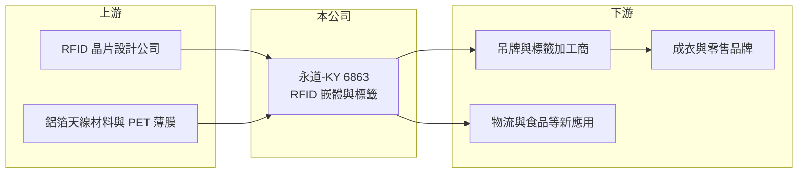

# 6863 永道-KY

> 上市｜[[產業索引-通信網路業|通信網路業]]｜上市（櫃）日期 2023/03/21

# 第一章：企業模式與商業藍圖

> [!info] 撰寫說明
> 本文由 Claude 依公開資料整理，架構比照 [[2330台積電]] 的四章研究，資料截至 2026-10-08。財務數字來源：Goodinfo 年度經營績效頁、證交所開放資料（基本資料、2026 年第二季資產負債與損益、營益分析、股利、本益比殖利率）；越南新廠與可轉債依科技新報 2024 年 9 月報導標題整理。產品應用、客戶與集團關係部分憑記憶整理，已標「待校對」。#待校對

評估 RFID 標籤廠，要看零售與物流業者導入電子標籤的速度，以及它能否用規模與良率在低單價產品上賺到合理報酬。本章說明永道-KY（股票代號：6863，以下簡稱永道）的商業模式。

## 一、核心定位：大量生產的 RFID 標籤

永道是開曼群島註冊的控股公司，2021 年設立、2023 年在證交所上市，實收資本額約 7.5 億元，屬於 [[1907永豐餘]] 集團旗下的 RFID 事業（集團關係依公司網址與子公司名稱 YFY RFID 推論，待校對）。公司生產 [[RFID]] 標籤與嵌體，也就是把晶片與天線封裝在薄膜上的電子標籤，再由客戶加工成吊牌、貼紙或洗標。

RFID 標籤最大的應用是成衣零售：品牌商在每件衣服上貼一個標籤，門市用讀取器就能幾秒內盤點整家店的庫存，減少缺貨與盤點人力（應用描述待校對）。單一標籤只值幾美分，因此這是一門靠「量」與「良率」取勝的生意，年出貨量通常以十億顆計。

## 二、產能布局與擴張

依 2024 年 9 月報導，永道規劃募集 10 億元可轉換公司債，用於加速越南新廠建置。設立越南產能的意義在於，成衣供應鏈大量位於東南亞，就近供貨可縮短交期；同時也回應國際品牌分散中國生產的要求。新廠帶來的折舊與營運成本，是 2025 年毛利率從 32.2% 降到 22.3% 的可能原因之一（推估）。各產品與地區的營收比重未查得。

## 三、長期方向

永道的長期方向是讓 RFID 從成衣擴展到食品、物流、醫療與航空行李等新場景。這些場景一旦採用，標籤用量會呈數倍成長，率先建立大規模低成本產能的廠商將受益最多。不過新場景的導入速度取決於零售與物流業者的投資意願，屬於長期而非短期的動能。

# 第二章：護城河深度與競爭優勢

在長期價值投資中，「護城河」指企業抵禦競爭、維持超額利潤的保護機制。本章分析永道在 RFID 標籤市場的位置。

## 一、護城河的組成

* **規模與良率：** 標籤單價極低，只有大規模自動化產線、極高良率的廠商才能在價格戰中獲利。永道營收從 2020 年的 17.2 億元成長到 2024 年的 46.1 億元，規模已躋身全球主要供應商之列（推估）。
* **品牌認證：** 成衣品牌通常要求標籤通過效能與一致性測試，並指定合格供應商名單，進入名單後具一定黏著度。
* **集團資源：** 永豐餘集團在紙業與包材的經驗，有助於標籤後段加工與客戶開發（推估，待校對）。

## 二、主要競爭對手

| 對手 | 定位 | 對永道的威脅 |
|---|---|---|
| 艾利丹尼森（Avery Dennison） | 全球最大 RFID 標籤與吊牌供應商 | 規模與品牌客戶最完整 |
| 中國大陸 RFID 標籤廠 | 成本低、擴產快 | 壓低嵌體報價 |
| 其他吊牌與標籤加工商 | 整合吊牌與 RFID | 爭取品牌一站式採購 |

## 三、守得住／守不住／觀察重點

守得住的是已通過認證的品牌專案與大量出貨的成本優勢。守不住的是嵌體報價，2025 年毛利率大降十個百分點，說明擴產期與價格競爭會快速反映在獲利上。長期觀察重點是越南新廠的稼動率、毛利率能否回到三成，以及非成衣應用的營收占比。

# 第三章：財務體質與盈利規模

資料日期：2026-10-08，表格是撰寫當時的快照；最新月營收、毛利率、累計 EPS 由自動排程寫在本筆記的屬性欄位（月營收、毛利率、累計EPS 等）。#待校對

財務報表是檢驗護城河是否真實存在的最終標準。本章用六年的三率、ROE 與資本報酬，檢視永道的獲利品質。

## 一、多年度經營績效

| 年度 | 營收（新台幣） | [[毛利率]] | [[營業利益率]] | EPS（元） | [[ROE]] |
|---|---|---|---|---|---|
| 2020 | 17.2 億 | 31.8% | 19.5% | 5.08 | 9.44% |
| 2021 | 20.3 億 | 29.3% | 15.0% | 4.07 | 7.71% |
| 2022 | 21.0 億 | 32.1% | 15.3% | 5.18 | 8.98% |
| 2023 | 26.9 億 | 29.5% | 14.6% | 6.17 | 9.72% |
| 2024 | 46.1 億 | 32.2% | 18.5% | 11.36 | 14.7% |
| 2025 | 39.5 億 | 22.3% | 8.89% | 3.00 | 3.68% |
| 2026 上半年 | 26.8 億 | 22.3% | 9.62% | 1.93 | 未查得 |

永道 2020 至 2025 年營收年複合成長率約 18%（推算），是本批網通與光電公司中成長最明顯的一家。不過 ROE 長期只有 8% 至 15%，原因是每股淨值高（2026 年第二季約 83 元），上市募資與擴產讓股東權益大幅增加。2021 至 2025 年平均 ROE 約 9.0%（推算）。2025 年度配發現金股利每股 1.5 元，配發率約 50%（推算）。2026 年上半年營收已達 2025 全年的三分之二，但所得稅費用約占稅前淨利的四成，稅後獲利被壓縮，稅負偏高的原因未查得。

## 二、[[ROIC]] 與 [[WACC]]：價值創造利差

**ROIC 推算：** 2025 年營業利益約 3.51 億元（39.5 億 × 8.89%），以 20% 稅率估算稅後約 2.81 億元。2026 年第二季權益總計約 62.3 億元，負債約 41.9 億元，其中包含可轉債與銀行借款，假設有息負債約 25 億元（推估），投入資本約 87 億元，2025 年 ROIC 約 3.2%（推算）；以 2026 年上半年營業利益 2.58 億元年化，ROIC 約 4.7%（推算）。2024 年景氣高點時 ROIC 推估接近 10%。

**WACC 推算：** 台灣 10 年期公債 1.75%、市場風險溢酬 6%、β 取同業常見值 1.0，股東權益成本約 7.8%；負債成本 2.5%、稅後 2.0%；權益占投入資本約 71%，WACC 約 6.1%（推算）。

**結論：** 永道只有在 2024 年這類高成長年度 ROIC 才明顯超過 WACC，擴產期的 ROIC 則低於資金成本。長期能否創造價值，關鍵在越南新廠滿載後營業利益率能否回到 15% 以上。

# 第四章：總體風險與地緣政治

任何企業都無法脫離宏觀環境獨立存在。本章分析永道長期必須面對的風險。

## 一、零售景氣與導入節奏

RFID 標籤需求跟著成衣品牌的出貨量與庫存政策起伏，品牌商降低庫存時，標籤訂單會同步減少。新應用場景的導入也可能比預期慢。

## 二、價格競爭與擴產風險

標籤是高度量產的產品，同業擴產會快速壓低報價。永道同時在擴建越南產能，若需求成長不如預期，折舊與利息費用會壓低獲利，這在 2025 年已經出現。

## 三、匯率、稅負與地緣政治

營收以美元計價為主（推估），匯率變動影響獲利；跨國控股架構下的稅負偏高，會壓縮股東可分配的盈餘。美中貿易政策則可能改變品牌客戶的產地要求，影響中國與越南產能的配置。

# 專有名詞解析

## 應用

- **[[RFID]]**：無線射頻辨識，用無線電波讀取晶片標籤資料，不需逐一掃描即可快速盤點大量物品。

## 金融

- **[[可轉換公司債]]**：可依約定價格轉換成公司股票的債券，公司可用較低利率籌資，但轉換後會稀釋股權。
- **[[ROIC]]**：投入資本報酬率，稅後營業利益除以股東權益與有息負債的合計，衡量本業對所有資金提供者的報酬。
- **[[WACC]]**：加權平均資金成本，依股東權益與負債的比重加權計算的資金成本，ROIC 高於它才代表創造價值。

# 核心供應鏈

## 1. 上游：晶片與材料
- RFID 晶片設計公司（實際供應商未查得）、天線材料與薄膜供應商

## 2. 中游：永道與同業
- 集團：[[1907永豐餘]]
- 同業：艾利丹尼森（Avery Dennison）、中國大陸 RFID 標籤廠

## 3. 下游：客戶
- 成衣與零售品牌、吊牌加工商、物流業者（具體客戶未查得）

## 最新新聞
<!-- news:start（自動產生，請勿手動編輯此範圍） -->
- 2026-10-12 📰 媒體 11:36｜RFID雙雄韋僑、永道-KY營收Q3同創新高 本季營運仍看旺｜[鉅亨網](https://news.cnyes.com/news/id/6627936)

完整紀錄：[[6863永道-KY 新聞]]
<!-- news:end -->

## 相關連結
- [公開資訊觀測站](https://mopsov.twse.com.tw/mops/web/t05st03?step=1&firstin=1&co_id=6863)
- [Goodinfo](https://goodinfo.tw/tw/StockDetail.asp?STOCK_ID=6863)
- [Yahoo 股市](https://tw.stock.yahoo.com/quote/6863)
- [鉅亨網新聞](https://www.cnyes.com/twstock/6863/news)
