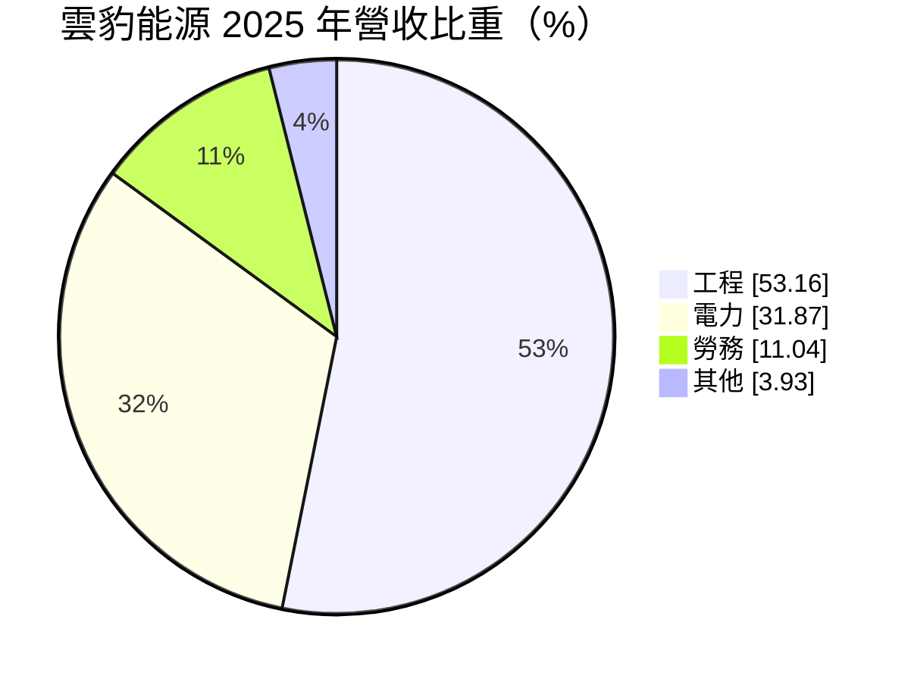
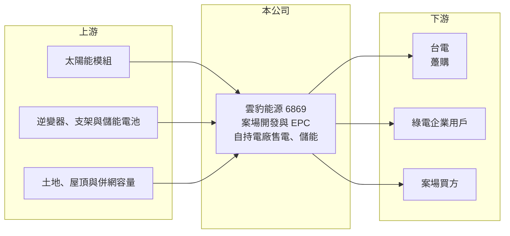

# 6869 雲豹能源

> 上市｜[[產業索引-綠能環保|綠能環保]]｜上市（櫃）日期 2024/06/19

# 第一章：企業模式與商業藍圖

> [!info] 撰寫說明
> 精簡版，由 Claude 依公開資料整理，架構比照 [[2330台積電]]，資料截至 2026-10-08。來源：富邦 MoneyDJ 財務比率年表（2018 至 2025 年）與基本資料（2025 年營收比重）；證交所開放資料快照（基本資料、2026 年上半年資產負債與損益、2025 年度股利、每月營收）；經濟日報、工商時報、優分析新聞標題。股東背景、案場類型與儲能布局為依新聞標題與記憶整理，已標「待校對」；歷年營收由每股營業額與成長率推算。#待校對

雲豹能源成立於 2016 年 2 月、2023 年 3 月上市，董事長廖福生、總經理趙書閔。它是台灣太陽光電的開發與統包業者，業務涵蓋案場開發、[[EPC]]工程、電廠維運與售電，近年積極擴大自持電廠與[[儲能]]，目標是把收入重心從一次性的工程，轉向長期穩定的發電收入。

- **核心業務：** 2025 年營收中工程占 53.16%、電力占 31.87%、勞務占 11.04%、其他占 3.93%。工程收入來自替自己或客戶興建太陽光電與儲能案場，電力收入來自自持案場賣電給台電或企業，勞務則包括案場維運與代操作服務。電力收入占比超過三成，在國內開發商中算是較高，這讓營收底盤比純工程商穩定。
- **營收結構：** 依每股營業額與成長率推算，2025 年營收約 77 億元（推算），年增 96.9%，2024 年約 39 億元（推算）。2026 年 8 月新聞指出雲豹取得「國內今年最大光電交易」的 187MW 案場，可望讓發電量翻倍，代表公司正以收購成熟案場的方式快速擴大自持容量。
- **營運據點：** 案場分布在台灣各地，類型包括屋頂型、地面型與漁電共生（各類容量待校對）。公司背景與能源、電力領域的股東有關（股東結構待校對），有助於取得併網與融資資源。
- **長期方向：** 雲豹的長期策略是「開發、持有、售電」並行，透過自持電廠累積[[綠電轉供]]給企業用戶的能力，並以儲能案場參與台電電力交易平台的輔助服務。若自持容量持續擴大，未來電力與維運等經常性收入的比重會進一步提升。

# 第二章：護城河深度與競爭優勢

雲豹的護城河來自案場開發與營運的整合能力，以及已累積的自持電廠規模，但產業同質性高，競爭激烈。

- **競爭優勢：** 從找地、許可、併網到施工與維運都能自己完成，讓雲豹能掌握案場品質與時程，也能在收購他人案場時快速評估技術風險。自持電廠的售電收入有長期合約保障（[[躉購費率]]通常保證 20 年），提供穩定現金流支撐開發。電廠規模越大，維運與融資的單位成本越低，形成一定的規模經濟。
- **主要對手：** 國內太陽光電開發與統包同業包括 [[6873泓德能源]]、[[6806森崴能源]]、[[3708上緯投控]]、[[6443元晶]] 等，綠電售電則與多家民營售電業者及外資開發商競爭。
- **觀察重點：** [[毛利率]]從 2020 年的 45.66% 一路降到 2025 年的 10.8%，主因是營收從售電為主轉為工程為主，工程毛利率較低。觀察重點是 2026 年新收購案場併入後，電力收入能否帶動毛利率回升，以及業外的利息與財務成本能否被營業利益覆蓋。

# 第三章：財務體質與盈利規模

資料日期：2026-10-08，表格是撰寫當時的快照；最新月營收、毛利率、累計 EPS 由自動排程寫在本筆記的屬性欄位（月營收、毛利率、累計EPS 等）。#待校對

雲豹在 2022 至 2024 年維持高 ROE，2025 年起因業外損失轉為虧損，正處於擴張投資、報酬尚未回收的階段。

| 年度 | 營收（億元） | [[毛利率]] | [[營業利益率]] | EPS（元） | [[ROE]] |
|---|---|---|---|---|---|
| 2021 | 約 22（推算） | 24.98% | 10.87% | 2.30 | 13.49% |
| 2022 | 約 65（推算） | 24.44% | 13.90% | 4.03 | 17.96% |
| 2023 | 約 70（推算） | 19.45% | 12.26% | 8.77 | 28.97% |
| 2024 | 約 39（推算） | 12.68% | −3.72% | 8.89 | 20.39% |
| 2025 | 約 77（推算） | 10.80% | 1.77% | −4.20 | −8.74% |

註：2025 年營收以每股營業額 55.95 元乘以約 1.378 億股推算，其他年度依 MoneyDJ 營收成長率回推；上市前股本較小，推算值僅供參考。2024 年營業虧損但 EPS 仍高，推估來自處分案場或投資的業外利益（未查得細節）。2026 年上半年營收 34.98 億元、毛利率 16.30%、營業利益率 3.11%、EPS −1.89 元（證交所資料）。

- **長期指標：** 2021 至 2025 年營收年複合成長率約 36%（推算），近 5 年平均 [[ROE]] 約 14.4%（推算），但波動極大，2025 年為 −8.74%。2025 年本期淨損約 5.70 億元，仍以累積盈餘配發現金股利 2 元，配息並非來自當年獲利。每股現金流量 2024 年 −6.32 元、2025 年 −2.72 元，擴張期的[[自由現金流]]為負。
- **[[ROIC]] 與 [[WACC]]：** 2025 年稅後營業利益約 1.1 億元（營業利益率 1.77% × 營收約 77 億元 × 0.8），投入資本約 121 億元（2026 年第二季權益總計 54.42 億元，加上以總負債 111.42 億元的六成推估的有息負債約 66.9 億元），ROIC 約 0.9%（推算）。WACC 約 4.5%（推算：無風險利率 1.75%、市場風險溢酬 6%、β 取綠能開發同業常見值 0.9，股東權益成本 7.15%；稅前負債成本 3%、稅率 20%；權益比重約 45%）。ROIC 遠低於 WACC，若計入業外損失，股東層級的報酬為負，代表目前的擴張尚未創造價值，需等新案場貢獻發電收入後再檢驗。
- **財務特色：** 2026 年第二季負債比率約 67%（負債 111.42 億元 ÷ 資產 165.84 億元），非流動資產 105.51 億元以電廠設備為主。2026 年上半年營業利益 1.09 億元，但業外淨損失 3.21 億元（推估包括利息費用、投資或評價損失），造成稅前虧損 2.13 億元。庫藏股 5.46 億元（448 萬股），非控制權益 9.00 億元，代表部分電廠子公司有外部股東。

# 第四章：總體風險與地緣政治

雲豹的風險集中在財務槓桿、案場收購的價格與政策變化。

- **產業週期：** 太陽光電案場的價值取決於躉購費率、綠電價格與利率。利率上升會同時提高融資成本並壓低案場估值；綠電供給增加則可能讓轉供價格下滑，影響自持電廠的報酬。
- **營運風險：** 大規模收購案場需要大量資金，若收購價格偏高或發電量不如預期，會長期拖累報酬率。工程收入依賴少數大型案場，完工與認列時點變動會讓季度獲利大幅波動；儲能案場的安全與技術標準仍在演進。
- **其他風險：** 颱風、淹水等天災會損壞案場；漁電共生與地面型案場常遇土地與地方爭議；電業法、轉供規則與躉購費率的調整都會改變商業模式的獲利空間。

# 專有名詞解析

## 金融

- **[[ROIC]]**：投入資本報酬率，稅後營業利益除以股東權益加有息負債，衡量本業運用資本的效率。
- **[[WACC]]**：加權平均資金成本，股東與債權人要求報酬率的加權平均，是 ROIC 要超越的門檻。

## 產業

- **[[EPC]]**：設計、採購、施工一次承攬的統包工程模式，完工後交給業主營運。
- **[[儲能]]**：以電池等設備把電力儲存起來，在用電尖峰或電網需要時釋放，可平衡再生能源的不穩定。
- **[[綠電轉供]]**：再生能源發電業者透過台電電網，把綠電直接賣給企業用戶的交易方式。
- **[[躉購費率]]**：政府保證收購再生能源電力的固定價格，通常保證 20 年，是太陽光電案場收益的基礎。

# 核心供應鏈

- 上游：模組廠 [[6443元晶]]、[[3576聯合再生]]，逆變器 [[2308台達電]]（是否為供應商待校對）。
- 下游／客戶：台灣電力公司、綠電採購企業、案場投資人。
- 同業：[[6873泓德能源]]、[[6806森崴能源]]、[[3708上緯投控]]。

## 最新新聞
<!-- news:start -->
<!-- news:end -->

## 相關連結
- [公開資訊觀測站](https://mopsov.twse.com.tw/mops/web/t05st03?step=1&firstin=1&co_id=6869)
- [Goodinfo](https://goodinfo.tw/tw/StockDetail.asp?STOCK_ID=6869)
- [Yahoo 股市](https://tw.stock.yahoo.com/quote/6869)
- [鉅亨網新聞](https://www.cnyes.com/twstock/6869/news)
