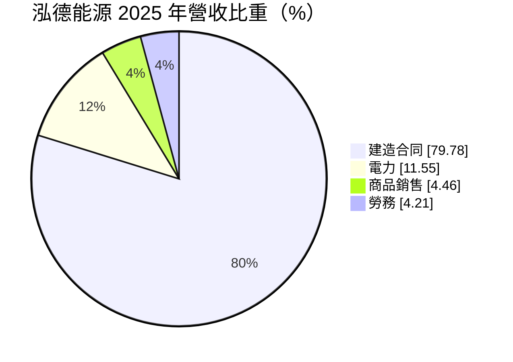
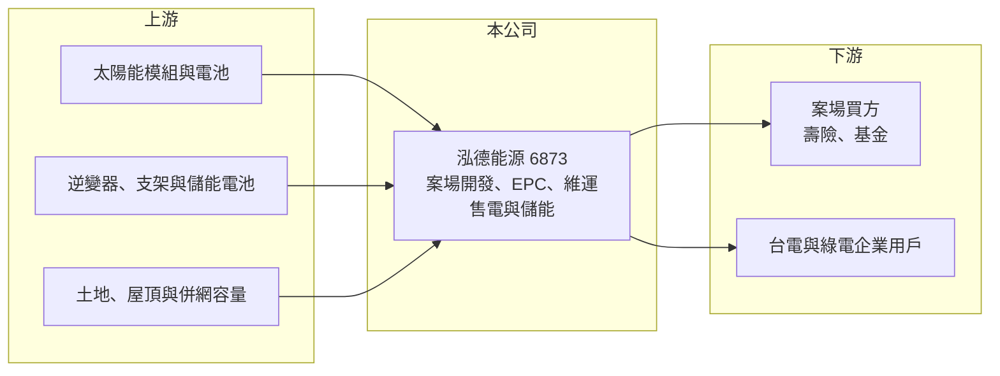

# 6873 泓德能源

> 上市｜[[產業索引-綠能環保|綠能環保]]｜上市（櫃）日期 2024/09/26

# 第一章：企業模式與商業藍圖

> [!info] 撰寫說明
> 精簡版，由 Claude 依公開資料整理，架構比照 [[2330台積電]]，資料截至 2026-10-08。來源：富邦 MoneyDJ 財務比率年表（2018 至 2025 年）與基本資料（2025 年營收比重）；證交所開放資料快照（基本資料、2026 年上半年資產負債與損益、2025 年度股利、每月營收）；科技新報、經濟日報、數位時代新聞標題。案場容量、海外布局與子公司細節為依新聞標題與記憶整理，已標「待校對」；歷年營收由每股營業額與成長率推算。#待校對

泓德能源成立於 2016 年 5 月，2024 年 9 月轉上市（此前曾在創新板交易，待校對），董事長謝源一、總經理周仕昌。它是台灣主要的太陽光電開發商之一，從找地、取得電業許可、設計施工到後續維運與售電一手包辦，近年再延伸到[[儲能]]與[[綠電轉供]]，並把開發模式複製到日本與澳洲。

- **核心業務：** 2025 年營收中建造合同占 79.78%、電力占 11.55%、商品銷售占 4.46%、勞務占 4.21%。泓德的主要模式是「開發後出售」：先以自己的能力開發太陽光電案場並完成建置，再把案場賣給壽險、基金等長期投資人，自己承接[[EPC]]工程與後續維運；部分案場自持，以售電收入累積穩定現金流。這讓營收同時具有工程專案的波動性與電廠的穩定性。
- **營收結構：** 依每股營業額與成長率推算，2025 年營收約 88 億元（推算），2024 年約 102 億元（推算）為高點。建造合同收入取決於案場完工與出售的時點，因此年度營收起伏很大；電力收入則來自自持案場，金額較小但逐年累積。
- **營運據點：** 以台灣為主，案場包括屋頂型、地面型與漁電共生等類型（各類容量待校對）。2025 年新聞指出公司在日本與澳洲有案場預計年底商轉，並以全球光電與儲能 10GW 為長期目標（目標年份待校對）。
- **長期方向：** 台灣電力市場逐步開放，企業為達成 RE100 與碳費要求，需要直接向綠電業者購電。泓德透過售電子公司（新聞提及星星電力規劃登錄興櫃，時程待校對）經營綠電轉供，並發展儲能案場參與電力輔助服務，目標是從「蓋電廠賣電廠」轉向「長期持有與經營電力」。

# 第二章：護城河深度與競爭優勢

泓德的護城河來自案場開發能力與資金調度經驗，但太陽光電開發屬於競爭激烈、門檻逐步降低的行業。

- **競爭優勢：** 太陽光電開發最難的環節是取得土地、併網容量與各項許可，這需要長期與地方、台電與主管機關溝通的經驗。泓德累積大量完工案場的實績，讓它在出售案場給金融機構時較具信用，也較容易取得專案融資。自持案場的售電收入為公司提供長期現金流，能支持後續開發。
- **主要對手：** 國內太陽光電開發與統包同業包括 [[6869雲豹能源]]、[[6806森崴能源]]、[[3708上緯投控]]（旗下開發業務）、[[6443元晶]]，以及外資開發商與大型集團（如台電再生能源相關單位）。綠電售電方面則與多家民營售電業者競爭。
- **觀察重點：** [[營業利益率]]從 2023 年的 16.98% 降到 2025 年的 10.11%，2026 年上半年只有 3.64%，且業外損失擴大造成虧損。觀察重點是案場出售的利潤能否回升、海外案場能否順利商轉，以及售電與儲能的經常性收入占比能否提高到足以支撐獲利。

# 第三章：財務體質與盈利規模

資料日期：2026-10-08，表格是撰寫當時的快照；最新月營收、毛利率、累計 EPS 由自動排程寫在本筆記的屬性欄位（月營收、毛利率、累計EPS 等）。#待校對

泓德的營收與獲利隨案場出售節奏大幅波動，2025 年起獲利與 ROE 明顯下滑，2026 年上半年轉為虧損。

| 年度 | 營收（億元） | [[毛利率]] | [[營業利益率]] | EPS（元） | [[ROE]] |
|---|---|---|---|---|---|
| 2021 | 約 27（推算） | 15.52% | 8.31% | 3.02 | 14.11% |
| 2022 | 約 51（推算） | 26.51% | 16.70% | 8.18 | 25.73% |
| 2023 | 約 59（推算） | 25.82% | 16.98% | 8.36 | 17.70% |
| 2024 | 約 102（推算） | 26.52% | 16.05% | 11.10 | 15.59% |
| 2025 | 約 88（推算） | 25.68% | 10.11% | 3.59 | 4.72% |

註：2025 年營收以每股營業額 61.88 元乘以約 1.426 億股推算，其他年度依 MoneyDJ 營收成長率回推；上市前股本較小，推算值僅供參考。2026 年上半年營收 30.78 億元、毛利率 24.63%、營業利益率 3.64%、EPS −1.32 元（證交所資料）。

- **長期指標：** 2021 至 2025 年營收年複合成長率約 34.5%（推算），近 5 年平均 [[ROE]] 約 15.6%（推算），但 2025 年已降到 4.72%。2025 年度配發現金股利 2.5 元，約為 EPS 3.59 元的 70%。每股現金流量正負交錯（2023 年 −18.22 元、2024 年 19.02 元、2025 年 −19.53 元），反映開發商「先投入建置、出售後回收」的資金循環，[[自由現金流]]並非長期為正。
- **[[ROIC]] 與 [[WACC]]：** 2025 年稅後營業利益約 7.1 億元（營業利益率 10.11% × 營收約 88 億元 × 0.8），投入資本約 247 億元（2026 年第二季權益總計 114.15 億元，加上以總負債 220.78 億元的六成推估的有息負債約 132.5 億元，案場多以專案融資興建），ROIC 約 2.9%（推算）。WACC 約 4.6%（推算：無風險利率 1.75%、市場風險溢酬 6%、β 取綠能開發同業常見值 0.9，股東權益成本 7.15%；稅前負債成本 3%、稅率 20%；權益比重約 46%）。2025 年 ROIC 低於 WACC，2026 年上半年稅前虧損使 ROIC 更低，代表大量投入的案場資本尚未產生足夠報酬。
- **財務特色：** 2026 年第二季負債比率約 66%（負債 220.78 億元 ÷ 資產 334.93 億元），高槓桿是開發商的常態，但也放大利率與出售時點的風險。2026 年上半年營業利益 1.12 億元，但業外淨損失 2.74 億元（推估包括利息費用與投資損益），造成稅前虧損。資本公積 74.42 億元，顯示上市與增資募得大量資金；股價淨值比約 0.91 倍。

# 第四章：總體風險與地緣政治

泓德的風險集中在案場出售時點、利率與政策三方面。

- **產業週期：** 太陽光電開發與政府[[躉購費率]]、綠電需求與模組價格連動。費率調降或模組價格波動會改變案場的投資報酬率，進而影響買方出價與泓德的出售利潤。利率上升時，案場估值下降、融資成本上升，兩面夾擊。
- **營運風險：** 案場出售集中在少數交易，延後一筆就會讓當年營收與獲利大幅變動。海外案場面臨當地法規、併網與匯率風險；儲能案場的技術與安全標準仍在演進，若發生事故會影響整體業務。
- **其他風險：** 地面型與漁電共生案場常遇到土地取得與地方反對，可能延誤進度；颱風、鹽害等天災會造成案場損壞；售電業務受電業法與轉供規則變動影響。

# 專有名詞解析

## 金融

- **[[ROIC]]**：投入資本報酬率，稅後營業利益除以股東權益加有息負債，衡量本業運用資本的效率。
- **[[WACC]]**：加權平均資金成本，股東與債權人要求報酬率的加權平均，是 ROIC 要超越的門檻。

## 產業

- **[[儲能]]**：以電池等設備把電力儲存起來，在用電尖峰或電網需要時釋放，可平衡再生能源的不穩定。
- **[[綠電轉供]]**：再生能源發電業者透過台電電網，把綠電直接賣給企業用戶的交易方式。
- **[[EPC]]**：設計、採購、施工一次承攬的統包工程模式，完工後交給業主營運。
- **[[躉購費率]]**：政府保證收購再生能源電力的固定價格，通常保證 20 年，是太陽光電案場收益的基礎。

# 核心供應鏈

- 上游：模組廠 [[6443元晶]]、[[3576聯合再生]]，逆變器 [[2308台達電]]、[[6409旭隼]]（是否為供應商待校對）。
- 下游／客戶：壽險與基金等案場買方、台灣電力公司、綠電採購企業。
- 同業：[[6869雲豹能源]]、[[6806森崴能源]]、[[3708上緯投控]]、[[3073天方能源]]（業務重疊程度待校對）。

## 最新新聞
<!-- news:start（自動產生，請勿手動編輯此範圍） -->
- 2026-10-13 📰 媒體 19:03｜〈智慧能源週〉泓德能源智慧電力布局再下一城 旗下TAITEN五項產品獲日本JC-STAR認證｜[鉅亨網](https://news.cnyes.com/news/id/6629547)

完整紀錄：[[6873泓德能源 新聞]]
<!-- news:end -->

## 相關連結
- [公開資訊觀測站](https://mopsov.twse.com.tw/mops/web/t05st03?step=1&firstin=1&co_id=6873)
- [Goodinfo](https://goodinfo.tw/tw/StockDetail.asp?STOCK_ID=6873)
- [Yahoo 股市](https://tw.stock.yahoo.com/quote/6873)
- [鉅亨網新聞](https://www.cnyes.com/twstock/6873/news)
