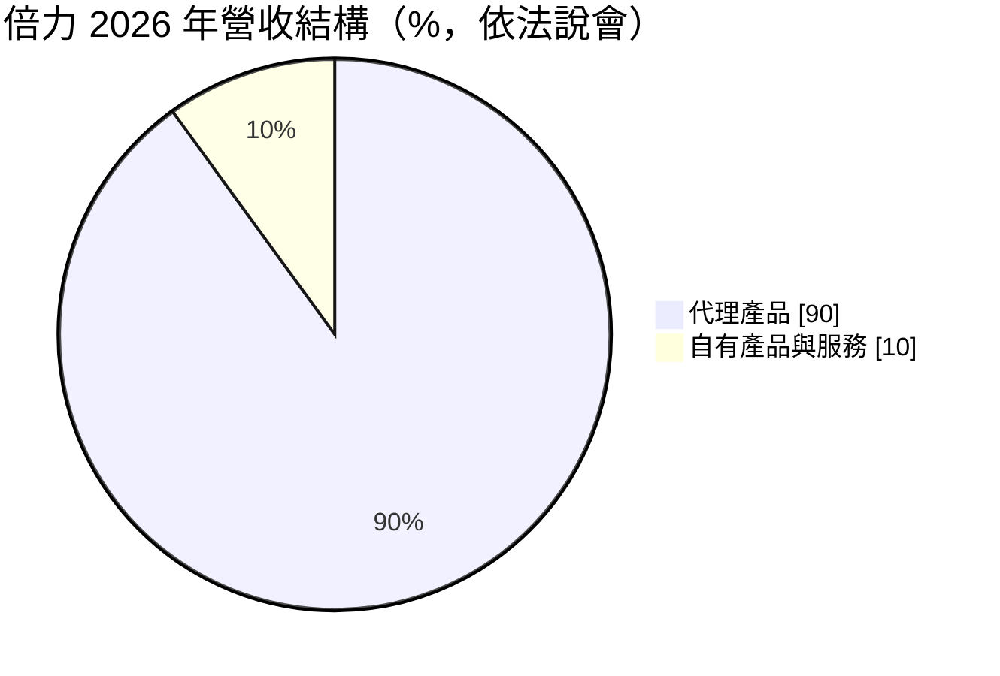
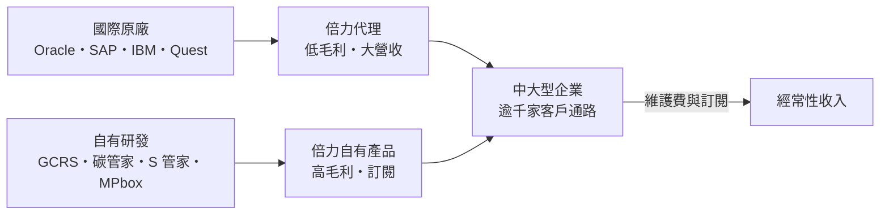
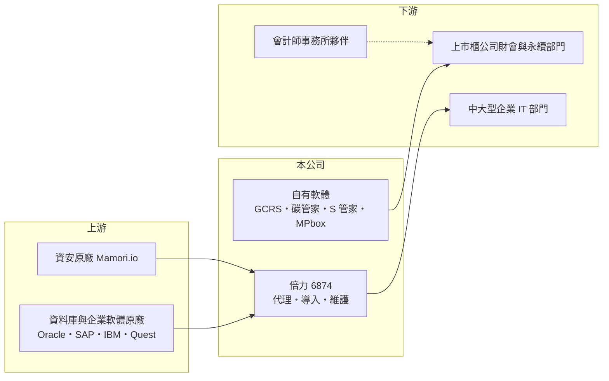

# 6874 倍力

> 上櫃｜[[產業索引-資訊服務業|資訊服務業]]｜上市（櫃）日期 2022/12/14

# 第一章：企業模式與商業藍圖

> [!info] 撰寫說明
> 本文由 Claude 依公開資料整理，架構比照 [[2330台積電]] 的四章研究，資料截至 2026-10-08。財務數字來源：Goodinfo 年度經營績效頁、富果研究 2026 年 8 月法說會整理、櫃買中心開放資料（基本資料、2026 年第二季資產負債與綜合損益、本益比殖利率）；產業描述為整理性內容，尚未逐條比對原始文件。#待校對

倍力資訊（股票代號：6874，以下簡稱倍力）是一家「兩種生意放在同一家公司」的資訊服務商：九成營收來自代理國際大廠的資料庫與企業軟體，毛利率低但規模大；一成來自自有的合併財報與碳盤查系統，毛利率超過八成。理解倍力，就是理解這兩種生意的比重如何變化。

## 一、核心定位：大型企業軟體代理商，兼營自有財會與 ESG 軟體

倍力成立於 1999 年，2022 年 12 月在櫃買中心掛牌，實收資本額約 2.2 億元（2026 年第二季底股本約 2.42 億元）。依富果研究整理的 2026 年 8 月法說會內容，代理品牌包括 Oracle、SAP、IBM、Quest，近年再加入澳洲資安品牌 Mamori.io，補強[[零信任]]架構的產品線。

自有產品是倍力的另一條主線。合併財報系統 GCRS 擁有超過 450 家上市櫃客戶，公司自稱市場領先；碳盤查系統「碳管家」有超過 150 家企業客戶；2026 年下半年再推出永續揭露系統「S 管家」與企業 AI 平台 MPbox。

## 二、營收結構

* **代理產品（約 90%）：** 銷售大型資料庫、ERP 與中介軟體的授權與維護，客戶以中大型企業為主。代理產品的毛利率隨品牌與專案而異，整體偏低，是公司綜合[[毛利率]]只有 12% 至 17% 的原因。
* **自有產品與服務（約 10%）：** GCRS 以永久授權加年度維護費為主，碳管家、S 管家與 MPbox 採訂閱制，毛利率超過 85%。公司目標是讓自有產品與服務貢獻六成以上的獲利，並表示訂閱收入占比正在提高。
* **客戶產業：** 法說會未揭露依產業別的營收分布。從產品性質看，GCRS 與碳管家的客戶是上市櫃公司的財會與永續部門，代理產品則涵蓋製造、金融與服務業（推估）。

## 三、資本轉化邏輯

代理業務的作用不只是營收，它替倍力建立了超過 1,000 家中大型企業的客戶通路。自有軟體再透過這個通路交叉銷售，等於用代理業務的關係降低自有產品的獲客成本。

## 四、長期方向

倍力提出「ACE」策略：AI 應用（MPbox）、資安（整合式防禦）與 ESG（財報、碳盤查、永續揭露整合成套）。台灣金管會要求上市櫃公司分階段揭露溫室氣體盤查與接軌國際永續揭露準則，這是倍力自有 ESG 產品的結構性需求來源。海外方面，公司以參展、在地代理與在地化的低風險方式，優先布局越南、印尼、泰國與馬來西亞，並不排除透過聯盟、投資或併購擴大生態系。

# 第二章：護城河深度與競爭優勢

倍力的護城河集中在自有產品，代理業務則屬於規模與關係型生意。本章分開檢視兩者。

## 一、護城河的組成

* **GCRS 的轉換成本：** 合併財報系統深度嵌入企業的結帳流程，每季都要使用，涉及會計師查核與法規申報。一旦導入，企業更換系統的風險與成本都很高，因此續約穩定。450 家以上的上市櫃客戶，也讓倍力能快速把法規變化做成產品更新。
* **財會加永續的整合：** 把財報、碳盤查與永續揭露串在一起，對同一群財會與永續主管銷售，比單一功能的軟體更不容易被取代。公司也與四大會計師事務所合作，形成約 20 至 30 家夥伴的 ESG 生態系。
* **代理通路的規模：** 長期代理國際大廠，累積認證工程師與企業客戶，是新進代理商難以短期複製的。

## 二、主要競爭對手

| 對手 | 領域 | 與倍力的比較 |
|---|---|---|
| [[6214精誠]] | 大型系統整合與軟體代理 | 規模大很多，在金融與企業客戶直接競爭 |
| [[2468華經]]、[[6112邁達特]] | 企業資料庫與基礎架構代理 | 代理品牌重疊，以價格與服務競爭 |
| [[6752叡揚]] | 自有企業軟體 | 同為自有軟體加代理的模式 |
| 國際 ERP 與 ESG 軟體廠商 | 財報合併與碳管理 | 大型集團可能直接選擇國際方案 |

## 三、守得住與守不住

* **守得住：** GCRS 的上市櫃客戶基礎與碳管家的早期市占，法規需求持續存在，續約率高。
* **守不住：** 代理產品的毛利與採購節奏。2025 年營收下滑 23%，公司解釋為代理客戶的採購週期，這部分無法由倍力控制。
* **觀察重點：** 自有產品營收占比能否從一成往上提升、訂閱收入比重，以及 MPbox 等新產品能否形成實際收入。

# 第三章：財務體質與盈利規模

資料日期：2026-10-08，表格是撰寫當時的快照；最新月營收、毛利率、累計 EPS 由自動排程寫在本筆記的屬性欄位（月營收、毛利率、累計EPS 等）。#待校對

倍力的財報要分兩層看：營收與毛利率被代理業務主導，獲利成長則越來越依賴自有產品。

## 一、多年度財務表

| 年度 | 營收（新台幣） | [[毛利率]] | [[營業利益率]] | EPS（元） | [[ROE]] |
|---|---|---|---|---|---|
| 2021 | 11.6 億 | 16.8% | 8.76% | 6.27 | 36.6% |
| 2022 | 14.8 億 | 14.9% | 8.06% | 4.81 | 24.3% |
| 2023 | 16.0 億 | 14.4% | 7.23% | 4.07 | 18.5% |
| 2024 | 17.7 億 | 13.9% | 7.13% | 4.46 | 19.5% |
| 2025 | 13.7 億 | 16.6% | 7.02% | 3.16 | 13.9% |
| 2026 上半年 | 13.47 億 | 12.0% | 6.4% | 3.10 | 未查得 |

資料來源：Goodinfo；2026 上半年為櫃買中心開放資料。2021 至 2022 年 EPS 較高，部分原因是掛牌前股本較小，與後續年度不能直接比較。

* **營收波動大：** 2020 至 2025 年營收年複合成長率約 13.7%（推算），但 2025 年下滑 23%、2026 上半年又年增 51%，顯示代理專案的認列時點會讓營收大起大落。
* **毛利率與產品組合：** 代理專案多的年度毛利率偏低，例如 2026 上半年只有 12%；自有產品占比高的年度毛利率較高，例如 2025 年 16.6%。
* **營益率穩定在 7% 上下：** 不論營收高低，營業利益率維持在 6% 至 9%，代表公司對費用控制相當紀律。
* **配息：** Goodinfo 統計一般平均現金股利約 2.86 元，2025 年度配發 4 元，配息率偏高（推算）。

## 二、ROE 與長期指標

2021 至 2025 年平均 ROE 約 22.6%（推算），但趨勢從 36.6% 降到 13.9%，主因是掛牌後股本與權益擴大。2026 年第二季底總負債約 11.06 億元、權益約 4.70 億元，負債比約 70%，但負債以應付原廠款項與合約負債為主（推估），反映代理生意「先收客戶錢、後付原廠」的營運資金特性。

## 三、[[ROIC]] 與 [[WACC]]

**ROIC 推算：** 2025 年營業利益 0.96 億元，扣除 20% 稅率後約 0.77 億元。權益約 4.70 億元；有息負債未查得，假設在 0 至 2 億元之間（推估），投入資本約 4.7 億至 6.7 億元，ROIC 約 11% 至 16%（推算）。

**WACC 推算：** 台灣 10 年期公債殖利率假設 1.75%、市場風險溢酬 6%、β 取資訊服務業常見值 0.8（同業估計值），股東權益成本約 6.55%；負債成本假設 2.5%、稅後 2.0%，權益占 70% 至 100%，WACC 約 5.2% 至 6.5%（推算）。

**結論：** 倍力的 ROIC 明顯高於 WACC，屬於創造價值的公司。代理業務靠的是周轉而非利潤率，自有軟體靠的是高毛利，兩者合計讓投入資本報酬維持在雙位數；未來若自有產品占比提高，ROIC 有機會進一步上升。

# 第四章：總體風險與地緣政治

倍力的風險分成兩類：代理業務的原廠與景氣風險，以及自有產品的執行風險。

## 一、產業週期

* **企業 IT 預算：** 代理產品的採購高度依賴企業資本支出，2025 年營收下滑 23% 即是採購週期的結果。景氣反轉時，大型專案容易延後。
* **法規驅動的需求：** ESG 產品需求來自法規時程，若主管機關延後或放寬揭露要求，需求成長會放慢；反之若加嚴則有利。

## 二、營運風險

* **原廠政策：** 國際大廠可能調整通路、改走雲端直銷或重新分配代理權，代理商的角色可能被壓縮。
* **新產品執行：** S 管家與 MPbox 尚在推出初期，企業 AI 市場競爭激烈，能否形成規模收入仍有不確定性。
* **營運資金：** 代理大型專案需要墊付原廠款項，若客戶付款延遲，現金流會承受壓力。

## 三、其他風險

* **匯率：** 原廠授權多以美元計價，新台幣貶值時進貨成本上升。
* **海外擴張：** 東南亞市場法規與語言差異大，在地化成本可能高於預期。
* **雲端化：** 企業軟體從地端授權轉向雲端訂閱，代理商的收入模式與毛利結構可能改變。

# 專有名詞解析

## 應用

- **[[零信任]]**：不預設信任任何使用者或裝置，每次存取都要驗證身分與權限的資安架構。
- **[[碳盤查]]**：依國際標準計算企業溫室氣體排放量的程序，是碳費與永續揭露的基礎。
- **[[SaaS]]**：軟體即服務，客戶以訂閱方式透過網路使用軟體，不需自行安裝與維護。

## 金融

- **[[毛利率]]**：營業毛利占營收的比例，反映產品定價能力與生產成本控制。
- **[[營業利益率]]**：扣除營業費用後的營業利益占營收的比例，衡量本業整體獲利能力。
- **[[ROE]]**：股東權益報酬率，稅後淨利除以股東權益，衡量公司運用股東資金的效率。
- **[[ROIC]]**：投入資本報酬率，稅後營業利益除以股東權益與有息負債的合計，衡量本業對所有資金提供者的報酬。
- **[[WACC]]**：加權平均資金成本，依股東權益與負債的比重加權計算的資金成本，ROIC 高於它才代表創造價值。

## 產業

- **[[經常性收入]]**：每年按合約重複收取的收入，例如軟體維護費、訂閱費，可預測性高於一次性銷售。
- **[[軟體代理商]]**：取得原廠授權，在特定地區銷售軟體並提供導入、教育訓練與技術支援的公司。

# 核心供應鏈

## 1. 上游：軟體原廠
- 資料庫、ERP 與中介軟體：Oracle、SAP、IBM、Quest
- 資安：Mamori.io

## 2. 中游：倍力與同業
- 系統整合與軟體代理同業：[[6214精誠]]、[[2468華經]]、[[6112邁達特]]
- 自有企業軟體同業：[[6752叡揚]]

## 3. 下游：客戶
- 超過 450 家使用 GCRS 的上市櫃公司、超過 150 家碳管家企業客戶
- 製造、金融與服務業的中大型企業

## 最新新聞
<!-- news:start（自動產生，請勿手動編輯此範圍） -->
- 2026-10-05 📰 媒體 19:07｜台數科導入倍力資訊「碳管家」 逾2300組水電數據全自動化｜[鉅亨網](https://news.cnyes.com/news/id/6621871)

完整紀錄：[[6874倍力 新聞]]
<!-- news:end -->

## 相關連結
- [公開資訊觀測站](https://mopsov.twse.com.tw/mops/web/t05st03?step=1&firstin=1&co_id=6874)
- [Goodinfo](https://goodinfo.tw/tw/StockDetail.asp?STOCK_ID=6874)
- [Yahoo 股市](https://tw.stock.yahoo.com/quote/6874)
- [鉅亨網新聞](https://www.cnyes.com/twstock/6874/news)
