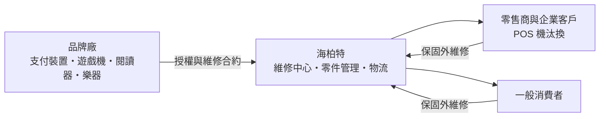
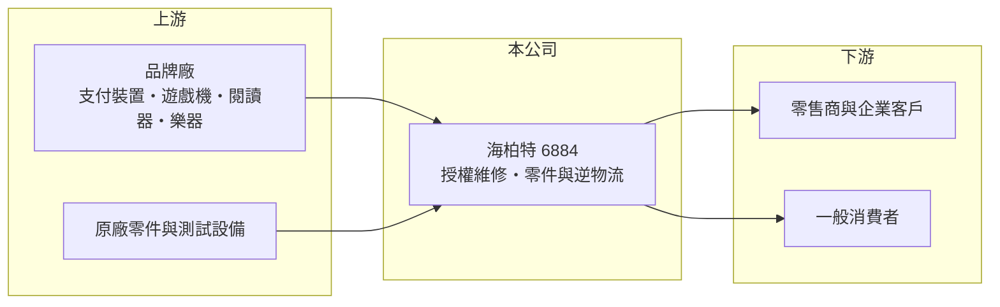

# 6884 海柏特

> 上櫃｜[[產業索引-資訊服務業|資訊服務業]]｜上市（櫃）日期 2025/12/17

# 第一章：企業模式與商業藍圖

> [!info] 撰寫說明
> 本文由 Claude 依公開資料整理，架構比照 [[2330台積電]] 的四章研究，資料截至 2026-10-08。財務數字來源：Goodinfo 年度經營績效頁、優分析 2025 年海柏特專訪報導、櫃買中心開放資料（基本資料、2026 年第二季資產負債與綜合損益、本益比殖利率）；產業描述為整理性內容，尚未逐條比對原始文件。公開資料有限。#待校對

海柏特（股票代號：6884）做的是一門很少人注意的生意：品牌廠把產品賣出去之後，誰來修？本章說明海柏特如何以[[授權維修]]切入亞太的電子產品售後服務市場。

## 一、核心定位：替品牌廠提供授權維修的服務商

海柏特成立於 2018 年，2025 年 12 月在櫃買中心掛牌，實收資本額約 1.84 億元，被媒體稱為台灣首家以維修服務掛牌的上櫃公司。它不製造產品，而是取得品牌廠的授權，替品牌廠在當地處理保固內與保固外的維修、零件更換與退換貨流程。

依優分析的專訪報導，海柏特以東南亞為主要市場，已取得全球前五大支付裝置品牌中兩家的維修授權，並陸續取得電子書閱讀器（Momo、Pubu）與數位樂器（Yamaha）的授權，在菲律賓則是唯一取得遊戲機授權的維修商。

## 二、營收結構

公開資料未查得海柏特依品項或地區的營收比重。依業務性質，收入可分為兩類：一是品牌廠按件或按合約支付的保固維修費，二是保固外由消費者或企業付費的維修與零件銷售。由於品牌廠合約通常是多年期，且維修量與市場上的產品安裝量相關，這類收入帶有一定的[[經常性收入]]性質（推估）。

## 三、資本轉化邏輯

* **先切入、再擴散：** 公司把策略形容為「從 0 到 1、再從 1 到 N」的成長飛輪：先在一個新品項累積維修經驗，再把同樣能力複製到更多品牌與國家。
* **輕資產但重人力：** 維修中心需要技術人員、測試設備與零件庫存，資本需求比製造業低，但人力成本占比高，這也是[[毛利率]]只有約 18% 至 21% 的原因。

## 四、長期方向

海柏特的長期目標是成為亞太區授權維修服務的第一品牌。成長動能來自三個方向：東南亞零售業數位化帶動的支付裝置與 POS 機汰換、新品項授權的累積，以及新國家市場（公司提到評估印度或中國）。公司也不排除以併購加速擴張，並把維修、再利用與回收連結到 [[ESG]] 與[[循環經濟]]的趨勢。

# 第二章：護城河深度與競爭優勢

維修服務的護城河來自信任與網絡：品牌廠很少輕易更換授權維修商。本章分析海柏特的競爭位置。

## 一、護城河的組成

* **品牌授權與認證：** 授權維修商需要通過品牌廠的技術認證、品質稽核與系統串接，取得授權往往需要長時間的合作紀錄。一旦取得，品牌廠更換維修商的成本與風險很高。
* **跨國服務網絡：** 品牌廠希望在多個國家由同一家服務商處理維修，以統一品質與報表。海柏特在東南亞多國的布局，是單一國家小型維修廠難以提供的。
* **多品項經驗：** 同時處理支付裝置、遊戲機、閱讀器與樂器，讓技術人員與零件物流可以共用，攤低每件維修成本。

## 二、主要競爭對手

| 對手類型 | 說明 | 與海柏特的比較 |
|---|---|---|
| 品牌廠自營服務中心 | 大品牌在主要市場自設維修 | 品牌若決定自營，海柏特會失去該市場 |
| 國際售後服務外包商 | 跨國電子維修與逆物流業者 | 規模大，與大型品牌合作較多 |
| 各國在地維修廠 | 價格低、彈性大 | 缺乏授權與跨國能力 |
| 品牌代工廠的維修部門 | 結合製造與維修 | 在既有代工的品牌有天然的合作關係（推估） |

## 三、守得住與守不住

* **守得住：** 已取得的品牌授權與東南亞的服務網絡，只要服務品質穩定，合約續約機率高。
* **守不住：** 單一品牌的合約條件。維修費率由品牌廠主導，品牌廠可以重新招標或壓低單價。
* **觀察重點：** 新品牌與新國家的授權數量、[[營業利益率]]能否突破 5%，以及併購是否發生。

# 第三章：財務體質與盈利規模

資料日期：2026-10-08，表格是撰寫當時的快照；最新月營收、毛利率、累計 EPS 由自動排程寫在本筆記的屬性欄位（月營收、毛利率、累計EPS 等）。#待校對

維修服務公司的財報特色是營收穩定成長、毛利率不高、營業費用占比大。本章用多年度數字檢視海柏特的成長品質。

## 一、多年度財務表

| 年度 | 營收（新台幣） | [[毛利率]] | [[營業利益率]] | EPS（元） | [[ROE]] |
|---|---|---|---|---|---|
| 2020 | 4.57 億 | 19.3% | 0.7% | 0.38 | 3.73% |
| 2021 | 5.83 億 | 21.8% | 3.78% | 0.82 | 7.9% |
| 2022 | 7.44 億 | 18.5% | 3.8% | 1.37 | 12.0% |
| 2023 | 9.04 億 | 18.0% | 3.91% | 1.52 | 12.1% |
| 2024 | 11.9 億 | 18.8% | 4.18% | 2.04 | 14.9% |
| 2025 | 12.1 億 | 20.7% | 3.84% | 2.05 | 11.6% |
| 2026 上半年 | 6.82 億 | 18.2% | 3.2% | 0.88 | 未查得 |

資料來源：Goodinfo；2026 上半年為櫃買中心開放資料。

* **高速成長：** 2020 至 2025 年營收從 4.57 億元增加到 12.1 億元，年複合成長率約 21.5%（推算），在台灣中小型資訊服務股中屬於成長較快的一群。
* **利潤率偏薄：** 營業利益率長期只有 4% 上下，代表每多做一元營收，大部分被人力與營運費用吃掉。獲利成長主要靠規模擴大，而不是利潤率提升。
* **配息：** Goodinfo 統計 2022 至 2026 年一般平均現金股利約 1.02 元，2025 年度配發 1.5 元，以 EPS 2.05 元計算配息率約 73%（推算）。

## 二、ROE 與長期指標

2021 至 2025 年平均 ROE 約 11.7%（推算）。2025 年 ROE 下降到 11.6%，主因是掛牌增資讓權益擴大。2026 年第二季底非流動負債約 1.62 億元，推估包含租賃負債與長期借款，維修據點的租約是主要的長期負債來源。

## 三、[[ROIC]] 與 [[WACC]]

**ROIC 推算：** 2025 年營業利益 0.46 億元，扣除 20% 稅率後約 0.37 億元。2026 年第二季底權益總計約 3.19 億元，有息負債（含租賃負債）未查得，假設約 0 至 2 億元（推估），投入資本約 3.2 億至 5.2 億元，ROIC 約 7% 至 11.5%（推算）。

**WACC 推算：** 台灣 10 年期公債殖利率假設 1.75%、市場風險溢酬 6%、β 取服務業常見值 0.8（同業估計值），股東權益成本約 6.55%；負債成本假設 3%、稅後 2.4%，權益占約 60% 至 100%，WACC 約 4.9% 至 6.5%（推算）。

**結論：** 海柏特的 ROIC 略高於 WACC，屬於「有創造價值、但利差不大」的狀態。利潤率偏薄使 ROIC 對營收成長很敏感：營收持續擴張時利差擴大，營收停滯時則接近資金成本。

# 第四章：總體風險與地緣政治

維修服務的風險主要來自客戶集中與人力成本。本章整理海柏特的長期風險。

## 一、產業週期

* **產品週期：** 維修量取決於市場上的裝置數量與使用年限。支付裝置與 POS 機的汰換潮有週期性，汰換高峰過後維修需求可能趨緩。
* **2025 年的放緩：** 2025 年前三季營收年減約 4%，顯示即使是服務業，也會受到品牌出貨與客戶專案節奏影響。

## 二、營運風險

* **品牌集中：** 若少數品牌占營收比重高，單一品牌更換維修商或改為自營，對營收的衝擊會很大（具體集中度未查得）。
* **人力成本：** 維修屬於勞力密集服務，東南亞工資上升會壓縮本來就不高的利潤率。
* **併購整合：** 公司不排除併購，跨國併購的整合與商譽減損風險需要觀察。

## 三、其他風險

* **匯率與多國營運：** 營收分散在多個東南亞國家，當地貨幣兌新台幣的波動會影響換算後的營收與獲利。
* **法規：** 各國的「維修權」立法、電子廢棄物與資料保護法規，可能改變品牌廠的售後策略與維修商的責任範圍。
* **產品可靠度提升：** 裝置品質提升或模組化設計，可能降低每台裝置的維修次數。

# 專有名詞解析

## 金融

- **[[毛利率]]**：營業毛利占營收的比例，反映產品定價能力與生產成本控制。
- **[[營業利益率]]**：扣除營業費用後的營業利益占營收的比例，衡量本業整體獲利能力。
- **[[ROE]]**：股東權益報酬率，稅後淨利除以股東權益，衡量公司運用股東資金的效率。
- **[[ROIC]]**：投入資本報酬率，稅後營業利益除以股東權益與有息負債的合計，衡量本業對所有資金提供者的報酬。
- **[[WACC]]**：加權平均資金成本，依股東權益與負債的比重加權計算的資金成本，ROIC 高於它才代表創造價值。

## 產業

- **[[授權維修]]**：取得品牌廠授權與技術認證，代品牌處理保固內外維修的服務模式，維修商須遵守品牌的品質與流程規範。
- **[[經常性收入]]**：每年按合約重複收取的收入，例如維護費、服務合約費，可預測性高於一次性銷售。
- **[[循環經濟]]**：透過維修、再利用與回收延長產品壽命、減少廢棄物的經濟模式。
- **[[ESG]]**：環境、社會與公司治理，投資人與主管機關評估企業永續經營的三大面向。

# 核心供應鏈

## 1. 上游：授權品牌與零件
- 支付裝置品牌（全球前五大中的兩家，名稱未揭露）
- 電子書閱讀器：Momo、Pubu；數位樂器：Yamaha
- 菲律賓遊戲機品牌（名稱未揭露）

## 2. 中游：海柏特與同業
- 國際售後服務外包商、各國在地維修廠、品牌自營服務中心

## 3. 下游：客戶
- 東南亞零售商與企業的 POS 與支付設備
- 一般消費者的 3C 與娛樂裝置

## 最新新聞
<!-- news:start（自動產生，請勿手動編輯此範圍） -->
- 2026-10-08 📰 媒體 08:22｜營收速報 - 海柏特(6884)9月營收1.95億元年增率高達105.09％｜[鉅亨網](https://news.cnyes.com/news/id/6624506)

完整紀錄：[[6884海柏特 新聞]]
<!-- news:end -->

## 相關連結
- [公開資訊觀測站](https://mopsov.twse.com.tw/mops/web/t05st03?step=1&firstin=1&co_id=6884)
- [Goodinfo](https://goodinfo.tw/tw/StockDetail.asp?STOCK_ID=6884)
- [Yahoo 股市](https://tw.stock.yahoo.com/quote/6884)
- [鉅亨網新聞](https://www.cnyes.com/twstock/6884/news)
