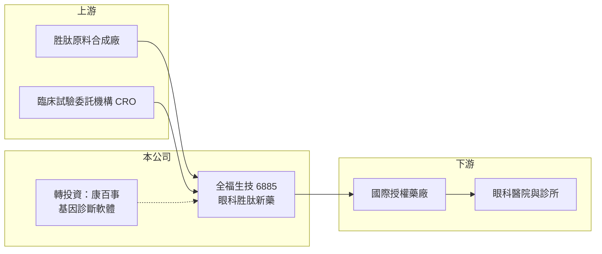

# 6885 全福生技

> 上市｜[[產業索引-生技醫療業|生技醫療業]]｜上市（櫃）日期 2024/12/16

# 第一章：企業模式與商業藍圖

> [!info] 撰寫說明
> 精簡版，由 Claude 依公開資料整理，架構比照 [[2330台積電]]，資料截至 2026-10-08。來源：證交所開放資料快照（基本資料、2026 年第二季財報與營益分析、2025 年度股利、2026 年 8 月營收）、Goodinfo 經營績效頁、聯合新聞網報導。技術來源與部分事件年份憑記憶或推估，已標「待校對」。#待校對

全福生技是一家專注眼科疾病的新藥開發公司，理解它的重點是一條以眼科為核心的產品管線，以及公司如何靠國際授權把研發成果變現。

- **核心業務：** 全福生技開發眼科新藥，主力管線包括乾眼症新藥 BRM421、神經營養性角膜炎新藥 BRM424、青光眼新藥 BRM411，以及抗血管新生新劑型 BRM412。公司的核心分子為胜肽類藥物（推估源自色素上皮衍生因子相關研究，待校對）。眼科藥物以局部點眼給藥為主，全身副作用較少，且[[乾眼症]]等疾病患者眾多，因此是國際藥廠願意授權引進的領域。
- **營收結構：** 公司尚無產品銷售，營收主要是諮詢服務收入與子公司營收，2025 年全年營收約 0.05 億元。官方月營收備註說明 2026 年營收已含子公司，1 至 8 月累計約 0.09 億元，規模仍非常小。
- **營運據點：** 公司設立於 2013 年 7 月，總部在台北內湖，2024 年 12 月 16 日上市，實收資本額約 13.31 億元。臨床試驗在台灣、美國與巴西等地進行。
- **長期方向：** 依報導，BRM424 已在美國與巴西完成二期臨床並展現成果，公司正與國際藥廠洽談授權；BRM421 規劃向美國 FDA 申請三期臨床。公司也以約 1.5 億元取得康百事生物資訊約 42% 股權，切入基因診斷軟體與 AI 新藥開發（投資年份依報導推估為 2025 年，待校對）。

# 第二章：護城河深度與競爭優勢

全福生技的護城河建立在專利與臨床資料上，本章說明它的優勢、對手與需要觀察的關鍵。

- **競爭優勢：** 公司把資源集中在眼科，同一類胜肽分子可以延伸到乾眼症、角膜炎、青光眼等多個適應症，研發經驗與臨床網絡可以重複使用。[[神經營養性角膜炎]]屬於罕見眼疾，若取得[[孤兒藥資格]]，上市後可享有市場獨占期，對小型公司是較容易切入的利基市場。
- **主要對手：** 乾眼症市場由國際大藥廠主導，例如艾伯維（Allergan）的 Restasis 與諾華體系的 Xiidra；神經營養性角膜炎則有義大利 Dompé 的 Oxervate（憑記憶，待校對）。台股眼科相關公司有 [[4166友霖]]、[[6782視陽]]，但後者以隱形眼鏡為主。
- **觀察重點：** BRM424 能否如期完成授權並取得簽約金、BRM421 三期臨床能否啟動，以及康百事的基因診斷業務能否帶來穩定營收。對新藥公司來說，第一筆國際授權是驗證技術價值最重要的里程碑。

# 第三章：財務體質與盈利規模

資料日期：2026-10-08，表格是撰寫當時的快照；最新月營收、毛利率、累計 EPS 由自動排程寫在本筆記的屬性欄位（月營收、毛利率、累計EPS 等）。#待校對

新藥公司在授權或上市前通常連年虧損，本章用多年度數據觀察全福生技的虧損規模與資金存量。

| 年度 | 營收（億元） | [[毛利率]] | [[營業利益率]] | EPS（元） | [[ROE]] |
|---|---|---|---|---|---|
| 2021 | 約 0 | 未查得 | 未查得 | -1.78 | -28.4% |
| 2022 | 0.01 | 未查得 | 未查得 | -3.85 | -39.4% |
| 2023 | 約 0 | 未查得 | 未查得 | -6.84 | -51.9% |
| 2024 | 約 0 | 未查得 | 未查得 | -2.70 | -16.6% |
| 2025 | 0.05 | 22.8% | 未查得 | -3.32 | -23.7% |
| 2026 上半年 | 0.07 | -17.2% | 未具意義 | -1.39 | 未查得 |

- **營收規模：** 營收幾乎為零，營業利益率因分母太小而失去意義，因此表中以「未查得」或「未具意義」表示。營收在授權成功前不會是評估重點。
- **獲利：** 2025 年稅後淨損約 4.36 億元，2026 年上半年營業損失約 1.69 億元、稅後淨損約 2.04 億元。2025 年底累積虧損約 10.2 億元，依公司法須待彌補虧損後才能配息。
- **財務特色：** 2026 年第二季底股東權益約 16.20 億元、負債僅約 0.43 億元，資金主要來自上市前後的增資。以 2025 年的虧損規模推算，現有權益約可支撐 3 至 4 年研發（推算）。
- **[[ROIC]] 與 [[WACC]]：** 以 2026 年上半年營業損失 1.69 億元年化為 3.39 億元，除以股東權益 16.20 億元（有息負債接近零），ROIC 約 -21%（推算）。WACC 以 CAPM 推估：無風險利率 1.75%、市場風險溢酬 6%、β 取研發型生技常見的 1.3（假設值），公司幾乎無負債，WACC 約 9.5% 至 10%（推算）。ROIC 為負且遠低於 WACC，代表目前是投入期，公司價值取決於管線能否授權或上市。
- **長期指標：** 近 5 年（2021 至 2025 年）ROE 平均約 -32%（推算），未配發現金股利，自由現金流長期為負。

# 第四章：總體風險與地緣政治

眼科新藥公司的風險集中在臨床結果、授權談判與資金，本章逐項說明。

- **產業週期：** 新藥研發本身不隨景氣循環，但生技募資環境與國際藥廠授權熱度會影響公司取得資金的條件。資金行情轉弱時，研發型公司可能被迫以較低價格增資。
- **營運風險：** 臨床試驗結果若不如預期，或授權談判延宕，公司收入與研發計畫都會受影響。轉投資康百事屬於跨領域布局，整合成效與後續資金需求需要追蹤。
- **其他風險：** 乾眼症市場競爭激烈，即使上市也要面對大藥廠的行銷資源。海外臨床費用與授權收入多以美元計價，有匯率影響。

# 專有名詞解析

## 產業

- **[[乾眼症]]**：淚液分泌不足或品質不佳造成的眼睛乾澀與發炎，患者人數多，是眼科大型藥物市場。
- **[[神經營養性角膜炎]]**：角膜神經受損導致角膜難以癒合的罕見眼疾，嚴重時會造成潰瘍與失明。
- **[[孤兒藥資格]]**：主管機關給罕見疾病藥物的認定，可享有審查優惠與上市後市場獨占期。
- **[[授權里程碑金]]**：新藥授權後，被授權方在臨床或上市達到約定階段時支付給授權方的款項。

# 核心供應鏈

- 上游：胜肽原料藥合成廠與臨床試驗委託機構（個別名稱未查得）；台股胜肽原料相關公司可參考 [[4746台耀]]、[[1789神隆]]（是否為供應商未查得）。
- 下游／客戶：洽談中的國際授權藥廠，最終使用者為眼科醫師與病患；轉投資康百事的客戶為醫院與基因檢測單位。
- 同業：眼科相關的 [[4166友霖]]；走國際授權模式的 [[6576逸達]]、[[6875國邑]]。

## 最新新聞
<!-- news:start（自動產生，請勿手動編輯此範圍） -->
- 2026-10-08 📰 媒體 17:24｜營收速報 - 全福生技(6885)9月營收123萬元年增率高達209.55％｜[鉅亨網](https://news.cnyes.com/news/id/6625038)

完整紀錄：[[6885全福生技 新聞]]
<!-- news:end -->

## 相關連結
- [公開資訊觀測站](https://mopsov.twse.com.tw/mops/web/t05st03?step=1&firstin=1&co_id=6885)
- [Goodinfo](https://goodinfo.tw/tw/StockDetail.asp?STOCK_ID=6885)
- [Yahoo 股市](https://tw.stock.yahoo.com/quote/6885)
- [鉅亨網新聞](https://www.cnyes.com/twstock/6885/news)
