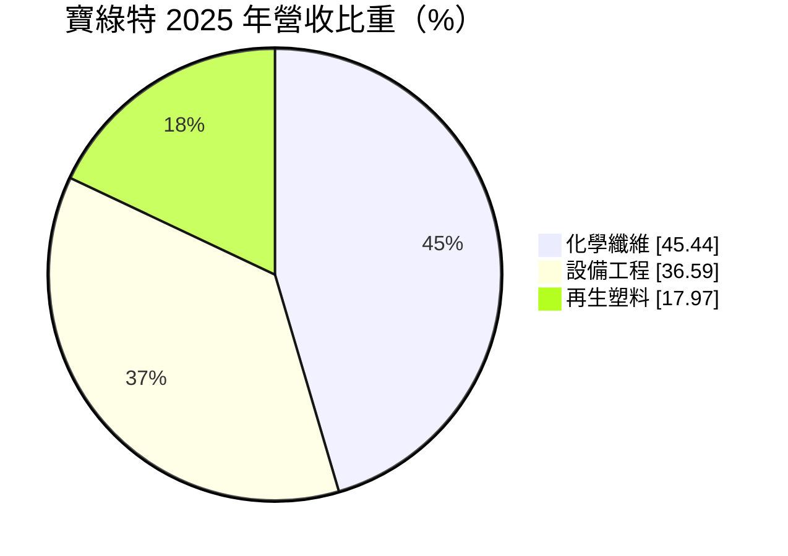
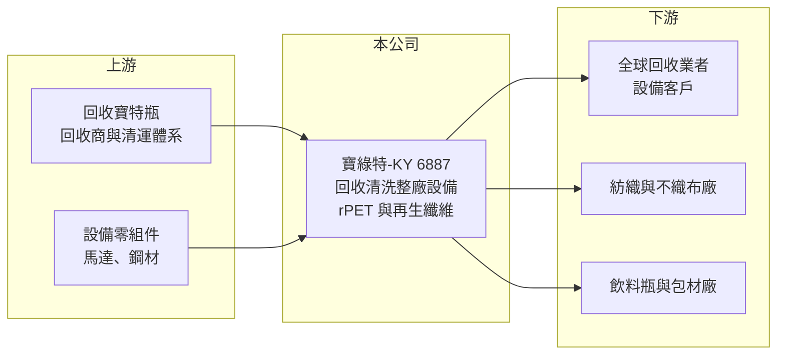

# 6887 寶綠特-KY

> 上市｜[[產業索引-綠能環保|綠能環保]]｜上市（櫃）日期 2025/03/10

# 第一章：企業模式與商業藍圖

> [!info] 撰寫說明
> 精簡版，由 Claude 依公開資料整理，架構比照 [[2330台積電]]，資料截至 2026-10-08。來源：富邦 MoneyDJ 財務比率年表（2021 至 2025 年）與基本資料（2025 年營收比重）；證交所開放資料快照（基本資料、2026 年上半年資產負債與損益、2025 年度股利、每月營收）；優分析、科技新報、富果新聞與法說標題。工廠地點、客戶與技術細節為憑記憶整理，已標「待校對」；歷年營收由每股營業額與成長率推算。#待校對

寶綠特控股成立於 2013 年 4 月，註冊於開曼群島，2025 年 3 月上市，董事長歐晢文、總經理林俊華，營運總部在台南（待校對）。它從寶特瓶回收清洗設備起家，再往下游自己經營回收料加工與[[再生聚酯纖維]]生產，形成「賣設備＋自己做再生料」的雙引擎模式，切入全球塑膠循環經濟。

- **核心業務：** 2025 年營收中化學纖維占 45.44%、設備工程占 36.59%、再生塑料占 17.97%。設備工程是替全球回收業者設計與建置寶特瓶破碎、清洗、分選的整廠設備；再生塑料是把回收瓶加工成[[rPET]]瓶片或粒子；化學纖維則是用再生料紡成再生聚酯纖維，供紡織與不織布使用。三個事業互相支援：設備技術提升自家回收料品質，自家工廠又是設備改良的實驗場。
- **營收結構：** 依每股營業額與成長率推算，2025 年營收約 48 億元（推算），年減約 12%，2024 年約 55 億元（推算）為高點。設備工程依專案認列，年度波動較大；再生料與纖維則跟著原油價格、原生聚酯價格與品牌採購需求變動。
- **營運據點：** 台灣有研發與設備製造據點，海外在東南亞等地設有回收料與纖維工廠（國家與產能待校對）。整廠設備出口到歐洲、美洲與亞洲多國（客戶名單待校對），國際化程度高。
- **長期方向：** 歐盟規定寶特瓶需含一定比例再生料（例如 2025 年 25%、2030 年 30%，待校對），國際飲料與服飾品牌也承諾提高再生材料使用率，這是長期的結構性需求。寶綠特的方向是擴大再生料與纖維產能，並推廣能處理更低品質回收料的設備技術，新聞也以「全球塑膠回收 125 億美元商機」描述其市場。

# 第二章：護城河深度與競爭優勢

寶綠特的護城河來自回收設備的製程技術，以及設備與再生料一條龍的整合，但再生料本身是大宗商品，價格競爭激烈。

- **競爭優勢：** 寶特瓶回收的難點在於去除標籤、瓶蓋、膠水與雜質，讓再生料達到食品級或纖維級品質，清洗與分選技術直接決定成品價值。寶綠特同時是設備商與再生料生產商，能用自家工廠驗證設備效能，對客戶有說服力。整廠設備銷售後還有零件與改善服務，帶來持續的收入與客戶黏著度。
- **主要對手：** 回收設備的國際對手包括義大利、德國與奧地利的整廠設備商（如 Sorema、Krones 回收部門等，待校對），以及中國低價設備廠。再生聚酯纖維與瓶片方面，台灣的 [[1402遠東新]]、[[1409新纖]]、[[1326台化]] 等石化纖維大廠都有再生聚酯產品，規模遠大於寶綠特。
- **觀察重點：** [[營業利益率]]在 2023 年達 12.17%、2025 年降到 8.26%，2026 年上半年回到 10.12%。觀察重點是設備接單能否隨各國再生料法規落地而增加，以及再生纖維是否能維持高於原生料的價格溢價；若溢價縮小，再生料事業的毛利會被壓縮。

# 第三章：財務體質與盈利規模

資料日期：2026-10-08，表格是撰寫當時的快照；最新月營收、毛利率、累計 EPS 由自動排程寫在本筆記的屬性欄位（月營收、毛利率、累計EPS 等）。#待校對

寶綠特 2022 至 2024 年成長快速、ROE 一度超過兩成，2025 年隨營收下滑回落，但仍維持穩定獲利。

| 年度 | 營收（億元） | [[毛利率]] | [[營業利益率]] | EPS（元） | [[ROE]] |
|---|---|---|---|---|---|
| 2021 | 約 27（推算） | 21.80% | 9.89% | 3.71 | 未查得 |
| 2022 | 約 36（推算） | 19.10% | 6.91% | 3.54 | 14.61% |
| 2023 | 約 45（推算） | 24.96% | 12.17% | 7.02 | 25.22% |
| 2024 | 約 55（推算） | 21.42% | 10.09% | 7.51 | 23.50% |
| 2025 | 約 48（推算） | 22.90% | 8.26% | 4.58 | 12.90% |

註：2025 年營收以每股營業額 64.62 元乘以約 7,421 萬股推算，其他年度依 MoneyDJ 營收成長率回推；上市前股本較小，推算值僅供參考。2026 年上半年營收 23.83 億元、毛利率 28.21%、營業利益率 10.12%、EPS 2.09 元（證交所資料）。

- **長期指標：** 2021 至 2025 年營收年複合成長率約 15%（推算），2022 至 2025 年平均 [[ROE]] 約 19.1%（推算）。2025 年度配發現金股利約 2.42 元，約為 EPS 4.58 元的 53%。每股現金流量除 2024 年為 −1.49 元外，2021 至 2025 年其他年度皆為正，[[自由現金流]]大致為正（推估）。
- **[[ROIC]] 與 [[WACC]]：** 2025 年稅後營業利益約 3.2 億元（營業利益率 8.26% × 營收約 48 億元 × 0.8），投入資本約 40 億元（2026 年第二季權益總計 30.10 億元，加上以總負債 19.59 億元的一半推估的有息負債約 9.8 億元），ROIC 約 8%（推算）。WACC 約 5.9%（推算：無風險利率 1.75%、市場風險溢酬 6%、β 取設備與塑化同業常見值 0.9，股東權益成本 7.15%；稅前負債成本 2.5%、稅率 20%；權益比重約 75%）。ROIC 高於 WACC 約 2 個百分點，2023 至 2024 年的利差更大，代表公司仍在創造價值，但幅度隨景氣縮小。
- **財務特色：** 2026 年第二季負債比率約 39%（負債 19.59 億元 ÷ 資產 49.69 億元），流動資產 37.47 億元約為流動負債的 2 倍，財務穩健。資本公積 13.45 億元，主要來自上市承銷溢價。股價淨值比約 0.91 倍、殖利率約 6.6%（2026 年 10 月初快照）。

# 第四章：總體風險與地緣政治

寶綠特的風險集中在原料與再生料價格、設備接單週期與海外營運。

- **產業週期：** 再生聚酯與原生聚酯互為替代品，原油價格下跌時原生料變便宜，再生料的價格優勢就會縮小，影響纖維與瓶片的售價與毛利。設備工程則跟著各國回收業者的投資意願走，景氣不佳或補助縮減時接單會放緩。
- **營運風險：** 回收寶特瓶的取得價格與品質不穩定，會影響產品良率與成本。整廠設備專案金額大、交期長，若延遲驗收或客戶財務出問題，會造成應收帳款風險。
- **其他風險：** KY 公司的財報透明度與海外子公司管理需要投資人額外關注；歐盟與各國再生料法規若延後或放寬，會削弱長期需求；匯率變動影響以美元、歐元計價的設備出口。

# 專有名詞解析

## 金融

- **[[ROIC]]**：投入資本報酬率，稅後營業利益除以股東權益加有息負債，衡量本業運用資本的效率。
- **[[WACC]]**：加權平均資金成本，股東與債權人要求報酬率的加權平均，是 ROIC 要超越的門檻。
- **[[自由現金流]]**：營業活動現金流減去資本支出，代表企業可自由用於配息、還債或併購的現金。

## 產業

- **[[rPET]]**：再生聚對苯二甲酸乙二酯，用回收寶特瓶加工製成的再生塑料，可再做成瓶子或纖維。
- **[[再生聚酯纖維]]**：以回收寶特瓶為原料紡成的聚酯纖維，用於運動服、包包與不織布，品牌用來降低碳足跡。

# 核心供應鏈

- 上游：回收寶特瓶供應商與資源回收體系（名單未查得）。
- 下游／客戶：海外回收業者（設備）、紡織與不織布廠、品牌供應鏈（名單待校對）。
- 同業：[[1402遠東新]]、[[1409新纖]]、[[1326台化]]（再生聚酯），以及國際回收設備商。

## 最新新聞
<!-- news:start -->
<!-- news:end -->

## 相關連結
- [公開資訊觀測站](https://mopsov.twse.com.tw/mops/web/t05st03?step=1&firstin=1&co_id=6887)
- [Goodinfo](https://goodinfo.tw/tw/StockDetail.asp?STOCK_ID=6887)
- [Yahoo 股市](https://tw.stock.yahoo.com/quote/6887)
- [鉅亨網新聞](https://www.cnyes.com/twstock/6887/news)
