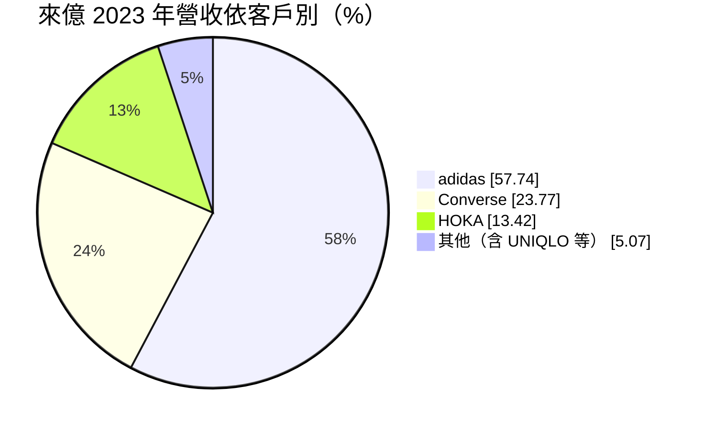
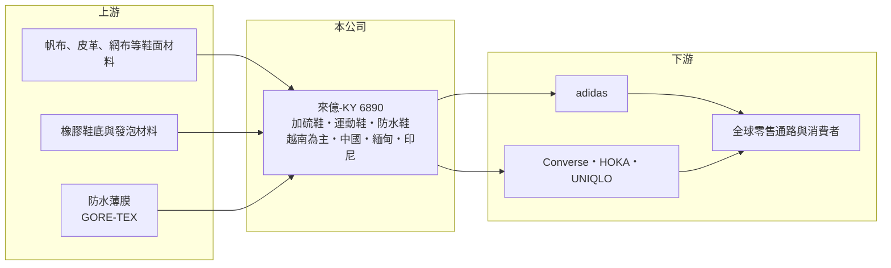

# 6890 來億-KY

> 上市｜[[產業索引-運動休閒|運動休閒]]｜上市（櫃）日期 2024/06/12

# 第一章：企業模式與商業藍圖

> [!info] 撰寫說明
> 精簡版，由 Claude 依公開資料整理，架構比照 [[2330台積電]]，資料截至 2026-10-08。來源：MoneyDJ 理財網財務比率年表（2020 至 2025 年）；自由時報 2024 年 5 月上市前報導（產品、2023 年客戶比重、產地、產能、2023 年營收）；商周 Smart 製鞋股報導；證交所開放資料快照（基本資料、2026 年上半年資產負債與損益、2025 年度股利）。客戶比重為 2023 年資料；2021、2022、2024、2025 年營收以每股營業額乘以推估股數推算。#待校對

來億興業是開曼群島註冊的[[KY股]]控股公司，控股公司成立於 2021 年 6 月、2024 年 6 月上市，營運總部在台中大雅，董事長鐘德禮、總經理林昌永，實收資本額約 25 億元。集團製鞋事業始於 1987 年，以加硫鞋（帆布休閒鞋）起家，之後擴展到運動鞋與防水鞋，是 adidas 與 Converse 的重要代工夥伴。

- **核心業務：** 來億替國際品牌代工成鞋，技術涵蓋[[加硫鞋]]（帆布鞋等以高溫硫化把橡膠鞋底與鞋面結合的鞋款）、冷貼運動鞋與防水鞋，也是 GORE-TEX 認證工廠，可量產防水機能鞋款。產品從休閒帆布鞋到跑鞋、戶外鞋都有，客戶分布在運動與時尚休閒兩端。
- **營收結構：** 依自由時報 2024 年 5 月報導，2023 年 adidas 占營收 57.74%、Converse 23.77%、HOKA 13.42%，UNIQLO 也是主要客戶之一（比重未揭露）。adidas 一家就接近六成，客戶集中度高；HOKA 屬於近年快速成長的跑鞋品牌，是來億未來成長的重要來源。
- **營運據點：** 生產基地以越南為主，另有中國、緬甸與印尼廠；印尼新廠在 2024 年第二季投入營運。依同一報導，年產量約 6,000 萬雙、員工約 5.5 萬人（待校對）。越南產能比重很高，是來億面對美國關稅時的重要變數。
- **長期方向：** 來億的長期成長來自三條線：擴大 HOKA 等高成長跑鞋品牌的訂單、印尼新產能爬坡分散越南集中風險，以及提高運動鞋占比以提升單價與毛利。上市後採高配息政策，2025 年度配發每股 9 元現金（含 2 元資本公積）。

# 第二章：護城河深度與競爭優勢

來億的護城河是加硫鞋的製程專長與 adidas、Converse 的長期合作關係，屬於代工業中的窄護城河。

- **競爭優勢：** 加硫鞋需要硫化罐等專用設備與溫度、時間的精確控制，產品看似簡單，但大量生產時的外觀一致性與膠合強度不容易做好，全球能為大品牌大量供應的廠商不多。長期為 adidas 與 Converse 供貨，代表它通過品牌的品質、交期與社會責任稽核，品牌換廠成本高。
- **主要對手：** 運動鞋代工大廠 [[9904寶成]]、[[9910豐泰]]、[[6768志強-KY]]、[[6965中傑-KY]]、[[9802鈺齊-KY]]，以及中國華利集團；在加硫鞋領域則與越南、中國的休閒鞋廠競爭。與志強相同，來億也是 adidas 比重最高的台灣鞋廠之一（商周 Smart 報導）。
- **觀察重點：** 2023 年品牌去庫存時毛利率跌到 13.5%，2024 年回升到 19.8%，2025 年又降到 16.0%，顯示毛利率受訂單量與產能利用率影響很大。長期要看 adidas 以外客戶比重能否持續提高、HOKA 訂單成長能否延續，以及印尼廠的效率。

# 第三章：財務體質與盈利規模

資料日期：2026-10-08，表格是撰寫當時的快照；最新月營收、毛利率、累計 EPS 由自動排程寫在本筆記的屬性欄位（月營收、毛利率、累計EPS 等）。#待校對

來億的毛利率約 13% 至 20%、營業利益率約 4% 至 12%，獲利隨品牌庫存週期明顯波動，2024 年 EPS 16.13 元為近年高點。

| 年度 | 營收（億元） | [[毛利率]] | [[營業利益率]] | EPS（元） | [[ROE]] |
|---|---|---|---|---|---|
| 2021 | 約 200（推算） | 12.98% | 3.51% | 1.00 | 1.44% |
| 2022 | 約 313（推算） | 18.16% | 10.61% | 11.39 | 15.76% |
| 2023 | 280.16 | 13.47% | 5.39% | 6.26 | 7.02% |
| 2024 | 約 370（推算） | 19.79% | 12.43% | 16.13 | 18.93% |
| 2025 | 約 397（推算） | 16.03% | 9.54% | 13.02 | 13.53% |

註：2023 年營收來自自由時報；以 2023 年營收除以每股營業額得約 2.2 億股，2021、2022 年以此股數推算；2024 年上市增資後股數變動，以約 2.45 億股推算；2025 年以約 2.5 億股推算。

- **長期指標：** 2021 至 2025 年平均 ROE 約 11.3%（推算），2021 年受越南疫情封鎖影響最低（推估）。2021 至 2025 年營收年複合成長率約 19%（推算，含上市增資與擴產效果）。2025 年度每股現金股利 9 元（盈餘 7 元、資本公積 2 元），約為 EPS 的 69%（證交所資料）；每股現金流量 2020 與 2024 年為負，其他年度為正。
- **[[ROIC]] 與 [[WACC]]：** 2025 年營業利益約 37.9 億元（營收約 397 億元 × 9.54%），稅後約 30.3 億元（稅率 20%）。投入資本以 2026 年第二季權益總計 243.1 億元，加有息負債推估約 30 億元計算（負債總計 110.4 億元，官方快照未拆分），ROIC 約 11%（推算）。WACC 約 6.8%（推算：無風險利率 1.75%、市場風險溢酬 6%、β 取 0.9，股東權益成本 7.15%；稅前負債成本 3%、稅率 20%，以市值約 368 億元與負債 30 億元計算權重約 92：8）。ROIC 高於 WACC 約 4 個百分點，代表景氣正常年度能創造價值，但 2021 與 2023 年 ROIC 低於 WACC，價值創造隨週期起伏。
- **財務特色：** 2026 年第二季總資產 353.5 億元、負債 110.4 億元，負債比率約 31%，每股淨值 93.15 元。2026 年上半年營收 179.0 億元、毛利率 15.1%、營業利益率 7.7%、EPS 4.53 元；1 至 8 月累計營收年減約 10.5%（證交所月營收資料），顯示訂單仍在調整。

# 第四章：總體風險與地緣政治

來億的風險集中在客戶集中、越南產地集中與品牌庫存週期。

- **產業週期：** 運動與休閒鞋代工的訂單取決於品牌庫存，2023 年全球品牌去庫存時，來億營收與獲利明顯下滑，屬於典型的[[長鞭效應]]。休閒帆布鞋還受流行趨勢影響，Converse 等品牌熱度的起伏會直接反映在訂單上。
- **營運風險：** adidas 占營收近六成，若 adidas 調整產地或分散供應商，影響非常大。製鞋是勞力密集產業，越南與印尼的工資上漲、勞資關係與招工難度會持續推高成本；新廠爬坡期間效率較低，也會壓抑毛利率。
- **其他風險：** 越南占產能比重很高，美國對越南的關稅政策是最大外部變數，法說會曾表示若 adidas 不要求共同負擔，關稅對營收影響不超過 5%。營收以美元計價，匯率波動影響獲利；作為 KY 公司，法律適用與資訊揭露與本國公司不同。

# 專有名詞解析

## 金融

- **[[KY股]]**：在台灣上市櫃、但註冊於開曼群島等境外地區的公司，適用的公司法與揭露規範與本國公司不同。
- **[[長鞭效應]]**：終端需求的小幅變動，沿供應鏈往上游傳遞時被逐級放大，造成上游庫存與訂單劇烈波動。
- **[[ROIC]]**：投入資本報酬率，稅後營業利益除以股東權益加有息負債，衡量本業運用資本的效率。
- **[[WACC]]**：加權平均資金成本，股東與債權人要求報酬率的加權平均，是 ROIC 要超越的門檻。

## 產業

- **[[加硫鞋]]**：以高溫硫化讓橡膠鞋底與帆布鞋面結合的鞋款，帆布鞋是代表，耐用但製程需要專用設備。

# 核心供應鏈

- 上游：帆布、皮革、網布等鞋面材料；橡膠鞋底與發泡材料；GORE-TEX 防水薄膜；鞋材配件如 [[9938百和]]（實際往來未查得）。
- 下游／客戶：adidas、Converse（Nike 旗下）、HOKA、UNIQLO。
- 同業：[[9904寶成]]、[[9910豐泰]]、[[6768志強-KY]]、[[6965中傑-KY]]、[[9802鈺齊-KY]]；中國華利集團。

## 最新新聞
<!-- news:start -->
<!-- news:end -->

## 相關連結
- [公開資訊觀測站](https://mopsov.twse.com.tw/mops/web/t05st03?step=1&firstin=1&co_id=6890)
- [Goodinfo](https://goodinfo.tw/tw/StockDetail.asp?STOCK_ID=6890)
- [Yahoo 股市](https://tw.stock.yahoo.com/quote/6890)
- [鉅亨網新聞](https://www.cnyes.com/twstock/6890/news)
