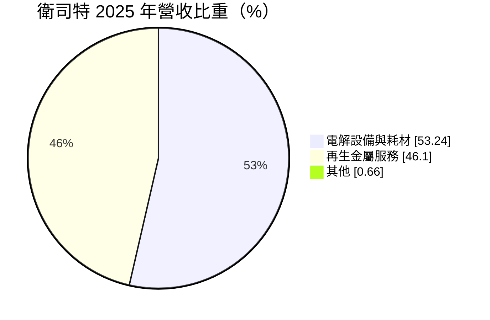
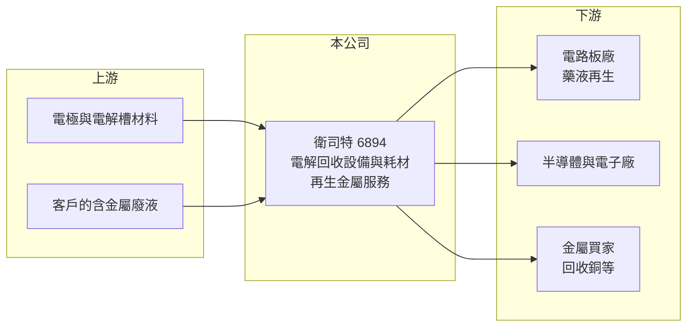

# 6894 衛司特

> 上櫃｜[[產業索引-綠能環保|綠能環保]]｜上市（櫃）日期 2023/11/29

# 第一章：企業模式與商業藍圖

> [!info] 撰寫說明
> 精簡版，由 Claude 依公開資料整理，架構比照 [[2330台積電]]，資料截至 2026-10-08。來源：富邦 MoneyDJ 財務比率年表（2019 至 2025 年）與基本資料（2025 年營收比重）；櫃買中心開放資料快照（基本資料、2026 年上半年資產負債與損益、本益比殖利率、每月營收）；優分析、經濟日報、天下雜誌、富果法說標題。客戶產業、回收金屬種類與技術內容為憑記憶與新聞標題整理，已標「待校對」；歷年營收由每股營業額推算。#待校對

衛司特成立於 2001 年 1 月、2023 年 11 月上櫃，董事長兼總經理林世民。它專做[[電解回收]]技術：一方面賣電解設備與耗材給電路板、半導體等產業，讓工廠能從蝕刻廢液中回收銅等金屬並讓藥液再生；另一方面自己經營再生金屬服務，收取廢液處理費並出售回收金屬，新聞以「科技與再生循環的雙重玩家」形容它。

- **核心業務：** 2025 年營收中電解設備與耗材占 53.24%、再生金屬服務占 46.10%。電路板與半導體製程會產生大量含銅的[[蝕刻液]]，傳統做法是當作廢液委外處理，衛司特的電解設備能把銅直接電解析出，同時讓蝕刻液恢復功能重複使用，替客戶同時省下藥液與廢液處理成本。再生金屬服務則是收集客戶的含金屬廢液或廢料，在自家工廠回收成金屬產品出售（金屬種類待校對）。
- **營收結構：** 依每股營業額推算，2025 年營收約 13.8 億元（推算），年增 40.66%，2023 年約 7.8 億元（推算）。2026 年 1 至 8 月累計營收 15.02 億元，已超過 2025 年全年，年增約 67%，成長主要來自 AI 伺服器帶動的高階電路板產能擴張（推估）。
- **營運據點：** 總部與工廠在台灣（地點待校對），並跟隨電路板客戶在中國、東南亞的據點提供設備與服務（海外比重待校對）。電解設備裝在客戶產線旁，需要長期駐點維護與耗材補充，服務網路是重要資產。
- **長期方向：** 電路板與半導體廠面臨水資源、碳排與廢棄物減量的壓力，「廠內回收、藥液再生」比「委外處理」更符合 ESG 要求。衛司特的方向是把電解技術延伸到更多金屬與更多產業（例如半導體廢液，待校對），並擴大再生金屬服務的處理量。

# 第二章：護城河深度與競爭優勢

衛司特的護城河來自電解製程的專業技術與客戶產線綁定，設備裝上之後的耗材與服務收入具延續性。

- **競爭優勢：** 蝕刻液再生必須兼顧回收效率與藥液品質，若處理不好會影響電路板良率，客戶對新供應商非常謹慎，一旦導入就形成很高的[[轉換成本]]。設備銷售後，電極等耗材需要定期更換，帶來類似「刮鬍刀與刀片」的持續收入。[[毛利率]]長期維持在 35% 至 44%，[[營業利益率]]接近三成，反映技術含量與議價能力。
- **主要對手：** 台灣專門做電路板蝕刻液電解再生的業者不多（同業名單待校對），廢液委外處理業者如 [[6923中台]]、[[8422可寧衛]] 等屬於替代方案；國際上則有日本與歐洲的蝕刻液再生設備商。
- **觀察重點：** 營收與 AI 伺服器、高階電路板的擴產高度相關，2025 至 2026 年成長快速。觀察重點是設備銷售的高成長能否轉換成更大的耗材與服務基礎，以及金屬價格（尤其銅價）變動對再生金屬服務毛利的影響。

# 第三章：財務體質與盈利規模

資料日期：2026-10-08，表格是撰寫當時的快照；最新月營收、毛利率、累計 EPS 由自動排程寫在本筆記的屬性欄位（月營收、毛利率、累計EPS 等）。#待校對

衛司特長期維持高毛利、低負債，2024 年後營收加速成長，2026 年上半年獲利再創新高。

| 年度 | 營收（億元） | [[毛利率]] | [[營業利益率]] | EPS（元） | [[ROE]] |
|---|---|---|---|---|---|
| 2021 | 約 7.2（推算） | 42.20% | 31.51% | 8.55 | 23.83% |
| 2022 | 約 8.1（推算） | 40.51% | 29.51% | 9.32 | 21.05% |
| 2023 | 約 7.8（推算） | 39.27% | 27.91% | 7.86 | 13.51% |
| 2024 | 約 9.8（推算） | 37.82% | 26.42% | 8.50 | 14.03% |
| 2025 | 約 13.8（推算） | 36.70% | 26.94% | 10.99 | 17.08% |

註：營收以每股營業額乘以 2,380 萬股推算，並與 MoneyDJ 營收成長率交叉核對一致；上櫃前股本可能較小，2021 至 2022 年數字僅供參考。2026 年上半年營收 11.06 億元、毛利率約 36.5%、營業利益率約 28.3%、EPS 9.70 元（櫃買中心資料，比率由損益表計算）。

- **長期指標：** 2021 至 2025 年營收年複合成長率約 18%（推算），近 5 年平均 [[ROE]] 約 17.9%（推算）。最近一次年度現金股利 8.5 元（櫃買中心殖利率資料），約為 2025 年 EPS 10.99 元的 77%。每股現金流量 2019 至 2025 年皆為正值（6.03 至 14.66 元），[[自由現金流]]長期為正（推估）。
- **[[ROIC]] 與 [[WACC]]：** 2025 年稅後營業利益約 3.0 億元（營業利益率 26.94% × 營收約 13.8 億元 × 0.8），投入資本約 26.8 億元（2026 年第二季權益總計 20.02 億元，加上以總負債 13.64 億元的一半推估的有息負債約 6.8 億元），ROIC 約 11%（推算）。WACC 約 5.4%（推算：無風險利率 1.75%、市場風險溢酬 6%、β 取環保設備同業常見值 0.8，股東權益成本 6.55%；稅前負債成本 2.5%、稅率 20%；權益比重約 75%）。ROIC 高出 WACC 約 6 個百分點，代表衛司特的技術型商業模式持續創造價值。
- **財務特色：** 2026 年第二季負債比率約 41%（負債 13.64 億元 ÷ 資產 33.66 億元），較 2025 年底的 23% 上升，非流動負債 6.50 億元，推估與擴廠融資有關。非控制權益 3.51 億元，代表有子公司引進外部股東。2026 年上半年營業費用僅約營收的 8%，營收成長帶動營業利益率擴張。

# 第四章：總體風險與地緣政治

衛司特的風險集中在電路板景氣、金屬價格與客戶擴產節奏。

- **產業週期：** 設備銷售取決於電路板與半導體廠的擴產，2023 年營收年減約 4% 就是電子業庫存調整的結果。AI 伺服器帶動的高階電路板擴產若放緩，設備接單會跟著減少。
- **營運風險：** 再生金屬服務的收入受銅等金屬價格影響，金屬價格下跌會壓縮回收產品的售價與毛利。客戶集中在電路板產業（客戶比重待校對），若主要客戶自行開發回收技術或改採其他方案，會影響接單。
- **其他風險：** 廢液屬於事業廢棄物，處理與運輸需遵守環保法規，許可變動或工安事件都會影響營運；客戶赴海外設廠時，衛司特需投入資源建立當地服務能力。

# 專有名詞解析

## 金融

- **[[ROIC]]**：投入資本報酬率，稅後營業利益除以股東權益加有息負債，衡量本業運用資本的效率。
- **[[WACC]]**：加權平均資金成本，股東與債權人要求報酬率的加權平均，是 ROIC 要超越的門檻。

## 產業

- **[[電解回收]]**：在溶液中通電，讓金屬離子在電極上析出成金屬，用來從廢液中回收銅等金屬。
- **[[蝕刻液]]**：電路板與半導體製程中用來溶解多餘金屬的化學藥液，使用後含有大量金屬離子。
- **[[轉換成本]]**：客戶更換供應商時需付出的時間、金錢與風險，轉換成本愈高，供應商的客戶黏著度愈高。

# 核心供應鏈

- 上游：電極與化學材料供應商（名單未查得）。
- 下游／客戶：電路板廠如 [[8046南電]]、[[3189景碩]] 等高階載板與電路板業者（是否為客戶待校對），以及半導體廠。
- 同業：[[6923中台]]、[[8422可寧衛]]（廢液處理替代方案）。

## 最新新聞
<!-- news:start（自動產生，請勿手動編輯此範圍） -->
- 2026-10-08 🏛️ 重訊 17:32｜本公司受邀參加寬量國際主辦之「20th QIC CEO Week」，向投資人說明本公司之營運概況、財務及業務相關資訊。｜[觀測站](https://mops.twse.com.tw/mops/#/web/t05st01)

完整紀錄：[[6894衛司特 新聞]]
<!-- news:end -->

## 相關連結
- [公開資訊觀測站](https://mopsov.twse.com.tw/mops/web/t05st03?step=1&firstin=1&co_id=6894)
- [Goodinfo](https://goodinfo.tw/tw/StockDetail.asp?STOCK_ID=6894)
- [Yahoo 股市](https://tw.stock.yahoo.com/quote/6894)
- [鉅亨網新聞](https://www.cnyes.com/twstock/6894/news)
