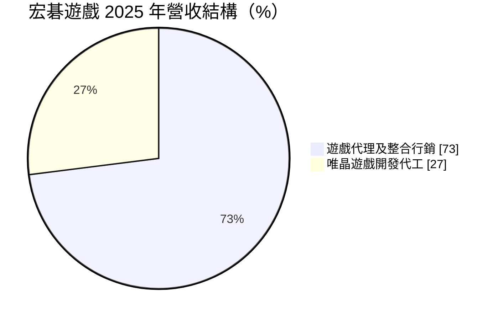
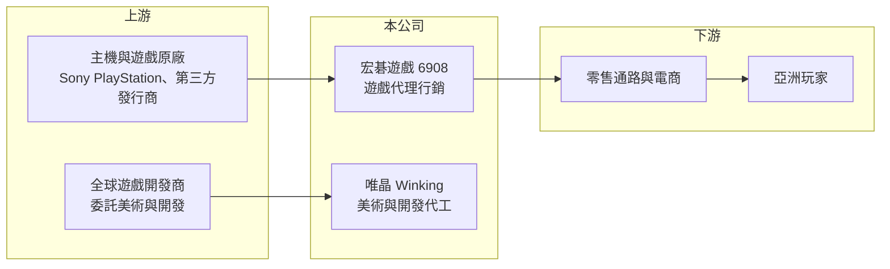

# 6908 宏碁遊戲-創

> 創新板｜[[產業索引-電子通路業|電子通路業]]｜上市（櫃）日期 2026/03/25

# 第一章：企業模式與商業藍圖

> [!info] 撰寫說明
> 精簡版，由 Claude 依公開資料整理，架構比照 [[2330台積電]] 的四章研究，資料截至 2026-10-08。來源：Goodinfo 年度經營績效頁、富果 2026 年 2 月掛牌前法說會備忘錄、證交所開放資料（基本資料、2026 年第二季資產負債與綜合損益、營益分析、股利、每月營收）。創新板／新掛牌，公開資料有限；毛利率分業務數字與股權結構未查得。#待校對

宏碁遊戲是宏碁集團旗下的遊戲事業平台，同時做遊戲代理行銷與遊戲美術開發代工。本章說明它的兩大業務與長期方向。

## 一、核心定位：遊戲產業的「加速器」

宏碁遊戲成立於 2020 年，總部位於新北市汐止，2026 年 3 月在證交所[[創新板]]掛牌，實收資本額約 3.7 億元，董事長由 [[2353宏碁]] 董事長陳俊聖兼任（證交所開放資料）。公司自稱「遊戲行業加速器」，整合遊戲從開發、製作、行銷到銷售的上下游（富果）。

* **[[遊戲代理]]與整合行銷：** 代理 PlayStation 主機、第三方遊戲軟體、周邊商品與點數卡，並經營自營電商，在台灣、菲律賓、香港與新加坡營運。代理業務的營收規模大，但毛利率低，靠的是通路與行銷效率。
* **遊戲開發代工（唯晶 Winking）：** 子公司唯晶提供[[遊戲美術外包]]與開發代工服務，具 20 年以上經驗，熟悉 Unreal Engine 與 Unity，曾參與《原神》等遊戲的開發（富果）。公司用晶圓代工比喻唯晶的角色：替全球遊戲大廠承接美術與開發工作。

## 二、營收結構

2025 年合併營收約 55 億元，其中唯晶約占 27%（富果），代理業務約占 73%（推算）。代理業務的地區分布約為台灣 50%、菲律賓 10%、香港 8%、新加坡 5%（分母口徑未說明）。兩種業務性質不同：代理業務營收大、毛利低；開發代工營收小、毛利較高（推估）。

## 三、長期藍圖

代理事業的方向是國際化（聚焦東南亞）、在地化行銷與規模化；唯晶則計畫透過併購整合分散的全球同業，在北美與歐洲設立直營據點以爭取較高單價，目標從全球第四名進入前三名（富果）。公司也在開發 AI 動作生成工具 GenMotion，但多數遊戲大廠目前限制在核心美術使用生成式 AI。2020 至 2025 年營收年複合成長率約 61%（富果），成長多來自代理規模擴大與併購。

# 第二章：護城河深度與競爭優勢

遊戲代理與美術代工各有不同的競爭邏輯，本章分析宏碁遊戲的優勢與限制。

## 一、護城河的核心組成要素

* **PlayStation 亞洲代理身分：** 主機代理需要原廠授權與在地通路能力，取得後可帶動軟體、周邊與點數卡銷售，形成完整的產品組合。
* **唯晶的開發經驗與客戶名單：** 遊戲美術代工靠的是作品實績與大廠信任，參與過國際知名遊戲的經驗，是爭取新案的重要籌碼。
* **集團資源：** 代理事業可使用宏碁集團在各地的法務、財務與人資資源，降低跨國營運成本。

## 二、主要競爭對手

| 對手 | 定位 | 對宏碁遊戲的威脅 |
|---|---|---|
| [[5478智冠]] | 台灣遊戲代理與點數通路龍頭 | 點數卡與遊戲通路直接競爭 |
| [[6180橘子]] | 遊戲營運與支付 | 在台灣遊戲市場競爭玩家與通路 |
| 維塔士（Virtuos） | 全球最大遊戲開發外包商之一 | 唯晶在美術代工的主要對手 |
| 中國美術外包商 | 低成本美術製作 | 以價格搶外包訂單 |

## 三、守得住與守不住

* **守得住：** 主機代理權帶來的穩定出貨，以及唯晶與國際遊戲大廠的長期合作。
* **守不住：** 利潤率。2022 年後營業利益率都在 2.1% 以下，2024 年只有 0.1%（Goodinfo），代理業務的低毛利拉低整體獲利。
* **觀察重點：** 唯晶的併購與歐美據點能否拉高開發代工比重，讓營業利益率回到 3% 以上。

# 第三章：財務體質與盈利規模

資料日期：2026-10-08，表格是撰寫當時的快照；最新月營收、毛利率、累計 EPS 由自動排程寫在本筆記的屬性欄位（月營收、毛利率、累計EPS 等）。#待校對

本章用多年度數據檢視宏碁遊戲「營收快速擴大、利潤率很薄」的特性。

## 一、多年度三率與 ROE

| 年度 | 營收（新台幣） | [[毛利率]] | [[營業利益率]] | EPS（元） | [[ROE]] |
|---|---|---|---|---|---|
| 2021 | 12.8 億 | 7.83% | 3.71% | 9.69 | 48.9% |
| 2022 | 22.6 億 | 5.49% | 2.14% | 1.91 | 5.22% |
| 2023 | 47.2 億 | 9.35% | 1.65% | 1.70 | 5.09% |
| 2024 | 43.0 億 | 11.0% | 0.10% | 1.36 | 2.90% |
| 2025 | 55.2 億 | 11.6% | 1.50% | 1.44 | 2.50% |
| 2026 上半年 | 23.5 億 | 13.83% | 0.30% | 0.45 | 未查得 |

註：2021 至 2025 年取自 Goodinfo；2026 上半年取自證交所營益分析與綜合損益。2021 年 EPS 與 ROE 偏高，與當時股本與權益規模較小有關。

* **營收規模擴大：** 2021 至 2025 年營收年複合成長率約 44%（推算），2023 年營收翻倍可能與併入唯晶有關（推估，待校對）。2026 年 1 至 8 月累計營收約 31.2 億元，年減約 5%（證交所每月營收）。
* **毛利率提升、營業利益率仍低：** 毛利率從 5% 至 8% 提升到 11% 至 14%，反映高毛利的開發代工比重上升；但營業費用同步增加，營業利益率只有 0% 至 2%。
* **ROE 偏低：** 2022 至 2025 年 ROE 在 2.5% 至 5.2% 之間，資本效率不高。

## 二、股利與財務結構

2025 年度配發現金股利 1.24 元，以 EPS 1.44 元計算配發率約 86%（證交所股利資料，推算），公司表示歷年盈餘分配率維持七成以上。2026 年第二季底總資產約 35.5 億元、總負債約 15.0 億元、權益約 20.5 億元（歸屬母公司約 13.0 億元，其餘為非控制權益），每股淨值 34.96 元（證交所資產負債）。非控制權益比重高，代表部分子公司由其他股東共同持有（推估）。

## 三、[[ROIC]] 與 [[WACC]]

**ROIC 推算：** 2025 年營業利益約 55.2 億 × 1.5% ≈ 0.83 億元，稅後約 0.66 億元。有息負債未查得，假設總負債 15.0 億元的一半約 7.5 億元為有息負債，加上權益 20.5 億元，投入資本約 28.0 億元，ROIC 約 2.4%（推算）。

**WACC 推算：** 台灣 10 年期公債 1.75%、市場風險溢酬 6%、β 取遊戲同業常見值 1.0，權益成本約 7.75%；負債成本 3%、稅率 20%，權益占比約 73%，WACC 約 6.3%（推算）。

**結論：** ROIC 低於 WACC，代表目前的業務組合還沒有賺到資金成本。代理業務規模大但利潤薄，價值創造必須靠唯晶這類高附加價值業務擴大比重，或代理業務透過規模化顯著提升效率。

# 第四章：總體風險與地緣政治

本章整理宏碁遊戲長期面對的產業、授權與營運風險。

## 一、產業週期

* **主機世代循環：** PlayStation 等主機約每 6 至 7 年換代，新主機上市初期銷售暢旺，世代末期則需求下滑，代理業務的營收會跟著循環。
* **遊戲開發預算：** 全球遊戲大廠在景氣不佳時會裁員、縮減外包預算，直接影響唯晶的接案量。

## 二、營運風險

* **代理權集中：** 代理業務高度依賴 Sony 的授權，授權條件變動或原廠改為直營，會衝擊營收。
* **併購整合：** 唯晶的成長策略依賴併購，併購價格過高或整合不順，可能造成商譽減損。
* **生成式 AI：** AI 工具若大幅降低美術製作成本，可能壓縮外包單價，也可能成為效率工具，影響方向未定。

## 三、其他風險

* **匯率：** 跨國營運與代工收入多以外幣計價，匯率波動影響營收與獲利。
* **東南亞市場風險：** 菲律賓等市場的消費力與法規變化，會影響代理業務的成長。

# 專有名詞解析

## 金融

- **[[創新板]]**：證交所 2021 年設立的板塊，讓尚未獲利但具技術或創新能力的公司掛牌，初期限合格投資人交易。
- **[[ROIC]]**：投入資本報酬率，衡量企業用股東與債權人投入的資本，每年能產生多少稅後營業利益。
- **[[WACC]]**：加權平均資金成本，股東要求報酬與負債利息依資本結構加權後的平均值，是判斷是否創造價值的門檻。

## 產業

- **[[遊戲代理]]**：取得遊戲或主機原廠授權，在特定地區負責發行、行銷與通路銷售的業務。
- **[[遊戲美術外包]]**：遊戲公司把角色、場景、動作等美術製作委託給外部團隊，以降低成本並加快開發速度。

# 核心供應鏈

- 上游：Sony（[[SONY索尼]]）PlayStation 主機與第三方遊戲發行商；唯晶的客戶則是委託美術與開發的全球遊戲公司。
- 下游／客戶：台灣、菲律賓、香港、新加坡的零售通路、電商與玩家。
- 同業：[[5478智冠]]、[[6180橘子]]、維塔士。
- 集團：[[2353宏碁]]、[[2432倚天酷碁-創]]。

## 最新新聞
<!-- news:start -->
<!-- news:end -->

## 相關連結
- [公開資訊觀測站](https://mopsov.twse.com.tw/mops/web/t05st03?step=1&firstin=1&co_id=6908)
- [Goodinfo](https://goodinfo.tw/tw/StockDetail.asp?STOCK_ID=6908)
- [Yahoo 股市](https://tw.stock.yahoo.com/quote/6908)
- [鉅亨網新聞](https://www.cnyes.com/twstock/6908/news)
